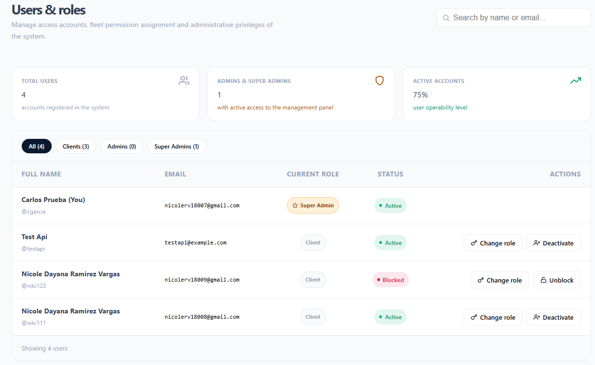
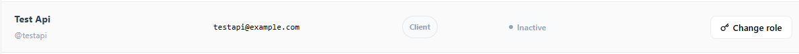
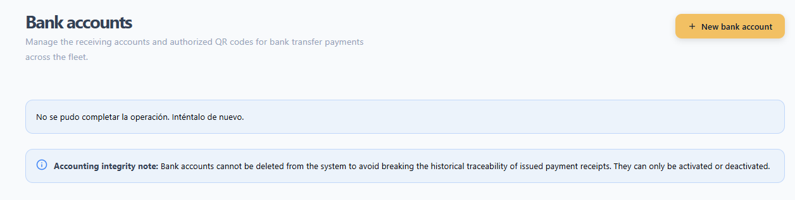
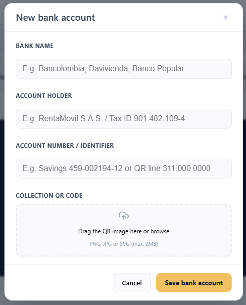
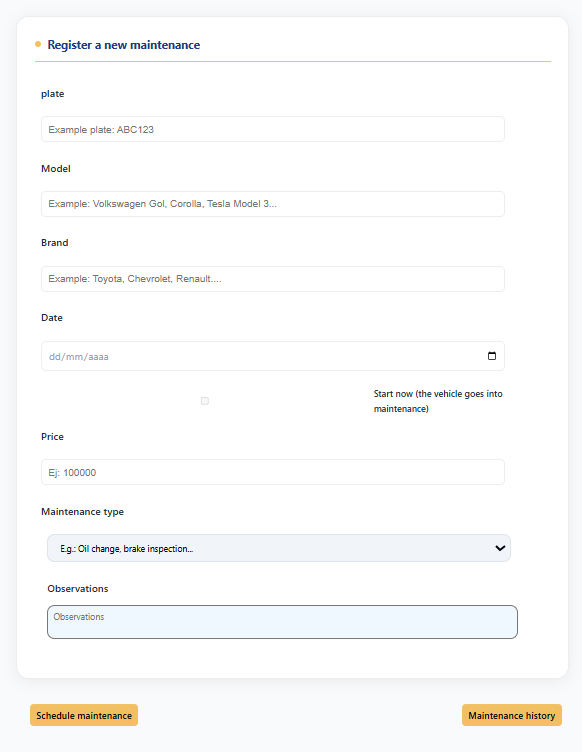
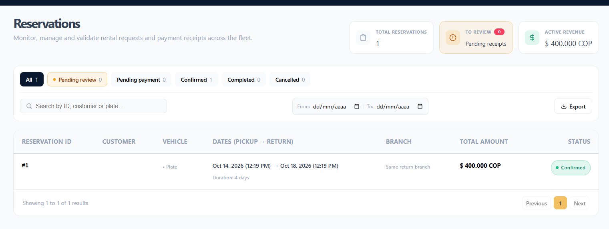
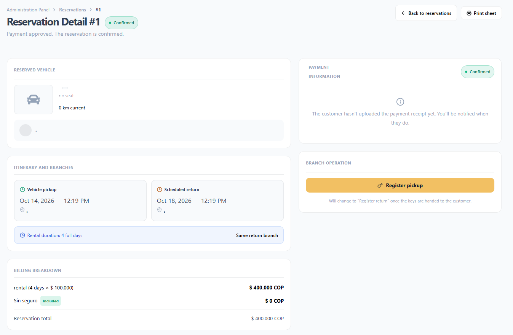
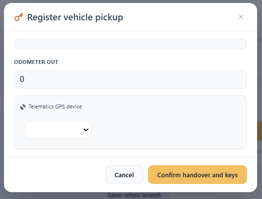
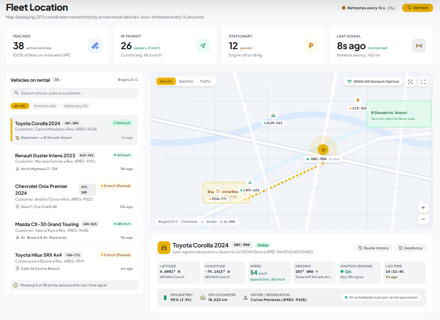
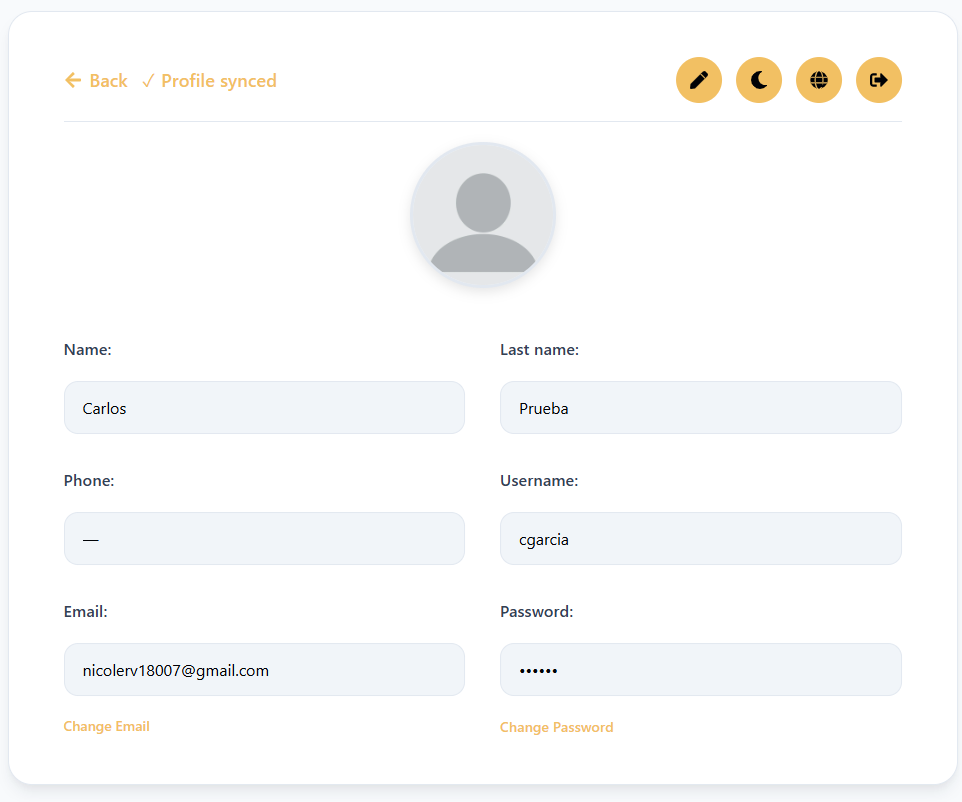

RentaMovil

Vehicle rental platform

ADMINISTRATOR MANUAL

Team members

Nicole Dayana Ramirez

Thiago Fabian Rojas

David Santiago Erez

Class ID (ficha): 3145556

Program: Technologist in Software Analysis and Development

Instructor: Karol Daniela Correa

Training center: SENA

Date: October 2026

Version: 2.0

Version control

Table 1. Manual version control

| Version | Date | Change description | Responsible |
| --- | --- | --- | --- |
| 1.0 | 09/07/2026 | Initial creation: sign-in, main panel, vehicles, maintenance, notifications and account settings. | Development team |
| 2.0 | 06/10/2026 | Update to match the current version of the system: user and role management, roles and permissions, branches, insurance types, bank accounts, reservations (payment validation, pickup and return), fleet location, route history, reports, backups, auditing and security recommendations. | Development team |

Table of contents

- 1. Introduction
- 2. Objective
- 3. Scope
- 4. Administrator profile
- 5. Access to the administration panel
- 5.1 Administrator navigation bar
- 5.2 Administration Panel options
- 5.3 Sign out
- 6. User management
- 6.1 User query
- 6.2 Changing a user's role
- 6.3 Deactivating an account
- 6.4 Unlocking an account
- 7. Role and permission management
- 7.1 System roles
- 7.2 Access by module
- 8. System configuration
- 8.1 Branch management
- 8.2 Insurance type management
- 8.3 Bank account management
- 9. Main information management
- 9.1 Vehicle registration
- 9.2 Vehicle inventory
- 9.3 Maintenance registration
- 9.4 Maintenance management
- 9.5 Reservation query
- 9.6 Reservation payment validation
- 9.7 Vehicle pickup and return
- 9.8 Fleet location
- 9.9 Route history
- 9.10 Vehicle availability query
- 9.11 Notifications
- 9.12 Administrator account
- 10. Administrative reports
- 10.1 Indicators by module
- 10.2 Reservation export and record printing
- 11. Backups
- 12. Information restoration
- 13. Auditing or action history
- 14. Security recommendations
- 15. Messages and validations
- 16. Glossary
- 17. Annexes
- Annex A. Flow of a reservation from the administration side
- Annex B. Reservation statuses
- Annex C. Maintenance statuses
- Annex D. Vehicle statuses

# 1. Introduction

This Administrator Manual guides people holding the Administrator or Super Admin role in the management, configuration and supervision of RentaMovil, the company's vehicle rental platform.

It describes how to access the Administration Panel and how to use each administrative module: users and roles, branches, insurance types, bank accounts, vehicles, maintenance, reservations (payment validation, pickup and return), fleet location, reports and the administrator account. Each feature is presented with its description, the role allowed to use it, the path, the steps, the expected result and the applicable restrictions.

# 2. Objective

Guide the administrator in the management, configuration and supervision of RentaMovil, so that they can keep the fleet, the catalogs and the reservations up to date, validate customer payments and control user access, ensuring a safe and organized use of the platform.

# 3. Scope

This manual covers the features available in the web version for the Administrator and Super Admin roles:

- Access to the Administration Panel.
- User, role and permission management.
- System configuration: branches, insurance types and bank accounts.
- Management of the main information: vehicles, maintenance, reservations, payments, pickups, returns and fleet location.
- Reports, indicators and export of information.
- Backups, restoration, auditing and security recommendations.

It does not cover using the system as a customer (search, reservation, payment and customer account management), which is described in the User Manual, nor installation, technical configuration, the database or the code, which correspond to the Installation Manual and the Technical Manual. The mobile app is intended for customers and has no administrative features.

# 4. Administrator profile

The administrator is the person responsible for RentaMovil's daily operation. They keep the fleet information and the catalogs up to date, validate reservation payments, record vehicle pickup and return, and supervise vehicle location during rentals. The Super Admin also controls who accesses the system and with which permissions, and manages the collection bank accounts.

### Responsibilities

- Register vehicles and keep their status up to date.
- Schedule and track maintenance.
- Review payment receipts and approve or reject them in a timely manner.
- Record the mileage and the GPS device when handing over a vehicle, and the mileage when receiving it back.
- Supervise the location of vehicles on rental.
- Keep the branch, insurance and bank account catalogs up to date.
- Manage user accounts and their roles (Super Admin).
- Protect customer information and access credentials.

### Permissions

The permissions for each role are detailed in section 7. Roles and permissions.

# 5. Access to the administration panel

Table 2. Sign-in to the administration panel

| Module name | Sign-in to the administration panel |
| --- | --- |
| Description | Allows the administrator to sign in to RentaMovil with their account and access the panel from which they manage the fleet, the reservations and the system configuration. |
| Role allowed to use it | Administrator and Super Admin. |
| Path or menu | System home screen (sign-in). |
| Steps to use it | Open the browser and go to the RentaMovil address (URL). Enter the Email or username and the Password of the administrator account. Click Sign in. Verify that the system shows the administration home page, with the Administration option in the top bar. Click Administration to expand the Administration Panel and choose the desired module. |
| Screenshot | Figure 1. Sign-in screen / Figure 2. Administrator navigation bar / Figure 3. Administration Panel expanded |
| Expected result | The system recognizes the account role and takes the administrator to their home page. From the Administration Panel they can open every module enabled for their role. |
| Observations or restrictions | There is no public list of administrators. An account becomes an administrator when a Super Admin assigns that role in Users and roles. If a customer tries to open an administration page, the system returns them to their home page. The sign-in error messages (incorrect credentials, blocked account, too many attempts) are the same ones described in the User Manual. The Super Administration section of the panel only appears for accounts with permission to manage users or bank accounts. |

## 5.1 Administrator navigation bar

Table 3. Administrator navigation bar

| Option | Description |
| --- | --- |
| Home | Query of vehicle availability by branch and dates. |
| Notifications | Notice center for the account. |
| Reservation | The account's own reservations for the signed-in account. |
| Administration | Expands the Administration Panel with all modules. |
| Person icon | Administrator account: profile, email, password, theme, language and Sign out. |

## 5.2 Administration Panel options

Table 4. Administration Panel options

| Section | Option | Description |
| --- | --- | --- |
| Vehicle | Add vehicle | Registration of new vehicles. |
| Vehicle | Vehicle Inventory | Fleet query with indicators and filters. |
| Location | Fleet Location | Map with the GPS position of vehicles on rental. |
| Location | Route History | Active rentals to be tracked and signal status. |
| Branches | Manage branches | Creation, editing and deletion of locations. |
| Reservations | All reservations | Reservation supervision, payment validation, pickup and return. |
| Maintenance | Register maintenance | Scheduling of maintenance. |
| Maintenance | Maintenance History | Management of recorded maintenance. |
| Insurance | Insurance types | Catalog of coverages and rates. |
| Super Administration | Users and roles | Management of accounts and roles (permission required). |
| Super Administration | Bank accounts | Collection accounts and QR codes (permission required). |

## 5.3 Sign out

1. Click the person icon in the top bar.
2. Click the Sign out icon.
3. Verify that the system shows the sign-in screen.

Always sign out when you finish, especially on shared computers.

# 6. User management

User management is performed in the Users and roles module, available to accounts with permission to assign roles (by default, the Super Admin). From there you can query accounts, change their role and control their status.

## 6.1 User query

Table 5. User query

| Module name | User query |
| --- | --- |
| Description | Allows querying all accounts registered in the system, with their role, status and registration date, and locating a specific account. |
| Role allowed to use it | Users with the corresponding permission (by default, the Super Admin role). |
| Path or menu | Administration > Super Administration > Users and roles. |
| Steps to use it | Open Users and roles from the Administration Panel. Review the top indicators: Total Users, Admins and Super Admins, and Active Accounts (percentage). Type in Search by name or email... to locate an account. Filter by role with the options All, Customers, Administrators or Super Admins. Review in the table the Full Name, Email, Current Role, Status and available Actions. |
| Screenshot | Figure 4. Users and roles page |
| Expected result | The table shows the accounts that match the search and filter, along with the total number of results (Showing N users). |
| Observations or restrictions | The account you signed in with is marked with (You). Customers create their own account from the registration screen; the panel has no option to create users. To create an administrator, the person registers and then a Super Admin changes their role. Passwords cannot be queried or changed from this module. If a user forgot it, they must use Forgot your password? on the sign-in screen. If there are no matches, No users found with those criteria appears. |

## 6.2 Changing a user's role

Table 6. Changing a user's role

| Module name | Changing a user's role |
| --- | --- |
| Description | Allows assigning an account the Customer, Administrator or Super Admin role, which defines which modules it can access. |
| Role allowed to use it | Users with the corresponding permission (by default, the Super Admin role). |
| Path or menu | Users and roles > Actions column > Change role. |
| Steps to use it | Locate the account in Users and roles. Click Change role. In the Modify user role window, select the new role in Select the new role level: (Customer, Administrator or Super Admin). Each option shows a description of its scope. If Super Admin is chosen, read the Security warning. Click Confirm role change. To exit without changes, click Cancel. |
| Screenshot | Figure 5. Modify user role window |
| Expected result | The account role is updated in the table. The user will see the modules of the new role the next time they sign in. |
| Observations or restrictions | The Super Admin role has full access, including managing bank accounts and other users' privileges. It should only be assigned to fully trusted people. Before removing the administrator role from an account, verify that another active administrator account exists. |

## 6.3 Deactivating an account

Table 7. Deactivating an account

| Module name | Deactivating an account |
| --- | --- |
| Description | Allows preventing a user from signing in again, for example when they no longer belong to the company or their account should no longer be used. |
| Role allowed to use it | Users with the corresponding permission (by default, the Super Admin role). |
| Path or menu | Users and roles > Actions column > Deactivate. |
| Steps to use it | Locate the account (Active status) in Users and roles. Click Deactivate. In the Deactivate the account of [name]? They will not be able to sign in. window, click Deactivate to confirm. |
| Screenshot | Figure 6. Deactivation confirmation |
| Expected result | The account changes to Inactive status and the user can no longer sign in. |
| Observations or restrictions | An Inactive account cannot be reactivated from the panel. Check the account very carefully before confirming. Deactivating does not delete the account information or its reservations. |

## 6.4 Unlocking an account

Table 8. Unlocking an account

| Module name | Unlocking an account |
| --- | --- |
| Description | Allows restoring access to an account that the system blocked due to too many failed sign-in attempts. |
| Role allowed to use it | Users with the corresponding permission (by default, the Super Admin role). |
| Path or menu | Users and roles > Actions column > Unlock. |
| Steps to use it | Filter or search for the account with Blocked status. Click Unlock. |
| Screenshot | Figure 7. Blocked account with the Unlock action |
| Expected result | The account returns to Active status and the user can sign in again. |
| Observations or restrictions | Before unlocking, confirm with the user that the failed attempts were theirs. If they do not remember the password, point them to Forgot your password? The Unlock option only appears on accounts with Blocked status. |

# 7. Role and permission management

RentaMovil handles three roles. Each account's role is assigned in Users and roles (see 6.2 Changing a user's role). In addition to the role, some functions require a specific permission that the system assigns to the account.

## 7.1 System roles

Table 9. System roles

| Role | Main permissions | Restrictions |
| --- | --- | --- |
| Customer | Search vehicles, make reservations, pay by transfer, query and cancel their reservations, receive notifications and manage their account. | Does not access the Administration Panel. Only sees their own reservations and notifications. |
| Administrator | Manage vehicles, maintenance, branches and insurance types; review reservations and validate payments; record pickups and returns; query fleet location and reports. | Does not manage users, roles or bank accounts, unless those permissions are assigned. |
| Super Admin | Everything the Administrator can do, plus user and role management and administration of the collection bank accounts. | It must be an individual, secure account assigned to very few people. |

## 7.2 Access by module

Table 10. Access by module

| Module | Customer | Administrator | Super Admin |
| --- | --- | --- | --- |
| Home (availability query) | Yes | Yes | Yes |
| Own reservations, payment and My account | Yes | Yes | Yes |
| Notifications | Yes | Yes | Yes |
| Vehicles: registration and inventory | No | Yes | Yes |
| Maintenance | No | Yes | Yes |
| Reservations: query, payment validation, pickup and return | No | Yes | Yes |
| Fleet location and route history | No | Yes | Yes |
| Branches | No | Yes | Yes |
| Insurance types | No | Yes | Yes |
| Users and roles (roles:grant permission) | No | Only with permission | Yes |
| Bank accounts (bank-accounts:manage permission) | No | Only with permission | Yes |

If a person tries to open a page they have no role or permission for, the system returns them to their home page. The actual protection of the data is done by the server, which rejects any unauthorized operation.

# 8. System configuration

System configuration corresponds to the catalogs that customers use during reservation and payment. Keeping them up to date ensures customers see correct branches, insurance plans and payment accounts.

Table 11. System configuration

| Parameter | Description | Where it is configured |
| --- | --- | --- |
| Branches | Pickup and return locations, with address, phone, map location and schedule. | Manage branches |
| Opening hours | Opening and closing time per day for each branch (COT time zone). | Manage branches |
| Insurance types | Optional coverages and their daily cost. | Insurance types |
| Bank accounts | Accounts and QR codes that customers transfer to. | Bank accounts |
| Maintenance types | List of suggestions shown when registering maintenance. | System catalog (technical team) |
| Reservation, vehicle and maintenance statuses | Fixed values defined by the system (see Annexes). | Not configurable |

## 8.1 Branch management

Table 12. Branch management

| Module name | Branch management |
| --- | --- |
| Description | Allows creating, querying, editing and deleting the physical locations where customers pick up and return vehicles, with their map location and opening hours. |
| Role allowed to use it | Administrator and Super Admin. |
| Path or menu | Administration > Branches > Manage branches. |
| Steps to use it | Query branches Open Manage branches. Review the Active branches and Assigned vehicles indicators. Search with Search by name, city or address... and review the table: Name, Address, City, Phone, Hours and Actions. Create a branch Click New branch. Fill in Branch name, City, Contact phone and Physical address. In Map location, click on the exact point of the location. In Opening hours, enter the opening and closing time for each day. Mark Closed on days with no service. Click Save branch. Edit a branch Click the pencil icon of the branch (or View full schedule). Modify the data, location or schedule in the Edit branch window. Click Save branch. Delete a branch Click the trash icon of the branch. In the Delete branch window, confirm with Delete. |
| Screenshot | Figure 8. Branches page / Figure 9. New branch window with map and schedule |
| Expected result | The branch is created, updated or deleted, and the change is reflected in the table and in the branch options customers see when searching and booking. |
| Observations or restrictions | All form fields are mandatory. The schedule is recorded in the Colombia time zone (COT, UTC-5). A branch with assigned vehicles cannot be deleted: Cannot delete: it has assigned vehicles. Reassign them first. Deletion cannot be undone. If an error occurs while saving, Could not save the branch appears. |

## 8.2 Insurance type management

Table 13. Insurance type management

| Module name | Insurance type management |
| --- | --- |
| Description | Allows configuring the coverages customers can choose when booking, with their description and rate. |
| Role allowed to use it | Administrator and Super Admin. |
| Path or menu | Administration > Insurance > Insurance types. |
| Steps to use it | Query insurance Open Insurance types. Review the Available plans, Average rate and Recommended indicators. Review the table: Name, Coverage Detail, Cost per Day and Actions. Create an insurance type Click New insurance type. Fill in Coverage name, Coverage detail (what it includes and excludes) and Cost per day (COP). Click Save. Edit an insurance type Click the pencil icon of the insurance plan. Modify the data in Edit insurance type and click Save. Delete an insurance type Click the trash icon of the insurance plan. In Delete insurance type, confirm with Delete. |
| Screenshot | Figure 10. Insurance types page / Figure 11. New insurance type window |
| Expected result | The insurance catalog is updated and the changes appear in the Insurance section of the customers' reservation screen. |
| Observations or restrictions | The cost must be greater than 0: The cost must be greater than 0. Changing the cost only affects new reservations; reservations already created keep the cost they were calculated with. When an insurance plan is deleted, already invoiced reservations keep their rate. If an error occurs while saving, Could not save the insurance plan appears. |

## 8.3 Bank account management

Table 14. Bank account management

| Module name | Bank account management |
| --- | --- |
| Description | Allows managing the accounts that customers transfer their reservation payment to, with the collection QR code for each one. |
| Role allowed to use it | Users with the corresponding permission (by default, the Super Admin role). |
| Path or menu | Administration > Super Administration > Bank accounts. |
| Steps to use it | Query accounts Open Bank accounts. Review the Registered Accounts, Active Accounts and Inactive Accounts indicators. Review each account and its status (Active or Inactive). Register an account Click New bank account. Fill in Bank name, Account holder and Account number / Identifier. In Collection QR Code, drag the QR image or click to browse for it. Click Save bank account. Deactivate or activate an account Use the account switch. To deactivate it, confirm in Deactivate this account? with Deactivate account. To activate it, simply turn the switch on. |
| Screenshot | Figure 12. Bank accounts page / Figure 13. New bank account window |
| Expected result | Active accounts appear as a payment option on the customers' payment screen; inactive ones are no longer shown. |
| Observations or restrictions | The QR code is mandatory: You must attach the account QR code before saving. Format PNG, JPG or SVG, maximum 2 MB. Accounts cannot be deleted or edited, in order not to break the traceability of payments already recorded. If a value changes, register a new account and deactivate the previous one. When an account is deactivated, the previous payments that used it remain registered. Always keep at least one active account; without it customers cannot pay. |

# 9. Main information management

This section describes daily operations: the fleet, its maintenance, the reservations and their payments, vehicle pickup and return, and GPS tracking.

## 9.1 Vehicle registration

Table 15. Vehicle registration

| Module name | Vehicle registration |
| --- | --- |
| Description | Allows adding a new vehicle to the fleet with its data, daily rate, branch and photograph. |
| Role allowed to use it | Administrator and Super Admin. |
| Path or menu | Administration > Vehicle > Add vehicle (also from Vehicle Inventory > + Add Vehicle). |
| Steps to use it | Open Add vehicle. Fill in Plate, Brand (you can pick a suggestion from the list), Model, Price (daily rate), Mileage, Year and Capacity. Select the Vehicle type (Cars: Sedan, Hatchback, SUV, Pickup truck, Pickup, Van or Coupe; Cargo: Truck, Tractor Truck or Van). Select the Fuel type and the Branch the vehicle belongs to. Drag the photograph into the box or click to select it. To replace it, use Change image. Click Save vehicle and wait for the confirmation animation to finish. |
| Screenshot | Figure 14. Register a new vehicle form |
| Expected result | The vehicle is registered, the form clears for a new record, and the unit appears in the Vehicle Inventory and in the searches of customers from its branch. |
| Observations or restrictions | The plate must follow the car format, for example ABC123. Brand and model: between 2 and 30 characters, letters, numbers and hyphens only. Price between 0 and 100,000,000; mileage between 0 and 1,000,000; capacity between 1 and 100; year between 1900 and the year following the current one. The photograph is mandatory (This section is mandatory). It must be sharp and show the complete vehicle. Each field shows its own message if it is missing or invalid (for example, The plate is mandatory). |

## 9.2 Vehicle inventory

Table 16. Vehicle Inventory

| Module name | Vehicle Inventory |
| --- | --- |
| Description | Allows querying the entire fleet centrally, along with its status and branch, with indicators, search and filters. |
| Role allowed to use it | Administrator and Super Admin. |
| Path or menu | Administration > Vehicle > Vehicle Inventory. |
| Steps to use it | Open Vehicle Inventory. Review the Total, Available, In use and Maintenance indicators. Search with Search by plate, brand or model... Filter with the Status, Branch, Type, Brand and Model buttons. To remove them, click X Clear filters. Switch between the Grid (cards) view and the Table view using the icons on the right. |
| Screenshot | Figure 15. Inventory view screen |
| Expected result | The system shows the vehicles that match the search and filters, with the number of results (N vehicles found). |
| Observations or restrictions | The statuses handled are Available, In use and Maintenance. The status changes with the operation; for example, when maintenance is registered the vehicle moves to maintenance. In the current version, the inventory is read-only: it has no options to edit or delete vehicles. If there are no matches, No vehicles matching the filters were found appears. |

## 9.3 Maintenance registration

Table 17. Maintenance registration

| Module name | Maintenance registration |
| --- | --- |
| Description | Allows scheduling preventive or corrective maintenance for a fleet vehicle. |
| Role allowed to use it | Administrator and Super Admin. |
| Path or menu | Administration > Maintenance > Register maintenance. |
| Steps to use it | Open Register maintenance. In the Vehicles for maintenance panel, search by plate, brand or model and click the vehicle. Plate, Model and Brand are filled in automatically. Select the maintenance Date. Enter the Price (maintenance cost). Type or select from the list the Maintenance type (for example, Oil change or Brake inspection). Optionally, enter Observations. Click Schedule maintenance and wait for the Scheduling maintenance... message. |
| Screenshot | Figure 16. Register maintenance page |
| Expected result | The maintenance is registered, the vehicle moves to maintenance status and is no longer available for rental. The form clears for a new record. |
| Observations or restrictions | Only Available or In use vehicles appear in the panel. If you try to register without choosing a vehicle, Select a vehicle from the list appears. The date cannot be before today nor more than two months from today. The maintenance type must be between 3 and 60 characters (letters, numbers, hyphens and commas). Observations, if entered, between 5 and 200 characters. The Maintenance History button leads to maintenance management. |

## 9.4 Maintenance management

Table 18. Maintenance management

| Module name | Maintenance management |
| --- | --- |
| Description | Allows querying all recorded maintenance, viewing its indicators, updating its information and status, or deleting it. |
| Role allowed to use it | Administrator and Super Admin. |
| Path or menu | Administration > Maintenance > Maintenance History. |
| Steps to use it | Query Open Maintenance History (Maintenance management page). Review the Maintenance status and Maintenance per month charts. Search by plate, brand or model and filter by status: All, Pending, In progress, Completed or Cancelled. On the maintenance card, click See more to open the Detail (model, type, date, location, status and observations). Edit or change the status In the detail, click Edit. Modify Model, Maintenance type, Date, Observations or Status. Click Save changes. To discard, click Cancel. Delete In the detail, click Delete. Confirm with Confirm (or Cancel to keep it). |
| Screenshot | Figure 17. Maintenance management page with chart |
| Expected result | The maintenance information is updated or the record is deleted, and the charts and the list are recalculated. |
| Observations or restrictions | Keep the status up to date: Pending (scheduled), In progress, Completed or Cancelled. When editing, the date must be between today and two months from today. Deleting maintenance cannot be undone. Prefer changing the status to Cancelled if you need to keep the history. |

## 9.5 Reservation query

Table 19. Reservation query

| Module name | Reservation query |
| --- | --- |
| Description | Allows supervising all customer reservations, with indicators, filters by status and by date, and access to the detail of each one. |
| Role allowed to use it | Administrator and Super Admin. |
| Path or menu | Administration > Reservations > All reservations. |
| Steps to use it | Open All reservations. Review the Total reservations, To review (pending receipts) and Active billing indicators. Filter by status with the top options (All, Pending review, Pending payment, Confirmed, Completed, Cancelled); each one shows its count. Search with Search by ID, customer or plate... and, if necessary, limit the period with From: and To:. Review the table: Reservation ID, Customer, Vehicle, Dates (pickup → return), Branch, Total amount and Status. Navigate between pages with Previous and Next. Click a row to open the reservation detail. |
| Screenshot | Figure 18. Reservations page with indicators and filters |
| Expected result | The system shows the reservations that match the filters (5 per page) and allows opening the Reservation Detail for any of them. |
| Observations or restrictions | Reservations with an active rental are shown as In progress. Review the Pending review filter first: these are payments awaiting validation. If there are no matches, No reservations match these filters appears. with the Clear filters option. |

## 9.6 Reservation payment validation

Table 20. Reservation payment validation

| Module name | Reservation payment validation |
| --- | --- |
| Description | Allows reviewing the transfer receipt uploaded by the customer and approving or rejecting the payment. |
| Role allowed to use it | Administrator and Super Admin. |
| Path or menu | All reservations > reservation in Pending review status > Reservation Detail. |
| Steps to use it | Review the payment Open the detail of a reservation in Pending review status. At the top, Required administrative action: Receipt validation appears. In Payment information, review Amount transferred, Receiving entity, Reference number and Receipt date / time. Click Enlarge receipt to see the full image. Compare the amount with the reservation Total in the Payment breakdown. Approve the payment If everything matches, click Approve payment. Reject the payment Click Reject payment. In Reject reservation payment, enter the Rejection reason. In Subsequent action, choose Allow the customer to upload the receipt again or Cancel the reservation directly. Click Confirm rejection. |
| Screenshot | Figure 19. Reservation detail pending review |
| Expected result | Approved: the reservation moves to Confirmed and the customer receives a notification. Rejected: the reason is recorded and the reservation returns to Pending payment or moves to Cancelled. |
| Observations or restrictions | Approval is applied immediately, with no confirmation dialog. Check the receipt before clicking. The rejection reason is mandatory: You must enter a reason. The amount transferred must match the total exactly; the system does not accept partial payments. If the customer has not uploaded the receipt yet, the detail shows The customer has not uploaded the payment receipt yet. If an error occurs, Could not approve the payment. or Could not reject the payment. appears. |

## 9.7 Vehicle pickup and return

Table 21. Vehicle pickup and return

| Module name | Vehicle pickup and return |
| --- | --- |
| Description | Allows recording in the system the moment when the branch hands the vehicle over to the customer (pickup) and the moment when it receives it back (return). |
| Role allowed to use it | Administrator and Super Admin. |
| Path or menu | All reservations > Confirmed reservation > Reservation Detail > Branch operation section. |
| Steps to use it | Record the pickup Open the detail of a Confirmed reservation. In Branch operation, click Register pickup. In Register vehicle pickup, enter the Starting mileage and select the installed telematics GPS Device. Click Confirm handover and keys. Record the return Open the reservation detail (In progress status). Click Register return. Enter the Ending mileage. Click Confirm return. |
| Screenshot | Figure 20. Register vehicle pickup and return window |
| Expected result | Pickup: the rental starts, the reservation is shown as In progress and the vehicle can be followed on the map (GPS online). Return: the reservation moves to Completed and Vehicle returned on [date] appears. |
| Observations or restrictions | The operation is only enabled when the reservation is Confirmed: It is enabled once the reservation is confirmed. For cancelled reservations, Reservation cancelled — branch operation does not apply appears. Mileage is mandatory. Verify it on the vehicle dashboard. From the detail of a reservation with an active rental you can open See vehicle tracking on the map. If an error occurs, Could not record the operation. appears. |

## 9.8 Fleet location

Table 22. Fleet Location

| Module name | Fleet Location |
| --- | --- |
| Description | Allows viewing on a map the last position sent by the GPS of each vehicle that is on rental. |
| Role allowed to use it | Administrator and Super Admin. |
| Path or menu | Administration > Location > Fleet Location. |
| Steps to use it | Open Fleet Location. Review the Being tracked, Moving, Stopped and Last signal indicators. In the Vehicles list, click the vehicle you want to track. Each one indicates whether it is Moving or Stopped, its reservation and its customer. Review on the map and in Last recorded position the latitude, longitude, speed (km/h), heading, ignition and time of the record. To update immediately, click Refresh. |
| Screenshot | Figure 21. Fleet location map |
| Expected result | The map shows the position of vehicles on rental and updates automatically every 15 seconds. |
| Observations or restrictions | Only vehicles with an in-progress reservation and an active GPS appear: Location is only available for vehicles with an in-progress reservation and an active GPS. If the device is not connected, the position of the last report is shown. If the location service does not respond, The location service is not yet available appears. |

## 9.9 Route history

Table 23. Route History

| Module name | Route History |
| --- | --- |
| Description | Allows reviewing reservations with a delivered vehicle that must be tracked during the day and identifying those that have gone a long time without reporting a position. |
| Role allowed to use it | Administrator and Super Admin. |
| Path or menu | Administration > Location > Route History. |
| Steps to use it | Open Route History. Read the notice with the number of active reservations to be tracked and, if it appears, the warning about vehicles with more than 2 hours without reporting a position. Review the Active reservations list, with the signal status of each vehicle: Reporting, No signal or No GPS report. Click See on the map to open the fleet location. Click Refresh when you need the most recent information. |
| Screenshot | Figure 22. Route history page |
| Expected result | The administrator identifies which rentals they must watch and which are not sending a GPS signal. |
| Observations or restrictions | The page updates automatically every few seconds. If there are no rentals in progress, No active reservations to be tracked appears. A vehicle with more than 2 hours without reporting may indicate a disconnected GPS; check with the customer or the branch. |

## 9.10 Vehicle availability query

Table 24. Vehicle availability query

| Module name | Vehicle availability query |
| --- | --- |
| Description | Allows the administrator to search which vehicles are free at a branch on given dates, exactly as the customer sees it, for example to handle an inquiry. |
| Role allowed to use it | Administrator and Super Admin. |
| Path or menu | Top bar > Home. |
| Steps to use it | Click Home. Select the branch in Pickup location and enter pickup and return dates and times. Click Search. Use the Available Fleet filters (Brand, Price, Model, Engine type, Category) or Clear filters. |
| Screenshot | Figure 23. Administrator home with results |
| Expected result | The system shows the vehicles available at that branch and period. |
| Observations or restrictions | The branch, date and time validations (8:00 to 18:00) are the same as those in the User Manual. The Continue button opens the reservation flow; a reservation made from here is registered under the name of the signed-in account. |

## 9.11 Notifications

Table 25. Notifications

| Module name | Notifications |
| --- | --- |
| Description | Allows querying the system notices associated with the administrator account. |
| Role allowed to use it | Administrator and Super Admin. |
| Path or menu | Top bar > Notifications. |
| Steps to use it | Click Notifications. Choose a filter: All, Confirmed Reservations, Payments, Cancellations or Reminders. Click a notification to see its detail and then click Close. |
| Screenshot | Figure 24. Notification center |
| Expected result | The system shows the notifications for the chosen filter and marks the opened one as read. |
| Observations or restrictions | To find out which payments are pending validation, use the To review indicator in the Reservations module. |

## 9.12 Administrator account

Table 26. Administrator account

| Module name | Administrator account |
| --- | --- |
| Description | Allows the administrator to update their profile, email and password, change the theme and language, and sign out. |
| Role allowed to use it | Administrator and Super Admin. |
| Path or menu | Top bar > person icon. |
| Steps to use it | Click the person icon in the top bar. To edit the profile, click the pencil, modify First name, Last name, Phone or the photo and click Save changes. To change the email, click Change email, type the new email and the current password and click Confirm change. To change the password, click Change password, fill in the current password, the new one and its confirmation and click Save changes. To change the theme or the language, use the moon and globe icons. To sign out, click the Sign out icon. |
| Screenshot | Figure 25. Administrator account page |
| Expected result | The changes are saved (Profile updated, Email updated or Password changed successfully). When the password is changed, all sessions are closed and you must sign in again. |
| Observations or restrictions | The detailed steps and validations for these options are in the User Manual (sections My account, Change email, Change password and Preferences). The password must have at least 8 characters, a special character, an uppercase letter and a number. |

# 10. Administrative reports

RentaMovil presents its reports as indicators and charts within each module. In addition, the reservation list can be exported and each reservation record can be printed or saved as a PDF.

## 10.1 Indicators by module

Table 27. Indicators by module

| Module | Indicators | Filters / export |
| --- | --- | --- |
| Reservations | Total reservations, To review (pending receipts), Active billing and count by status. | Filters by status, text and date range; Export button (CSV). |
| Maintenance | Maintenance status chart and Maintenance per month chart. | Search and filter by status. |
| Vehicle Inventory | Total vehicles, Available, In use and in Maintenance. | Filters by status, branch, type, brand and model. |
| Users and roles | Total users, Admins and Super Admins, and percentage of active accounts. | Search and filter by role. |
| Branches | Active branches and assigned vehicles. | Search by name, city or address. |
| Insurance types | Available plans, average rate and recommended plan. | — |
| Bank accounts | Registered, active and inactive accounts. | — |
| Fleet Location | Vehicles being tracked, moving, stopped and last signal. | Automatic refresh every 15 s. |

## 10.2 Reservation export and record printing

Table 28. Reservation export and record printing

| Module name | Reservation export and record printing |
| --- | --- |
| Description | Allows downloading the reservation list as a CSV file (which opens in Excel) and printing or saving to PDF the complete record of a reservation. |
| Role allowed to use it | Administrator and Super Admin. |
| Path or menu | All reservations > Export; Reservation Detail > Print record. |
| Steps to use it | Export the list Open All reservations. Apply the desired filters (status, search, From: and To:). Click Export. Open the downloaded file with Excel or another spreadsheet. Print a reservation record Open the Reservation Detail. Click Print record. In the browser dialog, choose the printer or the Save as PDF option. |
| Screenshot | Figure 26. Reservation print view |
| Expected result | You get a CSV file with the columns ID, Customer, Vehicle, Plate, Pickup, Return, Branch, Total and Status for the filtered reservations, or the printed/PDF record of the reservation. |
| Observations or restrictions | The exported file contains customer personal data. Store it in a secure location and do not share it outside the company. The export includes only the reservations that match the filters applied at that moment. |

# 11. Backups

The current version of RentaMovil has no backup option in the Administration Panel. Backups are taken directly on the database and the system servers, and are the responsibility of the technical team, following the procedure in the Installation Manual and the Technical Manual.

Administrator responsibilities regarding backups:

- Request a backup from the technical team before important changes (for example, bulk vehicle uploads, rate changes or system updates).
- Agree with the technical team on backup frequency (at least one daily is recommended).
- Verify that each backup is stored in a secure location, separate from the server, and named with the date (for example, backup_rentamovil_2026-10-06).
- Periodically export the reservation list (section 10.2) as a query backup.

# 12. Information restoration

Restoring a backup is also not done from the Administration Panel: the technical team performs it on the database.

1. Detect and document the problem (what information was lost or damaged and since when).
2. Notify the technical team and indicate the date of the last correct information.
3. While restoring, avoid recording or modifying information in the system.
4. Once the technical team confirms the restoration, verify in the modules (inventory, reservations, users) that the information is complete.
5. Manually record the operations performed after the date of the restored backup, if any.

# 13. Auditing or action history

The current version has no auditing module in the Administration Panel to query the user action history. However, the system keeps the following traceability:

- Each payment approval or rejection records which administrator performed it and, on rejection, the reason.
- Bank accounts are not deleted, only deactivated, in order to keep the relationship with historical payments.
- Deactivated user accounts are kept along with their information and reservations.
- The acceptance of the terms and conditions of each reservation stores the version and date accepted.
- Reservations keep their status history, pickup and return mileages and operation dates.

If you need to check who performed a specific action, request the query from the technical team.

# 14. Security recommendations

- Do not share the administrator password; each person must have their own account.
- Use passwords of at least 8 characters with an uppercase letter, a number and a special character, and change them periodically.
- Assign the Super Admin role only to the people who really need it.
- Immediately deactivate the accounts of people who no longer belong to the company.
- Before unlocking an account, confirm with its holder that the failed attempts were theirs.
- Verify each payment receipt before approving it; approval does not ask for confirmation.
- Check that the active bank accounts and their QR codes are correct; a wrong value misdirects customer payments.
- Treat customer information (personal data, receipts, GPS location) and exported files as confidential.
- Request a backup before important changes.
- Sign out when you finish, especially on shared computers.

# 15. Messages and validations

Most frequent messages of the administrative modules. Sign-in and account messages are in the User Manual.

Table 29. Messages and validations

| System message | Meaning | Administrator action |
| --- | --- | --- |
| The plate is mandatory / Invalid format. Car: ABC123 | The plate is missing or does not have the correct format. | Type the plate in the ABC123 format. |
| This section is mandatory | The vehicle photograph was not attached. | Attach an image of the vehicle. |
| The price must not exceed 100000000 | The value is outside the allowed range. | Correct the value. |
| The year must be greater than or equal to ... / must not exceed ... | The year is outside the allowed range. | Enter a year between 1900 and the year following the current one. |
| Select a vehicle from the list | An attempt was made to schedule maintenance without choosing a vehicle. | Click a vehicle in the panel. |
| The date cannot be before today | The maintenance date has already passed. | Choose a date from today onwards. |
| The date cannot be more than two months from today | The date exceeds the scheduling limit. | Choose a date within the next two months. |
| The maintenance type is mandatory | No maintenance was specified. | Type or choose the maintenance type. |
| You must enter a reason | An attempt was made to reject a payment without a reason. | Enter the rejection reason. |
| Could not approve the payment. / Could not reject the payment. | The server did not complete the validation. | Try again; if it persists, notify the technical team. |
| It is enabled once the reservation is confirmed. | The pickup cannot be recorded because the payment has not been approved. | Validate the payment first. |
| Could not record the operation. | Recording the pickup or return failed. | Review the data and try again. |
| Cannot delete: it has assigned vehicles. Reassign them first. | The branch still has vehicles. | Reassign the vehicles to another branch. |
| Could not save the branch. | Saving the branch failed. | Review the data and try again. |
| The cost must be greater than 0 | The insurance cost is not valid. | Enter a value greater than zero. |
| You must attach the account QR code before saving. | The bank account QR code is missing. | Attach the QR image (max. 2 MB). |
| Deactivate the account of ...? They will not be able to sign in. | Confirmation before deactivating a user. | Confirm only if the account should have no access. |
| Deactivate this account? | Confirmation before deactivating a bank account. | Confirm if the account should no longer receive payments. |
| No vehicles on rental | There are no in-progress reservations with an active GPS. | None; the map will fill in when there are active rentals. |
| The location service is not yet available. | The GPS service did not respond. | Try again later or notify the technical team. |

# 16. Glossary

Table 30. Glossary

| Term | Definition |
| --- | --- |
| Administrator | Role that manages the fleet, maintenance, branches, insurance and reservations. |
| Super Admin | Role with full control: in addition to the above, it manages users, roles and bank accounts. |
| Permission | Specific authorization of an account (for example, managing users or bank accounts). |
| Administration Panel | Side menu from which the administrative modules are accessed. |
| Fleet | Set of vehicles registered in RentaMovil. |
| Inventory | Consolidated listing of the fleet with its status and branch. |
| Maintenance | Preventive or corrective intervention scheduled for a vehicle. |
| Payment receipt | Image or PDF of the transfer that the customer uploads to pay for their reservation. |
| Payment validation | Review of the receipt by the administrator in order to approve or reject it. |
| Pickup / handover | Moment when the branch hands the vehicle and the keys over to the customer. |
| Return | Moment when the customer returns the vehicle to the branch. |
| Rental in progress | Reservation whose vehicle has already been delivered and has not yet been returned. |
| Telematics GPS | Device installed in the vehicle that reports its position. |
| Collection QR code | Image the customer scans with their banking app to transfer to a RentaMovil account. |
| Inactive account | User account with no system access, or bank account no longer offered for payments. |
| Blocked account | User account automatically blocked due to too many failed sign-in attempts. |
| CSV | Text file with comma-separated data that opens in Excel. |
| Backup | Copy of the database that allows recovering the information in case of a failure. |

# 17. Annexes

## Annex A. Flow of a reservation from the administration side

Table 31. Flow of a reservation from the administration side

| Step | Action | System response |
| --- | --- | --- |
| 1 | The customer creates the reservation and uploads the receipt. | The reservation appears in Pending review and increments the To review indicator. |
| 2 | The administrator opens the detail and reviews the receipt. | It shows amount, bank, reference, date and the receipt image. |
| 3 | The administrator approves the payment. | The reservation moves to Confirmed and the customer is notified. |
| 4 | The customer arrives at the branch; the administrator records the pickup. | The reservation stays In progress and the vehicle appears on the map. |
| 5 | The administrator tracks the vehicle during the rental. | Fleet Location and Route History show its position and signal. |
| 6 | The customer returns the vehicle; the administrator records the return. | The reservation moves to Completed. |

## Annex B. Reservation statuses

Table 32. Reservation statuses

| Status | Meaning | Administrator action |
| --- | --- | --- |
| Pending payment | Reservation created; the customer has not uploaded the receipt yet (they have 24 hours). | Wait for the receipt. |
| Pending review | The customer uploaded the receipt. | Validate the payment: approve or reject. |
| Confirmed | Payment approved; vehicle reserved. | Record the pickup when the customer collects the vehicle. |
| In progress | Vehicle delivered; active rental. | Track the vehicle on the map and record the return. |
| Completed | Vehicle returned. | None. |
| Cancelled | Reservation cancelled by the customer, by payment rejection or by payment deadline expiry. | None. |

## Annex C. Maintenance statuses

Table 33. Maintenance statuses

| Status | Meaning |
| --- | --- |
| Pending | Scheduled maintenance that has not started yet. |
| In progress | Maintenance in progress. |
| Completed | Maintenance finished. |
| Cancelled | Maintenance suspended or voided. |

## Annex D. Vehicle statuses

Table 34. Vehicle statuses

| Status | Meaning |
| --- | --- |
| Available | It can be rented and scheduled for maintenance. |
| In use | It is delivered to a customer or reserved. |
| Maintenance | It has an open maintenance; it is not offered for rental. |

## Annex E. User account statuses

Table 35. User account statuses

| Status | Meaning | Available action |
| --- | --- | --- |
| Active | It can sign in normally. | Deactivate |
| Blocked | Blocked due to too many failed attempts. | Unlock |
| Inactive | Deactivated by a Super Admin; it cannot sign in. | None from the panel |

## Annex F. Screenshots

The screenshots are inserted in the Screenshot field of each module, replacing the text in square brackets. They must be taken from the final version of the system, with good resolution and without real customer personal data.
