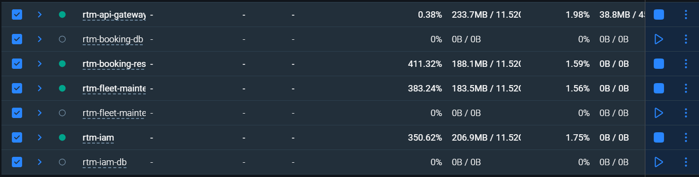
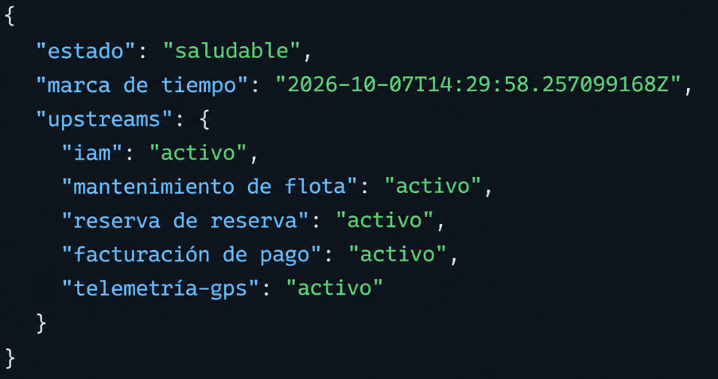
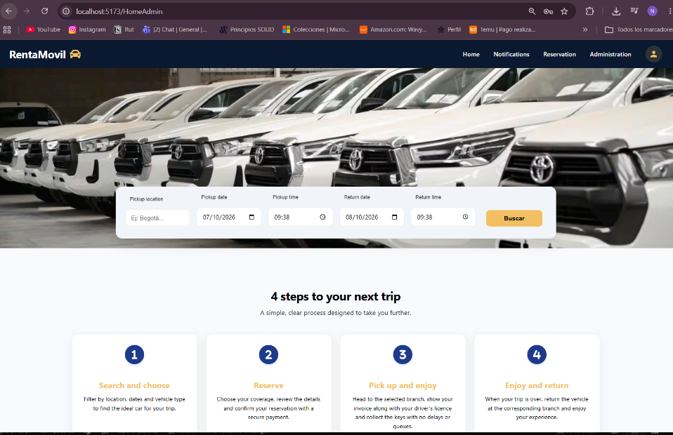
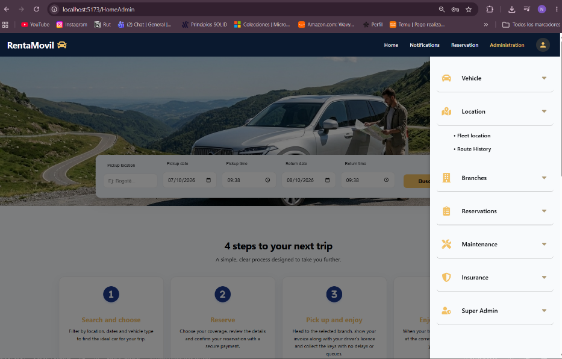

RentaMovil

Vehicle rental platform

INSTALLATION MANUAL

Team members

Nicole Dayana Ramirez

Thiago Fabian Rojas

David Santiago Erez

Class ID (ficha): 3145556

Program: Technologist in Software Analysis and Development

Instructor:  Karol Daniela Correa

Training center: SENA

Date: October 2026

Version: 2.0

Version control

| Version | Date | Change description | Responsible |
| --- | --- | --- | --- |
| 1.0 | 09/07/2026 | Initial creation of the installation manual. | Development team |
| 2.0 | 07/10/2026 | Update to match the current architecture: SQL Server in Docker, Liquibase migrations per schema, RS256 JWT keys, the iam, fleet-maintenance and booking-reservation microservices, API Gateway, web frontend with API mock, mobile app, first Super Admin, verification and common errors. | Development team |
| 2.1 | 27/10/2026 | payment-billing and telemetry-gps are added (schemas, services and migration order), the API mock is removed and the mobile app now consumes the API Gateway. | Development team |

Table of contents

- 1. Introduction
    - 1.1 Conventions
- 2. Objective
    - 2.1 Scope
- 3. Minimum hardware requirements
- 4. Required software
- 5. Obtaining the project
    - 5.1 Branches to use
- 6. Installing dependencies
- 7. Environment variable configuration
    - 7.1 Passwords that must match
    - 7.2 Database repositories
    - 7.3 JWT keys (RS256)
    - 7.4 Microservices and gateway
    - 7.5 Web frontend
    - 7.6 Mobile app
- 8. Creating and importing the database
- 9. Running the backend
    - 9.1 With Docker
    - 9.2 With Maven (without Docker)
- 10. Running the frontend
    - 10.1 Web frontend in development mode
    - 10.2 Web frontend with Docker
    - 10.3 Mobile app
- 11. System access
- 12. Test user
    - 12.1 Test customer
    - 12.2 First Super Admin (once per environment)
- 13. Installation verification
- 14. Common errors and solutions
- 15. Known limitations of the installed version
- 16. Glossary
- 17. References
- 18. Annexes
    - Annex A. Installation order summary
    - Annex B. Operation commands
    - Annex C. Verification screenshots

# 1. Introduction

This manual explains how to prepare a machine, obtain the code, configure and start all RentaMovil components in a local development or testing environment, and how to verify that the installation is correct.

RentaMovil is made up of several repositories that are installed separately and communicate over a Docker network called rentamovil: a SQL Server (Microsoft, n.d.) database, five migration repositories (iam, fleet, telemetry, booking and payment), five Java microservices (iam, fleet-maintenance, booking-reservation, payment-billing and telemetry-gps), an API Gateway, the web frontend and the mobile app. That is why installation order matters, and it is indicated in each step.

## 1.1 Conventions

• Commands are shown in grey blocks and are typed in a bash terminal. On Windows, Git Bash is recommended (it includes OpenSSL); Docker and Maven commands work the same in PowerShell.
• Passwords and keys are shown as <value> or ********: this manual never publishes real credentials. Each team must define its own.
• When a command must be run inside a folder, the block starts with the corresponding cd.

# 2. Objective

Enable another person to install and get RentaMovil running by following clear, complete and verifiable instructions, from a blank machine to being able to sign in to the web application with a test user and a Super Admin.

## 2.1 Scope

It covers local installation (development or testing machine) with Docker. It does not cover deployment on a production server with a domain and HTTPS, nor publishing the mobile app in the stores: this is an academic project with no production server or domain of its own, so that deployment is outside this manual's scope. Using the system is described in the user and administrator manuals, and its internal construction in the technical manual.

# 3. Minimum hardware requirements

Table 1. Hardware requirements

| Resource | Minimum | Recommended |
| --- | --- | --- |
| Operating system | 64-bit Windows 10/11 with WSL 2, Ubuntu 22.04 or macOS 13 | Windows 11 with WSL 2 or Ubuntu 22.04 / 24.04 |
| Processor | 64-bit, 4 cores (x86-64) | 6 cores or more |
| RAM memory | 8 GB (SQL Server needs at least 2 GB for its container) | 16 GB |
| Disk space | 15 GB free (Docker images, Maven and npm dependencies, database) | 25 GB free on an SSD |
| Network | Internet to download images and dependencies | Stable broadband |
| Browser | An updated Google Chrome, Microsoft Edge or Mozilla Firefox | Google Chrome |
| Mobile device (optional) | Android 10+ or iOS 16+ with the Expo Go app | On the same Wi-Fi network as the machine |

The SQL Server 2022 image is for x86-64 processors. On Mac machines with an Apple Silicon processor it runs through emulation (Rosetta) and is slower.

# 4. Required software

Table 2. Required software

| Tool | Version | Use | Verify with |
| --- | --- | --- | --- |
| Git (Git, n.d.) | 2.40 or later | Clone the repositories. On Windows it includes Git Bash and OpenSSL. | git --version |
| Docker Desktop (Docker Inc., n.d.) (or Docker Engine) | 24.0 or later, with Docker Compose 2.20+ | SQL Server, migrations and the service containers. | docker --version / docker compose version |
| Java JDK (Oracle Corporation, n.d.) | 21 (Eclipse Temurin recommended) | Compile and run the microservices outside Docker. | java -version |
| Apache Maven (Apache Software Foundation, n.d.) | 3.9 or later | Dependencies, tests, running and Liquibase migrations (Liquibase, n.d.). | mvn -version |
| Node.js (OpenJS Foundation, n.d.) + npm | Node 22 LTS and npm 10 or later | Web frontend and mobile app. | node -v / npm -v |
| OpenSSL (OpenSSL Software Foundation, n.d.) | Included in Git Bash, Linux and macOS | Generate the RS256 JWT key pair. | openssl version |
| Code editor | Visual Studio Code or IntelliJ IDEA | Edit .env files and review the code. | — |
| Database client (optional) | SQL Server Management Studio or Azure Data Studio | Query the database and create the first Super Admin. | — |
| Postman (optional) | Current | Test the endpoints. | — |
| Expo Go (Expo, n.d.) (optional) | Current, on the phone | Run the mobile app. | — |

If Docker is going to be used for the entire backend, Java and Maven are not mandatory: the images compile the code inside the container. They are required to run the services and migrations directly on the machine.

# 5. Obtaining the project

Create a working folder and clone all the repositories into it, side by side:

mkdir rentamovil && cd rentamovil

git clone https://github.com/RentaMovil/rtm-iam-db.git

git clone https://github.com/RentaMovil/rtm-fleet-maintenance-db.git

git clone https://github.com/RentaMovil/rtm-booking-db.git

git clone https://github.com/RentaMovil/rtm-iam.git

git clone https://github.com/RentaMovil/rtm-fleet-maintenance.git

git clone https://github.com/RentaMovil/rtm-booking-reservation.git

git clone https://github.com/RentaMovil/rtm-api-gateway.git

git clone https://github.com/RentaMovil/RentaMovil.git

Expected folder result:

rentamovil/

├── rtm-iam-db/ ← SQL Server + iam schema (installed first)

├── rtm-fleet-maintenance-db/ ← fleet schema

├── rtm-booking-db/ ← booking schema

├── rtm-iam/ ← identity service (:3001)

├── rtm-fleet-maintenance/ ← fleet service (:3002)

├── rtm-booking-reservation/ ← booking service (:3003)

├── rtm-api-gateway/ ← entry point (:8080)

└── RentaMovil/ ← web/Front-end and app_mobile/Frontend

## 5.1 Branches to use

The documented version corresponds to the following branches. Switch to each one with git checkout <branch> inside its folder. Once these changes are merged into develop, it is enough to use develop everywhere.

Table 3. Branch of each repository

| Repository | Branch | Reason |
| --- | --- | --- |
| rtm-iam-db, rtm-booking-db, rtm-fleet-maintenance-db | develop | Current schemas and reference data (in main, fleet-db is empty). |
| rtm-iam | feat/ConectBooking | It includes the personId claim needed by booking-reservation. |
| rtm-fleet-maintenance | develop | The service code is in develop (main only has the initial commit). |
| rtm-booking-reservation | develop | Version integrated with the frontend. |
| rtm-api-gateway | feat/booking-routes | It includes the booking-reservation routes. |
| RentaMovil | develop | Current web frontend and mobile app. |

# 6. Installing dependencies

With Docker, the dependencies of the Java services are downloaded automatically when the images are built (step 9). To run on the machine without Docker, or for the frontend, install them as follows:

Table 4. Dependency installation commands

| Component | Folder | Command |
| --- | --- | --- |
| Database repositories | rtm-*-db | mvn -q dependency:resolve (optional; Liquibase does it when running) |
| Microservices and gateway | rtm-iam, rtm-fleet-maintenance, rtm-booking-reservation, rtm-payment-billing, rtm-telemetry-gps, rtm-api-gateway | mvn install -DskipTests |
| Web frontend | RentaMovil/web/Front-end | npm install |
| Mobile app | RentaMovil/app_mobile/Frontend | npm install |

The first Maven and npm download may take several minutes; later ones use the cache.

# 7. Environment variable configuration

Each repository includes example files (.env.example and, in the database repositories, liquibase.properties.example). They are copied once and filled in. The .env and liquibase.properties files are never uploaded to the repository.

## 7.1 Passwords that must match

Define these passwords first and use them consistently. They must comply with the SQL Server policy: 8 or more characters with uppercase, lowercase, number and symbol.

Table 5. Passwords shared across repositories

| Password | Where it is written |
| --- | --- |
| SQL Server administrator (sa) | MSSQL_SA_PASSWORD in the .env of rtm-iam-db, rtm-fleet-maintenance-db, rtm-telemetry-gps-db, rtm-booking-db and rtm-payment-billing-db; password in each liquibase.properties. |
| iam_app user | IAM_APP_PASSWORD in rtm-iam-db/.env; parameter.iamAppPassword in rtm-iam-db/liquibase.properties; DATABASE_PASSWORD in rtm-iam/.env. |
| fleet_app user | FLEET_APP_PASSWORD in rtm-fleet-maintenance-db/.env; parameter.fleetAppPassword in its liquibase.properties; DATABASE_PASSWORD in rtm-fleet-maintenance/.env. |
| booking_app user | BOOKING_APP_PASSWORD in rtm-booking-db/.env; parameter.bookingAppPassword in its liquibase.properties; DATABASE_PASSWORD in rtm-booking-reservation/.env. |
| telemetry_app user | TELEMETRY_APP_PASSWORD in rtm-telemetry-gps-db/.env; parameter.telemetryAppPassword in its liquibase.properties; DATABASE_PASSWORD in rtm-telemetry-gps/.env. |
| payment_app user | parameter.paymentAppPassword in rtm-payment-billing-db/liquibase.properties (and the password variable in its .env.example); DATABASE_PASSWORD in rtm-payment-billing/.env. |
| Internal key between services | APP_INTERNAL_API_KEY: the SAME value in rtm-booking-reservation, rtm-fleet-maintenance, rtm-payment-billing and rtm-telemetry-gps (X-Internal-Key header). |

## 7.2 Database repositories

cd rtm-iam-db

cp .env.example .env

cp liquibase.properties.example liquibase.properties

# repeat in rtm-fleet-maintenance-db, rtm-telemetry-gps-db, rtm-booking-db and rtm-payment-billing-db

# rtm-iam-db/.env

MSSQL_SA_PASSWORD=********

MSSQL_PORT=1433

MSSQL_DATABASE=rentamovil

IAM_APP_PASSWORD=********

# rtm-iam-db/liquibase.properties

url=jdbc:sqlserver://localhost:1433;databaseName=rentamovil;encrypt=true;trustServerCertificate=true

username=sa

password=********

parameter.iamAppPassword=********

## 7.3 JWT keys (RS256)

The iam service signs the tokens with a private key; the others verify them with the public key. Generate a pair for your environment from Git Bash:

openssl genpkey -algorithm RSA -pkeyopt rsa_keygen_bits:2048 -out priv.pem

openssl pkey -in priv.pem -pubout -out pub.pem

sed '/-----/d' priv.pem | tr -d '\r\n' # APP_IAM_JWT_PRIVATE_KEY value

sed '/-----/d' pub.pem | tr -d '\r\n' # APP_IAM_JWT_PUBLIC_KEY value

rm priv.pem pub.pem # do not leave the keys on disk

Each value is copied on a single line, without the BEGIN/END lines. The public key is used in rtm-iam (APP_IAM_JWT_PUBLIC_KEY) in rtm-booking-reservation (APP_BOOKING_RESERVATION_JWT_PUBLIC_KEY) and in rtm-telemetry-gps (APP_TELEMETRY_GPS_JWT_PUBLIC_KEY); fleet-maintenance and payment-billing download it from iam's GET /jwks endpoint through IAM_URL. iam does not start if the keys are missing, are shorter than 2048 bits or do not form a pair.

## 7.4 Microservices and gateway

cd rtm-iam && cp .env.example .env

# repeat in rtm-fleet-maintenance, rtm-booking-reservation, rtm-payment-billing, rtm-telemetry-gps and rtm-api-gateway

Table 6. Main variables per service

| File | Variables to fill in | Local value |
| --- | --- | --- |
| rtm-iam/.env | DATABASE_URL, DATABASE_USERNAME, DATABASE_PASSWORD, APP_IAM_PORT, APP_IAM_JWT_PRIVATE_KEY, APP_IAM_JWT_PUBLIC_KEY, APP_IAM_JWT_EXPIRY, APP_IAM_REFRESH_TOKEN_EXPIRY, APP_IAM_BCRYPT_ROUNDS | iam_app user; port 3001; keys from step 7.3; 1800, 604800 and 12 by default. |
| rtm-fleet-maintenance/.env | DATABASE_URL, DATABASE_USERNAME, DATABASE_PASSWORD, APP_FLEET_MAINTENANCE_PORT, IAM_URL, BOOKING_URL, BOOKING_TIMEOUT, RETIRE_RESERVATION_HORIZON_DAYS, APP_INTERNAL_API_KEY | fleet_app user; port 3002; http://localhost:3001 and http://localhost:3003. |
| rtm-booking-reservation/.env | DATABASE_URL, DATABASE_USERNAME, DATABASE_PASSWORD, APP_BOOKING_RESERVATION_PORT, APP_BOOKING_RESERVATION_JWT_PUBLIC_KEY, IAM_URL, FLEET_URL, TELEMETRY_URL, APP_BOOKING_RESERVATION_PAYMENT_WINDOW_HOURS, APP_INTERNAL_API_KEY | booking_app user; port 3003; iam, fleet and telemetry URLs; 24 hours. |
| rtm-payment-billing/.env | DATABASE_URL, DATABASE_USERNAME, DATABASE_PASSWORD, APP_PAYMENT_BILLING_PORT, IAM_URL, BOOKING_URL, APP_PAYMENT_BILLING_FILE_ALLOWED_PREFIX, APP_PAYMENT_BILLING_INVOICE_STORAGE_DIR, APP_INTERNAL_API_KEY | payment_app user; port 3004; local invoice folder (./invoices-storage). |
| rtm-telemetry-gps/.env | DATABASE_URL, DATABASE_USERNAME, DATABASE_PASSWORD, APP_TELEMETRY_GPS_PORT, APP_TELEMETRY_GPS_JWT_PUBLIC_KEY, APP_TELEMETRY_GPS_DEVICE_API_KEY, BOOKING_URL, APP_INTERNAL_API_KEY | telemetry_app user; port 3005; iam public key; one key for the test GPS devices. |
| rtm-api-gateway/.env | GATEWAY_PORT, IAM_URL, FLEET_URL, BOOKING_URL, PAYMENT_URL, TELEMETRY_URL, CORS_ALLOWED_ORIGINS, RATE_LIMIT_* | Port 8080; the values in .env.example work for local. |

The local database URL is jdbc:sqlserver://localhost:1433;databaseName=rentamovil;encrypt=true;trustServerCertificate=true. Inside Docker, each docker-compose.yml changes it automatically to use the container name (sqlserver).

## 7.5 Web frontend

The RentaMovil/web/Front-end/.env file already contains the local values and has no secrets (everything it holds ends up in the browser):

VITE_API_URL=/api # Vite proxy to the gateway (localhost:8080)

VITE_CLOUDINARY_CLOUD_NAME=<Cloudinary cloud name>

VITE_CLOUDINARY_UPLOAD_PRESET=<Cloudinary unsigned preset>

## 7.6 Mobile app

cd RentaMovil/app_mobile/Frontend && cp .env.example .env

# empty EXPO_PUBLIC_API_URL = per-platform value; on a physical phone: http://<machine-IP>:<port>

# 8. Creating and importing the database

The rentamovil database is created in a SQL Server 2022 container. The tables, the reference data (roles, permissions, categories, brands, models and maintenance types) and the users of each service are created with Liquibase migrations, in this mandatory order: rtm-iam-db → rtm-fleet-maintenance-db → rtm-booking-db.

### 8.1 Create the shared network (once per machine)

docker network create rentamovil

### 8.2 SQL Server, rentamovil database and iam schema

cd rtm-iam-db

docker compose up -d

docker compose ps -a

You should see rentamovil-sqlserver in Up (healthy) status, and the sqlserver-init and migrations containers in Exited (0): the first one created the database and the second one applied the iam migrations.

### 8.3 fleet schema

cd ../rtm-fleet-maintenance-db

docker compose up --build

The migrations container ends in Exited (0). Alternative without Docker: mvn liquibase:update.

### 8.4 telemetry schema

cd ../rtm-telemetry-gps-db

docker compose up --build

It must run before booking, because booking.rental.gps_id points to telemetry.gps. Alternative without Docker: mvn liquibase:update.

### 8.5 booking schema

cd ../rtm-booking-db

docker compose up --build

Alternative without Docker: mvn liquibase:update.

### 8.6 payment schema

cd ../rtm-payment-billing-db

docker compose up --build

It must run last: its foreign keys point to booking.reservation and iam.[user]. Alternative without Docker: mvn liquibase:update.

### 8.7 Check the migrations

From each database repository:

mvn liquibase:status # must report no pending changesets

When using parameters, the Maven plugin may print a NoSuchFieldException about parameter.*AppPassword. It is harmless; what matters is the final BUILD SUCCESS.

Each schema stores its history in its own table: dbo.DATABASECHANGELOG_IAM, dbo.DATABASECHANGELOG_FLEET, dbo.DATABASECHANGELOG_TELEMETRY, dbo.DATABASECHANGELOG_BOOKING and dbo.DATABASECHANGELOG_PAYMENT.

# 9. Running the backend

Start the services in this order: rtm-iam → rtm-fleet-maintenance → rtm-booking-reservation → rtm-payment-billing → rtm-telemetry-gps → rtm-api-gateway. You can do this with Docker (recommended) or directly with Maven; do not use both methods at once for the same service, because they use the same port.

## 9.1 With Docker

cd rtm-iam && docker compose up -d --build

cd ../rtm-fleet-maintenance && docker compose up -d --build

cd ../rtm-booking-reservation && docker compose up -d --build

cd ../rtm-payment-billing && docker compose up -d --build

cd ../rtm-telemetry-gps && docker compose up -d --build

cd ../rtm-api-gateway && docker compose up -d --build

docker ps # rentamovil-iam, -fleet-maintenance, -booking-reservation, -payment-billing, -telemetry-gps, -api-gateway: Up

The first build takes several minutes because it downloads the dependencies inside the image; later ones are fast.

## 9.2 With Maven (without Docker)

Open one terminal per service and, inside each folder, run:

mvn spring-boot:run

Table 7. Backend services

| Service | Port | Container | Check |
| --- | --- | --- | --- |
| rtm-iam | 3001 | rentamovil-iam | curl http://localhost:3001/health |
| rtm-fleet-maintenance | 3002 | rentamovil-fleet-maintenance | curl http://localhost:3002/health |
| rtm-booking-reservation | 3003 | rentamovil-booking-reservation | curl http://localhost:3003/health |
| rtm-payment-billing | 3004 | rentamovil-payment-billing | curl http://localhost:3004/health |
| rtm-telemetry-gps | 3005 | rentamovil-telemetry-gps | curl http://localhost:3005/health |
| rtm-api-gateway | 8080 | rentamovil-api-gateway | curl http://localhost:8080/health |

Each service responds {"status":"ok","db":"connected",...}. The gateway responds with the status of each service (ok, degraded or down).

# 10. Running the frontend

## 10.1 Web frontend in development mode

Open one terminal in RentaMovil/web/Front-end:

# Web application on port 5173

npm run dev

## 10.2 Web frontend with Docker

With the backend already up on the rentamovil network:

cd RentaMovil/web/Front-end

docker compose up -d --build # web at http://localhost:4173

## 10.3 Mobile app

cd RentaMovil/app_mobile/Frontend

npx expo start

Scan the QR code with Expo Go (Android) or with the camera (iOS), or press a for the Android emulator and w for the web version.

The mobile app consumes the API Gateway: it must be running before you sign in. On the emulator or the web version the default value is enough (http://localhost:8080); on a physical phone set EXPO_PUBLIC_API_URL to your machine's IP (for example, http://192.168.1.50:8080).

# 11. System access

Table 8. Access addresses

| Component | Address | Note |
| --- | --- | --- |
| Web application (development) | http://localhost:5173 | Sign-in screen. |
| Web application (Docker) | http://localhost:4173 | Same application served by the rentamovil-web container. |
| API Gateway | http://localhost:8080 | API entry point; /health shows the status of the services. |
| SQL Server | localhost,1433 | sa user with the password defined in step 7.1 (only for database administration). |

# 12. Test user

The migrations deliberately do not create users: that way there are no passwords or hashes in the repositories. Users are created as follows:

## 12.1 Test customer

1. Open http://localhost:5173 and click Do you have an account? Register.
2. Register a test user, for example: First name Test, Last name Customer, username test.customer, email test.customer@rentamovil.test and a password that complies with the policy (8 characters, uppercase and number).
3. When you click Create account, the session opens with the Customer role.
It can also be created through the API:

curl -X POST http://localhost:8080/auth/register -H "Content-Type: application/json" \

-d '{"firstName":"Prueba","lastName":"Cliente","email":"cliente.prueba@rentamovil.test",

"username":"cliente.prueba","password":"<contraseña>"}'

## 12.2 First Super Admin (once per environment)

Public registration always creates customers, and only a Super Admin can assign roles. In a new database, the first one is assigned directly in the database:

1. Register in the web app the account that will be the administrator (for example, username test.admin).
2. Connect to SQL Server as sa (SQL Server Management Studio, Azure Data Studio or sqlcmd) and run:
UPDATE iam.[user]

SET role_id = (SELECT role_id FROM iam.role WHERE name = 'SUPER_ADMIN')

WHERE username = 'admin.prueba';

1. Log out and sign back in with that account: the system takes you to the administration panel.
2. From Administration > Super Administration > Users and roles, assign the other roles.
Use test accounts and passwords only in local environments. Never reuse these credentials in production.

# 13. Installation verification

Table 9. Checklist

| Verification | How to check it | Expected result |
| --- | --- | --- |
| Network and database | docker ps -a | rentamovil-sqlserver Up (healthy); sqlserver-init and migrations Exited (0). |
| Migrations | mvn liquibase:status in each *-db repository | No pending changesets. |
| Services | curl http://localhost:300X/health | status ok and db connected on 3001, 3002 and 3003. |
| Gateway | curl http://localhost:8080/health | iam, fleet-maintenance and booking-reservation in ok. |
| JWT keys | curl http://localhost:8080/auth/jwks | Responds with a JSON containing keys and alg RS256. |
| Frontend | Open http://localhost:5173 | You see the sign-in screen. |
| Registration and sign-in | Create the test customer (12.1) | The customer's Home page opens. |
| Data in the database | Search vehicles by branch and dates | The search responds (with vehicles if the administrator has already registered any). |
| Administration | Sign in with the Super Admin (12.2) | Administration appears in the bar and the panel shows all sections. |
| Persistence | Register a branch or a vehicle and reload the page | The record still appears. |
| Payments | Open Administration > Bank accounts | The list of collection accounts is loaded from payment-billing (empty if none has been registered yet). |

# 14. Common errors and solutions

Table 10. Frequent errors

| Error | Likely cause | Solution |
| --- | --- | --- |
| network rentamovil declared as external, but could not be found | The shared network was not created. | docker network create rentamovil and repeat the command. |
| rentamovil-sqlserver stops on startup | The sa password does not comply with the SQL Server policy or memory is insufficient. | Use 8+ characters with uppercase, lowercase, number and symbol; assign at least 2 GB of RAM to Docker. |
| Port is already allocated (1433, 3001, 3002, 3003, 3004, 3005, 8080, 5173 or 4173) | Another process, or the same service run with Maven and Docker at the same time. | Stop the duplicate process (netstat -ano \| findstr :PORT on Windows) or change the port in the .env. |
| Missing parameter.iamAppPassword (or fleet / telemetry / booking / payment) | The service user password is missing in liquibase.properties or in the .env. | Fill in the parameter and run the migrations again. |
| The fleet or booking migrations fail because of iam objects | They were run before rtm-iam-db. | Respect the order: iam-db → fleet-db → telemetry-db → booking-db → payment-db. |
| A service does not start: schema validation error (Hibernate) | Migrations are missing, or the code and the schema come from different branches. | Run mvn liquibase:update and use the branches from section 5.1. |
| Login failed for user 'iam_app' (or fleet_app / booking_app) | DATABASE_PASSWORD does not match the parameter used in the migration. | Make the passwords match according to table 7.1. |
| iam does not start: invalid JWT keys | Empty keys, with line breaks, with the BEGIN/END lines, or that do not form a pair. | Regenerate them with step 7.3 and paste them on a single line. |
| 401 INVALID_TOKEN on all booking requests | APP_BOOKING_RESERVATION_JWT_PUBLIC_KEY is not iam's public key. | Copy the same APP_IAM_JWT_PUBLIC_KEY. |
| The gateway responds 503 SERVICE_UNAVAILABLE | The target service is not up. | Start it and check the gateway /health. |
| Creating a reservation responds 409 FLEET_SERVICE_UNAVAILABLE | Known limitation of booking-reservation (provisional fleet adapter). | Expected behaviour in this version. |
| Blank screen or network errors on the web | The gateway is down, or the frontend .env was modified. | Check the browser console (F12) and bring up the gateway. |
| The password recovery code does not arrive | In development iam does not send emails: it writes the code in its log. | docker logs rentamovil-iam and look for [EMAIL DE DESARROLLO]. |
| 429 when signing in | Limit of 10 attempts every 5 minutes per IP. | Wait or adjust RATE_LIMIT_* in the gateway .env. |
| java, mvn or npm not recognized | The tool is not installed or is not in the PATH. | Install it and open a new terminal. |

# 15. Known limitations of the installed version

• Events between services travel over HTTP with no broker or outbox: if a destination service is down, the event is lost and only remains in the log (ADR-012).
• The gateway rate-limit counters and the iam failed-login counter are in memory: with several instances they require Redis.
• Payment is a bank transfer manually reviewed by an administrator; there is no payment gateway (ADR-013).
• Invoices are stored in a local folder of the payment-billing service (invoices-storage); persistent storage is advisable in production.
• iam email sending is development-grade (it writes to the log).

# 16. Glossary

| Term | Definition |
| --- | --- |
| Docker / container | Tool that runs each component isolated with everything it needs. |
| Docker Compose | docker-compose.yml file that defines how one or more containers are brought up. |
| rentamovil network | Shared Docker network through which containers find each other by name. |
| Image | Template from which a container is created. |
| Liquibase | Tool that applies, in order, the versioned changes of the database schema. |
| Changeset | Each individual database change applied by Liquibase. |
| Schema | Grouping of tables inside the rentamovil database (iam, fleet, booking, shared). |
| sa | SQL Server administrator user; only the migrations use it. |
| .env file | Local file with a component's configuration and secrets; it is not uploaded to the repository. |
| JWT / RS256 | Session token signed with an RSA key pair. |
| API Gateway | Service that receives all requests and forwards them to the correct microservice. |
| Health check | /health endpoint that indicates whether a service and its database are working. |
| Maven / npm | Dependency and build managers for Java and JavaScript. |
| Expo Go | Phone app used to run the mobile app in development. |

# 17. References

Apache Software Foundation. (n.d.). *Apache Maven* [Software documentation]. https://maven.apache.org/

Docker Inc. (n.d.). *Docker documentation*. https://docs.docker.com/

Expo. (n.d.). *Expo documentation*. https://docs.expo.dev/

Git. (n.d.). *Git documentation*. https://git-scm.com/doc

Liquibase. (n.d.). *Liquibase documentation*. https://docs.liquibase.com/

Microsoft. (n.d.). *SQL Server technical documentation*. https://learn.microsoft.com/en-us/sql/sql-server/

OpenJS Foundation. (n.d.). *Node.js documentation*. https://nodejs.org/en/docs

OpenSSL Software Foundation. (n.d.). *OpenSSL documentation*. https://www.openssl.org/docs/

Oracle Corporation. (n.d.). *Java SE documentation*. https://docs.oracle.com/en/java/javase/

# 18. Annexes

## Annex A. Installation order summary

| Step | Action | Main command |
| --- | --- | --- |
| 1 | Create the network | docker network create rentamovil |
| 2 | SQL Server + iam schema | cd rtm-iam-db && docker compose up -d |
| 3 | fleet schema | cd rtm-fleet-maintenance-db && docker compose up --build |
| 4 | telemetry schema | cd rtm-telemetry-gps-db && docker compose up --build |
| 5 | booking schema | cd rtm-booking-db && docker compose up --build |
| 6 | payment schema | cd rtm-payment-billing-db && docker compose up --build |
| 7 | JWT keys and .env files | openssl genpkey ... / cp .env.example .env |
| 8 | iam service | cd rtm-iam && docker compose up -d --build |
| 9 | fleet-maintenance service | cd rtm-fleet-maintenance && docker compose up -d --build |
| 10 | booking-reservation service | cd rtm-booking-reservation && docker compose up -d --build |
| 11 | payment-billing service | cd rtm-payment-billing && docker compose up -d --build |
| 12 | telemetry-gps service | cd rtm-telemetry-gps && docker compose up -d --build |
| 13 | API Gateway | cd rtm-api-gateway && docker compose up -d --build |
| 14 | Web frontend | npm run dev |
| 15 | First Super Admin | UPDATE iam.[user] ... (section 12.2) |

## Annex B. Operation commands

| Task | Command |
| --- | --- |
| View containers and their status | docker ps -a |
| View the log of a service | docker logs -f rentamovil-iam |
| Stop a component (data is preserved) | docker compose down |
| Stop and DELETE the SQL Server data | cd rtm-iam-db && docker compose down -v |
| Undo the last changeset | mvn liquibase:rollback -Dliquibase.rollbackCount=1 |
| Run a service's tests | mvn test |
| Lint the web frontend code | npm run lint |
| Type-check the mobile app | npm run typecheck |

## Annex C. Verification screenshots

Figure 1. Output of docker ps with the containers running

Figure 2. Response from http://localhost:8080/health

Figure 3. Home screen at http://localhost:5173

Figure 4. Administration panel with the Super Admin menu

