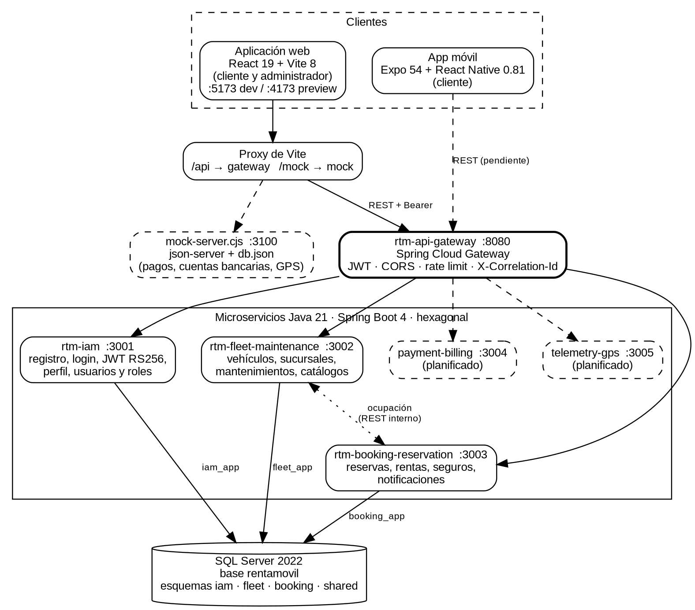

RentaMovil

Vehicle rental platform

TECHNICAL MANUAL

Team members

Nicole Dayana Ramirez

Thiago Fabian Rojas

David Santiago Erez

Class ID (ficha): 3145556

Program: Technologist in Software Analysis and Development

Instructor: Karol Daniela Correa

Training center: SENA
Date: October 2026

Version: 2.0

Version control

| Version | Date | Change description | Responsible |
| --- | --- | --- | --- |
| 1.0 | 09/07/2026 | Initial creation of the technical manual. | Development team |
| 2.0 | 06/10/2026 | Update to match the current architecture: microservices (API Gateway, iam, fleet-maintenance, booking-reservation), SQL Server database split by schema with Liquibase, data dictionary, endpoints, security, version control, maintenance and troubleshooting. | Development team |

Table of contents

- 1. Introduction
    - 1.1 Conventions
- 2. Objective
- 3. Technical scope
- 4. General system description
    - 4.1 Repositories
    - 4.2 Implementation status
- 5. Technologies used
    - 5.1 Dependencies per component
    - 5.2 System configuration
- 6. System architecture
    - 6.1 Architectural style
    - 6.2 Architecture diagram
    - 6.3 Components and ports
    - 6.4 Layers of each microservice (hexagonal)
    - 6.5 Communication between components
    - 6.6 Path of a request
- 7. Project structure
    - 7.1 Microservice (example: rtm-booking-reservation)
    - 7.2 Database repository (example: rtm-iam-db)
    - 7.3 Web frontend (RentaMovil/web/Front-end)
    - 7.4 Mobile app (RentaMovil/app_mobile/Frontend)
- 8. Database
    - 8.1 Entity-relationship diagram
    - 8.2 Main tables
    - 8.3 Data dictionary
    - 8.4 Notable integrity rules
- 9. Technical modules
- 10. System API or routes
    - 10.1 Gateway routing
    - 10.2 rtm-iam (the /auth prefix is stripped at the gateway; /users is forwarded unchanged)
    - 10.3 rtm-fleet-maintenance
    - 10.4 rtm-booking-reservation
    - 10.5 Internal use between services (not exposed by the gateway)
    - 10.6 rtm-payment-billing and rtm-telemetry-gps
    - 10.7 Response codes and error format
- 11. Security
    - 11.1 Permissions by role
- 12. Version control
    - 12.1 Architecture decisions (ADR)
- 13. Maintenance recommendations
    - 13.1 Troubleshooting
    - 13.2 Technical debt and known limitations
- 14. Glossary
- 15. References
- 16. Annexes
    - Annex A. Quick reference commands
    - Annex B. Environment variables
    - Annex C. Related documents

# 1. Introduction

This manual describes how RentaMovil, the vehicle rental platform, is built: its architecture, the technologies it uses, the code organization, the database, the technical modules, the application programming interface (API), security, and the recommendations for maintaining and extending it.

It is aimed at developers, technical support staff and instructors who need to understand, maintain or continue the system. It assumes knowledge of Java, Spring Boot, React, SQL Server, Git, Docker and HTTP. It does not explain how the system is used from its screens (that is in the User Manual and the Administrator Manual) nor the installation step by step (Installation Manual).

## 1.1 Conventions

• Commands, paths, file names, variables and classes are written in monospace font inside grey blocks or inline in the text (for example, application.properties, APP_IAM_JWT_EXPIRY, /auth/login).
• API paths are written as the client calls them through the gateway (port 8080), unless otherwise stated.
• The code and technical documentation in the repositories are in English; what the user sees (messages, screens) is in Spanish. This is a decision recorded in ADR-001, not an oversight.
• Everything described was verified against the repository code on 6 October 2026 (branches listed in section 4.2).

# 2. Objective

Document RentaMovil's architecture, technologies, project structure, database, modules, API, dependencies, security and maintenance recommendations, so that another development team can understand the system, support it and continue building it.

# 3. Technical scope

The manual covers:

• The web frontend (customer and administration) and the mobile app.
• The API Gateway and the implemented microservices: rtm-iam, rtm-fleet-maintenance and rtm-booking-reservation.
• The SQL Server database, its schemas, tables, relationships and Liquibase migrations.
• Security, version control, maintenance, troubleshooting and reference commands.
It does not cover the detail of each request and response body (that is in the OpenAPI contracts in rtm-docs/07-api/contracts), the planned services that do not exist yet (payment-billing and telemetry-gps) beyond their place in the architecture, nor the full installation procedure.

# 4. General system description

RentaMovil lets customers search for available vehicles by branch and dates, reserve them with optional insurance, pay by bank transfer with a receipt, and check their reservations and notifications. Administrators manage the fleet, maintenance, branches, insurance, bank accounts, users, payment validation, vehicle pickup and return, and GPS tracking.

It is a client-server application: two clients (web and mobile) consume, through an API Gateway, a Java microservices backend that share a single SQL Server database, split by schema.

## 4.1 Repositories

Table 1. System repositories

| Repository | Location | Contents |
| --- | --- | --- |
| RentaMovil | github.com/RentaMovil/RentaMovil (mirror: nicolerv18/RentaMovil) | Web frontend (web/Front-end), mobile app (app_mobile/Frontend), functional documentation. |
| rtm-api-gateway | github.com/RentaMovil/rtm-api-gateway | Single entry point: routing, JWT verification, CORS, rate limiting and traceability. |
| rtm-iam | github.com/RentaMovil/rtm-iam | Identity and access: registration, login, JWT, sessions, profile, users and roles. |
| rtm-iam-db | github.com/RentaMovil/rtm-iam-db | Liquibase migrations for the iam schema and the shared.audit table; SQL Server container. |
| rtm-fleet-maintenance | github.com/RentaMovil/rtm-fleet-maintenance | Fleet: vehicles, branches, maintenance and reference catalogs. |
| rtm-fleet-maintenance-db | github.com/RentaMovil/rtm-fleet-maintenance-db | Liquibase migrations for the fleet schema. |
| rtm-booking-reservation | github.com/RentaMovil/rtm-booking-reservation | Reservations, rental execution (pickup and return), insurance plans and notifications. |
| rtm-booking-db | github.com/RentaMovil/rtm-booking-db | Liquibase migrations for the booking schema. |
| rtm-docs | github.com/code-sena/rtm-docs | Governance, domain, architecture (ADR), data, OpenAPI contract and operations documentation. |

## 4.2 Implementation status

Verified branches: RentaMovil develop; rtm-api-gateway feat/booking-routes; rtm-iam feat/ConectBooking; rtm-booking-reservation develop; rtm-fleet-maintenance develop; *-db repositories develop; rtm-docs main.

Table 2. Status of each component

| Component | Status | Note |
| --- | --- | --- |
| Web frontend | Operational | Connected to the gateway for auth, users, vehicles, branches, maintenance, reservations, rentals, insurance and notifications. Payments, bank accounts, invoices and GPS tracking also go through the gateway. |
| Mobile app | Operational | Consumes the API Gateway (EXPO_PUBLIC_API_URL): authentication, branches, vehicles, reservations, payments with receipt and notifications. |
| rtm-api-gateway | Operational | Routes the five services; the two planned ones respond 503 until they exist. |
| rtm-iam | Operational | All identity, profile and user administration operations. |
| rtm-fleet-maintenance | Operational (develop branch) | Vehicles, inventory, availability, branches, maintenance and catalogs. |
| rtm-booking-reservation | Operational | Queries fleet-maintenance through a real HTTP adapter (FleetVehicleClientAdapter) and forwards events to fleet and telemetry. A reservation is confirmed when the payment is approved in payment-billing. |
| payment-billing (:3004) | Operational | Bank-transfer payments with manual review, bank accounts and invoices (/payments, /invoices, /bank-accounts). |
| telemetry-gps (:3005) | Operational | Location ingestion and tracking/history queries (/locations, /tracking, /gps). |

# 5. Technologies used

Table 3. Technologies and versions

| Component | Technology | Version / detail |
| --- | --- | --- |
| Web frontend | React (Meta Platforms, Inc., n.d.) + Vite (Vite, n.d.) | React 19.2, Vite 8, React Router 7, react-hook-form 7, i18next 26, Leaflet 1.9 / react-leaflet 5, Recharts 3, GSAP 3, react-dropzone 15 |
| Mobile app | Expo (Expo, n.d.) + React Native (TypeScript) | Expo SDK 54, React Native 0.81.5, React 19.1, expo-router 6, Zustand 5, expo-secure-store 15, TypeScript 5.9 |
| Backend | Java + Spring Boot (VMware, Inc., n.d.-a) | Java 21; Spring Boot 4.1.1 (iam, fleet, booking); Spring Boot 4.0.8 (gateway) |
| API Gateway | Spring Cloud Gateway (VMware, Inc., n.d.-b) (WebMVC) | Spring Cloud 2025.1.3 |
| Persistence | Spring Data JPA (VMware, Inc., n.d.-c) + Hibernate | ddl-auto=validate; JDBC time zone UTC; mssql-jdbc driver |
| Security | Nimbus JOSE + JWT (Connect2id, n.d.; Jones et al., 2015); Spring Security Crypto | nimbus-jose-jwt 10.10 (RS256); BCrypt (12 rounds) |
| Database | Microsoft SQL Server (Microsoft, n.d.) | SQL Server 2022 (image mcr.microsoft.com/mssql/server:2022-latest, Developer edition) |
| Migrations | Liquibase (Liquibase, n.d.) (Maven plugin, Apache Software Foundation, n.d.) | Liquibase 5.0.4 |
| Build | Maven (Apache Software Foundation, n.d.) / npm (OpenJS Foundation, n.d.) | Maven 3.9; Node.js 22 (image node:22-alpine) |
| Containers | Docker (Docker Inc., n.d.) and Docker Compose | Shared external network rentamovil; images eclipse-temurin:21-jre |
| Image storage | Cloudinary | Direct upload from the browser (vehicle photos, profile and receipts) |
| API contracts | OpenAPI 3 (OpenAPI Initiative, 2021) | rtm-docs/07-api/contracts/openapi (one file per service + _shared.yaml) |
| Version control | Git (Git, n.d.) + GitHub | RentaMovil organization; branches develop → qa → staging → main; Conventional Commits (Conventional Commits, n.d.) |
| Diagrams | Mermaid, PlantUML, Graphviz | rtm-docs and Documentacion/Diagramas UML |

## 5.1 Dependencies per component

Table 4. Dependency management per component

| Component | Dependency file | Manager |
| --- | --- | --- |
| rtm-api-gateway, rtm-iam, rtm-fleet-maintenance, rtm-booking-reservation | pom.xml | Maven 3.9 |
| rtm-iam-db, rtm-fleet-maintenance-db, rtm-booking-reservation-db (*-db repositories) | pom.xml (Liquibase plugin) | Maven 3.9 + Liquibase 5.0.4 |
| web/Front-end | package.json | npm (Node.js 22) |
| app_mobile/Frontend | package.json | npm (Expo SDK 54) |

Each repository declares its own dependencies in its pom.xml or package.json file; since this is a microservices architecture with independent repositories, there is no single dependency file for the whole system. The main dependencies per component are listed in Table 3 (section 5):

- Backend (Java + Spring Boot): Spring Boot, Spring Cloud Gateway, Spring Data JPA + Hibernate, Nimbus JOSE + JWT, Spring Security Crypto, mssql-jdbc driver.
- Web frontend (React): React, React Router, react-hook-form, i18next, Leaflet / react-leaflet, Recharts, GSAP, react-dropzone.
- Mobile app (Expo + React Native): expo-router, Zustand, expo-secure-store, TypeScript.
- Database and migrations: Microsoft SQL Server, Liquibase.

## 5.2 System configuration

Table 5. Configuration files and variables per component

| Component | Configuration file | Key variables |
| --- | --- | --- |
| Microservices (iam, fleet-maintenance, booking-reservation) | application.properties + .env (from .env.example) | See Annex B. Environment variables (DATABASE_*, APP_*_PORT, JWT, etc.) |
| API Gateway | application.properties + .env (from .env.example) | GATEWAY_PORT, IAM_URL, FLEET_URL, BOOKING_URL, CORS_ALLOWED_ORIGINS, RATE_LIMIT_* |
| *-db repositories | liquibase.properties (from liquibase.properties.example) | url, username, password, parameter.<service>AppPassword |
| Web frontend | vite.config.js, .env | VITE_API_URL; proxy /api → gateway (port 8080) |
| Mobile app | config/env.ts | EXPO_PUBLIC_API_URL |
| Containers | docker-compose.yml per repository | Shared external network rentamovil |

Configuration files containing credentials (.env, liquibase.properties) are never pushed to the repository: each one is created locally from its matching .example file. The full detail of environment variables per component is in Annex B. Environment variables.

# 6. System architecture

## 6.1 Architectural style

The backend follows a microservices architecture organized by business domains (bounded contexts): identity and access, fleet and maintenance, reservations and rentals, payments and billing, and GPS telemetry. Each microservice is internally implemented with hexagonal architecture (ports and adapters), so that business rules do not depend on Spring, the database or HTTP.

The frontends use a feature-based organization with reusable components (component-driven): each module groups its pages, components, hooks and services.

All services share a single SQL Server database, but each one owns its own schema and connects with a user that only has permissions on that schema (ADR-009).

## 6.2 Architecture diagram

Figure 1. Container architecture. Dashed lines indicate planned services or pending integrations.

## 6.3 Components and ports

Table 6. System ports in local development

| Component | Port | Note |
| --- | --- | --- |
| Web frontend (Vite dev) | 5173 | npm run dev |
| Web frontend (preview / Docker) | 4173 | npm run preview or rentamovil-web container |
| rtm-api-gateway | 8080 | Single entry point for clients |
| rtm-iam | 3001 | Internal; only through the gateway |
| rtm-fleet-maintenance | 3002 | Internal |
| rtm-booking-reservation | 3003 | Internal |
| payment-billing (planned) | 3004 | — |
| telemetry-gps (planned) | 3005 | — |
| SQL Server | 1433 | rentamovil-sqlserver container |

## 6.4 Layers of each microservice (hexagonal)

The three implemented microservices share the same organization. The rule that cannot be broken: domain imports nothing from infrastructure nor from Spring; dependencies always point toward the domain.

Table 7. Layers of a microservice

| Package | Responsibility |
| --- | --- |
| domain/entity | Business entities and value objects (Reservation, Vehicle, User...). They do not depend on Spring or JPA. |
| domain/enums | Domain statuses (ReservationStatus, VehicleStatus, UserStatus, MaintenanceStatus...). |
| domain/exception | Business exceptions (BusinessRuleException, ResourceNotFoundException...). |
| domain/port/in | Input ports: interfaces of the use cases the service offers. |
| domain/port/out | Output ports: what the domain needs from the outside (repositories, token verifier, events, audit). |
| application/usecase | Use case implementation; orchestrates domain and ports. |
| infrastructure/web | Input adapters: REST controllers, DTOs, global error handler and filters. |
| infrastructure/persistence | Output adapters: JPA entities, Spring Data repositories and adapters implementing the *RepositoryPort. |
| infrastructure/security | JWT verification or issuance and password hashing. |
| infrastructure/config | BeanConfig: wires each use case with its adapters (dependency injection). |

## 6.5 Communication between components

• Client → backend: REST over HTTP with JSON. The browser calls /api (gateway) on its own origin; the Vite proxy forwards it to the gateway.
• Gateway → services: the gateway routes by path prefix (section 9.1) and adds X-User-Id, X-User-Role and X-Correlation-Id.
• Service → service: internal REST calls; for example, fleet-maintenance queries booking-reservation for vehicle occupancy in order to calculate availability.
• Domain events: booking-reservation dispatches them in memory (InProcessEventDispatcher) and fleet publishes them in the log; between services they are delivered via POST /internal/events. No message broker is used at this scale.
Table 8. Domain events

| Event | Published by | Consumed by / effect |
| --- | --- | --- |
| ReservationCreated / ReservationReturnBranchChanged / ReservationExpired | booking-reservation | In-app notifications (booking) |
| RentalStarted | booking-reservation | fleet-maintenance: vehicle to RENTED; telemetry-gps (future) |
| RentalCompleted | booking-reservation | fleet-maintenance: vehicle to AVAILABLE |
| PaymentCompleted / PaymentRejected | payment-billing (future) | booking-reservation: reservation to CONFIRMED or rejection; notification |
| MaintenanceCompleted | fleet-maintenance | booking-reservation: MAINTENANCE_COMPLETED notification |

## 6.6 Path of a request

Example: the customer checks their reservations from the web.

1. The My Reservations screen calls reservationService.getMine(), which uses httpClient.get('/reservations/mine').
2. httpClient decides the base: /reservations is in REAL_BACKEND_PREFIXES, so it calls /api/reservations/mine with the access token in the Authorization: Bearer header.
3. The Vite proxy strips /api and forwards to http://localhost:8080/reservations/mine (without an Origin header).
4. The gateway assigns X-Correlation-Id, applies rate limiting, verifies the JWT signature and expiry with iam's public key, strips any external X-User-* headers and adds X-User-Id and X-User-Role.
5. The /reservations/** route is forwarded to booking-reservation (:3003).
6. In booking, the ReservationController re-verifies the token (CurrentUserArgumentResolver), calls the use case, and the use case calls the ReservationRepositoryPort.
7. The JPA adapter queries booking.reservation with the booking_app user and returns the rows.
8. The response returns through the same path; if the access token expired (401), httpClient requests a new token from /auth/refresh once and repeats the request.

# 7. Project structure

## 7.1 Microservice (example: rtm-booking-reservation)

rtm-booking-reservation/

├── src/main/java/com/rentamovil/booking/

│ ├── domain/ entity · enums · exception · port/in · port/out

│ ├── application/usecase/ use case implementations

│ └── infrastructure/

│ ├── config/ BeanConfig, WebConfig

│ ├── events/ InProcessEventDispatcher

│ ├── fleet/ availability adapter (provisional)

│ ├── persistence/ entity (JPA) · repository · adapter

│ ├── scheduling/ ReservationExpirationJob (expires unpaid reservations)

│ ├── security/ JwtKeyConfig, JwtVerifierAdapter

│ └── web/ controller · dto · exception · filter · auth

├── src/main/resources/application.properties

├── src/test/java/ unit and integration tests

├── .env.example · Dockerfile · docker-compose.yml · pom.xml · README.md

## 7.2 Database repository (example: rtm-iam-db)

rtm-iam-db/

├── 01_ddl/ 01_schemas · 03_tables · 04_alter · 05_views

│ 10_indexes

├── 02_dml/ 00_inserts · 01_updates · 02_deletes

├── 03_dcl/ 00_roles · 01_grants

├── 04_tcl/

├── 05_rollbacks/

├── changelog/ master Liquibase changelog

├── liquibase.properties.example · docker-compose.yml

└── Dockerfile · pom.xml

Table 9. Folders of a database repository

| Folder | Purpose |
| --- | --- |
| 01_ddl | Schemas, tables, foreign keys (04_alter), views and indexes (10_indexes). |
| 02_dml | Seed data (roles, permissions, categories, brands, models, maintenance types). |
| 03_dcl | Service login and database user, and their permissions (GRANT). |
| 04_tcl | Transaction control, when applicable. |
| 05_rollbacks | Mirror with the rollback of each change. |
| changelog | Master changelog that Liquibase executes in order. |
| liquibase.properties | Connection and parameters (*_app user password). Copied from liquibase.properties.example and never uploaded. |

## 7.3 Web frontend (RentaMovil/web/Front-end)

web/Front-end/

├── src/

│ ├── features/ auth · vehicles · booking · payment · notification

│ │ └── admin/ registerVehicle · VehicleInventory · registerMaintenance

│ │ historyMaintenance · reservations · branches

│ │ insuranceTypes · bankAccounts · users

│ │ vehicleLocation · routeHistory

│ ├── contexts/ AuthContext, ThemeContext

│ ├── shared/ api · components · hooks · services · utils

│ ├── Traductions/ es · en · fr · pt

│ ├── App.jsx protected routes with RequireAuth / RequireRole

│ └── main.jsx providers: Auth, Reservation, Payment

├── vite.config.js /api proxy

├── Dockerfile · docker-compose.yml · package.json

Table 10. Web frontend folders

| Folder / file | Purpose |
| --- | --- |
| src/features/<module>/pages | Screens of each module (auth, vehicles, booking, payment, notification, admin/*). |
| src/features/<module>/components | Components specific to the module. |
| src/features/<module>/hooks | Screen state and logic (useCars, useReservationsList, useCreateMaintenance...). |
| src/features/<module>/services | HTTP calls and mappers that convert the backend response into the view model. |
| src/contexts | Global contexts: AuthContext (session and user) and ThemeContext. |
| src/shared/api | httpClient.js (HTTP client with refresh) and tokenStore.js (access token in memory). |
| src/shared/components | Reusable components: layout (Navbar, Footer), ProtectedRoute (RequireAuth / RequireRole), dialogs. |
| src/shared/services and hooks | Cross-cutting services (cloudinaryService, useImageUpload, useIsMobile). |
| src/Traductions | i18next configuration and es, en, fr, pt files. |
| vite.config.js | /api → gateway (:8080) proxy. |

## 7.4 Mobile app (RentaMovil/app_mobile/Frontend)

app_mobile/Frontend/src/

├── app/ expo-router routes: (tabs) · auth · account

│ reservation · payment · notifications

│ reservation-detail

├── features/ account · auth · branches · home · insurance

│ menu · notification · payment · reservation

│ vehicles (pages · components · services · mocks)

├── shared/ api (httpClient, tokenStore) · components · hooks

├── config/ env.ts (API URL per platform), assets.ts

├── theme/ themes and design constants

├── translation/ i18n es · en · fr · pt

└── types/ TypeScript domain types

# 8. Database

| Aspect | Value |
| --- | --- |
| Engine | Microsoft SQL Server 2022 (rentamovil-sqlserver container, port 1433) |
| Database | rentamovil (shared by all services) |
| Schemas | iam (rtm-iam), fleet (rtm-fleet-maintenance), booking (rtm-booking-reservation), shared (common audit) |
| Application users | iam_app, fleet_app, booking_app: CRUD only on their schema + INSERT into shared.audit |
| Migrations | Liquibase 5.0.4, one repository per schema (rtm-iam-db, rtm-fleet-maintenance-db, rtm-booking-db) |
| Tables | 21 tables: 7 in iam, 1 in shared, 9 in fleet and 4 in booking |

## 8.1 Entity-relationship diagram

Figure 2. Entity-relationship model by schema. Dashed lines are logical references between schemas with no physical foreign key.

Between schemas there are only foreign keys to iam.person (reservation holder and notification recipient) and to iam.user (audit). The references from booking.reservation to fleet.vehicle and fleet.branch are logical: each service owns its data and validates them through the API, not through the database.

## 8.2 Main tables

| Table | Purpose |
| --- | --- |
| iam.person / iam.user | Personal data and access account (1 to 1). The person is the one who reserves; the user is the one who signs in. |
| iam.role / iam.permission / iam.role_permission | CLIENT, ADMIN, SUPER_ADMIN roles and their 25 permissions. |
| iam.session / iam.verification_code | Sessions with refresh token and password recovery codes. |
| shared.audit | Log of administrative actions from all services. |
| fleet.vehicle and catalogs | Vehicles with model, brand, category, engine type, branch, status and daily rate. |
| fleet.branch / branch_operating_hour | Branches with coordinates and daily schedule. |
| fleet.vehicle_maintenance / maintenance_type | Maintenance and its type catalog. |
| booking.reservation | Reservation with dates, branches, insurance, subtotals, total and status. |
| booking.rental | Rental execution: pickup, return, mileages and GPS. |
| booking.insurance_type / notification | Insurance plans and in-app notifications. |

## 8.3 Data dictionary

### iam.person

| Field | Type | Constraint | Description |
| --- | --- | --- | --- |
| person_id | INT | PK, IDENTITY | Person identifier. |
| first_name | VARCHAR(100) | NOT NULL | First names. |
| last_name | VARCHAR(100) | NOT NULL | Last names. |
| email | VARCHAR(150) | NOT NULL, UNIQUE | Access email; unique in the system. |
| phone | VARCHAR(20) | NULL | Contact phone. |
| image_url | VARCHAR(500) | NULL | Profile photo URL (Cloudinary). |

### iam.role

| Field | Type | Constraint | Description |
| --- | --- | --- | --- |
| role_id | INT | PK, IDENTITY | Role identifier. |
| name | VARCHAR(50) | NOT NULL, UNIQUE | CLIENT, ADMIN or SUPER_ADMIN. |
| description | VARCHAR(255) | NULL | Role description. |

### iam.permission

| Field | Type | Constraint | Description |
| --- | --- | --- | --- |
| permission_id | INT | PK, IDENTITY | Permission identifier. |
| name | VARCHAR(50) | NOT NULL, UNIQUE | Permission in resource:action format (e.g. vehicles:create). |
| description | VARCHAR(255) | NULL | Permission description. |

### iam.role_permission

| Field | Type | Constraint | Description |
| --- | --- | --- | --- |
| role_id | INT | PK, FK → iam.role | Role. |
| permission_id | INT | PK, FK → iam.permission | Permission assigned to the role. |

### iam.user

| Field | Type | Constraint | Description |
| --- | --- | --- | --- |
| user_id | INT | PK, IDENTITY | Account identifier (sub claim of the JWT). |
| person_id | INT | FK → iam.person, UNIQUE | Person owning the account (one account per person). |
| role_id | INT | FK → iam.role | Account role. |
| username | VARCHAR(50) | NOT NULL, UNIQUE | Username; cannot be modified. |
| password_hash | VARCHAR(255) | NOT NULL | BCrypt hash of the password. |
| status | VARCHAR(20) | CHECK ACTIVE/INACTIVE/BLOCKED | Account status. |
| last_login | DATETIME | NULL | Last successful sign-in. |

### iam.verification_code

| Field | Type | Constraint | Description |
| --- | --- | --- | --- |
| verification_code_id | INT | PK, IDENTITY | Code identifier. |
| user_id | INT | FK → iam.user | Account that requested the code. |
| code | VARCHAR(10) | NOT NULL | 6-digit code. |
| type | VARCHAR(30) | NOT NULL | Purpose (password recovery). |
| created_at | DATETIME | NOT NULL | Issued date. |
| expires_at | DATETIME | NOT NULL | Expiry (15 minutes by default). |
| used | BIT | NOT NULL | Indicates whether it was already used. |

### iam.session

| Field | Type | Constraint | Description |
| --- | --- | --- | --- |
| session_id | INT | PK, IDENTITY | Session identifier. |
| user_id | INT | FK → iam.user, index | Session account. |
| refresh_token | VARCHAR(255) | NOT NULL | Active refresh token of the session. |
| created_at | DATETIME | NOT NULL | Session start. |
| expires_at | DATETIME | NOT NULL | Refresh token expiry (7 days by default). |
| ip_address | VARCHAR(45) | NULL | Source IP. |
| user_agent | VARCHAR(255) | NULL | Browser or client. |
| revoked | BIT | NOT NULL | Revoked session (logout, rotation or reuse detected). |

### shared.audit

| Field | Type | Constraint | Description |
| --- | --- | --- | --- |
| audit_id | INT | PK, IDENTITY | Audit record identifier. |
| user_id | INT | FK → iam.user, NULL | Who performed the action (NULL = system or anonymous). |
| action | VARCHAR(50) | NOT NULL | Action (e.g. USER_UNBLOCKED, ROLE_GRANTED). |
| affected_table | VARCHAR(50) | NOT NULL, index | Affected table. |
| affected_record_id | INT | NULL, index | Affected record. |
| date | DATETIME | NOT NULL | Date and time. |
| detail | NVARCHAR(MAX) | CHECK ISJSON | Additional detail in JSON. |

### fleet.branch

| Field | Type | Constraint | Description |
| --- | --- | --- | --- |
| branch_id | INT | PK, IDENTITY | Branch identifier. |
| name | VARCHAR(100) | NOT NULL | Location name. |
| address | VARCHAR(200) | NOT NULL | Physical address. |
| city | VARCHAR(100) | NOT NULL | City. |
| phone | VARCHAR(20) | NULL | Contact phone. |
| latitude | DECIMAL(10,8) | NULL | Latitude for the map. |
| longitude | DECIMAL(11,8) | NULL | Longitude for the map. |

### fleet.branch_operating_hour

| Field | Type | Constraint | Description |
| --- | --- | --- | --- |
| branch_operating_hour_id | INT | PK, IDENTITY | Identifier. |
| branch_id | INT | FK → fleet.branch | Branch. |
| day_of_week | SMALLINT | CHECK 1..7; UNIQUE with branch_id | Day (1 = Monday … 7 = Sunday). |
| opens_at | TIME | NOT NULL | Opening time. |
| closes_at | TIME | NOT NULL | Closing time. |

### fleet.brand

| Field | Type | Constraint | Description |
| --- | --- | --- | --- |
| brand_id | INT | PK, IDENTITY | Brand identifier. |
| name | VARCHAR(50) | NOT NULL, UNIQUE | Brand name. |

### fleet.category

| Field | Type | Constraint | Description |
| --- | --- | --- | --- |
| category_id | INT | PK, IDENTITY | Category identifier. |
| name | VARCHAR(50) | NOT NULL | Name (Sedan, SUV...). |
| description | VARCHAR(255) | NULL | Description. |

### fleet.engine_type

| Field | Type | Constraint | Description |
| --- | --- | --- | --- |
| engine_type_id | INT | PK, IDENTITY | Identifier. |
| name | VARCHAR(50) | NOT NULL | Engine or fuel type. |

### fleet.vehicle_model

| Field | Type | Constraint | Description |
| --- | --- | --- | --- |
| model_id | INT | PK, IDENTITY | Model identifier. |
| brand_id | INT | FK → fleet.brand | Brand. |
| name | VARCHAR(50) | NOT NULL | Model name. |
| category_id | INT | FK → fleet.category | Category. |
| engine_type_id | INT | FK → fleet.engine_type | Engine type. |

### fleet.vehicle

| Field | Type | Constraint | Description |
| --- | --- | --- | --- |
| vehicle_id | INT | PK, IDENTITY | Vehicle identifier. |
| plate | VARCHAR(10) | NOT NULL, UNIQUE | License plate. |
| model_id | INT | FK → fleet.vehicle_model | Model (brand, category and engine are derived from it). |
| capacity | INT | NULL | Number of passengers. |
| year | INT | NULL | Model year. |
| image_url | VARCHAR(255) | NULL | Photo URL. |
| status | VARCHAR(30) | CHECK AVAILABLE/RENTED/MAINTENANCE/RETIRED; index | Operational status. |
| mileage | DECIMAL(10,2) | NOT NULL | Current mileage. |
| daily_price | DECIMAL(10,2) | NOT NULL | Daily rate (COP). |
| branch_id | INT | FK → fleet.branch; index | Branch it belongs to. |

### fleet.maintenance_type

| Field | Type | Constraint | Description |
| --- | --- | --- | --- |
| maintenance_type_id | INT | PK, IDENTITY | Identifier. |
| name | VARCHAR(50) | NOT NULL | Type (Oil change, Brake inspection...). |
| description | VARCHAR(255) | NULL | Description. |

### fleet.vehicle_maintenance

| Field | Type | Constraint | Description |
| --- | --- | --- | --- |
| maintenance_id | INT | PK, IDENTITY | Maintenance identifier. |
| vehicle_id | INT | FK → fleet.vehicle; index with status | Serviced vehicle. |
| maintenance_type_id | INT | FK → fleet.maintenance_type | Maintenance type. |
| start_date | DATE | NOT NULL | Start date. |
| end_date | DATE | NULL | End date (NULL while it is open). |
| cost | DECIMAL(10,2) | NULL | Cost. |
| status | VARCHAR(30) | CHECK SCHEDULED/IN_PROGRESS/COMPLETED | Maintenance status. |

### booking.insurance_type

| Field | Type | Constraint | Description |
| --- | --- | --- | --- |
| insurance_type_id | INT | PK, IDENTITY | Insurance plan identifier. |
| name | VARCHAR(100) | NOT NULL | Coverage name. |
| coverage_details | TEXT | NULL | What it includes and excludes. |
| daily_cost | DECIMAL(10,2) | NOT NULL, CHECK >= 0 | Cost per day. |

### booking.reservation

| Field | Type | Constraint | Description |
| --- | --- | --- | --- |
| reservation_id | INT | PK, IDENTITY | Reservation identifier. |
| client_id | INT | FK → iam.person; index | Reservation holder (personId claim). |
| vehicle_id | INT | NOT NULL (logical reference a fleet.vehicle) | Reserved vehicle. |
| insurance_type_id | INT | FK → booking.insurance_type, NULL | Chosen insurance (optional). |
| pickup_branch_id | INT | NOT NULL (logical reference a fleet.branch) | Pickup branch. |
| return_branch_id | INT | NOT NULL (logical reference a fleet.branch) | Return branch. |
| reservation_date | DATETIME | NOT NULL | Creation date. |
| start_date | DATETIME | NOT NULL | Start of the rental. |
| end_date | DATETIME | NOT NULL | End of the rental. |
| vehicle_subtotal | DECIMAL(10,2) | CHECK >= 0 | Vehicle rental value. |
| insurance_subtotal | DECIMAL(10,2) | CHECK >= 0 | Insurance value. |
| total_amount | DECIMAL(10,2) | CHECK = vehicle_subtotal + insurance_subtotal | Reservation total. |
| status | VARCHAR(30) | CHECK PENDING_PAYMENT/PENDING_REVIEW/CONFIRMED/CANCELLED/COMPLETED | Reservation status. |

### booking.rental

| Field | Type | Constraint | Description |
| --- | --- | --- | --- |
| rental_id | INT | PK, IDENTITY | Rental identifier. |
| reservation_id | INT | FK → booking.reservation, UNIQUE | Reservation being executed (one rental per reservation). |
| gps_id | INT | NOT NULL | GPS device assigned at pickup. |
| actual_start_date | DATETIME | NOT NULL | Actual pickup date. |
| actual_end_date | DATETIME | NULL | Actual return date. |
| initial_mileage | DECIMAL(10,2) | CHECK >= 0 | Starting mileage. |
| final_mileage | DECIMAL(10,2) | NULL | Ending mileage. |
| status | VARCHAR(30) | CHECK IN_PROGRESS/COMPLETED; COMPLETED requires final date and mileage | Rental status. |

### booking.notification

| Field | Type | Constraint | Description |
| --- | --- | --- | --- |
| notification_id | INT | PK, IDENTITY | Identifier. |
| person_id | INT | FK → iam.person; index with is_read | Recipient. |
| notification_type | VARCHAR(50) | CHECK (8 types) | RESERVATION_CREATED, RESERVATION_CANCELLED, RESERVATION_RETURN_BRANCH_CHANGED, RESERVATION_RETURN_DATE_EXTENDED, RESERVATION_EXPIRED, PAYMENT_APPROVED, PAYMENT_REJECTED or MAINTENANCE_COMPLETED. |
| message | TEXT | NOT NULL | Notice text. |
| sent_date | DATETIME | NOT NULL | Sent date. |
| is_read | BIT | NOT NULL | Read by the recipient. |
| reservation_id | INT | FK → booking.reservation, NULL | Related reservation. |
| invoice_id | INT | NULL | Related invoice (payment-billing). |
| payment_id | INT | NULL | Related payment (payment-billing). |
| maintenance_id | INT | NULL | Related maintenance (fleet). |

## 8.4 Notable integrity rules

• booking.reservation: total_amount = vehicle_subtotal + insurance_subtotal, and both subtotals >= 0 (CHECK).
• booking.rental: one rental per reservation (UNIQUE); a COMPLETED rental requires final date and mileage.
• fleet.vehicle: unique plate; status restricted to AVAILABLE, RENTED, MAINTENANCE or RETIRED.
• fleet.branch_operating_hour: a single schedule per branch and day (UNIQUE branch_id + day_of_week).
• iam.user: one user per person, unique username; status ACTIVE, INACTIVE or BLOCKED. iam.person: unique email.
• shared.audit.detail must be valid JSON (CHECK ISJSON).

# 9. Technical modules

### rtm-api-gateway

| Element | Detail |
| --- | --- |
| Purpose | Single entry point: prefix routing, JWT verification, CORS, rate limiting, X-Correlation-Id, handling of downed services (503/504) and an aggregated GET /health. |
| Related files | application.properties (routes), filter/JwtAuthenticationFilter, filter/RateLimitFilter, filter/CorrelationIdFilter, filter/UpstreamErrorFilter, security/JwtVerifier, ratelimit/InMemoryRateLimiter, health/HealthController, config/CorsConfig |
| Related tables | None (it has no database) |
| Main operations | Forward requests; validate tokens; limit requests; report service status. |

### rtm-iam (Identity and access)

| Element | Detail |
| --- | --- |
| Purpose | Registration, login, RS256 JWT issuance, refresh with rotation, logout, password recovery, profile, email and password change, user and role administration. |
| Related files | web/controller: AuthController, PasswordController, ProfileController, UserAdminController, JwksController, HealthController; application/usecase: LoginUseCaseImpl, RegisterUserUseCaseImpl, RefreshTokenUseCaseImpl, ResetPasswordUseCaseImpl, ChangeUserStatusUseCaseImpl...; infrastructure/security: JwtTokenProviderAdapter, BCrypt; infrastructure/email: LogEmailSenderAdapter |
| Related tables | iam.person, iam.user, iam.role, iam.permission, iam.role_permission, iam.session, iam.verification_code, shared.audit |
| Main operations | Register; authenticate and lock after 5 failures; renew and revoke sessions; recover password; update profile; change user role and status. |

### rtm-fleet-maintenance (Fleet)

| Element | Detail |
| --- | --- |
| Purpose | Single source of truth for vehicles, their status and availability, the branches with schedule and coordinates, the maintenance records and the reference catalogs. |
| Related files | web/controller: VehicleController, BranchController, MaintenanceController, ReferenceDataController, InternalEventController; usecase: RegisterVehicleUseCaseImpl, SearchVehiclesUseCaseImpl, CheckVehicleAvailabilityUseCaseImpl, ChangeVehicleStatusUseCaseImpl, CompleteMaintenanceUseCaseImpl, ManageBranchUseCaseImpl, HandleRentalEventUseCaseImpl; client/BookingOccupancyClientAdapter |
| Related tables | fleet.vehicle, fleet.vehicle_model, fleet.brand, fleet.category, fleet.engine_type, fleet.branch, fleet.branch_operating_hour, fleet.vehicle_maintenance, fleet.maintenance_type, shared.audit |
| Main operations | Search and query vehicles; calculate availability; register and edit vehicles; send to maintenance and complete it; manage branches; react to RentalStarted/RentalCompleted. |

### rtm-booking-reservation (Reservations, rentals and notifications)

| Element | Detail |
| --- | --- |
| Purpose | Reservation lifecycle (creation, query, return branch change, cancellation and automatic expiration after 24 h without payment), vehicle pickup and return, insurance plans and in-app notifications. |
| Related files | web/controller: ReservationController, RentalController, AdminBookingController, InsuranceController, NotificationController, InternalEventController, InternalReservationController; scheduling/ReservationExpirationJob; events/InProcessEventDispatcher; fleet/PendingVehicleAvailabilityAdapter |
| Related tables | booking.reservation, booking.rental, booking.insurance_type, booking.notification, shared.audit |
| Main operations | Create, query, modify and cancel reservations; expire reservations; register pickup and return; list and create insurance plans; notify the customer; receive payment events. |

### Web frontend

| Element | Detail |
| --- | --- |
| Purpose | Customer and administrator interface. |
| Related files | src/App.jsx (routes), contexts/AuthContext.jsx, shared/api/httpClient.js, shared/components/ProtectedRoute.jsx, features/*/services/*Service.js and *Mapper.js |
| Related tables | Consumes the APIs; does not access the database |
| Main operations | Authentication with automatic refresh; role-based routing; consumption of the gateway; image upload to Cloudinary; internationalization. |

### Mobile app

| Element | Detail |
| --- | --- |
| Purpose | Mobile client (Customer role) with Expo Router. |
| Related files | src/app/* (routes), src/config/env.ts, src/shared/api/httpClient.ts, src/features/*/services/*.ts |
| Related tables | Consumes the APIs; does not access the database |
| Main operations | Login and registration, search, reservation, payment with receipt (camera or gallery), history, notifications and account. Pending connection to the gateway. |

# 10. System API or routes

The full contracts (parameters, bodies and responses) are in OpenAPI 3 in rtm-docs/07-api/contracts/openapi/. The following tables list the implemented endpoints, as they are called through the gateway.

## 10.1 Gateway routing

| The client calls | Is forwarded to |
| --- | --- |
| /auth/** | rtm-iam, stripping /auth (e.g. /auth/login → /login) |
| /users/** | rtm-iam, unchanged |
| /vehicles/**, /branches/** | rtm-fleet-maintenance (:3002) |
| /reservations/**, /rentals/**, /notifications/**, /insurance-plans/**, /admin/reservations/**, /admin/rentals/**, /admin/insurance-plans/** | rtm-booking-reservation (:3003) |
| /payments/**, /invoices/**, /bank-accounts/** | payment-billing (:3004, planned) |
| /tracking/** | telemetry-gps (:3005, planned) |

Note: the web frontend also calls /maintenances and the catalogs (/brands, /categories, /engine-types, /vehicle-models, /maintenance-types), which fleet-maintenance exposes but which the verified gateway routing table does not yet include; they must be added to the fleet-maintenance route.

## 10.2 rtm-iam (the /auth prefix is stripped at the gateway; /users is forwarded unchanged)

| Method | Path | Description | Access / permission |
| --- | --- | --- | --- |
| POST | /auth/register | Registers a customer and signs them in. | Public |
| POST | /auth/login | Authenticates with email or username; returns access and refresh tokens. | Public |
| POST | /auth/refresh | Renews the access token and rotates the refresh token. | Public (refresh token) |
| POST | /auth/logout | Revokes the session. | Session |
| GET | /auth/jwks | RS256 public key for verifying tokens. | Public |
| POST | /auth/password/forgot | Generates and sends the recovery code. | Public |
| POST | /auth/password/reset | Changes the password with the code. | Public |
| GET | /users/me | Profile of the authenticated user. | Session |
| PATCH | /users/me | Updates first name, last name, phone or photo. | Session |
| PATCH | /users/me/email | Changes the email (requires the current password). | Session |
| PATCH | /users/me/password | Changes the password and revokes all sessions. | Session |
| GET | /users | Lists users. | users:read |
| PATCH | /users/{id}/role | Changes a user's role. | roles:grant |
| PATCH | /users/{id}/status | Unlocks (BLOCKED→ACTIVE) or deactivates (ACTIVE→INACTIVE). | users:update-status |

## 10.3 rtm-fleet-maintenance

| Method | Path | Description | Access / permission |
| --- | --- | --- | --- |
| GET | /vehicles | Paginated catalog search (dates, branch, brand, category, engine, price). | Public |
| GET | /vehicles/inventory | Full inventory (any status). | Administration |
| GET | /vehicles/stats | Fleet indicators. | Administration |
| GET | /vehicles/{id} | Detail of a vehicle. | Public |
| GET | /vehicles/{id}/availability?from&to | Availability over a date range. | Public |
| POST | /vehicles | Registers a vehicle. | vehicles:create |
| PUT | /vehicles/{id} | Edits a vehicle. | vehicles:update |
| PATCH | /vehicles/{id}/status | Changes the status; to MAINTENANCE it opens a maintenance record. | vehicles:update / maintenance:create |
| POST | /vehicles/{id}/maintenance/complete | Closes the ongoing maintenance. | maintenance:update |
| GET | /maintenances | Maintenance history. | Administration |
| GET | /branches | Lists branches. | Public |
| POST | /branches | Creates a branch. | branches:manage |
| PUT | /branches/{id} | Edits a branch. | branches:manage |
| DELETE | /branches/{id} | Deletes a branch with no vehicles. | branches:manage |
| GET | /brands, /categories, /engine-types, /vehicle-models, /maintenance-types | Reference catalogs. | Public / session |

## 10.4 rtm-booking-reservation

| Method | Path | Description | Access / permission |
| --- | --- | --- | --- |
| POST | /reservations | Creates a reservation (PENDING_PAYMENT). | reservations:create |
| GET | /reservations/mine | Reservations of the authenticated user. | reservations:read:own |
| GET | /reservations/{id} | Detail of a reservation. | Owner or reservations:read |
| PATCH | /reservations/{id} | Changes the return branch. | reservations:update(:own) |
| POST | /reservations/{id}/cancel | Cancels the reservation. | reservations:cancel(:own) |
| GET | /reservations/admin | All reservations with filters. | reservations:read |
| GET | /reservations/insurance-types | Insurance plans. | Public |
| POST | /reservations/insurance-types | Creates an insurance plan. | insurance-types:manage |
| POST | /rentals/{reservationId}/pickup | Records the pickup (GPS and mileage). | rentals:manage |
| POST | /rentals/{id}/return | Records the return and completes the reservation. | rentals:manage |
| GET | /rentals/in-progress, /rentals/admin | Ongoing rentals and all rentals. | Administration |
| GET | /notifications | User notifications. | Session |
| PATCH | /notifications/{id}/read | Marks a notification as read. | Session |

## 10.5 Internal use between services (not exposed by the gateway)

| Method | Path | Description | Access / permission |
| --- | --- | --- | --- |
| GET | booking: /internal/reservations/vehicle-occupancy | Vehicle occupancy; the fleet query to calculate availability. | Internal |
| POST | booking and fleet: /internal/events | Receives domain events (PaymentCompleted, RentalStarted...). | Internal |
| GET | /health (each service and the gateway) | Service and database status. | Public |

## 10.6 rtm-payment-billing and rtm-telemetry-gps

| Method | Route | Description |
| --- | --- | --- |
| POST/GET | /payments | Register a payment with receipt and list them. |
| GET | /payments/{id} | Payment detail. |
| PATCH | /payments/{id}/approve, /payments/{id}/reject | Manual approval or rejection by an administrator. |
| GET/POST/PATCH | /bank-accounts, /bank-accounts/{id} | Collection bank accounts. |
| GET | /invoices/{reservationId}, /invoices/{reservationId}/file | Reservation invoice and its PDF. |
| GET | /gps | GPS devices. |
| POST | /locations | Position reporting from the device (device key). |
| GET | /tracking/{rentalId}/live, /tracking/{rentalId}/history | Current position and history of a rental. |
| GET | /internal/payments | Internal use between services (X-Internal-Key). |
| POST | /internal/events | Receives events from other services (X-Internal-Key). |

## 10.7 Response codes and error format

All services respond to errors with the same shape:

{ "error": "VALIDATION_ERROR",

"message": "The email field is required",

"details": [ { "field": "email", "message": "The email field is required" } ] }

The error field is stable and is the one the frontend uses to decide; message is in Spanish for the user. Paginated lists use page (1 by default) and limit (20 by default, max 100) and respond { items, page, limit, total, totalPages }; an empty list is not an error.

| Code | Cause | What to do |
| --- | --- | --- |
| 200 / 201 / 204 | Success; 201 returns the created resource; 204 has no body. | — |
| 400 VALIDATION_ERROR | Data with invalid shape or a rule expressed on a field. | Fix the request; details indicates the field. |
| 401 INVALID_TOKEN | No token, altered token or expired token. | The frontend attempts a refresh; if it fails, it returns to login. |
| 403 | Valid token without the required permission; or CORS not allowed. | Check role/permissions or CORS_ALLOWED_ORIGINS. |
| 404 | The resource does not exist. | Verify the identifier. |
| 409 | Conflict with the current state (e.g. FLEET_SERVICE_UNAVAILABLE, vehicle unavailable, branch with vehicles). | Check the resource status or the dependent service. |
| 423 | Account locked after 5 failed attempts. | A SUPER_ADMIN unlocks it. |
| 429 RATE_LIMITED | The gateway limit was exceeded; it includes Retry-After. | Wait the indicated seconds. |
| 503 SERVICE_UNAVAILABLE | The target service is not running. | Bring up the service; check the gateway GET /health. |
| 504 UPSTREAM_TIMEOUT | The target service did not respond in time. | Check the service and database logs. |

# 11. Security

| Aspect | Implementation |
| --- | --- |
| Authentication | JWT signed with RS256 by rtm-iam. Claims: sub (user_id), email, role, permissions and personId. The access token lasts 30 min (APP_IAM_JWT_EXPIRY=1800) and the refresh token 7 days (604800 s). |
| Key publication | rtm-iam publishes its public key at /jwks. The gateway downloads and caches it; if it changes, it requests it again. Each service re-verifies the token with the public key before authorizing. |
| Sessions and refresh | Each login creates a row in iam.session. The refresh rotates the token: the previous one is revoked. If an already-used refresh arrives (possible theft), iam revokes all of the user's sessions. Changing or resetting the password also revokes all sessions. |
| Passwords | BCrypt hash with 12 rounds (APP_IAM_BCRYPT_ROUNDS). Policy in the web frontend: minimum 8 characters, uppercase, number and special character. |
| Account locking | On the 5th consecutive failed attempt the account moves to BLOCKED and login responds 423. Only a SUPER_ADMIN unlocks it (PATCH /users/{id}/status). |
| Password recovery | 6-digit code that expires in 15 minutes (APP_IAM_PASSWORD_RESET_CODE_EXPIRY=900). The endpoint responds the same way whether or not the email exists, in order not to reveal accounts. |
| Authorization (RBAC) | Three roles (CLIENT, ADMIN, SUPER_ADMIN) and 25 resource:action permissions in iam.role_permission. Permissions travel in the token; the frontend hides screens with RequireRole, but each service is what protects the data. |
| Gateway | It always strips incoming external X-User-* headers and sets them itself from the verified token. Rate limiting: 10 requests every 5 min per IP on login, registration and recovery; 100 per minute elsewhere. CORS only for CORS_ALLOWED_ORIGINS. |
| Traceability | The gateway assigns or respects X-Correlation-Id and propagates it to the services and to the response, so a request can be followed across all logs. |
| Database | Each service connects with its own user (iam_app, fleet_app, booking_app) that only has SELECT/INSERT/UPDATE/DELETE on its schema and INSERT on shared.audit; never with sa. Hibernate runs with ddl-auto=validate: the service does not create or alter tables. |
| Audit | Administrative actions (unlocking, deactivation, role change, fleet and reservation operations) are recorded in shared.audit with JSON detail. |
| Secrets | Passwords, JWT keys and connection strings are read from .env / liquibase.properties, which are never uploaded (there are .example files). Each environment must have its own RS256 key pair. |
| Frontend | The access token lives only in memory (tokenStore); the refresh token is stored in localStorage. When the refresh fails, the session is cleared and it returns to login. |
| Files | Images are uploaded to Cloudinary; iam only accepts profile URLs with the configured prefix (APP_IAM_PROFILE_IMAGE_ALLOWED_PREFIX). |

## 11.1 Permissions by role

| Role | Permissions |
| --- | --- |
| CLIENT | vehicles:read, reservations:create, reservations:read:own, reservations:update:own, reservations:cancel:own, payments:create:own, invoices:read:own |
| ADMIN | The customer's ones + vehicles:create, vehicles:update, branches:manage, maintenance:create, maintenance:update, reservations:read, reservations:update, reservations:cancel, insurance-types:manage, rentals:manage, payments:read, payments:review, invoices:read, tracking:read, users:read |
| SUPER_ADMIN | All permissions: the administrator's ones + bank-accounts:manage, users:update-status and roles:grant |

Source: rtm-iam-db/02_dml/00_inserts (002_insert_permissions.sql and 003_insert_role_permissions.sql).

# 12. Version control

All repositories use Git and are on GitHub (RentaMovil organization; rtm-docs under code-sena). Each repository follows the same convention (rtm-docs/00-governance/git-conventions.md):

• Permanent branches: develop (integration) → qa (functional testing) → staging (production simulation) → main (production). Changes are promoted in that order.
• Working branches: feat/<description>, fix/<description>, chore/<description>, created from develop and merged via pull request; they are deleted after the merge.
• Hotfix: hotfix/<description> from main; merged into main and then towards staging, qa and develop.
• Commits: Conventional Commits (feat, fix, docs, refactor, test, chore), for example feat: add personId claim to the access token.
• One branch, one task. Different features are not mixed on the same branch.

## 12.1 Architecture decisions (ADR)

| ADR | Decision |
| --- | --- |
| ADR-001 | Documentation language (technical in English, product in Spanish). |
| ADR-002 | Decomposition into microservices. |
| ADR-003 | Mobile app architecture. |
| ADR-004 | State management. |
| ADR-005 | Web authentication and authorization. |
| ADR-006 | Web frontend architecture. |
| ADR-007 | Frontend–backend boundary. |
| ADR-008 | MVP route boundary. |
| ADR-009 | Schema per service and migration repositories. |

# 13. Maintenance recommendations

| Task | Recommended procedure |
| --- | --- |
| Add a use case | 1) Declare the interface in domain/port/in. 2) If it needs something external, declare the port in domain/port/out. 3) Implement it in application/usecase without importing Spring. 4) Implement the adapter in infrastructure. 5) Register the bean in BeanConfig. 6) Expose it in an infrastructure/web controller. 7) Write its tests and run mvn test. |
| Change the schema | First a new changeset in the *-db repository (never edit one already applied), with its rollback script in 05_rollbacks; apply it with mvn liquibase:update. Then adjust the JPA entity: since ddl-auto=validate, the service will not start if they do not match. |
| Add an endpoint | Define it first in the OpenAPI contract in rtm-docs/07-api/contracts (API first), respecting plural names, kebab-case, page/limit pagination and the common error format. If it is a new route for the client, add it to the gateway routing table (application.properties). |
| Dependencies | Update versions in pom.xml / package.json on a chore/ branch, run tests and lint (mvn test, npm run lint) and validate on develop before promoting. |
| Database backup | BACKUP DATABASE rentamovil TO DISK = '/var/opt/mssql/backup/rentamovil_AAAA-MM-DD.bak' from sqlcmd in the rentamovil-sqlserver container; copy the file out of the container and store it off the server. Schedule at least one daily backup and one before each migration. |
| Restoration | Stop the services, run RESTORE DATABASE rentamovil FROM DISK = '...' WITH REPLACE, verify with each service's GET /health and check that the Liquibase migrations are up to date (mvn liquibase:status). |
| Observability | Follow a request through its X-Correlation-Id in the gateway and service logs; check the gateway GET /health, which reports the status of each service (ok / degraded / down). |

## 13.1 Troubleshooting

| Symptom | Likely cause | Solution |
| --- | --- | --- |
| The gateway responds 503 SERVICE_UNAVAILABLE | The target service is not running, or the URL in .env is incorrect. | Bring up the service and check IAM_URL, FLEET_URL, BOOKING_URL; consult the gateway GET /health. |
| All authenticated requests respond 401 INVALID_TOKEN | The gateway or the service does not have the correct public key, or the machine clock is out of sync. | Verify that iam is up (/auth/jwks) and that APP_*_JWT_PUBLIC_KEY matches iam's pair. |
| A service does not start: schema validation error | The JPA entity does not match the table (ddl-auto=validate). | Apply the pending migrations from the *-db repository or fix the entity. |
| Creating a reservation responds 409 FLEET_SERVICE_UNAVAILABLE | fleet-maintenance is down or its URL in the booking .env is wrong. | Start fleet-maintenance and check the fleet service URL in booking-reservation. |
| The browser shows a CORS error | The frontend origin is not in CORS_ALLOWED_ORIGINS. | Add the origin (e.g. http://localhost:5173) to the gateway .env. |
| Login responds 429 | Gateway rate limiting (10 attempts every 5 min per IP). | Wait the Retry-After time; in development RATE_LIMIT_* can be adjusted. |
| Liquibase fails with 'Missing parameter.*AppPassword' | The service user password is missing in liquibase.properties. | Copy liquibase.properties.example and fill in the parameter. |
| The recovery code does not reach the email | In development iam uses LogEmailSenderAdapter: the code is written to the service log. | Search '[EMAIL DE DESARROLLO]' in the rtm-iam log; in production a real email adapter must be implemented. |
| Payments, bank accounts or GPS with no data on the web | payment-billing or telemetry-gps is down, or the gateway cannot reach it. | Check the gateway GET /health and start the failing service. |

## 13.2 Technical debt and known limitations

• After a payment is rejected, the follow-up action (re-upload the receipt or cancel) is not complete in the frontend yet.
• The gateway rate-limit counters and the iam failed-login counter are in memory; with several instances they require Redis. Events between services travel over HTTP with no broker (ADR-012).
• The gateway rate limiting keeps counters in memory; with several gateways a RateLimiter over Redis must be implemented.
• iam email sending is a development adapter that writes the code to the log; in production it must be replaced by an email provider.
• Images are uploaded from the browser to Cloudinary with an unsigned preset; it is better to move it to environment variables or sign it from the backend.

# 14. Glossary

| Term | Definition |
| --- | --- |
| API Gateway | Service that receives all client requests and forwards them to the corresponding microservice. |
| Microservice | Independent application that implements a business domain and is deployed separately. |
| Hexagonal architecture | Style that isolates the domain from the outside through ports (interfaces) and adapters (implementations). |
| Port / adapter | Interface that defines what the domain offers or needs / class that implements it with a specific technology. |
| JWT | JSON Web Token: signed credential that identifies the user and their permissions. |
| RS256 | JWT signing with an RSA key pair: iam signs with the private key and the others verify with the public one. |
| JWKS | JSON Web Key Set: endpoint that publishes the public key for verifying tokens. |
| Refresh token | Long-lived credential that allows obtaining a new access token without signing in again. |
| RBAC | Access control based on roles and permissions. |
| Rate limiting | Limit of requests per period to protect the system from abuse. |
| CORS | Browser mechanism that restricts which origins may call an API. |
| Liquibase / changeset | Migration tool / each versioned schema change. |
| Schema | Logical grouping of tables inside the rentamovil database (iam, fleet, booking, shared). |
| DDL / DML / DCL | Structure, data and permission definition statements respectively. |
| Domain event | Message announcing that something happened in a service (e.g. RentalStarted) so that others react. |
| X-Correlation-Id | Identifier that accompanies a request across all services so it can be traced in the logs. |
| OpenAPI | Standard specification for describing REST API contracts. |

# 15. References

Apache Software Foundation. (n.d.). *Apache Maven* [Software documentation]. https://maven.apache.org/

Connect2id. (n.d.). *Nimbus JOSE + JWT* [Software library]. https://connect2id.com/products/nimbus-jose-jwt

Conventional Commits. (n.d.). *Conventional Commits 1.0.0*. https://www.conventionalcommits.org/en/v1.0.0/

Docker Inc. (n.d.). *Docker documentation*. https://docs.docker.com/

Expo. (n.d.). *Expo documentation*. https://docs.expo.dev/

Git. (n.d.). *Git documentation*. https://git-scm.com/doc

Jones, M., Bradley, J., & Sakimura, N. (2015). *JSON Web Token (JWT)* (RFC 7519). Internet Engineering Task Force. https://doi.org/10.17487/RFC7519

Liquibase. (n.d.). *Liquibase documentation*. https://docs.liquibase.com/

Meta Platforms, Inc. (n.d.). *React documentation*. https://react.dev/

Microsoft. (n.d.). *SQL Server technical documentation*. https://learn.microsoft.com/en-us/sql/sql-server/

OpenAPI Initiative. (2021). *OpenAPI Specification* (v. 3.1.0). Linux Foundation. https://spec.openapis.org/oas/v3.1.0

OpenJS Foundation. (n.d.). *Node.js documentation*. https://nodejs.org/en/docs

Vite. (n.d.). *Vite documentation*. https://vite.dev/

VMware, Inc. (n.d.-a). *Spring Boot reference documentation*. https://docs.spring.io/spring-boot/

VMware, Inc. (n.d.-b). *Spring Cloud Gateway reference documentation*. https://docs.spring.io/spring-cloud-gateway/

VMware, Inc. (n.d.-c). *Spring Data JPA reference documentation*. https://docs.spring.io/spring-data/jpa/reference/

# 16. Annexes

## Annex A. Quick reference commands

| Task | Command |
| --- | --- |
| Create the shared network and SQL Server + iam migrations | cd rtm-iam-db && docker compose up -d |
| Apply a schema's migrations | cd rtm-<service>-db && mvn liquibase:update |
| View pending migrations | mvn liquibase:status |
| Run a service's tests | mvn test |
| Bring up a service locally | mvn spring-boot:run |
| Bring up a service with Docker | docker compose up -d --build |
| Verify a service | curl http://localhost:3001/health (3002, 3003, 8080 depending on the service) |
| Web frontend in development | cd web/Front-end && npm install && npm run dev |
| Lint the web frontend | npm run lint |
| Mobile app | cd app_mobile/Frontend && npm install && npx expo start |
| Type-check the mobile app | npm run typecheck |

## Annex B. Environment variables

| Component | Variables |
| --- | --- |
| Gateway | GATEWAY_PORT, IAM_URL, FLEET_URL, BOOKING_URL, PAYMENT_URL, TELEMETRY_URL, CORS_ALLOWED_ORIGINS, RATE_LIMIT_SENSITIVE_LIMIT/WINDOW, RATE_LIMIT_GENERAL_LIMIT/WINDOW |
| rtm-iam | DATABASE_URL, DATABASE_USERNAME (iam_app), DATABASE_PASSWORD, APP_IAM_PORT, APP_IAM_JWT_PRIVATE_KEY, APP_IAM_JWT_PUBLIC_KEY, APP_IAM_JWT_EXPIRY, APP_IAM_REFRESH_TOKEN_EXPIRY, APP_IAM_BCRYPT_ROUNDS, APP_IAM_PASSWORD_RESET_CODE_EXPIRY, APP_IAM_PROFILE_IMAGE_ALLOWED_PREFIX |
| rtm-fleet-maintenance | DATABASE_* (fleet_app), APP_FLEET_MAINTENANCE_PORT, IAM_URL, BOOKING_URL, BOOKING_TIMEOUT, RETIRE_RESERVATION_HORIZON_DAYS |
| rtm-booking-reservation | DATABASE_* (booking_app), APP_BOOKING_RESERVATION_PORT, APP_BOOKING_RESERVATION_JWT_PUBLIC_KEY, APP_BOOKING_RESERVATION_PAYMENT_WINDOW_HOURS (24) |
| *-db repositories | MSSQL_SA_PASSWORD, MSSQL_PORT, MSSQL_DATABASE (rentamovil); in liquibase.properties: url, username, password and parameter.<service>AppPassword |
| Web frontend | VITE_API_URL (/api); in Docker: GATEWAY_URL |
| Mobile app | EXPO_PUBLIC_API_URL |

Real values are never published: each .env and liquibase.properties is created from its .example and is not uploaded to the repository.

## Annex C. Related documents

| Document | Contents |
| --- | --- |
| User Manual | Use of the system by the customer (web and mobile). |
| Administrator Manual | Use of the administration panel. |
| Installation Manual | Requirements, installation, configuration and verification step by step. |
| rtm-docs/05-architecture | Architecture, ADR and client architecture. |
| rtm-docs/06-data | Models, dictionary and migration strategy. |
| rtm-docs/07-api | API, authentication and OpenAPI contract guides. |
| rtm-docs/09-microservices | Service catalog and per-service documentation. |
| Each repository's README | Local usage, configuration and status of each service. |

