RentaMovil

Vehicle rental platform

USER MANUAL

Team members

Nicole Dayana Ramirez

Thiago Fabian Rojas

David Santiago Erez

Class ID (ficha): 3145556

Program: Technologist in Software Analysis and Development

Instructor: Karol Daniela Correa

Training center: SENA

Date: October 2026

Version: 2.0

Version control

Table 1. Manual version control

| Version | Date | Change description | Responsible |
| --- | --- | --- | --- |
| 1.0 | 09/07/2026 | Initial creation of the manual. | Team leader |
| 2.0 | 06/10/2026 | Update to match the current version of the system: payment by bank transfer with receipt, the option to reserve and pay later, password recovery, email change, terms and conditions, return branch modification, preferences, and use on the mobile app. | Development team |

Table of contents

- 1. Introduction
    - 1.1 System presentation
- 2. Objective
- 3. Scope
- 4. Requirements for using the system
- 5. Signing in to the system
    - 5.1 User registration
    - 5.2 Sign-in
    - 5.3 Password recovery
- 6. Description of the main menu
    - 6.1 Menu in the web version
    - 6.2 Menu in the mobile app
- 7. System modules
    - 7.1 Search for available vehicles
    - 7.2 Catalog filters
    - 7.3 Vehicle reservation
    - 7.4 Reservation payment
    - 7.5 Reserve and pay later
    - 7.6 Querying my reservations
    - 7.7 Changing the return branch
    - 7.8 Cancellation policy and return date
    - 7.9 Notifications
    - 7.10 My account (profile)
    - 7.11 Email address change
    - 7.12 Password change
    - 7.13 Theme and language preferences
- 8. Messages and validations
- 9. Sign out
- 10. Frequently asked questions
- 11. Glossary
- 12. Annexes
    - Annex A. General usage flow
    - Annex B. Reservation statuses
    - Annex C. Requirements to pick up the vehicle
    - Annex D. Screenshots

# 1. Introduction

This User Manual guides customers in the use of RentaMovil, a web and mobile platform for vehicle rental. It describes step by step how to create an account, sign in, search for available vehicles, configure a reservation, pay for it by bank transfer, check the reservation history, receive notifications and manage personal information.

The document is aimed at anyone who wants to rent a vehicle through RentaMovil, with no need for technical knowledge. Each feature is presented with its description, the role allowed to use it, the path where it is located, the steps in the web version and in the mobile app, the expected result and the applicable restrictions.

## 1.1 System presentation

RentaMovil is a vehicle rental system that lets customers check the fleet available at a branch for given dates, filter the results, reserve the chosen vehicle with or without insurance, and pay for the reservation by bank transfer attaching the receipt. An administrator validates the payment and confirms the reservation.

The customer can check the status of their reservations at any time, change the return branch (the return date is fixed and the reservation cannot be cancelled by the customer), receive notifications about their reservations and payments, and customize their profile, the visual theme and the interface language (Spanish, English, French and Portuguese).

The system is available in two versions: a web application, used from the computer or phone browser, and a mobile application for Android and iOS.

# 2. Objective

Explain clearly and in an orderly way how the customer must sign in, navigate and use the RentaMovil features, so that they can complete the whole rental process — from searching for a vehicle to paying and managing their reservation — without help from the development team.

# 3. Scope

This manual covers the features available for the Customer role in the web version and in the mobile app:

• User registration, sign-in and password recovery.
• Search for available vehicles and catalog filters.
• Vehicle reservation, insurance selection and acceptance of terms and conditions.
• Payment of the reservation by bank transfer and the option to reserve and pay later.
• Querying reservations and modifying their return branch.
• Notifications, profile management, email and password change, theme and language preferences, and sign out.
It does not include the administrator staff functions (vehicle management, maintenance, branches, insurance types, bank accounts, users, payment and reservation review, fleet location and reports), which are documented in the Administrator Manual. It also does not include installation, technical configuration, the database or the system code, which correspond to the Installation Manual and the Technical Manual.

# 4. Requirements for using the system

Table 2. Requirements for using the system

| Requirement | Web version | Mobile app |
| --- | --- | --- |
| Device | Computer, tablet or phone | Android or iOS phone with the RentaMovil app installed |
| Browser | An updated Google Chrome, Microsoft Edge or Mozilla Firefox | Not applicable |
| Connection | Stable internet | Stable internet (mobile data or wifi) |
| Account | Registered and active user | Registered and active user |
| Resolution | Recommended 1366 × 768 or higher (it adapts to small screens) | Not applicable |
| Permissions | File access to attach the receipt and the profile photo | Camera and gallery access for the receipt and the profile photo |
| To pay | Banking app or portal to make the transfer | Banking app to make the transfer |

To pick up the vehicle at the branch, the customer must present the documents listed in Annex C.

# 5. Signing in to the system

To use RentaMovil you need an account. This section explains how to create one, how to sign in, and how to regain access if you forget your password.

## 5.1 User registration

Table 3. User registration

| Module name | User registration |
| --- | --- |
| Description | Allows a person to create their RentaMovil account in order to search, reserve and pay for vehicle rentals. |
| Role allowed to use it | Visitor (person without an account). Upon completing registration they become a user with the Customer role. |
| Path or menu | Web: system home screen > Do you have an account? Register link. Mobile app: Sign in screen > Do you have an account? Register. |
| Steps on the web | Open the browser and go to the RentaMovil address (URL). On the sign-in screen, click Do you have an account? Register. Fill in the fields First name, Last name, Phone, Username, Email, Password and Confirm password. If you want to review what you typed, click the eye icon to show or hide the password. Click the Create account button and wait for the Creating account... message to disappear. |
| Steps on the mobile app | Open the RentaMovil application on the phone. On the Sign in screen, tap Do you have an account? Register. Fill in First name, Last name, Phone, Username, Email, Password and Confirm password. Tap the Create account button |
| Screenshot | Figure 1. Registration form (web) / Figure 2. Registration form (web) |
| Expected result | The account is created and the session starts automatically. On the web the system shows the Home page; in the mobile app it shows the Menu. |
| Observations or restrictions | All fields are mandatory, except the phone on the web version. If any is missing, the message Fill in all the fields appears. The email must have a valid format (for example, name@domain.com) and cannot be previously registered. Web: the password must be at least 8 characters, with at least one uppercase letter and at least one number. Mobile app: the phone must have 10 digits and the password at least 6 characters. The password and its confirmation must match. The Username cannot be changed after registration. |

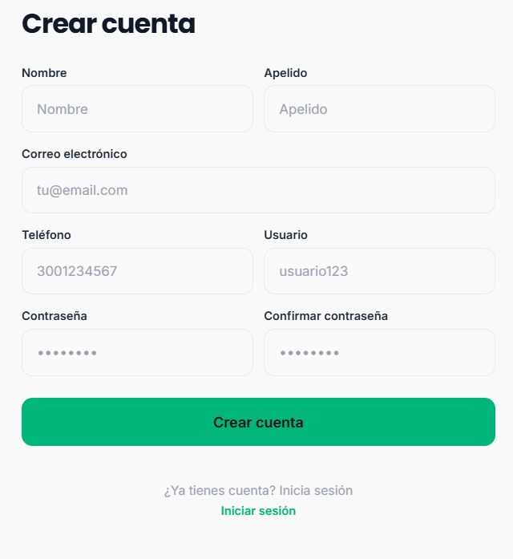

## 5.2 Sign-in

Table 4. Sign-in

| Module name | Sign-in |
| --- | --- |
| Description | Allows the user to sign in to the system with their credentials to access the reservation, payment and account management features. |
| Role allowed to use it | Customer. (The administrator also signs in through this screen, but the system directs them to their own panel, described in the Administrator Manual.) |
| Path or menu | Web: system home screen. Mobile app: first screen when opening the app with no active session. |
| Steps on the web | Open the browser and go to the RentaMovil address (URL). In the Email or username field, type the registered email address or username. In the Password field, type the password. You can use the eye icon to see it. Click Sign in. |
| Steps on the mobile app | Open the RentaMovil application. Type the Email and the Password. Tap Sign in. |
| Screenshot | Figure 3. Sign-in screen (web) / Figure 4. Sign-in screen (web) |
| Expected result | The system validates the credentials. On the web the customer is taken to the Home page; in the mobile app, to the Menu. The session stays open even if the page is reloaded. |
| Observations or restrictions | If any field is empty, Fill in all the fields appears. If the details do not match, Incorrect email or password appears. After several failed attempts the account is locked and the following appears: Your account is locked due to too many failed attempts. Recover your password or contact an administrator. If too many attempts are made in a row, the system asks you to wait a few minutes before trying again. For security, the session expires after a while. In that case Your session has expired. Sign in again appears. The reservation, payment, notifications and account pages can only be opened with an active session; otherwise the system takes the user to the sign-in screen. |

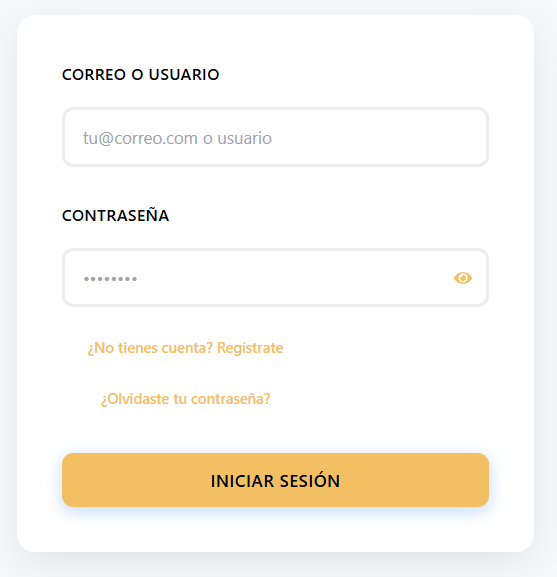

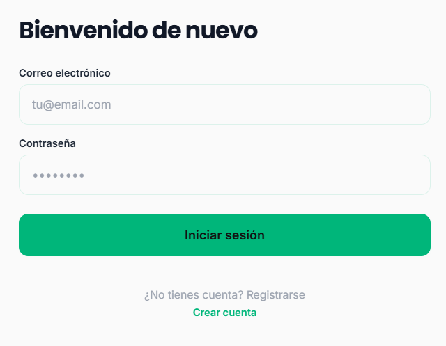

## 5.3 Password recovery

Table 5. Password recovery

| Module name | Password recovery |
| --- | --- |
| Description | Allows resetting the password when the user has forgotten it, through a verification code sent to their email address. |
| Role allowed to use it | Customer (registered user who does not remember their password). |
| Path or menu | Web: sign-in screen > Forgot your password? link |
| Steps on the web | On the sign-in screen, click Forgot your password? In the Enter your email address field, type the account email and click Confirm. Check the email inbox and copy the 6-digit code received. On the Enter the code sent to your email address screen, type the 6 digits (one per box) and click Verify. Type the New password. The requirements list is checked off as they are met. Type the password again in Confirm new password. Click Save changes and then Accept in the Password changed successfully message. |
| Steps on the mobile app | This feature is not available in the mobile app. It must be done from the web version. |
| Screenshot | Figure 5. Email request screen (web) / Figure 6. Code entry screen (web) / Figure 7. New password screen (web) |
| Expected result | The password is updated and the system returns to the sign-in screen, where the user can sign in with the new password. |
| Observations or restrictions | The new password must have at least 8 characters, a special character (#, @, !, $, %, &, *, . or -), an uppercase letter and a number. The Save changes button is only enabled when the password meets all the requirements and matches the confirmation. For security, the system advances to the code screen even if the email is not registered; in that case no code will arrive. The code is validated when the new password is saved. If it is incorrect or has expired, the system shows an error and a new code must be requested. If too many codes are requested in a row, the system asks you to wait before trying again. |

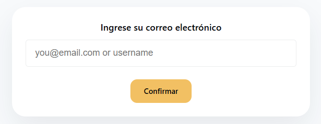

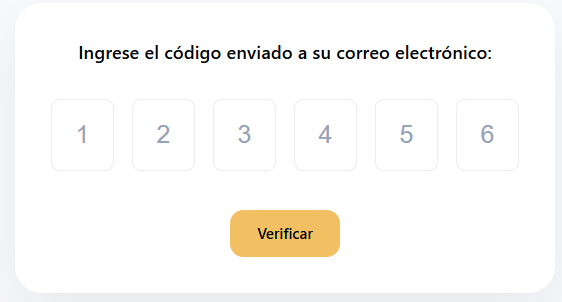

# 6. Description of the main menu

After signing in, the customer accesses the system options from the navigation bar (web) or from the bottom tabs and top icons (mobile app).

## 6.1 Menu in the web version

Table 6. Menu in the web version

| Option | Description |
| --- | --- |
| Home | Home page: search for available vehicles and catalog with filters. |
| Notifications | Notice center for reservations, payments, cancellations and reminders. |
| Reservation | My Reservations page: history, detail, and return branch change. |
| Person icon | Account page: profile, email, password, theme, language and Sign out. |
| Menu icon (☰) | On small screens, it expands the options above. |
| Footer | Links to Home, Notifications and Account, social networks and contact details. |

Figure 8. Web version navigation bar

## 6.2 Menu in the mobile app

Table 7. Menu in the mobile app

| Option | Description |
| --- | --- |
| Home tab | Vehicle search, results and filters. |
| Menu tab | Access to Home, My reservations, Notifications, My account and Sign out. |
| Reservations tab | Reservation history with filters and access to the detail. |
| Bell icon | Notifications. |
| User icon | My account: profile, password change and settings. |

Figure 9. Mobile app tabs and Menu screen

# 7. System modules

Below is a description of each feature available to the customer, in the order in which they are normally used during the rental process.

## 7.1 Search for available vehicles

Table 8. Search for available vehicles

| Module name | Search for available vehicles |
| --- | --- |
| Description | Allows searching for the vehicles available at a branch for a range of dates and times, which corresponds to the rental period. |
| Role allowed to use it | Customer. |
| Path or menu | Web: Home menu (form located above the main banner). Mobile app: Home tab. |
| Steps on the web | Go to the Home page. In Pickup location, type the name, city or address of the branch where the vehicle will be picked up, and select it from the suggestions list. In Pickup date and Pickup time, indicate when the vehicle will be picked up. In Return date and Return time, indicate when the vehicle will be returned. Click Search. |
| Steps on the mobile app | Tap the Home tab. In Branch, type and select the branch from the list (Select a branch). Enter Pickup date, Pickup time, Return date and Return time. Tap Search. |
| Screenshot | Figure 10. Search form on Home (web) / Figure 11. Results: Available Fleet (web) |
| Expected result | The system shows the Available Fleet section with the vehicles from the chosen branch that have no other reservation on those dates. Each card shows the photo, name, status, year, mileage, branch and price per day, along with the Continue button (web) or Rent (mobile app). |
| Observations or restrictions | In RentaMovil, pickup refers to the moment when the branch hands the vehicle over to the customer. The branch must be selected from the list; if it is only typed, Invalid branch appears (web) or Select a valid branch. (mobile app). Pickup and return times must be between 8:00 and 18:00; otherwise Invalid time (8:00 - 18:00) appears. The return date cannot be earlier than the pickup date: The pickup date cannot be earlier than the collection date. Before searching, the page shows the 4 steps for your next trip section and the requirements for renting. Mobile app: if you try to view vehicles without searching, You must perform a search first appears. |

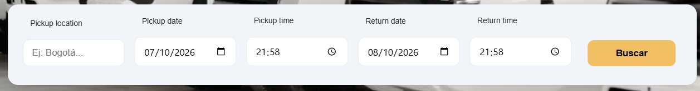

## 7.2 Catalog filters

Table 9. Catalog filters

| Module name | Catalog filters |
| --- | --- |
| Description | Allows reducing the search results by brand, price, model, engine type and vehicle category. |
| Role allowed to use it | Customer. |
| Path or menu | Web: Home page > Available Fleet filter side panel (on small screens, the Filter Fleet button). Mobile app: Home tab > Filter vehicles button. |
| Steps on the web | First perform a vehicle search. In the side panel, expand the desired filter: Brand, Price, Model, Engine type or Category. Select the desired option. For Price, adjust the range with the Minimum and Maximum values and click Apply filters. Review the updated list. To remove the filters, click Clear filters. |
| Steps on the mobile app | First perform a vehicle search. Tap Filter vehicles. In the Filters window, enter the Price range (Minimum and Maximum) and choose Engine type, Brand, Model or Category. Tap Apply. To remove the filters, tap Clear. |
| Screenshot | Figure 12. Catalog filter panel (web) |
| Expected result | The catalog shows only the vehicles that meet all the selected filters. |
| Observations or restrictions | The filters only appear after performing a search. The options for each filter are built from the vehicles found in the search. If no vehicle meets the filters, No vehicles available with those filters appears (web) or No vehicles available for the selected filters. (mobile app). When you select an already-checked option again, that filter is turned off. |

## 7.3 Vehicle reservation

Table 10. Vehicle reservation

| Module name | Vehicle reservation |
| --- | --- |
| Description | Allows configuring the reservation of the chosen vehicle: review its details, confirm or change the pickup and return branches, choose insurance and accept the terms and conditions before paying. |
| Role allowed to use it | Customer. |
| Path or menu | Web: Home > vehicle card > Continue. Mobile app: Home > vehicle card > Rent. |
| Steps on the web | On the chosen vehicle card, click Continue. Review the vehicle information on the top-left card. If you need to change the branch or the dates, modify them in the calendar at the top and click Search; the system returns to Home with the new search. In Change the pickup branch, verify the Pickup branch. To return the vehicle at another location, select it on the map; it will appear as Pickup branch. If none is chosen, Same pickup branch is used. In Summary, review the number of days, the price per day and the total. In Insurance, select the desired coverage. Its value is added to the total. Tick the I have read and accept the terms and conditions box. To read them, click View full document and, when finished, Accept and continue. Click Rent. |
| Steps on the mobile app | On the chosen vehicle card, tap Rent. On the Your reservation screen, review the vehicle and the dates. In the PICKUP block, tap Change if you want a different branch or date; the app returns to Home to search again. In the RETURN block, tap Change and choose the branch where you will return the vehicle. In Insurance, select the desired coverage (optional). Tap Continue and wait for the Creating reservation... message. |
| Screenshot | Figure 13. Reservation screen with branch map and summary (web) / Figure 14. Terms and conditions window (web) / Figure 15. Terms and conditions window (web) |
| Expected result | Web: the system saves the reservation details and takes the user to the Payment screen. Mobile app: the reservation is created in Pending payment status and the payment screen opens. |
| Observations or restrictions | Web: the Rent button stays disabled until the terms and conditions are accepted. If you try to continue without accepting them, You must accept the terms and conditions before continuing to payment appears. If the dates are missing, You must select dates appears. The total is calculated as: number of days × price per day + value of the selected insurance. Insurance is optional. If none is chosen, the reservation includes no additional coverage. The acceptance of the terms stores the version and date of the accepted document. |

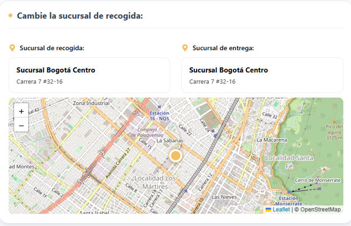

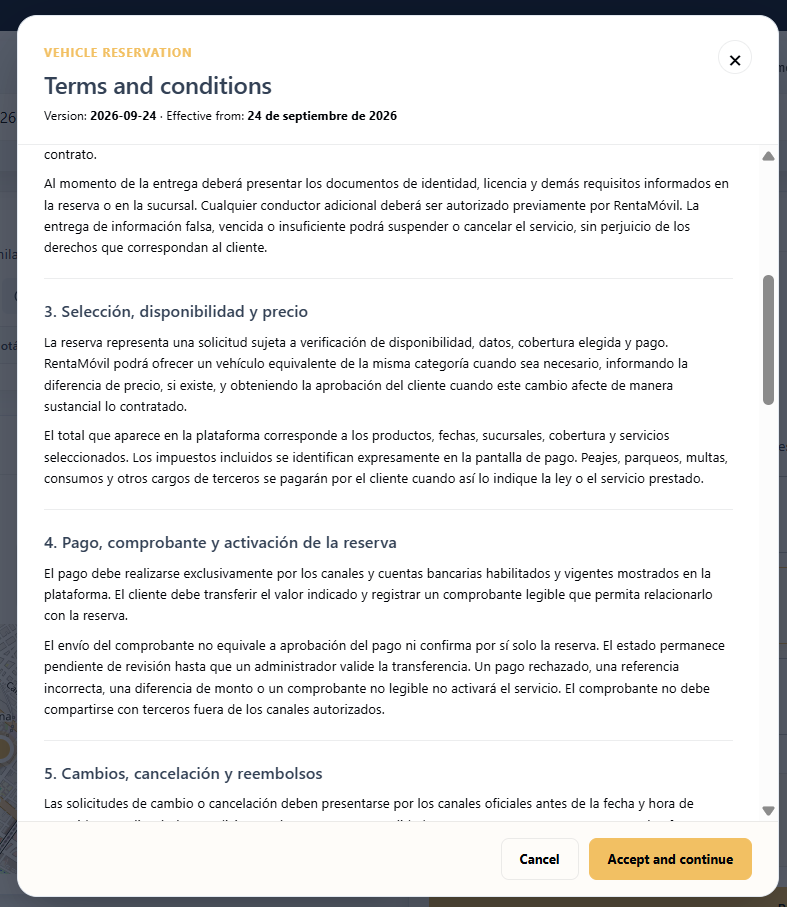

## 7.4 Reservation payment

Table 11. Reservation payment

| Module name | Reservation payment |
| --- | --- |
| Description | Allows paying for the reservation by bank transfer to one of the RentaMovil accounts and registering the receipt so that an administrator validates the payment. |
| Role allowed to use it | Customer. |
| Path or menu | Web: it opens automatically when clicking Rent on the reservation screen. Mobile app: it opens when tapping Continue on Your reservation. |
| Steps on the web | Review the Vehicle details section and the Invoice summary (rental, insurance and total). In Select your destination bank account, click Select bank account and choose the account you will transfer to. The holder, NIT, account number (with a Copy button) and the QR code are shown. From your banking app, transfer the exact amount shown in TOTAL TO TRANSFER, or scan the QR code. In Record transfer, type the Reference number shown on the bank receipt. In Payment receipt, click Select your receipt or drag the file into the box. Check the preview; to change it, click Delete and attach another one. Click Reserve and send receipt and wait for the Processing your payment... message. |
| Steps on the mobile app | Review the Invoice summary: Rental, Insurance (or No insurance) and Total to pay. In Payment account, select the destination account. You can tap Copy number to copy the account number. From your banking app, transfer the exact amount of the total. In Payment receipt, tap Attach image to choose a screenshot from the gallery, or Take photo to photograph the receipt. If the app asks for camera permission, accept it. Use Change or Remove to replace the image. Tap Record payment and wait for the Sending... message. |
| Screenshot | Figure 16. Bank account selection and QR code (web) / Figure 17. Transfer record and receipt (web) / Figure 18. Payment sent message (web) |
| Expected result | Web: the Payment sent! message appears, indicating that the reservation is pending review; the Back to home button takes you to the home page. Mobile app: the Payment registered notice appears and the Payment under review screen is shown. When an administrator validates the transfer, the reservation moves to Confirmed and the user receives a notification. |
| Observations or restrictions | The transferred amount must match the reservation total exactly. Partial payments are not accepted. The receipt must be in PNG, JPG, JPEG or PDF format and weigh at most 10 MB. Web: the Reserve and send receipt button is enabled only once the account has been selected, the reference number typed and the receipt attached. Mobile app: the reference number is not requested; the Record payment button is enabled once you select the account and attach the receipt. The payment is not approved automatically: it always stays under review until an administrator validates it. Only the bank accounts that RentaMovil has active are shown. |

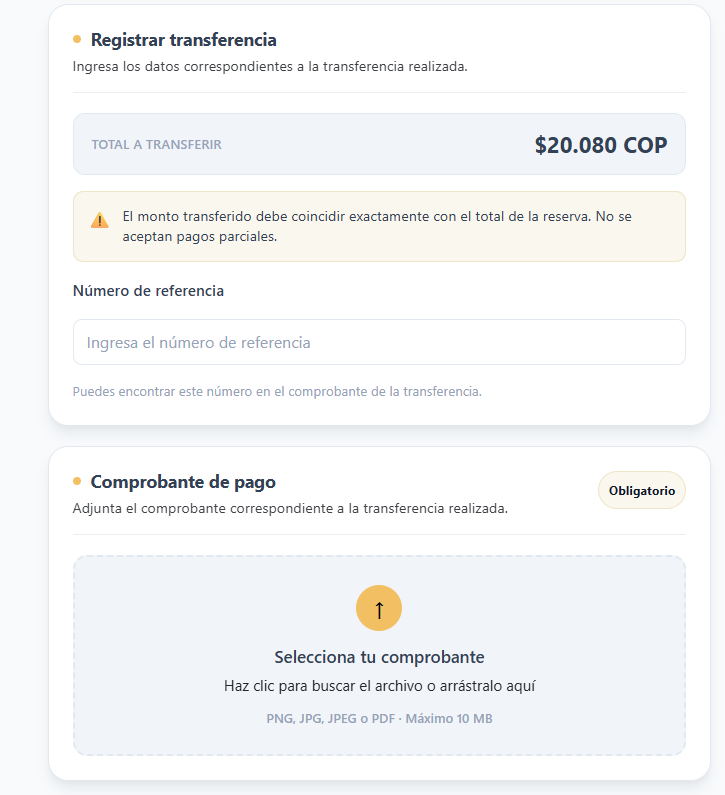

## 7.5 Reserve and pay later

Table 12. Reserve and pay later

| Module name | Reserve and pay later |
| --- | --- |
| Description | Allows creating the reservation without attaching the receipt at that moment, in order to make the payment later within the established period. |
| Role allowed to use it | Customer. |
| Path or menu | Web: Payment screen > Reserve and pay later button. |
| Steps on the web | Complete the reservation setup and reach the Payment screen. Review the Invoice summary. Click Reserve and pay later. |
| Steps on the mobile app | In the mobile app the reservation is created when tapping Continue on Your reservation, before the payment screen. If the user leaves without registering the payment, the reservation stays in Pending payment status. |
| Screenshot | Figure 19. Invoice summary and payment options (web) |
| Expected result | The reservation is created in pending payment status and the system takes the user to My Reservations, where it appears as active. |
| Observations or restrictions | The user has 24 hours to make the payment. After that period, the reservation is cancelled automatically. The vehicle is held only while the reservation is in force. |

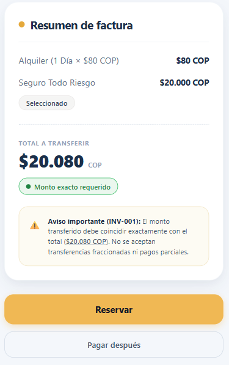

## 7.6 Querying my reservations

Table 13. Querying my reservations

| Module name | Querying my reservations |
| --- | --- |
| Description | Allows querying the reservations made by the user, their status and the billing detail of each one. |
| Role allowed to use it | Customer. |
| Path or menu | Web: Reservation menu > My Reservations page. Mobile app: Reservations tab or Menu > My reservations. |
| Steps on the web | Click Reservation in the navigation bar. Review the reservation cards. Each one shows the code (#), creation date, status, vehicle (photo, plate, category, transmission and passengers), the PICKUP and RETURN dates, the duration, the BILLED AMOUNT and whether it includes coverage. To see the breakdown, click See Details. In the Billing detail window, review the reservation code, the pickup branch, the return branch, the rental value, the insurance and the total. Click Understood and close to exit the detail. |
| Steps on the mobile app | Tap the Reservations tab. In My reservations, use the All, Active, Completed or Cancelled filters to locate the reservation. Tap a reservation to open its Detail. Review the status, the Vehicle, the Trip information (pickup, return and dates) and the Total to pay. |
| Screenshot | Figure 20. My Reservations page (web) / Figure 21. Billing detail window (web) |
| Expected result | The system shows the user's reservation history with its current status and allows querying the detail of each one. |
| Observations or restrictions | Only the reservations of the account you signed in with are shown. If there are no reservations, No reservations match these filters appears. On the web the statuses are shown as active (pending payment, under review or confirmed), cancelled or completed. In the mobile app they are shown as Pending payment, Payment under review, Confirmed, Completed or Cancelled. |

## 7.7 Changing the return branch

Table 14. Changing the return branch

| Module name | Changing the return branch |
| --- | --- |
| Description | Allows changing the branch where the vehicle will be returned on an already created reservation. |
| Role allowed to use it | Customer. |
| Path or menu | Web: Reservation > My Reservations > See Details > Modify branch. |
| Steps on the web | Go to My Reservas and click See Details on the desired reservation. Next to Return branch, click Modify branch. Select the new return branch. Click Save. To discard the change, click Cancel. |
| Steps on the mobile app | In the mobile app the return branch can only be chosen when creating the reservation (RETURN block > Change). To change it later, use the web version. |
| Screenshot | Figure 22. Editing the return branch in the detail (web) |
| Expected result | The new return branch is registered and shown in the reservation detail. |
| Observations or restrictions | It can only be changed on active reservations and up to 3 days before the return date. When 3 days or fewer remain, the system shows You can no longer modify: 3 days or fewer remain before the return. If an error occurs, It was not possible to update the return branch appears. |

## 7.8 Cancellation policy and return date

Table 15. Cancellation policy and return date

| Module name | Cancellation policy and return date |
| --- | --- |
| Description | Explains the rules in force: once the reservation is created, the customer cannot cancel it or change the return date. |
| Role allowed to use it | Customer. |
| Path or menu | Not applicable: neither the web nor the mobile app shows a Cancel reservation option. |
| Steps on the web | Before paying, check the dates, the vehicle and the return branch carefully. By reserving you accept the Terms and Conditions. If you only need to change the return branch, use the function described in section 7.7. |
| Steps on the mobile app | The same as on the web. |
| Screenshot | Not applicable. |
| Expected result | The reservation keeps the dates you chose. If you choose Reserve and pay later and do not pay within 24 hours, the reservation is cancelled automatically. |
| Observations or restrictions | The return date is fixed and cannot be extended or modified from the application. The full conditions are in the Terms and Conditions. For exceptional cases, contact RentaMovil. |

## 7.9 Notifications

Table 16. Notifications

| Module name | Notifications |
| --- | --- |
| Description | Allows querying the notices the system sends to the user about their reservations, payments, cancellations and reminders. |
| Role allowed to use it | Customer. |
| Path or menu | Web: Notifications menu. Mobile app: bell icon at the top or Menu > Notifications. |
| Steps on the web | Click Notifications in the navigation bar. In the left column, choose a filter: All (shows the number of unread notifications), Confirmed Reservations, Payments, Cancellations or Reminders. In the Received list, review the message and date of each notification. Unread ones appear highlighted. Click a notification to open Notification details (message, date, status and vehicle). Click Close. |
| Steps on the mobile app | Tap the bell icon or, in the Menu, the Notifications option. Choose one of the top filters: All, Confirmed Reservations, Payments, Cancellations or Reminders. Tap a notification to see its detail and then tap Close. |
| Screenshot | Figure 23. Notification center (web) / Figure 24. Notification detail (web) |
| Expected result | The system shows the notifications for the chosen filter. When you open a notification, it is marked as read. |
| Observations or restrictions | If there are no notifications for the chosen filter, No notifications for this filter appears. The Status field in the detail can be Active, Payment confirmed, Cancelled or Pending, depending on the notice type. |

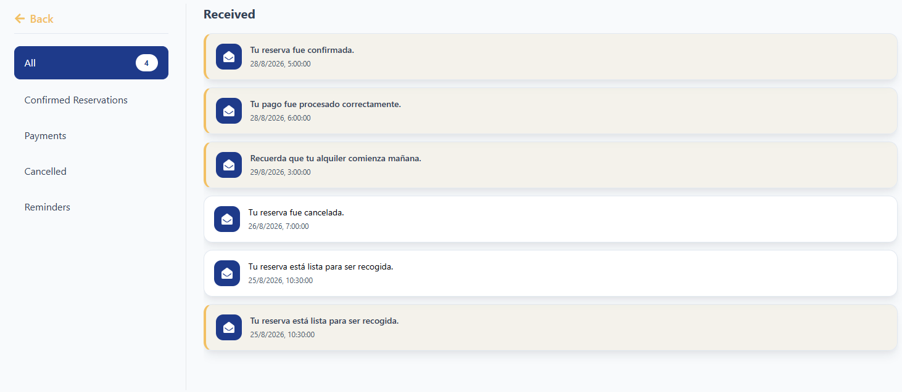

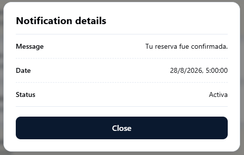

## 7.10 My account (profile)

Table 17. My account (profile)

| Module name | My account (profile) |
| --- | --- |
| Description | Allows querying and updating the user's personal information: first name, last name, phone and profile photo. |
| Role allowed to use it | Customer. |
| Path or menu | Web: person icon in the navigation bar > account page. Mobile app: user icon at the top or Menu > My account. |
| Steps on the web | Click the person icon in the navigation bar. Review the details: First name, Last name, Phone, Username, Email and Password (hidden). To edit, click the pencil icon (Edit profile). The editable fields are enabled. Modify First name, Last name or Phone. To change the photo, click Change photo and select an image. Click Save changes. To exit without saving, click the X (Cancel). |
| Steps on the mobile app | Tap the user icon or, in the Menu, the My account option. Review the Personal information section: First name, Phone and Email. Tap Edit to enable the fields, modify the details and tap Save. To change the photo, tap Change photo and choose an image from the gallery. |
| Screenshot | Figure 25. My account page in view mode (web) / Figure 26. My account page in edit mode (web) |
| Expected result | Web: the details are updated and the Profile updated message appears. |
| Observations or restrictions | The Username cannot be modified. The email address is not edited in this form; it is changed with the Change email option. First name and last name cannot be left empty. The phone can be cleared. The profile photo must be a JPG, PNG, WEBP or GIF image of at most 10 MB. If no data is modified, saving simply exits edit mode. Mobile app: in the current version, changes to name, phone and photo are not saved on the server. To update the data permanently, use the web version. |

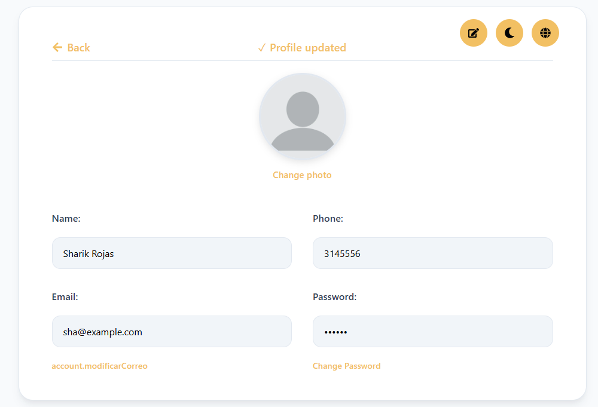

## 7.11 Email address change

Table 18. Email address change

| Module name | Email address change |
| --- | --- |
| Description | Allows replacing the email address associated with the account, confirming identity with the current password. |
| Role allowed to use it | Customer. |
| Path or menu | Web: account page > Change email button. |
| Steps on the web | Go to the account page. Next to the Email field, click Change email. In the Change email address window, verify the Current email. Type the New email address. Type the Current password. Click Confirm change. To exit without changes, click Cancel. |
| Steps on the mobile app | This feature is not available in the mobile app. It must be done from the web version. |
| Screenshot | Figure 27. Change email address window (web) |
| Expected result | The account email is updated and the Email updated message appears. From that moment on, the new email must be used to sign in. |
| Observations or restrictions | The new email must have a valid format, be different from the current one and not be registered by another user. If any data is missing, Write the new email. or Write your current password appears. If the password is incorrect or the email already exists, The email could not be updated. Check the details and try again appears. |

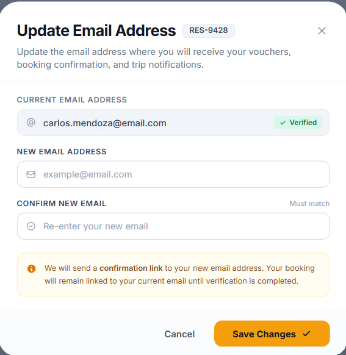

## 7.12 Password change

Table 19. Password change

| Module name | Password change |
| --- | --- |
| Description | Allows the signed-in user to update their password in order to keep the account secure. |
| Role allowed to use it | Customer. |
| Path or menu | Web: account page > Change password link. Mobile app: My account > Change password. |
| Steps on the web | Go to the account page and click Change password. Type the Current password. Type the New password and check that all the requirements in the list are marked. Type the password again in Confirm new password. Click Save changes. In the Password changed successfully message, click Accept. |
| Steps on the mobile app | In My account, tap Change password. Type the Current password, the New password and Confirm new password. Tap Update password. To exit without changes, tap Cancel. |
| Screenshot | Figure 28. Password change form (web) |
| Expected result | The password is updated. On the web, for security, all open sessions are closed and the system returns to the sign-in screen. In the mobile app the Password updated notice appears. |
| Observations or restrictions | Web: the new password must have at least 8 characters, a special character, an uppercase letter and a number. The Save changes button is enabled only when all requirements are met. Mobile app: the new password must have at least 6 characters and be different from the current one. The new password and its confirmation must match; otherwise The passwords do not match appears. If the current password is incorrect, the change is not made (Incorrect current password). |

## 7.13 Theme and language preferences

Table 20. Theme and language preferences

| Module name | Theme and language preferences |
| --- | --- |
| Description | Allows customizing the appearance of the interface (light or dark colours) and the language in which the texts are shown. |
| Role allowed to use it | Customer. |
| Path or menu | Web: account page > moon icon (Select a theme) and globe icon (Select a language). Mobile app: My account > Settings. |
| Steps on the web | Go to the account page. To change the theme, click the moon icon and choose Light mode, Neutral light mode, Neutral dark mode or Blue dark mode. To change the language, click the globe icon and choose Español, English, Français or Português. |
| Steps on the mobile app | In My account, tap Settings to expand the options. In Theme, choose Light green, Dark, Night or Light blue. In the language selector, choose Español, English, Français or Português. |
| Screenshot | Figure 29. Theme and language windows (web) |
| Expected result | The interface changes immediately to the selected theme or language, and the preference is kept on the device for subsequent visits. |
| Observations or restrictions | The preference is saved in the browser or phone used; on another device it must be configured again. |

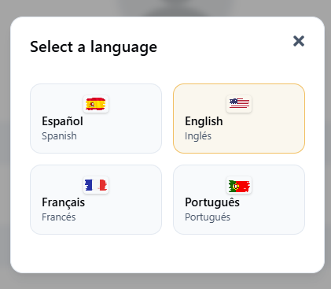

# 8. Messages and validations

The following table gathers the most frequent messages shown by the system, their meaning and the action the user must take.

Table 21. Messages and validations

| System message | Meaning | User action |
| --- | --- | --- |
| Fill in all the fields | A required field was left empty in registration or sign-in. | Fill in the empty fields. |
| Enter a valid email | The email does not have a valid format. | Type an email in the name@domain.com format. |
| Invalid phone (10 digits) | The phone has characters or a number of digits that are not allowed. | Type numbers only (10 digits in the mobile app). |
| The password must have at least 8 characters / an uppercase letter and a number | The password does not meet the security policy. | Type a password that meets the requirements. |
| The passwords do not match | The password and its confirmation are different. | Type the same password in both fields. |
| Incorrect email or password | The credentials do not match a registered account. | Check the details or use Forgot your password? |
| Your account is locked due to too many failed attempts... | The number of allowed sign-in attempts was exceeded. | Recover the password or contact an administrator. |
| Too many attempts. Wait ... and try again. | Many requests were made in a row. | Wait the indicated time and try again. |
| The service is not available at this moment. Try again later. | The server is temporarily not responding. | Try again later. |
| Your session has expired. Sign in again. | The maximum session time has elapsed. | Sign in again. |
| Invalid branch | The typed branch was not selected from the suggestions list. | Type and choose a branch from the list. |
| Invalid time (8:00 - 18:00) | The time is outside the opening hours. | Choose a time between 8:00 and 18:00. |
| The pickup date cannot be earlier than the collection date | The return date is earlier than the pickup date. | Correct the dates. |
| Search performed | The vehicle search ran successfully. | Review the results in Available Fleet. |
| No vehicles available with those filters | No vehicle meets the search or the filters. | Change the dates, the branch or clear the filters. |
| You must select dates | The rental dates were not entered. | Select pickup and return dates. |
| You must accept the terms and conditions before continuing to payment. | The acceptance box was not ticked. | Read and accept the terms and conditions. |
| You must select a destination bank account. | The account you transferred to was not chosen. | Select the bank account. |
| You must enter the transfer reference number. | The payment reference is missing. | Copy the reference from the bank receipt. |
| You must attach the payment receipt. | The receipt was not uploaded. | Attach the receipt image or PDF. |
| The receipt must be in PNG, JPG, JPEG or PDF format. | The file has a format that is not allowed. | Attach the receipt in a valid format. |
| The receipt cannot exceed 10 MB. | The file is too heavy. | Reduce the size or take a new screenshot. |
| Payment sent! / Payment registered | The receipt was registered and the reservation is pending review. | Wait for the confirmation notification. |
| You can no longer modify: 3 days or fewer remain before the return. | The deadline to change the return branch has passed. | Contact RentaMovil if the change is essential. |
| Profile updated | The profile changes were saved. | Continue. |
| Email updated | The account email was changed. | Use the new email to sign in. |
| Password changed successfully | The password was updated. | Sign in with the new password. |
| No notifications for this filter. | There are no notices of that type. | Choose another filter. |

# 9. Sign out

To sign out safely, especially on shared computers, the user must sign out when finished.

### On the web

1. Click the person icon in the navigation bar to open the account page.
2. Click the Sign out icon (door with arrow), located at the top right of the profile card.
3. Verify that the system shows the sign-in screen.

### In the mobile app

1. Tap the Menu tab.
2. Tap Sign out.
3. Verify that the app shows the Sign in screen.
Expected result: the session is closed and, in order to use the system again, you must sign in again.

Observation: when the password is changed from the web, the system automatically closes all open sessions for the account.

# 10. Frequently asked questions

Table 22. Frequently asked questions

| Question | Answer |
| --- | --- |
| Do I need an account to use RentaMovil? | Yes. To search for vehicles, reserve, pay and check notifications you must register and sign in. |
| What do I do if I forget my password? | On the web sign-in screen, click Forgot your password?, type your email and enter the 6-digit code you will receive in order to create a new password. |
| My account got locked, what do I do? | Reset the password with the Forgot your password? option or contact a RentaMovil administrator. |
| Why don't any vehicles appear in the search? | There may be no free vehicles at that branch and on those dates, or the filters may be too restrictive. Try other dates, another branch, or click Clear filters. |
| Can I return the vehicle at a different branch? | Yes. When reserving, select the return branch on the map (web) or with Change in RETURN (mobile app). On the web you can also change it afterwards from My Reservations, up to 3 days before the return. |
| Is insurance mandatory? | No. Insurance is optional; if you select it, its value is added to the reservation total. |
| How do I pay for my reservation? | By bank transfer to one of the RentaMovil accounts shown on the payment screen (also via QR code). Then attach the receipt. |
| Can I pay with a credit card or PSE? | No. The system only accepts payments by bank transfer, which an administrator then reviews. |
| Can I pay part now and the rest later? | No. The transferred amount must be exactly the reservation total. |
| When does my reservation get confirmed? | When an administrator validates the transfer receipt. You will receive a notification and the reservation will appear as confirmed. |
| What happens if I choose Reserve and pay later? | The reservation stays pending payment for 24 hours. If it is not paid within that period, it is cancelled automatically. |
| Can I cancel a reservation or change the return date? | No. Once created, the reservation cannot be cancelled by the customer and the return date is fixed; only the return branch can be changed. A reservation pending payment is cancelled automatically after 24 hours. |
| Can I change my username? | No. The username is set at registration and cannot be modified. You can change your first name, last name, phone, photo, email and password. |
| Which documents do I need to bring to pick up the vehicle? | A valid driving licence, the original identity document and the reservation invoice. |

# 11. Glossary

Table 23. Glossary

| Term | Definition |
| --- | --- |
| Customer | Registered user who searches, reserves and pays for vehicle rentals. |
| Administrator | RentaMovil user who manages the fleet, validates payments and administers the system. Their functions are described in the Administrator Manual. |
| Branch | RentaMovil location where the vehicle is handed over (picked up) or returned. |
| Pickup | Moment when the branch hands the vehicle over to the customer at the start of the rental. |
| Return | Moment when the customer returns the vehicle to the branch at the end of the rental. |
| Reservation | Vehicle rental request for a given period and specific branches. |
| Available fleet | Set of vehicles free for the searched branch and dates. |
| Insurance / coverage | Optional additional protection that is added to the rental value. |
| Terms and conditions | Document with the rental rules that the customer must accept before paying. |
| Bank transfer | The system's only payment method: the customer sends the money from their bank to a RentaMovil account. |
| Reference number | Code given by the bank when making the transfer that identifies the payment. |
| Payment receipt | Image or PDF that proves the transfer was made. |
| QR code | Image that is scanned with the banking app to make the transfer without typing the account number. |
| Pending payment | Status of a created reservation that has no registered receipt yet. |
| Payment under review | Status of a reservation whose receipt is awaiting validation by an administrator. |
| Confirmed | Status of a reservation whose payment was approved. |
| Notification | System notice about reservations, payments, cancellations or reminders. |
| Session | Period during which the user stays authenticated in the system. |
| Theme | Colour combination of the interface (light or dark). |

# 12. Annexes

## Annex A. General usage flow

The table summarizes the customer's complete journey within RentaMovil.

Table 24. General usage flow

| Step | User action | System response |
| --- | --- | --- |
| 1 | They register or sign in. | It shows the Home page (web) or the Menu (mobile app). |
| 2 | They search for vehicles by branch, dates and times. | It shows the Available Fleet for that period. |
| 3 | They apply filters (optional). | It updates the catalog according to the filters. |
| 4 | They choose a vehicle (Continue or Rent). | It opens the reservation screen. |
| 5 | They confirm branches, choose insurance and accept the terms. | It calculates the total and enables the step to payment. |
| 6 | They transfer the total amount and attach the receipt. | It records the payment as under review. |
| 7 | They wait for validation. | The administrator approves the payment; the reservation becomes Confirmed and a notification is sent. |
| 8 | They query the reservation or modify the return branch (optional). | It shows the history and applies the allowed changes. |
| 9 | They pick up the vehicle at the branch with their documents. | The rental begins. |
| 10 | They return the vehicle at the agreed branch. | The reservation becomes Completed. |

## Annex B. Reservation statuses

Table 25. Reservation statuses

| Status | Meaning | How it is shown in My Reservations (web) |
| --- | --- | --- |
| Pending payment | The reservation was created but has no receipt. It has 24 hours to be paid. | active |
| Payment under review | The customer registered the receipt; an administrator must validate it. | active |
| Confirmed | The payment was approved; the vehicle is reserved. | active |
| Completed | The rental ended and the vehicle was returned. | completed |
| Cancelled | The reservation was cancelled, for example when the payment deadline expired. | cancelled |

## Annex C. Requirements to pick up the vehicle

Table 26. Requirements to pick up the vehicle

| Requirement | Description |
| --- | --- |
| Driving licence | Valid and current for the type of vehicle reserved. |
| Identity document | Original document of the reservation holder. |
| Invoice / confirmed reservation | It is presented at the branch together with the licence in order to receive the keys. |

## Annex D. Screenshots

The screenshots are inserted in the Screenshot field of each module, replacing the text in square brackets. One screenshot per important action is recommended, taken from the final version of the system, with good resolution and without real personal data.

