RentaMovil

Plataforma de alquiler de vehículos

MANUAL DE ADMINISTRADOR

Integrantes

Nicole Dayana Ramirez

Thiago Fabian Rojas

David Santiago Erez

Número de ficha: 3145556

Programa: Tecnólogo en Análisis y Desarrollo de Software

Instructora: Karol Daniela Correa

Centro de formación: SENA

Fecha: Octubre de 2026

Versión: 2.0

Control de versiones

Tabla 1. Control de versiones del manual

| Versión | Fecha | Descripción del cambio | Responsable |
| --- | --- | --- | --- |
| 1.0 | 09/07/2026 | Creación inicial: inicio de sesión, panel principal, vehículos, mantenimiento, notificaciones y ajustes de cuenta. | Equipo de desarrollo |
| 2.0 | 06/10/2026 | Actualización para coincidir con la versión actual del sistema: gestión de usuarios y roles, roles y permisos, sucursales, tipos de seguro, cuentas bancarias, reservas (validación de pagos, recogida y devolución), ubicación de la flota, historial de rutas, informes, copias de seguridad, auditoría y recomendaciones de seguridad. | Equipo de desarrollo |

Tabla de contenido

- 1. Introducción
- 2. Objetivo
- 3. Alcance
- 4. Perfil del administrador
- 5. Acceso al panel de administración
    - 5.1 Barra de navegación del administrador
    - 5.2 Opciones del Panel de Administración
    - 5.3 Cierre de sesión
- 6. Gestión de usuarios
    - 6.1 Consulta de usuarios
    - 6.2 Cambio de rol de un usuario
    - 6.3 Desactivación de una cuenta
    - 6.4 Desbloqueo de una cuenta
- 7. Gestión de roles y permisos
    - 7.1 Roles del sistema
    - 7.2 Acceso por módulo
- 8. Configuración del sistema
    - 8.1 Gestión de sucursales
    - 8.2 Gestión de tipos de seguro
    - 8.3 Gestión de cuentas bancarias
- 9. Gestión de la información principal
    - 9.1 Registro de vehículos
    - 9.2 Inventario de vehículos
    - 9.3 Registro de mantenimiento
    - 9.4 Gestión del mantenimiento
    - 9.5 Consulta de reservas
    - 9.6 Validación del pago de la reserva
    - 9.7 Recogida y devolución de vehículos
    - 9.8 Ubicación de la flota
    - 9.9 Historial de rutas
    - 9.10 Consulta de disponibilidad de vehículos
    - 9.11 Notificaciones
    - 9.12 Cuenta del administrador
- 10. Informes administrativos
    - 10.1 Indicadores por módulo
    - 10.2 Exportación de reservas e impresión de registros
- 11. Copias de seguridad
- 12. Restauración de la información
- 13. Auditoría o historial de acciones
- 14. Recomendaciones de seguridad
- 15. Mensajes y validaciones
- 16. Glosario
- 17. Anexos
    - Anexo A. Flujo de una reserva desde el lado de la administración
    - Anexo B. Estados de las reservas
    - Anexo C. Estados del mantenimiento
    - Anexo D. Estados de los vehículos
 

# 1. Introducción

Este Manual de Administrador orienta a las personas que tienen el rol de Administrador o Super Admin en la gestión, configuración y supervisión de RentaMovil, la plataforma de alquiler de vehículos de la empresa.

Describe cómo acceder al Panel de Administración y cómo usar cada módulo administrativo: usuarios y roles, sucursales, tipos de seguro, cuentas bancarias, vehículos, mantenimiento, reservas (validación de pagos, recogida y devolución), ubicación de la flota, informes y la cuenta del administrador. Cada funcionalidad se presenta con su descripción, el rol autorizado a usarla, la ruta, los pasos, el resultado esperado y las restricciones aplicables.

# 2. Objetivo

Orientar al administrador en la gestión, configuración y supervisión de RentaMovil, para que pueda mantener actualizadas la flota, los catálogos y las reservas, validar los pagos de los clientes y controlar el acceso de los usuarios, garantizando un uso seguro y organizado de la plataforma.

# 3. Alcance

Este manual cubre las funcionalidades disponibles en la versión web para los roles Administrador y Super Admin:

• Acceso al Panel de Administración.
• Gestión de usuarios, roles y permisos.
• Configuración del sistema: sucursales, tipos de seguro y cuentas bancarias.
• Gestión de la información principal: vehículos, mantenimiento, reservas, pagos, recogidas, devoluciones y ubicación de la flota.
• Informes, indicadores y exportación de información.
• Copias de seguridad, restauración, auditoría y recomendaciones de seguridad.
No cubre el uso del sistema como cliente (búsqueda, reserva, pago y gestión de la cuenta del cliente), que se describe en el Manual de Usuario, ni la instalación, la configuración técnica, la base de datos o el código, que corresponden al Manual de Instalación y al Manual Técnico. La aplicación móvil está pensada para los clientes y no tiene funcionalidades administrativas.

# 4. Perfil del administrador

El administrador es la persona responsable de la operación diaria de RentaMovil. Mantiene actualizados los datos de la flota y los catálogos, valida los pagos de las reservas, registra la recogida y la devolución de los vehículos y supervisa la ubicación de los vehículos durante los alquileres. El Super Admin también controla quién accede al sistema y con qué permisos, y administra las cuentas bancarias de recaudo.

### Responsabilidades

• Registrar vehículos y mantener su estado actualizado.
• Programar y hacer seguimiento del mantenimiento.
• Revisar los comprobantes de pago y aprobarlos o rechazarlos a tiempo.
• Registrar el kilometraje y el dispositivo GPS al entregar un vehículo, y el kilometraje al recibirlo de vuelta.
• Supervisar la ubicación de los vehículos en alquiler.
• Mantener actualizados los catálogos de sucursales, seguros y cuentas bancarias.
• Administrar las cuentas de usuario y sus roles (Super Admin).
• Proteger la información de los clientes y las credenciales de acceso.

### Permisos

Los permisos de cada rol se detallan en la sección 7. Roles y permisos.

# 5. Acceso al panel de administración

Tabla 2. Inicio de sesión en el panel de administración

| Nombre del módulo | Inicio de sesión en el panel de administración |
| --- | --- |
| Descripción | Permite al administrador iniciar sesión en RentaMovil con su cuenta y acceder al panel desde el que administra la flota, las reservas y la configuración del sistema. |
| Rol autorizado a usarla | Administrador y Super Admin. |
| Ruta o menú | Pantalla de inicio del sistema (inicio de sesión). |
| Pasos para usarlo | Abra el navegador y vaya a la dirección de RentaMovil (URL). Ingrese el Correo o usuario y la Contraseña de la cuenta de administrador. Pulse Iniciar sesión. Verifique que el sistema muestre la página de inicio de la administración, con la opción Administración en la barra superior. Pulse Administración para desplegar el Panel de Administración y elija el módulo deseado. |
| Captura | Figura 1. Pantalla de inicio de sesión / Figura 2. Barra de navegación del administrador / Figura 3. Panel de Administración desplegado |
| Resultado esperado | El sistema reconoce el rol de la cuenta y lleva al administrador a su página de inicio. Desde el Panel de Administración puede abrir todos los módulos habilitados para su rol. |
| Observaciones o restricciones | No hay una lista pública de administradores. Una cuenta se convierte en administradora cuando un Super Admin le asigna ese rol en Usuarios y roles. Si un cliente intenta abrir una página de administración, el sistema lo devuelve a su página de inicio. Los mensajes de error de inicio de sesión (credenciales incorrectas, cuenta bloqueada, demasiados intentos) son los mismos descritos en el Manual de Usuario. La sección Superadministración del panel solo aparece para cuentas con permiso para administrar usuarios o cuentas bancarias. |

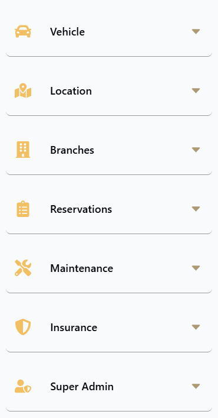

## 5.1 Barra de navegación del administrador

Tabla 3. Barra de navegación del administrador

| Opción | Descripción |
| --- | --- |
| Home | Consulta de disponibilidad de vehículos por sucursal y fechas. |
| Notificaciones | Centro de avisos de la cuenta. |
| Reserva | Las reservas de la cuenta que inició sesión. |
| Administración | Despliega el Panel de Administración con todos los módulos. |
| Ícono de persona | Cuenta del administrador: perfil, correo, contraseña, tema, idioma y Cerrar sesión. |

## 5.2 Opciones del Panel de Administración

Tabla 4. Opciones del Panel de Administración

| Sección | Opción | Descripción |
| --- | --- | --- |
| Vehículo | Agregar vehículo | Registro de vehículos nuevos. |
| Vehículo | Inventario de vehículos | Consulta de la flota con indicadores y filtros. |
| Ubicación | Ubicación de la flota | Mapa con la posición GPS de los vehículos en alquiler. |
| Ubicación | Historial de rutas | Alquileres activos que se deben monitorear y estado de la señal. |
| Sucursales | Administrar sucursales | Creación, edición y eliminación de sedes. |
| Reservas | Todas las reservas | Supervisión de reservas, validación de pagos, recogida y devolución. |
| Mantenimiento | Registrar mantenimiento | Programación de mantenimientos. |
| Mantenimiento | Historial de mantenimiento | Gestión de los mantenimientos registrados. |
| Seguros | Tipos de seguro | Catálogo de coberturas y tarifas. |
| Superadministración | Usuarios y roles | Gestión de cuentas y roles (requiere permiso). |
| Superadministración | Cuentas bancarias | Cuentas de recaudo y códigos QR (requiere permiso). |

## 5.3 Cierre de sesión

1. Pulse el ícono de persona en la barra superior.
2. Pulse el ícono de Cerrar sesión.
3. Verifique que el sistema muestre la pantalla de inicio de sesión.
Cierre siempre la sesión cuando termine, especialmente en computadores compartidos.

# 6. Gestión de usuarios

La gestión de usuarios se realiza en el módulo Usuarios y roles, disponible para cuentas con permiso para asignar roles (por defecto, el Super Admin). Desde allí puede consultar cuentas, cambiar su rol y controlar su estado.

## 6.1 Consulta de usuarios

Tabla 5. Consulta de usuarios

| Nombre del módulo | Consulta de usuarios |
| --- | --- |
| Descripción | Permite consultar todas las cuentas registradas en el sistema, con su rol, estado y fecha de registro, y localizar una cuenta concreta. |
| Rol autorizado a usarla | Usuarios con el permiso correspondiente (por defecto, el rol Super Admin). |
| Ruta o menú | Administración > Superadministración > Usuarios y roles. |
| Pasos para usarlo | Abra Usuarios y roles desde el Panel de Administración. Revise los indicadores superiores: Total de usuarios, Administradores y Super Admins, y Cuentas activas (porcentaje). Escriba en Buscar por nombre o correo... para localizar una cuenta. Filtre por rol con las opciones Todos, Clientes, Administradores o Super Admins. Revise en la tabla el Nombre completo, Correo, Rol actual, Estado y las Acciones disponibles. |
| Captura | Figura 4. Página de Usuarios y roles |
| Resultado esperado | La tabla muestra las cuentas que coinciden con la búsqueda y el filtro, junto con el total de resultados (Mostrando N usuarios). |
| Observaciones o restricciones | La cuenta con la que inició sesión aparece marcada con (Usted). Los clientes crean su propia cuenta desde la pantalla de registro; el panel no tiene opción de crear usuarios. Para crear un administrador, la persona se registra y luego un Super Admin cambia su rol. Las contraseñas no se pueden consultar ni cambiar desde este módulo. Si un usuario la olvidó, debe usar ¿Olvidó su contraseña? en la pantalla de inicio de sesión. Si no hay coincidencias, aparece No se encontraron usuarios con esos criterios. |

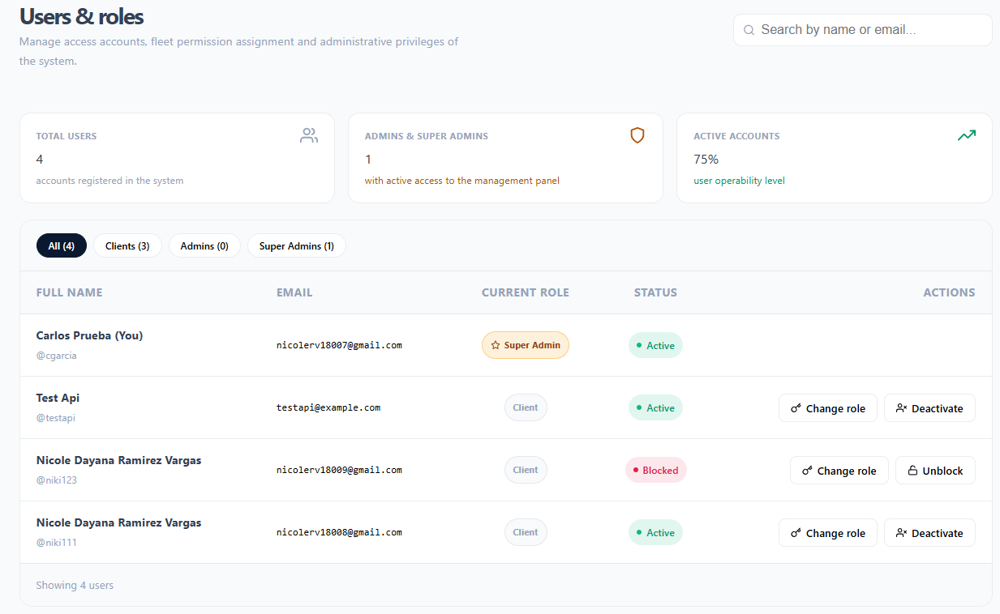

## 6.2 Cambio de rol de un usuario

Tabla 6. Cambio de rol de un usuario

| Nombre del módulo | Cambio de rol de un usuario |
| --- | --- |
| Descripción | Permite asignar a una cuenta el rol de Cliente, Administrador o Super Admin, lo que define a qué módulos puede acceder. |
| Rol autorizado a usarla | Usuarios con el permiso correspondiente (por defecto, el rol Super Admin). |
| Ruta o menú | Usuarios y roles > columna Acciones > Cambiar rol. |
| Pasos para usarlo | Localice la cuenta en Usuarios y roles. Pulse Cambiar rol. En la ventana Modificar rol del usuario, seleccione el nuevo rol en Seleccione el nuevo nivel de rol: (Cliente, Administrador o Super Admin). Cada opción muestra una descripción de su alcance. Si elige Super Admin, lea la Advertencia de seguridad. Pulse Confirmar cambio de rol. Para salir sin cambios, pulse Cancelar. |
| Captura | Figura 5. Ventana Modificar rol del usuario |
| Resultado esperado | El rol de la cuenta se actualiza en la tabla. El usuario verá los módulos del nuevo rol la próxima vez que inicie sesión. |
| Observaciones o restricciones | El rol Super Admin tiene acceso total, incluida la gestión de cuentas bancarias y los privilegios de otros usuarios. Solo debe asignarse a personas de plena confianza. Antes de quitar el rol de administrador a una cuenta, verifique que exista otra cuenta de administrador activa. |

## 6.3 Desactivación de una cuenta

Tabla 7. Desactivación de una cuenta

| Nombre del módulo | Desactivación de una cuenta |
| --- | --- |
| Descripción | Permite impedir que un usuario vuelva a iniciar sesión, por ejemplo cuando ya no pertenece a la empresa o su cuenta no debe seguir usándose. |
| Rol autorizado a usarla | Usuarios con el permiso correspondiente (por defecto, el rol Super Admin). |
| Ruta o menú | Usuarios y roles > columna Acciones > Desactivar. |
| Pasos para usarlo | Localice la cuenta (estado Activo) en Usuarios y roles. Pulse Desactivar. En la ventana ¿Desactivar la cuenta de [nombre]? No podrán iniciar sesión., pulse Desactivar para confirmar. |
| Captura | Figura 6. Confirmación de desactivación |
| Resultado esperado | La cuenta cambia al estado Inactivo y el usuario ya no puede iniciar sesión. |
| Observaciones o restricciones | Una cuenta Inactiva no se puede reactivar desde el panel. Revise la cuenta muy cuidadosamente antes de confirmar. Desactivar no elimina la información de la cuenta ni sus reservas. |

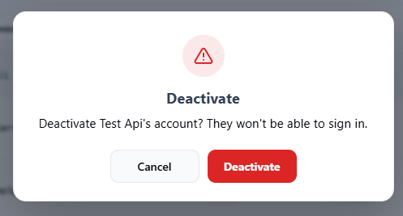

## 6.4 Desbloqueo de una cuenta

Tabla 8. Desbloqueo de una cuenta

| Nombre del módulo | Desbloqueo de una cuenta |
| --- | --- |
| Descripción | Permite restaurar el acceso a una cuenta que el sistema bloqueó por demasiados intentos fallidos de inicio de sesión. |
| Rol autorizado a usarla | Usuarios con el permiso correspondiente (por defecto, el rol Super Admin). |
| Ruta o menú | Usuarios y roles > columna Acciones > Desbloquear. |
| Pasos para usarlo | Filtre o busque la cuenta con estado Bloqueado. Pulse Desbloquear. |
| Captura | Figura 7. Cuenta bloqueada con la acción Desbloquear |
| Resultado esperado | La cuenta vuelve al estado Activo y el usuario puede iniciar sesión otra vez. |
| Observaciones o restricciones | Antes de desbloquear, confirme con el usuario que los intentos fallidos fueron suyos. Si no recuerda la contraseña, indíquele que use ¿Olvidó su contraseña? La opción Desbloquear solo aparece en cuentas con estado Bloqueado. |

# 7. Gestión de roles y permisos

RentaMovil maneja tres roles. El rol de cada cuenta se asigna en Usuarios y roles (ver 6.2 Cambio de rol de un usuario). Además del rol, algunas funciones requieren un permiso específico que el sistema asigna a la cuenta.

## 7.1 Roles del sistema

Tabla 9. Roles del sistema

| Rol | Permisos principales | Restricciones |
| --- | --- | --- |
| Cliente | Buscar vehículos, hacer reservas, pagar por transferencia, consultar sus reservas y cambiar la sucursal de devolución, recibir notificaciones y administrar su cuenta. | No accede al Panel de Administración. Solo ve sus propias reservas y notificaciones. |
| Administrador | Administrar vehículos, mantenimiento, sucursales y tipos de seguro; revisar reservas y validar pagos; registrar recogidas y devoluciones; consultar la ubicación de la flota e informes. | No administra usuarios, roles ni cuentas bancarias, salvo que se le asignen esos permisos. |
| Super Admin | Todo lo que puede hacer el Administrador, más la gestión de usuarios y roles y la administración de las cuentas bancarias de recaudo. | Debe ser una cuenta individual y segura, asignada a muy pocas personas. |

## 7.2 Acceso por módulo

Tabla 10. Acceso por módulo

| Módulo | Cliente | Administrador | Super Admin |
| --- | --- | --- | --- |
| Home (consulta de disponibilidad) | Sí | Sí | Sí |
| Reservas propias, pago y Mi cuenta | Sí | Sí | Sí |
| Notificaciones | Sí | Sí | Sí |
| Vehículos: registro e inventario | No | Sí | Sí |
| Mantenimiento | No | Sí | Sí |
| Reservas: consulta, validación de pago, recogida y devolución | No | Sí | Sí |
| Ubicación de la flota e historial de rutas | No | Sí | Sí |
| Sucursales | No | Sí | Sí |
| Tipos de seguro | No | Sí | Sí |
| Usuarios y roles (roles:otorgar permiso) | No | Solo con permiso | Sí |
| Cuentas bancarias (permiso bank-accounts:manage) | No | Solo con permiso | Sí |

Si una persona intenta abrir una página para la que no tiene rol ni permiso, el sistema la devuelve a su página de inicio. La protección real de los datos la hace el servidor, que rechaza cualquier operación no autorizada.

# 8. Configuración del sistema

La configuración del sistema corresponde a los catálogos que los clientes usan durante la reserva y el pago. Mantenerlos actualizados garantiza que los clientes vean sucursales, planes de seguro y cuentas de pago correctos.

Tabla 11. Configuración del sistema

| Parámetro | Descripción | Dónde se configura |
| --- | --- | --- |
| Sucursales | Sedes de recogida y devolución, con dirección, teléfono, ubicación en el mapa y horario. | Administrar sucursales |
| Horarios | Hora de apertura y cierre de cada día por sucursal (huso horario COT). | Administrar sucursales |
| Tipos de seguro | Coberturas opcionales y su costo diario. | Tipos de seguro |
| Cuentas bancarias | Cuentas y códigos QR a los que transfieren los clientes. | Cuentas bancarias |
| Tipos de mantenimiento | Lista de sugerencias que se muestra al registrar un mantenimiento. | Catálogo del sistema (equipo técnico) |
| Estados de reserva, vehículo y mantenimiento | Valores fijos definidos por el sistema (ver Anexos). | No configurable |

## 8.1 Gestión de sucursales

Tabla 12. Gestión de sucursales

| Nombre del módulo | Gestión de sucursales |
| --- | --- |
| Descripción | Permite crear, consultar, editar y eliminar las sedes físicas donde los clientes recogen y devuelven los vehículos, con su ubicación en el mapa y sus horarios. |
| Rol autorizado a usarla | Administrador y Super Admin. |
| Ruta o menú | Administración > Sucursales > Administrar sucursales. |
| Pasos para usarlo | Consultar sucursales. Abra Administrar sucursales. Revise los indicadores Sucursales activas y Vehículos asignados. Busque con Buscar por nombre, ciudad o dirección... y revise la tabla: Nombre, Dirección, Ciudad, Teléfono, Horario y Acciones. Crear una sucursal. Pulse Nueva sucursal. Complete Nombre de la sucursal, Ciudad, Teléfono de contacto y Dirección física. En Ubicación en el mapa, pulse en el punto exacto de la sede. En Horario, ingrese la hora de apertura y de cierre de cada día. Marque Cerrado en los días sin servicio. Pulse Guardar sucursal. Editar una sucursal. Pulse el ícono del lápiz de la sucursal (o Ver horario completo). Modifique los datos, la ubicación o el horario en la ventana Editar sucursal. Pulse Guardar sucursal. Eliminar una sucursal. Pulse el ícono de papelera de la sucursal. En la ventana Eliminar sucursal, confirme con Eliminar. |
| Captura | Figura 8. Página de sucursales / Figura 9. Ventana de nueva sucursal con mapa y horario |
| Resultado esperado | La sucursal se crea, actualiza o elimina, y el cambio se refleja en la tabla y en las opciones de sucursal que ven los clientes al buscar y reservar. |
| Observaciones o restricciones | Todos los campos del formulario son obligatorios. El horario se registra en la zona horaria de Colombia (COT, UTC-5). Una sucursal con vehículos asignados no se puede eliminar: No se puede eliminar: tiene vehículos asignados. Reasígnelos primero. La eliminación no se puede deshacer. Si ocurre un error al guardar, aparece No fue posible guardar la sucursal. |

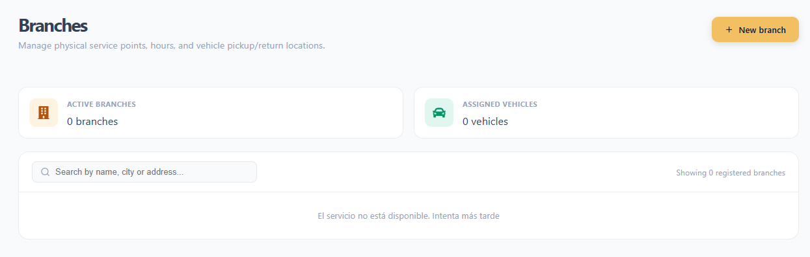

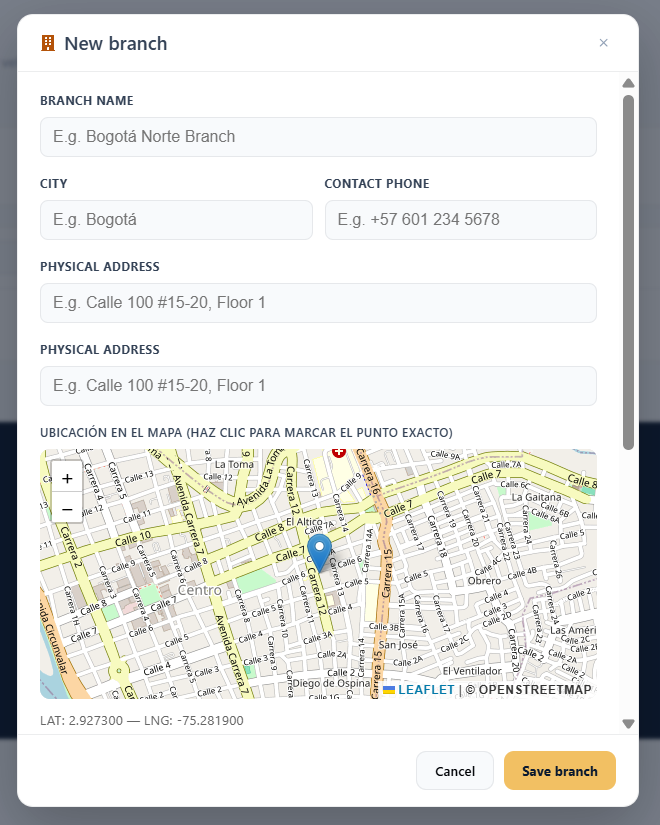

## 8.2 Gestión de tipos de seguro

Tabla 13. Gestión de tipos de seguro

| Nombre del módulo | Gestión de tipos de seguro |
| --- | --- |
| Descripción | Permite configurar las coberturas que los clientes pueden elegir al reservar, con su descripción y su tarifa. |
| Rol autorizado a usarla | Administrador y Super Admin. |
| Ruta o menú | Administración > Seguros > Tipos de seguro. |
| Pasos para usarlo | Consultar seguros. Abra Tipos de seguro. Revise los indicadores Planes disponibles, Tarifa promedio y Recomendado. Revise la tabla: Nombre, Detalle de la cobertura, Costo por día y Acciones. Crear un tipo de seguro. Pulse Nuevo tipo de seguro. Complete Nombre de la cobertura, Detalle de la cobertura (qué incluye y qué excluye) y Costo por día (COP). Pulse Guardar. Editar un tipo de seguro. Pulse el ícono del lápiz del plan de seguro. Modifique los datos en Editar tipo de seguro y pulse Guardar. Eliminar un tipo de seguro. Pulse el ícono de papelera del plan de seguro. En Eliminar tipo de seguro, confirme con Eliminar. |
| Captura | Figura 10. Página de tipos de seguro / Figura 11. Ventana de nuevo tipo de seguro |
| Resultado esperado | El catálogo de seguros se actualiza y los cambios aparecen en la sección Seguro de la pantalla de reserva de los clientes. |
| Observaciones o restricciones | El costo debe ser mayor que 0: El costo debe ser mayor que 0. Cambiar el costo solo afecta las reservas nuevas; las reservas ya creadas mantienen el costo con el que se calcularon. Cuando se elimina un plan de seguro, las reservas ya facturadas mantienen su tarifa. Si ocurre un error al guardar, aparece No fue posible guardar el plan de seguro. |

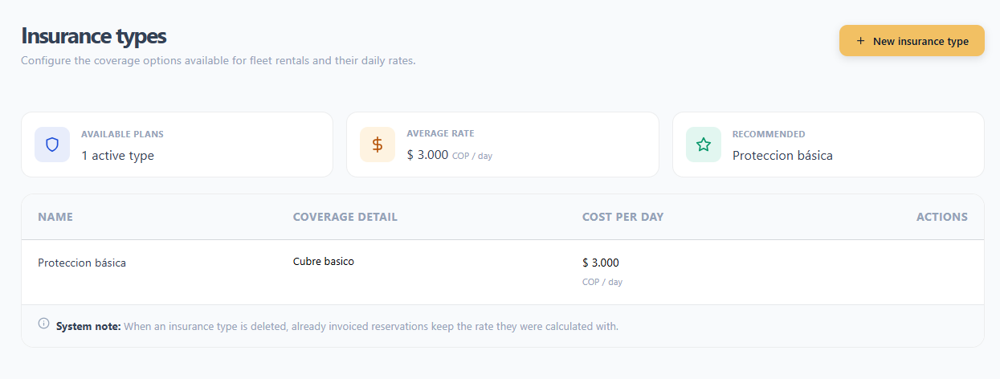

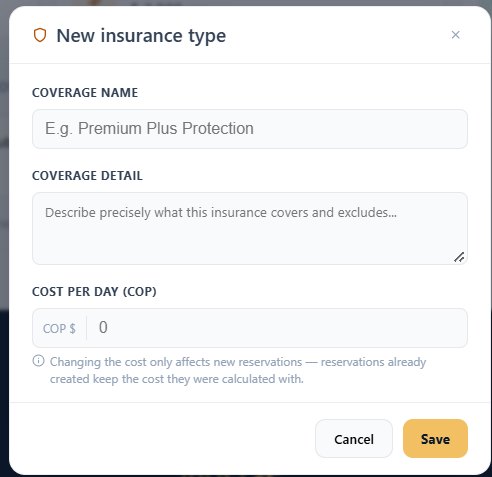

## 8.3 Gestión de cuentas bancarias

Tabla 14. Gestión de cuentas bancarias

| Nombre del módulo | Gestión de cuentas bancarias |
| --- | --- |
| Descripción | Permite administrar las cuentas a las que los clientes transfieren el pago de sus reservas, con el código QR de recaudo de cada una. |
| Rol autorizado a usarla | Usuarios con el permiso correspondiente (por defecto, el rol Super Admin). |
| Ruta o menú | Administración > Superadministración > Cuentas bancarias. |
| Pasos para usarlo | Consultar cuentas. Abra Cuentas bancarias. Revise los indicadores Cuentas registradas, Cuentas activas y Cuentas inactivas. Revise cada cuenta y su estado (Activa o Inactiva). Registrar una cuenta. Pulse Nueva cuenta bancaria. Complete Nombre del banco, Titular de la cuenta y Número de cuenta / Identificador. En Código QR de recaudo, arrastre la imagen del QR o pulse para buscarla. Pulse Guardar cuenta bancaria. Desactivar o activar una cuenta. Use el interruptor de la cuenta. Para desactivarla, confirme en ¿Desactivar esta cuenta? con Desactivar cuenta. Para activarla, simplemente encienda el interruptor. |
| Captura | Figura 12. Página de cuentas bancarias / Figura 13. Ventana de nueva cuenta bancaria |
| Resultado esperado | Las cuentas activas aparecen como opción de pago en la pantalla de pago de los clientes; las inactivas ya no se muestran. |
| Observaciones o restricciones | El código QR es obligatorio: Debe adjuntar el código QR de la cuenta antes de guardar. Formato PNG, JPG o SVG, máximo 2 MB. Las cuentas no se pueden eliminar ni editar, para no romper la trazabilidad de los pagos ya registrados. Si un valor cambia, registre una cuenta nueva y desactive la anterior. Cuando se desactiva una cuenta, los pagos anteriores que la usaron quedan registrados. Mantenga siempre al menos una cuenta activa; sin ella los clientes no pueden pagar. |

# 9. Gestión de la información principal

Esta sección describe las operaciones diarias: la flota, su mantenimiento, las reservas y sus pagos, la recogida y devolución de vehículos, y el seguimiento por GPS.

## 9.1 Registro de vehículos

Tabla 15. Registro de vehículos

| Nombre del módulo | Registro de vehículos |
| --- | --- |
| Descripción | Permite agregar un vehículo nuevo a la flota con sus datos, tarifa diaria, sucursal y fotografía. |
| Rol autorizado a usarla | Administrador y Super Admin. |
| Ruta o menú | Administración > Vehículo > Agregar vehículo (también desde Inventario de vehículos > + Agregar vehículo). |
| Pasos para usarlo | Abra Agregar vehículo. Complete Placa, Marca (puede elegir una sugerencia de la lista), Modelo, Precio (tarifa diaria), Kilometraje, Año y Capacidad. Seleccione el Tipo de vehículo (Automóviles: Sedán, Hatchback, SUV, Camioneta, Pick-up, Van o Coupé; Carga: Camión, Tractocamión o Van). Seleccione el Tipo de combustible y la Sucursal a la que pertenece el vehículo. Arrastre la fotografía dentro del recuadro o pulse para seleccionarla. Para reemplazarla, use Cambiar imagen. Pulse Guardar vehículo y espere a que termine la animación de confirmación. |
| Captura | Figura 14. Formulario de registro de vehículo nuevo |
| Resultado esperado | El vehículo queda registrado, el formulario se limpia para un nuevo registro y la unidad aparece en el Inventario de vehículos y en las búsquedas de los clientes de su sucursal. |
| Observaciones o restricciones | La placa debe seguir el formato de carro, por ejemplo ABC123. Marca y modelo: entre 2 y 30 caracteres, solo letras, números y guiones. Precio entre 0 y 100.000.000; kilometraje entre 0 y 1.000.000; capacidad entre 1 y 100; año entre 1900 y el año siguiente al actual. La fotografía es obligatoria (Esta sección es obligatoria). Debe estar nítida y mostrar el vehículo completo. Cada campo muestra su propio mensaje si falta o es inválido (por ejemplo, La placa es obligatoria). |

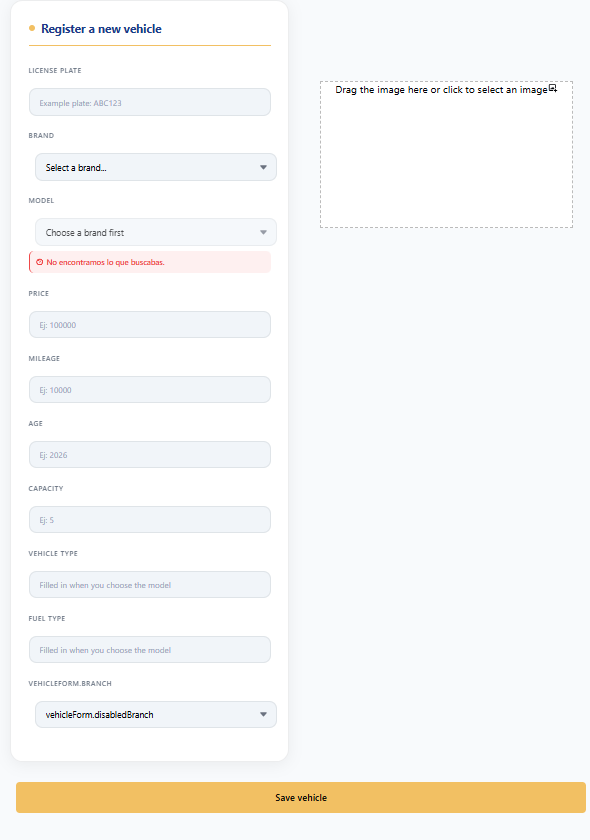

## 9.2 Inventario de vehículos

Tabla 16. Inventario de vehículos

| Nombre del módulo | Inventario de vehículos |
| --- | --- |
| Descripción | Permite consultar toda la flota de forma centralizada, junto con su estado y sucursal, con indicadores, búsqueda y filtros. |
| Rol autorizado a usarla | Administrador y Super Admin. |
| Ruta o menú | Administración > Vehículo > Inventario de vehículos. |
| Pasos para usarlo | Abra Inventario de vehículos. Revise los indicadores Total, Disponibles, En uso y En mantenimiento. Busque con Buscar por placa, marca o modelo... Filtre con los botones Estado, Sucursal, Tipo, Marca y Modelo. Para quitarlos, pulse X Limpiar filtros. Cambie entre la vista de Cuadrícula (tarjetas) y la vista de Tabla usando los íconos de la derecha. |
| Captura | Figura 15. Pantalla de vista de inventario |
| Resultado esperado | El sistema muestra los vehículos que coinciden con la búsqueda y los filtros, con el número de resultados (N vehículos encontrados). |
| Observaciones o restricciones | Los estados manejados son Disponible, En uso y En mantenimiento. El estado cambia según la operación; por ejemplo, cuando se registra un mantenimiento el vehículo pasa a mantenimiento. En la versión actual el inventario es de solo lectura: no tiene opciones para editar ni eliminar vehículos. Si no hay coincidencias, aparece No se encontraron vehículos que coincidan con los filtros. |

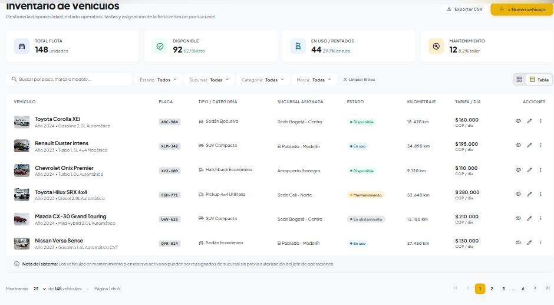

## 9.3 Registro de mantenimiento

Tabla 17. Registro de mantenimiento

| Nombre del módulo | Registro de mantenimiento |
| --- | --- |
| Descripción | Permite programar el mantenimiento preventivo o correctivo de un vehículo de la flota. |
| Rol autorizado a usarla | Administrador y Super Admin. |
| Ruta o menú | Administración > Mantenimiento > Registrar mantenimiento. |
| Pasos para usarlo | Abra Registrar mantenimiento. En el panel Vehículos para mantenimiento, busque por placa, marca o modelo y pulse el vehículo. Placa, Modelo y Marca se llenan automáticamente. Seleccione la Fecha del mantenimiento. Ingrese el Precio (costo del mantenimiento). Escriba o seleccione de la lista el Tipo de mantenimiento (por ejemplo, Cambio de aceite o Inspección de frenos). Opcionalmente, ingrese Observaciones. Pulse Programar mantenimiento y espere el mensaje Programando mantenimiento... |
| Captura | Figura 16. Página Registrar mantenimiento |
| Resultado esperado | El mantenimiento queda registrado, el vehículo pasa al estado En mantenimiento y deja de estar disponible para alquiler. El formulario se limpia para un nuevo registro. |
| Observaciones o restricciones | En el panel solo aparecen vehículos Disponibles o En uso. Si intenta registrar sin elegir un vehículo, aparece Seleccione un vehículo de la lista. La fecha no puede ser anterior a hoy ni más de dos meses a partir de hoy. El tipo de mantenimiento debe tener entre 3 y 60 caracteres (letras, números, guiones y comas). Las observaciones, si se ingresan, entre 5 y 200 caracteres. El botón Historial de mantenimiento lleva a la gestión de mantenimientos. |

## 9.4 Gestión del mantenimiento

Tabla 18. Gestión del mantenimiento

| Nombre del módulo | Gestión del mantenimiento |
| --- | --- |
| Descripción | Permite consultar todos los mantenimientos registrados, ver sus indicadores, actualizar su información y estado, o eliminarlos. |
| Rol autorizado a usarla | Administrador y Super Admin. |
| Ruta o menú | Administración > Mantenimiento > Historial de mantenimiento. |
| Pasos para usarlo | Consultar. Abra Historial de mantenimiento (página de gestión de mantenimiento). Revise las gráficas Estado del mantenimiento y Mantenimiento por mes. Busque por placa, marca o modelo y filtre por estado: Todos, Pendiente, En progreso, Completado o Cancelado. En la tarjeta del mantenimiento, pulse Ver más para abrir el Detalle (modelo, tipo, fecha, ubicación, estado y observaciones). Editar o cambiar el estado. En el detalle, pulse Editar. Modifique Modelo, Tipo de mantenimiento, Fecha, Observaciones o Estado. Pulse Guardar cambios. Para descartar, pulse Cancelar. Eliminar. En el detalle, pulse Eliminar. Confirme con Confirmar (o Cancelar para conservarlo). |
| Captura | Figura 17. Página de gestión de mantenimiento con gráfica |
| Resultado esperado | La información del mantenimiento se actualiza o se elimina el registro, y las gráficas y la lista se recalculan. |
| Observaciones o restricciones | Mantenga el estado actualizado: Pendiente (programado), En progreso, Completado o Cancelado. Al editar, la fecha debe estar entre hoy y dos meses a partir de hoy. Eliminar un mantenimiento no se puede deshacer. Es preferible cambiar el estado a Cancelado si necesita conservar el historial. |

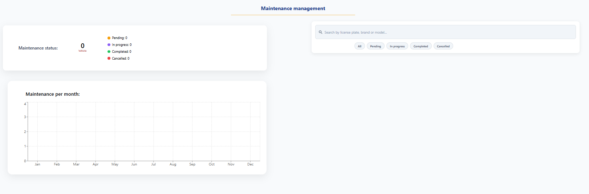

## 9.5 Consulta de reservas

Tabla 19. Consulta de reservas

| Nombre del módulo | Consulta de reservas |
| --- | --- |
| Descripción | Permite supervisar todas las reservas de los clientes, con indicadores, filtros por estado y por fecha, y acceso al detalle de cada una. |
| Rol autorizado a usarla | Administrador y Super Admin. |
| Ruta o menú | Administración > Reservas > Todas las reservas. |
| Pasos para usarlo | Abra Todas las reservas. Revise los indicadores Total de reservas, Por revisar (comprobantes pendientes) y Facturación activa. Filtre por estado con las opciones superiores (Todas, Pendiente de revisión, Pendiente de pago, Confirmada, Completada, Cancelada); cada una muestra su cantidad. Busque con Buscar por ID, cliente o placa... y, si es necesario, limite el periodo con Desde: y Hasta:. Revise la tabla: ID de reserva, Cliente, Vehículo, Fechas (recogida → devolución), Sucursal, Valor total y Estado. Navegue entre páginas con Anterior y Siguiente. Pulse una fila para abrir el detalle de la reserva. |
| Captura | Figura 18. Página de reservas con indicadores y filtros |
| Resultado esperado | El sistema muestra las reservas que coinciden con los filtros (5 por página) y permite abrir el Detalle de la reserva para cualquiera de ellas. |
| Observaciones o restricciones | Las reservas con un alquiler activo se muestran como En progreso. Revise primero el filtro Pendiente de revisión: son pagos que esperan validación. Si no hay coincidencias, aparece Ninguna reserva coincide con estos filtros. con la opción Limpiar filtros. |

## 9.6 Validación del pago de la reserva

Tabla 20. Validación del pago de la reserva

| Nombre del módulo | Validación del pago de la reserva |
| --- | --- |
| Descripción | Permite revisar el comprobante de transferencia cargado por el cliente y aprobar o rechazar el pago. |
| Rol autorizado a usarla | Administrador y Super Admin. |
| Ruta o menú | Todas las reservas > reserva en estado Pendiente de revisión > Detalle de la reserva. |
| Pasos para usarlo | Revisar el pago. Abra el detalle de una reserva en estado Pendiente de revisión. En la parte superior aparece Acción administrativa requerida: Validación del comprobante. En Información del pago, revise Valor transferido, Entidad receptora, Número de referencia y Fecha / hora del comprobante. Pulse Ampliar comprobante para ver la imagen completa. Compare el valor con el Total de la reserva en el Desglose del pago. Aprobar el pago. Si todo coincide, pulse Aprobar pago. Rechazar el pago Pulse Rechazar pago. En Rechazar el pago de la reserva, ingrese el Motivo del rechazo. En Acción posterior, elija Permitir que el cliente vuelva a cargar el comprobante o Cancelar la reserva directamente. Pulse Confirmar rechazo. |
| Captura | Figura 19. Detalle de reserva pendiente de revisión |
| Resultado esperado | Aprobado: la reserva pasa a Confirmada y el cliente recibe una notificación. Rechazado: se registra el motivo y la reserva vuelve a Pendiente de pago o pasa a Cancelada. |
| Observaciones o restricciones | La aprobación se aplica de inmediato, sin diálogo de confirmación. Revise el comprobante antes de pulsar. El motivo del rechazo es obligatorio: Debe ingresar un motivo. El valor transferido debe coincidir exactamente con el total; el sistema no acepta pagos parciales. Si el cliente aún no ha cargado el comprobante, el detalle muestra El cliente aún no ha cargado el comprobante de pago. Si ocurre un error, aparece No fue posible aprobar el pago. o No fue posible rechazar el pago. |

## 9.7 Recogida y devolución de vehículos

Tabla 21. Recogida y devolución de vehículos

| Nombre del módulo | Recogida y devolución de vehículos |
| --- | --- |
| Descripción | Permite registrar en el sistema el momento en que la sucursal entrega el vehículo al cliente (recogida) y el momento en que lo recibe de vuelta (devolución). |
| Rol autorizado a usarla | Administrador y Super Admin. |
| Ruta o menú | Todas las reservas > reserva Confirmada > Detalle de la reserva > sección Operación de sucursal. |
| Pasos para usarlo | Registrar la recogida. Abra el detalle de una reserva Confirmada. En Operación de sucursal, pulse Registrar recogida. En Registrar recogida del vehículo, ingrese el Kilometraje inicial y seleccione el Dispositivo GPS telemático instalado. Pulse Confirmar entrega y llaves. Registrar la devolución. Abra el detalle de la reserva (estado En progreso). Pulse Registrar devolución. Ingrese el Kilometraje final. Pulse Confirmar devolución. |
| Captura | Figura 20. Ventana de registro de recogida y devolución del vehículo |
| Resultado esperado | Recogida: el alquiler comienza, la reserva se muestra como En progreso y el vehículo se puede seguir en el mapa (GPS en línea). Devolución: la reserva pasa a Completada y aparece Vehículo devuelto el [fecha]. |
| Observaciones o restricciones | La operación solo está habilitada cuando la reserva está Confirmada: Se habilita una vez que la reserva está confirmada. Para reservas canceladas, aparece Reserva cancelada: la operación de sucursal no aplica. El kilometraje es obligatorio. Verifíquelo en el tablero del vehículo. Desde el detalle de una reserva con alquiler activo puede abrir Ver seguimiento del vehículo en el mapa. Si ocurre un error, aparece No fue posible registrar la operación. |

## 9.8 Ubicación de la flota

Tabla 22. Ubicación de la flota

| Nombre del módulo | Ubicación de la flota |
| --- | --- |
| Descripción | Permite ver en un mapa la última posición enviada por el GPS de cada vehículo que está en alquiler. |
| Rol autorizado a usarla | Administrador y Super Admin. |
| Ruta o menú | Administración > Ubicación > Ubicación de la flota. |
| Pasos para usarlo | Abra Ubicación de la flota. Revise los indicadores En seguimiento, En movimiento, Detenido y Última señal. En la lista Vehículos, pulse el vehículo que desea monitorear. Cada uno indica si está En movimiento o Detenido, su reserva y su cliente. Revise en el mapa y en Última posición registrada la latitud, longitud, velocidad (km/h), rumbo, encendido y hora del registro. Para actualizar de inmediato, pulse Actualizar. |
| Captura | Figura 21. Mapa de ubicación de la flota |
| Resultado esperado | El mapa muestra la posición de los vehículos en alquiler y se actualiza automáticamente cada 15 segundos. |
| Observaciones o restricciones | Solo aparecen los vehículos con una reserva en progreso y un GPS activo: La ubicación solo está disponible para vehículos con una reserva en progreso y un GPS activo. Si el dispositivo no está conectado, se muestra la posición del último reporte. Si el servicio de ubicación no responde, aparece El servicio de ubicación aún no está disponible. |

## 9.9 Historial de rutas

Tabla 23. Historial de rutas

| Nombre del módulo | Historial de rutas |
| --- | --- |
| Descripción | Permite revisar las reservas con vehículo entregado que deben monitorearse durante el día e identificar las que llevan mucho tiempo sin reportar posición. |
| Rol autorizado a usarla | Administrador y Super Admin. |
| Ruta o menú | Administración > Ubicación > Historial de rutas. |
| Pasos para usarlo | Abra Historial de rutas. Lea el aviso con el número de reservas activas que se deben monitorear y, si aparece, la advertencia sobre vehículos con más de 2 horas sin reportar posición. Revise la lista Reservas activas, con el estado de la señal de cada vehículo: Reportando, Sin señal o Sin reporte GPS. Pulse Ver en el mapa para abrir la ubicación de la flota. Pulse Actualizar cuando necesite la información más reciente. |
| Captura | Figura 22. Página de historial de rutas |
| Resultado esperado | El administrador identifica cuáles alquileres debe vigilar y cuáles no están enviando señal GPS. |
| Observaciones o restricciones | La página se actualiza automáticamente cada pocos segundos. Si no hay alquileres en curso, aparece No hay reservas activas que monitorear. Un vehículo con más de 2 horas sin reportar puede indicar un GPS desconectado; verifique con el cliente o con la sucursal. |

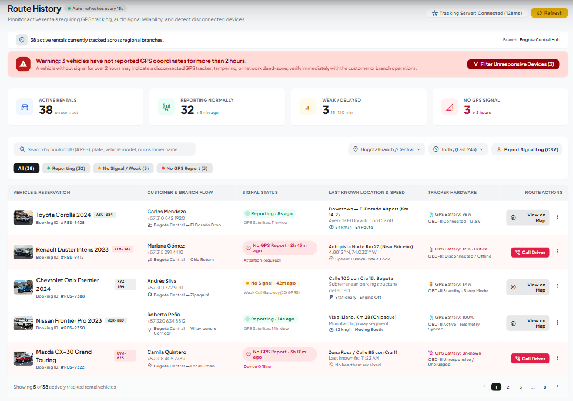

## 9.10 Consulta de disponibilidad de vehículos

Tabla 24. Consulta de disponibilidad de vehículos

| Nombre del módulo | Consulta de disponibilidad de vehículos |
| --- | --- |
| Descripción | Permite al administrador buscar qué vehículos están libres en una sucursal para ciertas fechas, exactamente como lo ve el cliente, por ejemplo para atender una consulta. |
| Rol autorizado a usarla | Administrador y Super Admin. |
| Ruta o menú | Barra superior > Home. |
| Pasos para usarlo | Pulse Home. Seleccione la sucursal en Lugar de recogida e ingrese las fechas y horas de recogida y devolución. Pulse Buscar. Use los filtros de Flota disponible (Marca, Precio, Modelo, Tipo de motor, Categoría) o Limpiar filtros. |
| Captura | Figura 23. Home del administrador con resultados |
| Resultado esperado | El sistema muestra los vehículos disponibles en esa sucursal y ese periodo. |
| Observaciones o restricciones | Las validaciones de sucursal, fecha y hora (8:00 a 18:00) son las mismas que las del Manual de Usuario. El botón Continuar abre el flujo de reserva; una reserva hecha desde aquí queda registrada a nombre de la cuenta que inició sesión. |

## 9.11 Notificaciones

Tabla 25. Notificaciones

| Nombre del módulo | Notificaciones |
| --- | --- |
| Descripción | Permite consultar los avisos del sistema asociados a la cuenta del administrador. |
| Rol autorizado a usarla | Administrador y Super Admin. |
| Ruta o menú | Barra superior > Notificaciones. |
| Pasos para usarlo | Pulse Notificaciones. Elija un filtro: Todas, Reservas confirmadas, Pagos, Cancelaciones o Recordatorios. Pulse una notificación para ver su detalle y luego pulse Cerrar. |
| Captura | Figura 24. Centro de notificaciones |
| Resultado esperado | El sistema muestra las notificaciones del filtro elegido y marca como leída la que se abrió. |
| Observaciones o restricciones | Para saber qué pagos están pendientes de validación, use el indicador Por revisar del módulo Reservas. |

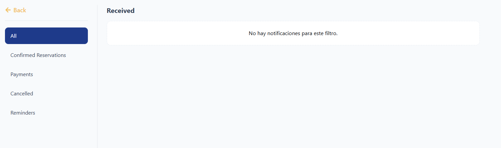

## 9.12 Cuenta del administrador

Tabla 26. Cuenta del administrador

| Nombre del módulo | Cuenta del administrador |
| --- | --- |
| Descripción | Permite al administrador actualizar su perfil, correo y contraseña, cambiar el tema y el idioma, y cerrar la sesión. |
| Rol autorizado a usarla | Administrador y Super Admin. |
| Ruta o menú | Barra superior > ícono de persona. |
| Pasos para usarlo | Pulse el ícono de persona en la barra superior. Para editar el perfil, pulse el lápiz, modifique Nombre, Apellido, Teléfono o la foto y pulse Guardar cambios. Para cambiar el correo, pulse Cambiar correo, escriba el nuevo correo y la contraseña actual y pulse Confirmar cambio. Para cambiar la contraseña, pulse Cambiar contraseña, complete la contraseña actual, la nueva y su confirmación y pulse Guardar cambios. Para cambiar el tema o el idioma, use los íconos de luna y globo. Para cerrar la sesión, pulse el ícono de Cerrar sesión. |
| Captura | Figura 25. Página de cuenta del administrador |
| Resultado esperado | Los cambios se guardan (Perfil actualizado, Correo actualizado o Contraseña cambiada exitosamente). Cuando se cambia la contraseña, se cierran todas las sesiones y debe iniciar sesión otra vez. |
| Observaciones o restricciones | Los pasos y validaciones detallados de estas opciones están en el Manual de Usuario (secciones Mi cuenta, Cambiar correo, Cambiar contraseña y Preferencias). La contraseña debe tener al menos 8 caracteres, un carácter especial, una letra mayúscula y un número. |

# 10. Informes administrativos

RentaMovil presenta sus informes como indicadores y gráficas dentro de cada módulo. Además, la lista de reservas se puede exportar y cada registro de reserva se puede imprimir o guardar como PDF.

## 10.1 Indicadores por módulo

Tabla 27. Indicadores por módulo

| Módulo | Indicadores | Filtros / exportación |
| --- | --- | --- |
| Reservas | Total de reservas, Por revisar (comprobantes pendientes), Facturación activa y cantidad por estado. | Filtros por estado, texto y rango de fechas; botón Exportar (CSV). |
| Mantenimiento | Gráfica de estado del mantenimiento y gráfica de mantenimiento por mes. | Búsqueda y filtro por estado. |
| Inventario de vehículos | Total de vehículos, Disponibles, En uso y En mantenimiento. | Filtros por estado, sucursal, tipo, marca y modelo. |
| Usuarios y roles | Total de usuarios, Administradores y Super Admins, y porcentaje de cuentas activas. | Búsqueda y filtro por rol. |
| Sucursales | Sucursales activas y vehículos asignados. | Búsqueda por nombre, ciudad o dirección. |
| Tipos de seguro | Planes disponibles, tarifa promedio y plan recomendado. | — |
| Cuentas bancarias | Cuentas registradas, activas e inactivas. | — |
| Ubicación de la flota | Vehículos en seguimiento, en movimiento, detenidos y última señal. | Actualización automática cada 15 s. |

## 10.2 Exportación de reservas e impresión de registros

Tabla 28. Exportación de reservas e impresión de registros

| Nombre del módulo | Exportación de reservas e impresión de registros |
| --- | --- |
| Descripción | Permite descargar la lista de reservas como archivo CSV (que se abre en Excel) e imprimir o guardar en PDF el registro completo de una reserva. |
| Rol autorizado a usarla | Administrador y Super Admin. |
| Ruta o menú | Todas las reservas > Exportar; Detalle de la reserva > Imprimir registro. |
| Pasos para usarlo | Exportar la lista. Abra Todas las reservas. Aplique los filtros deseados (estado, búsqueda, Desde: y Hasta:). Pulse Exportar. Abra el archivo descargado con Excel u otra hoja de cálculo. Imprimir el registro de una reserva. Abra el Detalle de la reserva. Pulse Imprimir registro. En el diálogo del navegador, elija la impresora o la opción Guardar como PDF. |
| Captura | Figura 26. Vista de impresión de la reserva |
| Resultado esperado | Obtiene un archivo CSV con las columnas ID, Cliente, Vehículo, Placa, Recogida, Devolución, Sucursal, Total y Estado para las reservas filtradas, o el registro impreso o en PDF de la reserva. |
| Observaciones o restricciones | El archivo exportado contiene datos personales de los clientes. Guárdelo en un lugar seguro y no lo comparta fuera de la empresa. La exportación incluye solo las reservas que coinciden con los filtros aplicados en ese momento. |

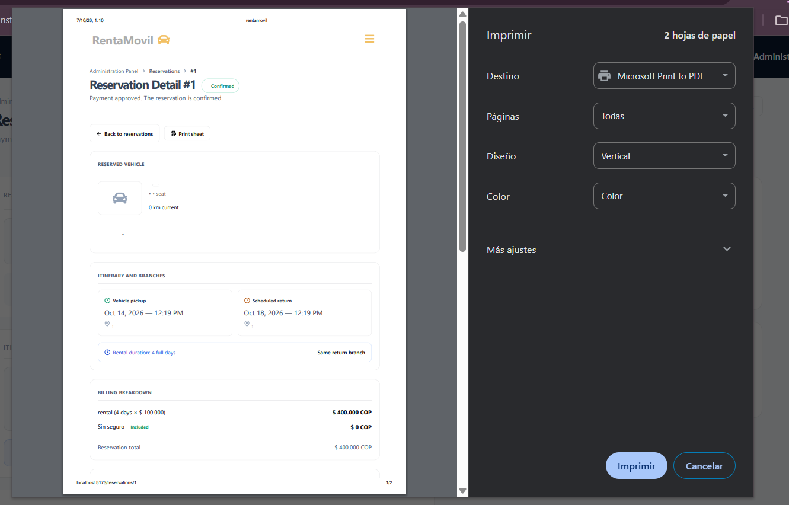

# 11. Copias de seguridad

La versión actual de RentaMovil no tiene una opción de copia de seguridad en el Panel de Administración. Las copias se toman directamente sobre la base de datos y los servidores del sistema, y son responsabilidad del equipo técnico, siguiendo el procedimiento del Manual de Instalación y del Manual Técnico.

Responsabilidades del administrador respecto a las copias de seguridad:

• Solicitar una copia de seguridad al equipo técnico antes de cambios importantes (por ejemplo, cargas masivas de vehículos, cambios de tarifas o actualizaciones del sistema).
• Acordar con el equipo técnico la frecuencia de las copias (se recomienda al menos una diaria).
• Verificar que cada copia se guarde en un lugar seguro, separado del servidor, y con la fecha en el nombre (por ejemplo, backup_rentamovil_2026-10-06).
• Exportar periódicamente la lista de reservas (sección 10.2) como copia de seguridad de consulta.

# 12. Restauración de la información

Restaurar una copia de seguridad tampoco se hace desde el Panel de Administración: el equipo técnico lo realiza sobre la base de datos.

1. Detecte y documente el problema (qué información se perdió o se dañó y desde cuándo).
2. Notifique al equipo técnico e indique la fecha de la última información correcta.
3. Mientras se restaura, evite registrar o modificar información en el sistema.
4. Una vez que el equipo técnico confirme la restauración, verifique en los módulos (inventario, reservas, usuarios) que la información esté completa.
5. Registre manualmente las operaciones realizadas después de la fecha de la copia restaurada, si las hubo.

# 13. Auditoría o historial de acciones

La versión actual no tiene un módulo de auditoría en el Panel de Administración para consultar el historial de acciones de los usuarios. Sin embargo, el sistema conserva la siguiente trazabilidad:

• Cada aprobación o rechazo de pago registra qué administrador lo realizó y, en el rechazo, el motivo.
• Las cuentas bancarias no se eliminan, solo se desactivan, para mantener la relación con los pagos históricos.
• Las cuentas de usuario desactivadas se conservan junto con su información y sus reservas.
• La aceptación de los términos y condiciones de cada reserva guarda la versión y la fecha aceptadas.
• Las reservas conservan el historial de sus estados, los kilometrajes de recogida y devolución y las fechas de operación.
Si necesita verificar quién realizó una acción concreta, solicite la consulta al equipo técnico.

# 14. Recomendaciones de seguridad

• No comparta la contraseña de administrador; cada persona debe tener su propia cuenta.
• Use contraseñas de al menos 8 caracteres con una letra mayúscula, un número y un carácter especial, y cámbielas periódicamente.
• Asigne el rol Super Admin solo a las personas que realmente lo necesitan.
• Desactive de inmediato las cuentas de personas que ya no pertenecen a la empresa.
• Antes de desbloquear una cuenta, confirme con su titular que los intentos fallidos fueron suyos.
• Verifique cada comprobante de pago antes de aprobarlo; la aprobación no pide confirmación.
• Compruebe que las cuentas bancarias activas y sus códigos QR sean correctos; un valor errado desvía los pagos de los clientes.
• Trate la información de los clientes (datos personales, comprobantes, ubicación GPS) y los archivos exportados como confidenciales.
• Solicite una copia de seguridad antes de cambios importantes.
• Cierre la sesión cuando termine, especialmente en computadores compartidos.

# 15. Mensajes y validaciones

Mensajes más frecuentes de los módulos administrativos. Los mensajes de inicio de sesión y de cuenta están en el Manual de Usuario.

Tabla 29. Mensajes y validaciones

| Mensaje del sistema | Significado | Acción del administrador |
| --- | --- | --- |
| La placa es obligatoria / Formato inválido. Carro: ABC123 | La placa falta o no tiene el formato correcto. | Escriba la placa con el formato ABC123. |
| Esta sección es obligatoria | No se adjuntó la fotografía del vehículo. | Adjunte una imagen del vehículo. |
| El precio no debe superar los 100000000 | El valor está fuera del rango permitido. | Corrija el valor. |
| El año debe ser mayor o igual a ... / no debe superar ... | El año está fuera del rango permitido. | Ingrese un año entre 1900 y el año siguiente al actual. |
| Seleccione un vehículo de la lista | Se intentó programar un mantenimiento sin elegir vehículo. | Pulse un vehículo en el panel. |
| La fecha no puede ser anterior a hoy | La fecha del mantenimiento ya pasó. | Elija una fecha desde hoy en adelante. |
| La fecha no puede ser más de dos meses a partir de hoy | La fecha supera el límite de programación. | Elija una fecha dentro de los próximos dos meses. |
| El tipo de mantenimiento es obligatorio | No se especificó un mantenimiento. | Escriba o elija el tipo de mantenimiento. |
| Debe ingresar un motivo | Se rechazó un pago sin indicar motivo. | Ingrese el motivo del rechazo. |
| No fue posible aprobar el pago. / No fue posible rechazar el pago. | El servidor no completó la validación. | Intente de nuevo; si persiste, notifique al equipo técnico. |
| Se habilita una vez que la reserva está confirmada. | No se puede registrar la recogida porque el pago no ha sido aprobado. | Valide primero el pago. |
| No fue posible registrar la operación. | Falló el registro de la recogida o la devolución. | Revise los datos e intente de nuevo. |
| No se puede eliminar: tiene vehículos asignados. Reasígnelos primero. | La sucursal todavía tiene vehículos. | Reasigne los vehículos a otra sucursal. |
| No fue posible guardar la sucursal. | Falló el guardado de la sucursal. | Revise los datos e intente de nuevo. |
| El costo debe ser mayor que 0 | El costo del seguro no es válido. | Ingrese un valor mayor que cero. |
| Debe adjuntar el código QR de la cuenta antes de guardar. | Falta el código QR de la cuenta bancaria. | Adjunte la imagen del QR (máx. 2 MB). |
| ¿Desactivar la cuenta de ...? No podrán iniciar sesión. | Confirmación antes de desactivar un usuario. | Confirme solo si la cuenta no debe tener acceso. |
| ¿Desactivar esta cuenta? | Confirmación antes de desactivar una cuenta bancaria. | Confirme si la cuenta ya no debe recibir pagos. |
| No hay vehículos en alquiler | No hay reservas en curso con un GPS activo. | Ninguna; el mapa se llenará cuando haya alquileres activos. |
| El servicio de ubicación aún no está disponible. | El servicio GPS no respondió. | Intente más tarde o notifique al equipo técnico. |

# 16. Glosario

Tabla 30. Glosario

| Término | Definición |
| --- | --- |
| Administrador | Rol que administra la flota, el mantenimiento, las sucursales, los seguros y las reservas. |
| Super Admin | Rol con control total: además de lo anterior, administra usuarios, roles y cuentas bancarias. |
| Permiso | Autorización específica de una cuenta (por ejemplo, administrar usuarios o cuentas bancarias). |
| Panel de Administración | Menú lateral desde el que se accede a los módulos administrativos. |
| Flota | Conjunto de vehículos registrados en RentaMovil. |
| Inventario | Listado consolidado de la flota con su estado y sucursal. |
| Mantenimiento | Intervención preventiva o correctiva programada para un vehículo. |
| Comprobante de pago | Imagen o PDF de la transferencia que el cliente carga para pagar su reserva. |
| Validación del pago | Revisión del comprobante por parte del administrador para aprobarlo o rechazarlo. |
| Recogida / entrega | Momento en que la sucursal entrega el vehículo y las llaves al cliente. |
| Devolución | Momento en que el cliente devuelve el vehículo a la sucursal. |
| Alquiler en curso | Reserva cuyo vehículo ya fue entregado y todavía no ha sido devuelto. |
| GPS telemático | Dispositivo instalado en el vehículo que reporta su posición. |
| Código QR de recaudo | Imagen que el cliente escanea con su app bancaria para transferir a una cuenta de RentaMovil. |
| Cuenta inactiva | Cuenta de usuario sin acceso al sistema, o cuenta bancaria que ya no se ofrece para pagos. |
| Cuenta bloqueada | Cuenta de usuario bloqueada automáticamente por demasiados intentos fallidos de inicio de sesión. |
| CSV | Archivo de texto con datos separados por comas que se abre en Excel. |
| Copia de seguridad | Copia de la base de datos que permite recuperar la información en caso de una falla. |

# 17. Anexos

## Anexo A. Flujo de una reserva desde el lado de la administración

Tabla 31. Flujo de una reserva desde el lado de la administración

| Paso | Acción | Respuesta del sistema |
| --- | --- | --- |
| 1 | El cliente crea la reserva y carga el comprobante. | La reserva aparece en Pendiente de revisión y aumenta el indicador Por revisar. |
| 2 | El administrador abre el detalle y revisa el comprobante. | Muestra valor, banco, referencia, fecha y la imagen del comprobante. |
| 3 | El administrador aprueba el pago. | La reserva pasa a Confirmada y se notifica al cliente. |
| 4 | El cliente llega a la sucursal; el administrador registra la recogida. | La reserva sigue En progreso y el vehículo aparece en el mapa. |
| 5 | El administrador monitorea el vehículo durante el alquiler. | Ubicación de la flota e Historial de rutas muestran su posición y señal. |
| 6 | El cliente devuelve el vehículo; el administrador registra la devolución. | La reserva pasa a Completada. |

## Anexo B. Estados de las reservas

Tabla 32. Estados de las reservas

| Estado | Significado | Acción del administrador |
| --- | --- | --- |
| Pendiente de pago | Reserva creada; el cliente aún no ha cargado el comprobante (tiene 24 horas). | Espere el comprobante. |
| Pendiente de revisión | El cliente cargó el comprobante. | Valide el pago: apruebe o rechace. |
| Confirmada | Pago aprobado; vehículo reservado. | Registre la recogida cuando el cliente recoja el vehículo. |
| En progreso | Vehículo entregado; alquiler activo. | Monitoree el vehículo en el mapa y registre la devolución. |
| Completada | Vehículo devuelto. | Ninguna. |
| Cancelada | Reserva cancelada por rechazo del pago o por vencimiento del plazo de pago. | Ninguna. |

## Anexo C. Estados del mantenimiento

Tabla 33. Estados del mantenimiento

| Estado | Significado |
| --- | --- |
| Pendiente | Mantenimiento programado que aún no ha comenzado. |
| En progreso | Mantenimiento en curso. |
| Completado | Mantenimiento terminado. |
| Cancelado | Mantenimiento suspendido o anulado. |

## Anexo D. Estados de los vehículos

Tabla 34. Estados de los vehículos

| Estado | Significado |
| --- | --- |
| Disponible | Se puede alquilar y programar para mantenimiento. |
| En uso | Está entregado a un cliente o reservado. |
| En mantenimiento | Tiene un mantenimiento abierto; no se ofrece para alquiler. |

## Anexo E. Estados de las cuentas de usuario

Tabla 35. Estados de las cuentas de usuario

| Estado | Significado | Acción disponible |
| --- | --- | --- |
| Activo | Puede iniciar sesión normalmente. | Desactivar |
| Bloqueado | Bloqueado por demasiados intentos fallidos. | Desbloquear |
| Inactivo | Desactivado por un Super Admin; no puede iniciar sesión. | Ninguna desde el panel |

## Anexo F. Capturas de pantalla

Las capturas se insertan en el campo Captura de cada módulo, reemplazando el texto entre corchetes. Deben tomarse de la versión final del sistema, con buena resolución y sin datos personales reales de clientes.