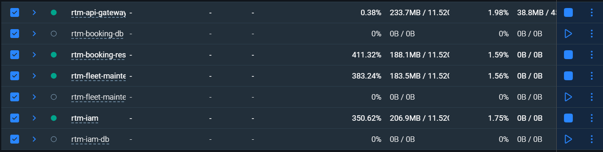
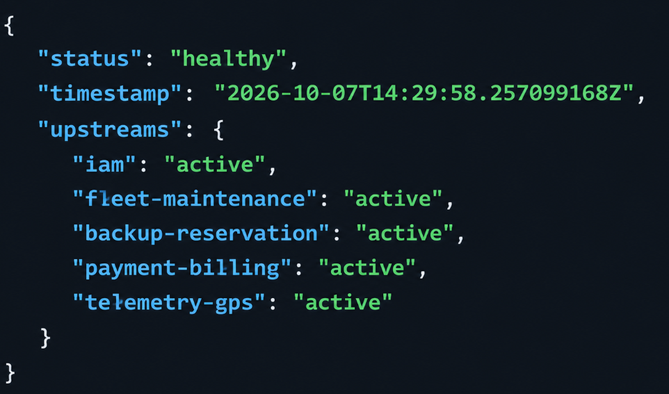
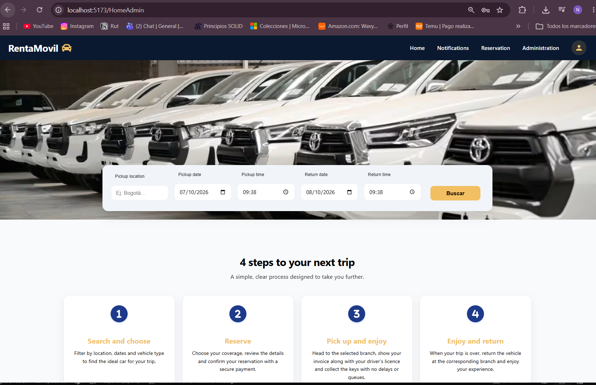
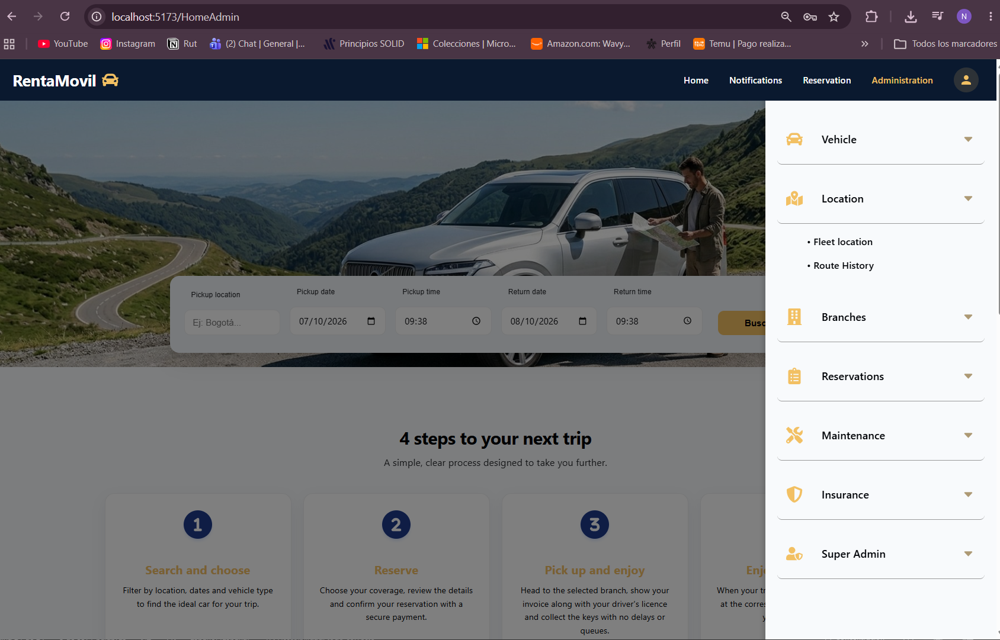

RentaMovil

Plataforma de alquiler de vehículos

MANUAL DE INSTALACIÓN

Integrantes

Nicole Dayana Ramirez

Thiago Fabian Rojas

David Santiago Erez

Número de ficha: 3145556

Programa: Tecnólogo en Análisis y Desarrollo de Software

Instructora: Karol Daniela Correa

Centro de formación: SENA

Fecha: Octubre de 2026

Versión: 2.0

Control de versiones

| Versión | Fecha | Descripción del cambio | Responsable |
| --- | --- | --- | --- |
| 1.0 | 09/07/2026 | Creación inicial del manual de instalación. | Equipo de desarrollo |
| 2.0 | 07/10/2026 | Actualización para coincidir con la arquitectura actual: SQL Server en Docker, migraciones Liquibase por esquema, claves JWT RS256, los microservicios iam, fleet-maintenance y booking-reservation, API Gateway, frontend web con mock de API, aplicación móvil, primer Super Admin, verificación y errores comunes. | Equipo de desarrollo |
| 2.1 | 27/10/2026 | Se incorporan payment-billing y telemetry-gps (esquemas, servicios y orden de migración), se elimina el mock de API y la aplicación móvil pasa a consumir el API Gateway. | Equipo de desarrollo |

Tabla de contenido

- 1. Introducción
    - 1.1 Convenciones
- 2. Objetivo
    - 2.1 Alcance
- 3. Requisitos mínimos de hardware
- 4. Software necesario
- 5. Obtención del proyecto
    - 5.1 Ramas a utilizar
- 6. Instalación de dependencias
- 7. Configuración de variables de entorno
    - 7.1 Contraseñas que deben coincidir
    - 7.2 Repositorios de base de datos
    - 7.3 Claves JWT (RS256)
    - 7.4 Microservicios y gateway
    - 7.5 Frontend web
    - 7.6 Aplicación móvil
- 8. Creación e importación de la base de datos
- 9. Ejecución del backend
    - 9.1 Con Docker
    - 9.2 Con Maven (sin Docker)
- 10. Ejecución del frontend
    - 10.1 Frontend web en modo desarrollo
    - 10.2 Frontend web con Docker
    - 10.3 Aplicación móvil
- 11. Acceso al sistema
- 12. Usuario de prueba
    - 12.1 Cliente de prueba
    - 12.2 Primer Super Admin (una vez por entorno)
- 13. Verificación de la instalación
- 14. Errores comunes y soluciones
- 15. Limitaciones conocidas de la versión instalada
- 16. Glosario
- 17. Referencias
- 18. Anexos
    - Anexo A. Resumen del orden de instalación
    - Anexo B. Comandos de operación
    - Anexo C. Capturas de verificación

# 1. Introducción

Este manual explica cómo preparar una máquina, obtener el código, configurar y arrancar todos los componentes de RentaMovil en un entorno local de desarrollo o pruebas, y cómo verificar que la instalación es correcta.

RentaMovil está compuesto por varios repositorios que se instalan por separado y se comunican a través de una red de Docker llamada rentamovil: una base de datos SQL Server (Microsoft, s. f.), cinco repositorios de migraciones (iam, fleet, telemetry, booking y payment), cinco microservicios Java (iam, fleet-maintenance, booking-reservation, payment-billing y telemetry-gps), un API Gateway, el frontend web y la aplicación móvil. Por eso el orden de instalación importa, y se indica en cada paso.

## 1.1 Convenciones

• Los comandos se muestran en bloques grises y se escriben en una terminal bash. En Windows se recomienda Git Bash (incluye OpenSSL); los comandos de Docker y Maven funcionan igual en PowerShell.
• Las contraseñas y claves se muestran como <valor> o ********: este manual nunca publica credenciales reales. Cada equipo debe definir las suyas.
• Cuando un comando debe ejecutarse dentro de una carpeta, el bloque comienza con el cd correspondiente.

# 2. Objetivo

Permitir que otra persona instale y deje funcionando RentaMovil siguiendo instrucciones claras, completas y verificables, desde una máquina en blanco hasta poder iniciar sesión en la aplicación web con un usuario de prueba y un Super Admin.

## 2.1 Alcance

Cubre la instalación local (máquina de desarrollo o pruebas) con Docker. No cubre el despliegue en un servidor de producción con dominio y HTTPS, ni la publicación de la aplicación móvil en las tiendas: este es un proyecto académico que no cuenta con un servidor ni un dominio de producción propios, por lo que ese despliegue queda fuera del alcance de este manual. El uso del sistema se describe en los manuales de usuario y administrador, y su construcción interna en el manual técnico.

# 3. Requisitos mínimos de hardware

Tabla 1. Requisitos de hardware

| Recurso | Mínimo | Recomendado |
| --- | --- | --- |
| Sistema operativo | Windows 10/11 de 64 bits con WSL 2, Ubuntu 22.04 o macOS 13 | Windows 11 con WSL 2 o Ubuntu 22.04 / 24.04 |
| Procesador | 64 bits, 4 núcleos (x86-64) | 6 núcleos o más |
| Memoria RAM | 8 GB (SQL Server necesita al menos 2 GB para su contenedor) | 16 GB |
| Espacio en disco | 15 GB libres (imágenes de Docker, dependencias de Maven y npm, base de datos) | 25 GB libres en un SSD |
| Red | Internet para descargar imágenes y dependencias | Banda ancha estable |
| Navegador | Un Google Chrome, Microsoft Edge o Mozilla Firefox actualizado | Google Chrome |
| Dispositivo móvil (opcional) | Android 10+ o iOS 16+ con la app Expo Go | En la misma red Wi-Fi que la máquina |

La imagen de SQL Server 2022 es para procesadores x86-64. En máquinas Mac con un procesador Apple Silicon se ejecuta por emulación (Rosetta) y es más lenta.

# 4. Software necesario

Tabla 2. Software necesario

| Herramienta | Versión | Uso | Verificar con |
| --- | --- | --- | --- |
| Git (Git, s. f.) | 2.40 o posterior | Clonar los repositorios. En Windows incluye Git Bash y OpenSSL. | git --version |
| Docker Desktop (Docker Inc., s. f.) (o Docker Engine) | 24.0 o posterior, con Docker Compose 2.20+ | SQL Server, migraciones y los contenedores de los servicios. | docker --version / docker compose version |
| Java JDK (Oracle Corporation, s. f.) | 21 (se recomienda Eclipse Temurin) | Compilar y ejecutar los microservicios fuera de Docker. | java -version |
| Apache Maven (Apache Software Foundation, s. f.) | 3.9 o posterior | Dependencias, pruebas, ejecución y migraciones Liquibase (Liquibase, s. f.). | mvn -version |
| Node.js (OpenJS Foundation, s. f.) + npm | Node 22 LTS y npm 10 o posterior | Frontend web y aplicación móvil. | node -v / npm -v |
| OpenSSL (OpenSSL Software Foundation, s. f.) | Incluido en Git Bash, Linux y macOS | Generar el par de claves JWT RS256. | openssl version |
| Editor de código | Visual Studio Code o IntelliJ IDEA | Editar los archivos .env y revisar el código. | — |
| Cliente de base de datos (opcional) | SQL Server Management Studio o Azure Data Studio | Consultar la base de datos y crear el primer Super Admin. | — |
| Postman (opcional) | Actual | Probar los endpoints. | — |
| Expo Go (Expo, s. f.) (opcional) | Actual, en el teléfono | Ejecutar la aplicación móvil. | — |

Si se va a usar Docker para todo el backend, Java y Maven no son obligatorios: las imágenes compilan el código dentro del contenedor. Son necesarios para ejecutar los servicios y las migraciones directamente en la máquina.

# 5. Obtención del proyecto

Cree una carpeta de trabajo y clone dentro de ella todos los repositorios, uno al lado del otro:

mkdir rentamovil && cd rentamovil

git clone https://github.com/RentaMovil/rtm-iam-db.git

git clone https://github.com/RentaMovil/rtm-fleet-maintenance-db.git

git clone https://github.com/RentaMovil/rtm-booking-db.git

git clone https://github.com/RentaMovil/rtm-iam.git

git clone https://github.com/RentaMovil/rtm-fleet-maintenance.git

git clone https://github.com/RentaMovil/rtm-booking-reservation.git

git clone https://github.com/RentaMovil/rtm-api-gateway.git

git clone https://github.com/RentaMovil/RentaMovil.git

Resultado esperado de carpetas:

rentamovil/

├── rtm-iam-db/ ← SQL Server + esquema iam (se instala primero)

├── rtm-fleet-maintenance-db/ ← esquema fleet

├── rtm-booking-db/ ← esquema booking

├── rtm-iam/ ← servicio de identidad (:3001)

├── rtm-fleet-maintenance/ ← servicio de flota (:3002)

├── rtm-booking-reservation/ ← servicio de reservas (:3003)

├── rtm-api-gateway/ ← punto de entrada (:8080)

└── RentaMovil/ ← web/Front-end y app_mobile/Frontend

## 5.1 Ramas a utilizar

La versión documentada corresponde a las siguientes ramas. Cambie a cada una con git checkout <rama> dentro de su carpeta. Una vez que estos cambios estén fusionados en develop, basta con usar develop en todas partes.

Tabla 3. Rama de cada repositorio

| Repositorio | Rama | Motivo |
| --- | --- | --- |
| rtm-iam-db, rtm-booking-db, rtm-fleet-maintenance-db | develop | Esquemas y datos de referencia actuales (en main, fleet-db está vacío). |
| rtm-iam | feat/ConectBooking | Incluye el claim personId que necesita booking-reservation. |
| rtm-fleet-maintenance | develop | El código del servicio está en develop (main solo tiene el commit inicial). |
| rtm-booking-reservation | develop | Versión integrada con el frontend. |
| rtm-api-gateway | feat/booking-routes | Incluye las rutas de booking-reservation. |
| RentaMovil | develop | Frontend web y aplicación móvil actuales. |

# 6. Instalación de dependencias

Con Docker, las dependencias de los servicios Java se descargan automáticamente cuando se construyen las imágenes (paso 9). Para ejecutar en la máquina sin Docker, o para el frontend, instálelas así:

Tabla 4. Comandos de instalación de dependencias

| Componente | Carpeta | Comando |
| --- | --- | --- |
| Repositorios de base de datos | rtm-*-db | mvn -q dependency:resolve (opcional; Liquibase lo hace al ejecutar) |
| Microservicios y gateway | rtm-iam, rtm-fleet-maintenance, rtm-booking-reservation, rtm-payment-billing, rtm-telemetry-gps, rtm-api-gateway | mvn install -DskipTests |
| Frontend web | RentaMovil/web/Front-end | npm install |
| Aplicación móvil | RentaMovil/app_mobile/Frontend | npm install |

La primera descarga de Maven y npm puede tardar varios minutos; las siguientes usan la caché.

# 7. Configuración de variables de entorno

Cada repositorio incluye archivos de ejemplo (.env.example y, en los repositorios de base de datos, liquibase.properties.example). Se copian una vez y se completan. Los archivos .env y liquibase.properties nunca se suben al repositorio.

## 7.1 Contraseñas que deben coincidir

Defina primero estas contraseñas y úselas de forma consistente. Deben cumplir la política de SQL Server: 8 o más caracteres con mayúscula, minúscula, número y símbolo.

Tabla 5. Contraseñas compartidas entre repositorios

| Contraseña | Dónde se escribe |
| --- | --- |
| Administrador de SQL Server (sa) | MSSQL_SA_PASSWORD en el .env de rtm-iam-db, rtm-fleet-maintenance-db, rtm-telemetry-gps-db, rtm-booking-db y rtm-payment-billing-db; password en cada liquibase.properties. |
| Usuario iam_app | IAM_APP_PASSWORD en rtm-iam-db/.env; parameter.iamAppPassword en rtm-iam-db/liquibase.properties; DATABASE_PASSWORD en rtm-iam/.env. |
| Usuario fleet_app | FLEET_APP_PASSWORD en rtm-fleet-maintenance-db/.env; parameter.fleetAppPassword en su liquibase.properties; DATABASE_PASSWORD en rtm-fleet-maintenance/.env. |
| Usuario booking_app | BOOKING_APP_PASSWORD en rtm-booking-db/.env; parameter.bookingAppPassword en su liquibase.properties; DATABASE_PASSWORD en rtm-booking-reservation/.env. |
| Usuario telemetry_app | TELEMETRY_APP_PASSWORD en rtm-telemetry-gps-db/.env; parameter.telemetryAppPassword en su liquibase.properties; DATABASE_PASSWORD en rtm-telemetry-gps/.env. |
| Usuario payment_app | parameter.paymentAppPassword en rtm-payment-billing-db/liquibase.properties (y la variable de contraseña de su .env.example); DATABASE_PASSWORD en rtm-payment-billing/.env. |
| Clave interna entre servicios | APP_INTERNAL_API_KEY: el MISMO valor en rtm-booking-reservation, rtm-fleet-maintenance, rtm-payment-billing y rtm-telemetry-gps (header X-Internal-Key). |

## 7.2 Repositorios de base de datos

cd rtm-iam-db

cp .env.example .env

cp liquibase.properties.example liquibase.properties

# repetir en rtm-fleet-maintenance-db, rtm-telemetry-gps-db, rtm-booking-db y rtm-payment-billing-db

# rtm-iam-db/.env

MSSQL_SA_PASSWORD=********

MSSQL_PORT=1433

MSSQL_DATABASE=rentamovil

IAM_APP_PASSWORD=********

# rtm-iam-db/liquibase.properties

url=jdbc:sqlserver://localhost:1433;databaseName=rentamovil;encrypt=true;trustServerCertificate=true

username=sa

password=********

parameter.iamAppPassword=********

## 7.3 Claves JWT (RS256)

El servicio iam firma los tokens con una clave privada; los demás los verifican con la clave pública. Genere un par para su entorno desde Git Bash:

openssl genpkey -algorithm RSA -pkeyopt rsa_keygen_bits:2048 -out priv.pem

openssl pkey -in priv.pem -pubout -out pub.pem

sed '/-----/d' priv.pem | tr -d '\r\n' # valor de APP_IAM_JWT_PRIVATE_KEY

sed '/-----/d' pub.pem | tr -d '\r\n' # valor de APP_IAM_JWT_PUBLIC_KEY

rm priv.pem pub.pem # no dejar las claves en el disco

Cada valor se copia en una sola línea, sin las líneas BEGIN/END. La clave pública se usa en rtm-iam (APP_IAM_JWT_PUBLIC_KEY) en rtm-booking-reservation (APP_BOOKING_RESERVATION_JWT_PUBLIC_KEY) y en rtm-telemetry-gps (APP_TELEMETRY_GPS_JWT_PUBLIC_KEY); fleet-maintenance y payment-billing la descargan del endpoint GET /jwks de iam a través de IAM_URL. iam no arranca si faltan las claves, si son menores de 2048 bits o si no forman un par.

## 7.4 Microservicios y gateway

cd rtm-iam && cp .env.example .env

# repetir en rtm-fleet-maintenance, rtm-booking-reservation, rtm-payment-billing, rtm-telemetry-gps y rtm-api-gateway

Tabla 6. Variables principales por servicio

| Archivo | Variables a completar | Valor local |
| --- | --- | --- |
| rtm-iam/.env | DATABASE_URL, DATABASE_USERNAME, DATABASE_PASSWORD, APP_IAM_PORT, APP_IAM_JWT_PRIVATE_KEY, APP_IAM_JWT_PUBLIC_KEY, APP_IAM_JWT_EXPIRY, APP_IAM_REFRESH_TOKEN_EXPIRY, APP_IAM_BCRYPT_ROUNDS | usuario iam_app; puerto 3001; claves del paso 7.3; 1800, 604800 y 12 por defecto. |
| rtm-fleet-maintenance/.env | DATABASE_URL, DATABASE_USERNAME, DATABASE_PASSWORD, APP_FLEET_MAINTENANCE_PORT, IAM_URL, BOOKING_URL, BOOKING_TIMEOUT, RETIRE_RESERVATION_HORIZON_DAYS, APP_INTERNAL_API_KEY | usuario fleet_app; puerto 3002; http://localhost:3001 y http://localhost:3003. |
| rtm-booking-reservation/.env | DATABASE_URL, DATABASE_USERNAME, DATABASE_PASSWORD, APP_BOOKING_RESERVATION_PORT, APP_BOOKING_RESERVATION_JWT_PUBLIC_KEY, IAM_URL, FLEET_URL, TELEMETRY_URL, APP_BOOKING_RESERVATION_PAYMENT_WINDOW_HOURS, APP_INTERNAL_API_KEY | usuario booking_app; puerto 3003; URLs de iam, fleet y telemetry; 24 horas. |
| rtm-payment-billing/.env | DATABASE_URL, DATABASE_USERNAME, DATABASE_PASSWORD, APP_PAYMENT_BILLING_PORT, IAM_URL, BOOKING_URL, APP_PAYMENT_BILLING_FILE_ALLOWED_PREFIX, APP_PAYMENT_BILLING_INVOICE_STORAGE_DIR, APP_INTERNAL_API_KEY | usuario payment_app; puerto 3004; carpeta local de facturas (./invoices-storage). |
| rtm-telemetry-gps/.env | DATABASE_URL, DATABASE_USERNAME, DATABASE_PASSWORD, APP_TELEMETRY_GPS_PORT, APP_TELEMETRY_GPS_JWT_PUBLIC_KEY, APP_TELEMETRY_GPS_DEVICE_API_KEY, BOOKING_URL, APP_INTERNAL_API_KEY | usuario telemetry_app; puerto 3005; clave pública de iam; una clave para los dispositivos GPS de prueba. |
| rtm-api-gateway/.env | GATEWAY_PORT, IAM_URL, FLEET_URL, BOOKING_URL, PAYMENT_URL, TELEMETRY_URL, CORS_ALLOWED_ORIGINS, RATE_LIMIT_* | Puerto 8080; los valores de .env.example sirven para local. |

La URL local de la base de datos es jdbc:sqlserver://localhost:1433;databaseName=rentamovil;encrypt=true;trustServerCertificate=true. Dentro de Docker, cada docker-compose.yml la cambia automáticamente para usar el nombre del contenedor (sqlserver).

## 7.5 Frontend web

El archivo RentaMovil/web/Front-end/.env ya contiene los valores locales y no tiene secretos (todo lo que contiene llega al navegador):

VITE_API_URL=/api # proxy de Vite hacia el gateway (localhost:8080)

VITE_CLOUDINARY_CLOUD_NAME=<nombre del cloud de Cloudinary>

VITE_CLOUDINARY_UPLOAD_PRESET=<preset unsigned de Cloudinary>

## 7.6 Aplicación móvil

cd RentaMovil/app_mobile/Frontend && cp .env.example .env

# EXPO_PUBLIC_API_URL vacía = valor por plataforma; en un teléfono físico: http://<IP-de-la-máquina>:<puerto>

# 8. Creación e importación de la base de datos

La base de datos rentamovil se crea en un contenedor de SQL Server 2022. Las tablas, los datos de referencia (roles, permisos, categorías, marcas, modelos y tipos de mantenimiento) y los usuarios de cada servicio se crean con migraciones Liquibase, en este orden obligatorio: rtm-iam-db → rtm-fleet-maintenance-db → rtm-booking-db.

### 8.1 Crear la red compartida (una vez por máquina)

docker network create rentamovil

### 8.2 SQL Server, base de datos rentamovil y esquema iam

cd rtm-iam-db

docker compose up -d

docker compose ps -a

Debería ver rentamovil-sqlserver en estado Up (healthy), y los contenedores sqlserver-init y migrations en Exited (0): el primero creó la base de datos y el segundo aplicó las migraciones de iam.

### 8.3 Esquema fleet

cd ../rtm-fleet-maintenance-db

docker compose up --build

El contenedor de migraciones termina en Exited (0). Alternativa sin Docker: mvn liquibase:update.

### 8.4 Esquema telemetry

cd ../rtm-telemetry-gps-db

docker compose up --build

Debe correr antes que booking, porque booking.rental.gps_id apunta a telemetry.gps. Alternativa sin Docker: mvn liquibase:update.

### 8.5 Esquema booking

cd ../rtm-booking-db

docker compose up --build

Alternativa sin Docker: mvn liquibase:update.

### 8.6 Esquema payment

cd ../rtm-payment-billing-db

docker compose up --build

Debe correr al final: sus claves foráneas apuntan a booking.reservation e iam.[user]. Alternativa sin Docker: mvn liquibase:update.

### 8.7 Verificar las migraciones

Desde cada repositorio de base de datos:

mvn liquibase:status # debe indicar que no hay changesets pendientes

Cuando se usan parámetros, el plugin de Maven puede imprimir un NoSuchFieldException sobre parameter.*AppPassword. Es inofensivo; lo importante es el BUILD SUCCESS final.

Cada esquema guarda su historial en su propia tabla: dbo.DATABASECHANGELOG_IAM, dbo.DATABASECHANGELOG_FLEET, dbo.DATABASECHANGELOG_TELEMETRY, dbo.DATABASECHANGELOG_BOOKING y dbo.DATABASECHANGELOG_PAYMENT.

# 9. Ejecución del backend

Arranque los servicios en este orden: rtm-iam → rtm-fleet-maintenance → rtm-booking-reservation → rtm-payment-billing → rtm-telemetry-gps → rtm-api-gateway. Puede hacerlo con Docker (recomendado) o directamente con Maven; no use los dos métodos a la vez para el mismo servicio, porque usan el mismo puerto.

## 9.1 Con Docker

cd rtm-iam && docker compose up -d --build

cd ../rtm-fleet-maintenance && docker compose up -d --build

cd ../rtm-booking-reservation && docker compose up -d --build

cd ../rtm-payment-billing && docker compose up -d --build

cd ../rtm-telemetry-gps && docker compose up -d --build

cd ../rtm-api-gateway && docker compose up -d --build

docker ps # rentamovil-iam, -fleet-maintenance, -booking-reservation, -payment-billing, -telemetry-gps, -api-gateway: Up

La primera construcción tarda varios minutos porque descarga las dependencias dentro de la imagen; las siguientes son rápidas.

## 9.2 Con Maven (sin Docker)

Abra una terminal por servicio y, dentro de cada carpeta, ejecute:

mvn spring-boot:run

Tabla 7. Servicios del backend

| Servicio | Puerto | Contenedor | Verificación |
| --- | --- | --- | --- |
| rtm-iam | 3001 | rentamovil-iam | curl http://localhost:3001/health |
| rtm-fleet-maintenance | 3002 | rentamovil-fleet-maintenance | curl http://localhost:3002/health |
| rtm-booking-reservation | 3003 | rentamovil-booking-reservation | curl http://localhost:3003/health |
| rtm-payment-billing | 3004 | rentamovil-payment-billing | curl http://localhost:3004/health |
| rtm-telemetry-gps | 3005 | rentamovil-telemetry-gps | curl http://localhost:3005/health |
| rtm-api-gateway | 8080 | rentamovil-api-gateway | curl http://localhost:8080/health |

Cada servicio responde {"status":"ok","db":"connected",...}. El gateway responde con el estado de cada servicio (ok, degraded o down).

# 10. Ejecución del frontend

## 10.1 Frontend web en modo desarrollo

Abra una terminal en RentaMovil/web/Front-end:

# Aplicación web en el puerto 5173

npm run dev

## 10.2 Frontend web con Docker

Con el backend ya levantado en la red rentamovil:

cd RentaMovil/web/Front-end

docker compose up -d --build # web en http://localhost:4173

## 10.3 Aplicación móvil

cd RentaMovil/app_mobile/Frontend

npx expo start

Escanee el código QR con Expo Go (Android) o con la cámara (iOS), o pulse a para el emulador de Android y w para la versión web.

La aplicación móvil consume el API Gateway: debe estar levantado antes de iniciar sesión. En el emulador o la versión web basta con el valor por defecto (http://localhost:8080); en un teléfono físico defina EXPO_PUBLIC_API_URL con la IP de su máquina (por ejemplo, http://192.168.1.50:8080).

# 11. Acceso al sistema

Tabla 8. Direcciones de acceso

| Componente | Dirección | Nota |
| --- | --- | --- |
| Aplicación web (desarrollo) | http://localhost:5173 | Pantalla de inicio de sesión. |
| Aplicación web (Docker) | http://localhost:4173 | La misma aplicación servida por el contenedor rentamovil-web. |
| API Gateway | http://localhost:8080 | Punto de entrada de la API; /health muestra el estado de los servicios. |
| SQL Server | localhost,1433 | usuario sa con la contraseña definida en el paso 7.1 (solo para administración de la base de datos). |

# 12. Usuario de prueba

Las migraciones deliberadamente no crean usuarios: así no hay contraseñas ni hashes en los repositorios. Los usuarios se crean así:

## 12.1 Cliente de prueba

1. Abra http://localhost:5173 y pulse ¿Ya tienes una cuenta? Regístrate.
2. Registre un usuario de prueba, por ejemplo: Nombre Prueba, Apellido Cliente, usuario test.customer, correo test.customer@rentamovil.test y una contraseña que cumpla la política (8 caracteres, mayúscula y número).
3. Al pulsar Crear cuenta, la sesión se abre con el rol Customer.
También se puede crear mediante la API:

curl -X POST http://localhost:8080/auth/register -H "Content-Type: application/json" \

-d '{"firstName":"Prueba","lastName":"Cliente","email":"cliente.prueba@rentamovil.test",

"username":"cliente.prueba","password":"<contraseña>"}'

## 12.2 Primer Super Admin (una vez por entorno)

El registro público siempre crea clientes, y solo un Super Admin puede asignar roles. En una base de datos nueva, el primero se asigna directamente en la base de datos:

1. Registre en la aplicación web la cuenta que será el administrador (por ejemplo, el usuario test.admin).
2. Conéctese a SQL Server como sa (SQL Server Management Studio, Azure Data Studio o sqlcmd) y ejecute:
UPDATE iam.[user]

SET role_id = (SELECT role_id FROM iam.role WHERE name = 'SUPER_ADMIN')

WHERE username = 'admin.prueba';

1. Cierre sesión y vuelva a iniciarla con esa cuenta: el sistema lo lleva al panel de administración.
2. Desde Administración > Superadministración > Usuarios y roles, asigne los demás roles.
Use cuentas y contraseñas de prueba solo en entornos locales. Nunca reutilice estas credenciales en producción.

# 13. Verificación de la instalación

Tabla 9. Lista de verificación

| Verificación | Cómo comprobarla | Resultado esperado |
| --- | --- | --- |
| Red y base de datos | docker ps -a | rentamovil-sqlserver Up (healthy); sqlserver-init y migrations Exited (0). |
| Migraciones | mvn liquibase:status en cada repositorio *-db | No hay changesets pendientes. |
| Servicios | curl http://localhost:300X/health | status ok y db connected en 3001, 3002 y 3003. |
| Gateway | curl http://localhost:8080/health | iam, fleet-maintenance y booking-reservation en ok. |
| Claves JWT | curl http://localhost:8080/auth/jwks | Responde con un JSON que contiene keys y alg RS256. |
| Frontend | Abra http://localhost:5173 | Ve la pantalla de inicio de sesión. |
| Registro e inicio de sesión | Cree el cliente de prueba (12.1) | Se abre la página Home del cliente. |
| Datos en la base de datos | Busque vehículos por sucursal y fechas | La búsqueda responde (con vehículos si el administrador ya registró alguno). |
| Administración | Inicie sesión con el Super Admin (12.2) | Administración aparece en la barra y el panel muestra todas las secciones. |
| Persistencia | Registre una sucursal o un vehículo y recargue la página | El registro sigue apareciendo. |
| Pagos | Abra Administración > Cuentas bancarias | Se carga la lista de cuentas de recaudo desde payment-billing (vacía si todavía no se registró ninguna). |

# 14. Errores comunes y soluciones

Tabla 10. Errores frecuentes

| Error | Causa probable | Solución |
| --- | --- | --- |
| network rentamovil declared as external, but could not be found | No se creó la red compartida. | docker network create rentamovil y repita el comando. |
| rentamovil-sqlserver se detiene al arrancar | La contraseña de sa no cumple la política de SQL Server o la memoria es insuficiente. | Use 8+ caracteres con mayúscula, minúscula, número y símbolo; asigne al menos 2 GB de RAM a Docker. |
| Port is already allocated (1433, 3001, 3002, 3003, 3004, 3005, 8080, 5173 o 4173) | Otro proceso, o el mismo servicio ejecutado con Maven y con Docker al mismo tiempo. | Detenga el proceso duplicado (netstat -ano \| findstr :PUERTO en Windows) o cambie el puerto en el .env. |
| Missing parameter.iamAppPassword (o fleet / telemetry / booking / payment) | Falta la contraseña del usuario del servicio en liquibase.properties o en el .env. | Complete el parámetro y ejecute las migraciones otra vez. |
| Las migraciones de fleet o booking fallan por objetos de iam | Se ejecutaron antes que rtm-iam-db. | Respete el orden: iam-db → fleet-db → telemetry-db → booking-db → payment-db. |
| Un servicio no arranca: error de validación de esquema (Hibernate) | Faltan migraciones, o el código y el esquema vienen de ramas distintas. | Ejecute mvn liquibase:update y use las ramas de la sección 5.1. |
| Login failed for user 'iam_app' (o fleet_app / booking_app) | DATABASE_PASSWORD no coincide con el parámetro usado en la migración. | Haga coincidir las contraseñas según la tabla 7.1. |
| iam no arranca: JWT keys inválidas | Claves vacías, con saltos de línea, con las líneas BEGIN/END, o que no forman un par. | Regenérelas con el paso 7.3 y péguelas en una sola línea. |
| 401 INVALID_TOKEN en todas las peticiones de booking | APP_BOOKING_RESERVATION_JWT_PUBLIC_KEY no es la clave pública de iam. | Copie el mismo APP_IAM_JWT_PUBLIC_KEY. |
| El gateway responde 503 SERVICE_UNAVAILABLE | El servicio de destino no está levantado. | Levántelo y revise el /health del gateway. |
| Crear una reserva responde 409 FLEET_SERVICE_UNAVAILABLE | Limitación conocida de booking-reservation (adaptador de flota provisional). | Comportamiento esperado en esta versión. |
| Pantalla en blanco o errores de red en la web | El gateway está caído, o se modificó el .env del frontend. | Revise la consola del navegador (F12) y levante el gateway. |
| El código de recuperación de contraseña no llega | En desarrollo iam no envía correos: escribe el código en su log. | docker logs rentamovil-iam y busque [EMAIL DE DESARROLLO]. |
| 429 al iniciar sesión | Límite de 10 intentos cada 5 minutos por IP. | Espere o ajuste RATE_LIMIT_* en el .env del gateway. |
| java, mvn o npm no se reconocen | La herramienta no está instalada o no está en el PATH. | Instálela y abra una terminal nueva. |

# 15. Limitaciones conocidas de la versión instalada

• Los eventos entre servicios viajan por HTTP sin broker ni outbox: si un servicio destino está caído, el evento se pierde y solo queda en el log (ADR-012).
• Los contadores del límite de peticiones del gateway y de intentos de inicio de sesión de iam están en memoria: con varias instancias requieren Redis.
• El pago es una transferencia bancaria con revisión manual de un administrador; no hay pasarela de pago (ADR-013).
• Las facturas se guardan en una carpeta local del servicio payment-billing (invoices-storage); en producción conviene un almacenamiento persistente.
• El envío de correos de iam es de calidad de desarrollo (escribe en el log).

# 16. Glosario

| Término | Definición |
| --- | --- |
| Docker / contenedor | Herramienta que ejecuta cada componente aislado con todo lo que necesita. |
| Docker Compose | Archivo docker-compose.yml que define cómo se levantan uno o más contenedores. |
| Red rentamovil | Red de Docker compartida por la que los contenedores se encuentran por nombre. |
| Imagen | Plantilla a partir de la cual se crea un contenedor. |
| Liquibase | Herramienta que aplica, en orden, los cambios versionados del esquema de la base de datos. |
| Changeset | Cada cambio individual de la base de datos aplicado por Liquibase. |
| Esquema | Agrupación de tablas dentro de la base de datos rentamovil (iam, fleet, booking, shared). |
| sa | Usuario administrador de SQL Server; solo lo usan las migraciones. |
| Archivo .env | Archivo local con la configuración y los secretos de un componente; no se sube al repositorio. |
| JWT / RS256 | Token de sesión firmado con un par de claves RSA. |
| API Gateway | Servicio que recibe todas las peticiones y las reenvía al microservicio correcto. |
| Health check | Endpoint /health que indica si un servicio y su base de datos funcionan. |
| Maven / npm | Gestores de dependencias y compilación para Java y JavaScript. |
| Expo Go | App de teléfono usada para ejecutar la aplicación móvil en desarrollo. |

# 17. Referencias

Apache Software Foundation. (s. f.). *Apache Maven* [Documentación de software]. https://maven.apache.org/

Docker Inc. (s. f.). *Docker documentation*. https://docs.docker.com/

Expo. (s. f.). *Expo documentation*. https://docs.expo.dev/

Git. (s. f.). *Git documentation*. https://git-scm.com/doc

Liquibase. (s. f.). *Liquibase documentation*. https://docs.liquibase.com/

Microsoft. (s. f.). *SQL Server technical documentation*. https://learn.microsoft.com/es-es/sql/sql-server/

OpenJS Foundation. (s. f.). *Node.js documentation*. https://nodejs.org/en/docs

OpenSSL Software Foundation. (s. f.). *OpenSSL documentation*. https://www.openssl.org/docs/

Oracle Corporation. (s. f.). *Java SE documentation*. https://docs.oracle.com/en/java/javase/

# 18. Anexos

## Anexo A. Resumen del orden de instalación

| Paso | Acción | Comando principal |
| --- | --- | --- |
| 1 | Crear la red | docker network create rentamovil |
| 2 | SQL Server + esquema iam | cd rtm-iam-db && docker compose up -d |
| 3 | Esquema fleet | cd rtm-fleet-maintenance-db && docker compose up --build |
| 4 | Esquema telemetry | cd rtm-telemetry-gps-db && docker compose up --build |
| 5 | Esquema booking | cd rtm-booking-db && docker compose up --build |
| 6 | Esquema payment | cd rtm-payment-billing-db && docker compose up --build |
| 7 | Claves JWT y archivos .env | openssl genpkey ... / cp .env.example .env |
| 8 | Servicio iam | cd rtm-iam && docker compose up -d --build |
| 9 | Servicio fleet-maintenance | cd rtm-fleet-maintenance && docker compose up -d --build |
| 10 | Servicio booking-reservation | cd rtm-booking-reservation && docker compose up -d --build |
| 11 | Servicio payment-billing | cd rtm-payment-billing && docker compose up -d --build |
| 12 | Servicio telemetry-gps | cd rtm-telemetry-gps && docker compose up -d --build |
| 13 | API Gateway | cd rtm-api-gateway && docker compose up -d --build |
| 14 | Frontend web | npm run dev |
| 15 | Primer Super Admin | UPDATE iam.[user] ... (sección 12.2) |

## Anexo B. Comandos de operación

| Tarea | Comando |
| --- | --- |
| Ver los contenedores y su estado | docker ps -a |
| Ver el log de un servicio | docker logs -f rentamovil-iam |
| Detener un componente (se conservan los datos) | docker compose down |
| Detener y BORRAR los datos de SQL Server | cd rtm-iam-db && docker compose down -v |
| Revertir el último changeset | mvn liquibase:rollback -Dliquibase.rollbackCount=1 |
| Ejecutar las pruebas de un servicio | mvn test |
| Analizar el código del frontend web | npm run lint |
| Verificar los tipos de la aplicación móvil | npm run typecheck |

## Anexo C. Capturas de verificación

Figura 1. Salida de docker ps con los contenedores en ejecución

Figura 2. Respuesta de http://localhost:8080/health

Figura 3. Pantalla de inicio en http://localhost:5173

Figura 4. Panel de administración con el menú de Super Admin