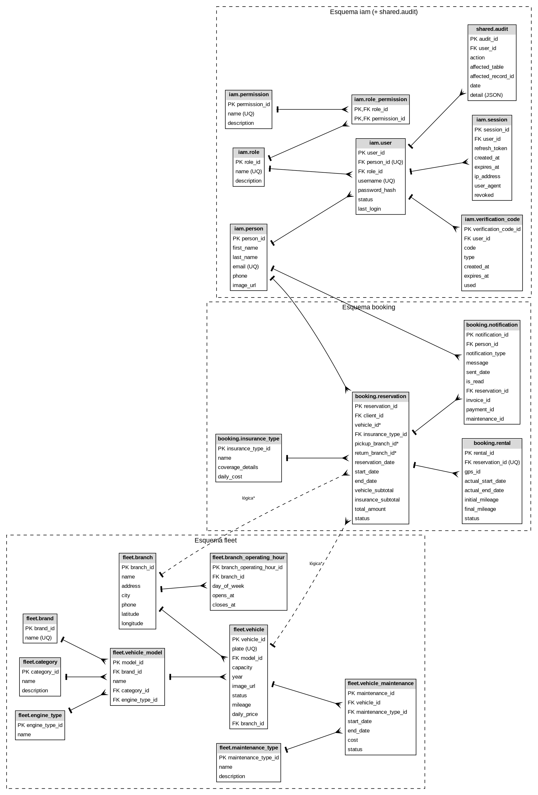

RentaMovil

Plataforma de alquiler de vehículos

MANUAL TÉCNICO

Integrantes

Nicole Dayana Ramirez

Thiago Fabian Rojas

David Santiago Erez

Número de ficha: 3145556

Programa: Tecnólogo en Análisis y Desarrollo de Software

Instructora: Karol Daniela Correa

Centro de formación: SENA
Fecha: Octubre de 2026

Versión: 2.0

Control de versiones

| Versión | Fecha | Descripción del cambio | Responsable |
| --- | --- | --- | --- |
| 1.0 | 09/07/2026 | Creación inicial del manual técnico. | Equipo de desarrollo |
| 2.0 | 06/10/2026 | Actualización para coincidir con la arquitectura actual: microservicios (API Gateway, iam, fleet-maintenance, booking-reservation), base de datos SQL Server dividida por esquema con Liquibase, diccionario de datos, endpoints, seguridad, control de versiones, mantenimiento y solución de problemas. | Equipo de desarrollo |

Tabla de contenido

- 1. Introducción
    - 1.1 Convenciones
- 2. Objetivo
- 3. Alcance técnico
- 4. Descripción general del sistema
    - 4.1 Repositorios
    - 4.2 Estado de implementación
- 5. Tecnologías utilizadas
    - 5.1 Dependencias por componente
    - 5.2 Configuración del sistema
- 6. Arquitectura del sistema
    - 6.1 Estilo arquitectónico
    - 6.2 Diagrama de arquitectura
    - 6.3 Componentes y puertos
    - 6.4 Capas de cada microservicio (hexagonal)
    - 6.5 Comunicación entre componentes
    - 6.6 Recorrido de una petición
- 7. Estructura del proyecto
    - 7.1 Microservicio (ejemplo: rtm-booking-reservation)
    - 7.2 Repositorio de base de datos (ejemplo: rtm-iam-db)
    - 7.3 Frontend web (RentaMovil/web/Front-end)
    - 7.4 Aplicación móvil (RentaMovil/app_mobile/Frontend)
- 8. Base de datos
    - 8.1 Diagrama entidad-relación
    - 8.2 Tablas principales
    - 8.3 Diccionario de datos
    - 8.4 Reglas de integridad relevantes
- 9. Módulos técnicos
- 10. API o rutas del sistema
    - 10.1 Enrutamiento del gateway
    - 10.2 rtm-iam (el prefijo /auth se quita en el gateway; /users se reenvía sin cambios)
    - 10.3 rtm-fleet-maintenance
    - 10.4 rtm-booking-reservation
    - 10.5 Uso interno entre servicios (no expuesto por el gateway)
    - 10.6 mock-server.cjs (puerto 3100, prefijo /mock en el frontend)
    - 10.7 Códigos de respuesta y formato de error
- 11. Seguridad
    - 11.1 Permisos por rol
- 12. Control de versiones
    - 12.1 Decisiones de arquitectura (ADR)
- 13. Recomendaciones de mantenimiento
    - 13.1 Solución de problemas
    - 13.2 Deuda técnica y limitaciones conocidas
- 14. Glosario
- 15. Referencias
- 16. Anexos
    - Anexo A. Comandos de referencia rápida
    - Anexo B. Variables de entorno
    - Anexo C. Documentos relacionados

# 1. Introducción

Este manual describe cómo está construido RentaMovil, la plataforma de alquiler de vehículos: su arquitectura, las tecnologías que utiliza, la organización del código, la base de datos, los módulos técnicos, la interfaz de programación de aplicaciones (API), la seguridad y las recomendaciones para mantenerlo y extenderlo.

Está dirigido a desarrolladores, personal de soporte técnico e instructores que necesitan entender, mantener o continuar el sistema. Assume conocimientos de Java, Spring Boot, React, SQL Server, Git, Docker y HTTP. No explica cómo se usa el sistema desde sus pantallas (eso está en el Manual de Usuario y el Manual de Administrador) ni la instalación paso a paso (Manual de Instalación).

## 1.1 Convenciones

• Los comandos, rutas, nombres de archivo, variables y clases se escriben en fuente monoespaciada dentro de bloques grises o en línea en el texto (por ejemplo, application.properties, APP_IAM_JWT_EXPIRY, /auth/login).
• Las rutas de la API se escriben como el cliente las llama a través del gateway (puerto 8080), salvo que se indique lo contrario.
• El código y la documentación técnica de los repositorios están en inglés; lo que ve el usuario (mensajes, pantallas) está en español. Esta es una decisión registrada en ADR-001, no un descuido.
• Todo lo descrito se verificó contra el código de los repositorios el 6 de octubre de 2026 (ramas listadas en la sección 4.2).

# 2. Objetivo

Documentar la arquitectura, las tecnologías, la estructura del proyecto, la base de datos, los módulos, la API, las dependencias, la seguridad y las recomendaciones de mantenimiento de RentaMovil, para que otro equipo de desarrollo pueda entender el sistema, darle soporte y seguir construyéndolo.

# 3. Alcance técnico

El manual cubre:

• El frontend web (cliente y administración) y la aplicación móvil.
• El API Gateway y los microservicios implementados: rtm-iam, rtm-fleet-maintenance y rtm-booking-reservation.
• La base de datos SQL Server, sus esquemas, tablas, relaciones y migraciones Liquibase.
• El servidor mock que reemplaza temporalmente los servicios de pago y GPS.
• Seguridad, control de versiones, mantenimiento, solución de problemas y comandos de referencia.
No cubre el detalle de cada cuerpo de petición y respuesta (eso está en los contratos OpenAPI de rtm-docs/07-api/contracts), los servicios planeados que todavía no existen (payment-billing y telemetry-gps) más allá de su lugar en la arquitectura, ni el procedimiento completo de instalación.

# 4. Descripción general del sistema

RentaMovil permite a los clientes buscar vehículos disponibles por sucursal y fechas, reservarlos con seguro opcional, pagar por transferencia bancaria con comprobante, y consultar sus reservas y notificaciones. Los administradores gestionan la flota, el mantenimiento, las sucursales, los seguros, las cuentas bancarias, los usuarios, la validación de pagos, la recogida y devolución de vehículos y el seguimiento por GPS.

Es una aplicación cliente-servidor: dos clientes (web y móvil) consumen, a través de un API Gateway, un backend de microservicios Java que comparten una única base de datos SQL Server, dividida por esquema.

## 4.1 Repositorios

Tabla 1. Repositorios del sistema

| Repositorio | Ubicación | Contenido |
| --- | --- | --- |
| RentaMovil | github.com/RentaMovil/RentaMovil (espejo: nicolerv18/RentaMovil) | Frontend web (web/Front-end), aplicación móvil (app_mobile/Frontend), servidor mock y documentación funcional. |
| rtm-api-gateway | github.com/RentaMovil/rtm-api-gateway | Punto de entrada único: enrutamiento, verificación JWT, CORS, límite de peticiones y trazabilidad. |
| rtm-iam | github.com/RentaMovil/rtm-iam | Identidad y acceso: registro, login, JWT, sesiones, perfil, usuarios y roles. |
| rtm-iam-db | github.com/RentaMovil/rtm-iam-db | Migraciones Liquibase del esquema iam y de la tabla shared.audit; contenedor de SQL Server. |
| rtm-fleet-maintenance | github.com/RentaMovil/rtm-fleet-maintenance | Flota: vehículos, sucursales, mantenimiento y catálogos de referencia. |
| rtm-fleet-maintenance-db | github.com/RentaMovil/rtm-fleet-maintenance-db | Migraciones Liquibase del esquema fleet. |
| rtm-booking-reservation | github.com/RentaMovil/rtm-booking-reservation | Reservas, ejecución del alquiler (recogida y devolución), planes de seguro y notificaciones. |
| rtm-booking-db | github.com/RentaMovil/rtm-booking-db | Migraciones Liquibase del esquema booking. |
| rtm-docs | github.com/code-sena/rtm-docs | Documentación de gobernanza, dominio, arquitectura (ADR), datos, contrato OpenAPI y operaciones. |

## 4.2 Estado de implementación

Ramas verificadas: RentaMovil develop; rtm-api-gateway feat/booking-routes; rtm-iam feat/ConectBooking; rtm-booking-reservation develop; rtm-fleet-maintenance develop; repositorios *-db develop; rtm-docs main.

Tabla 2. Estado de cada componente

| Componente | Estado | Nota |
| --- | --- | --- |
| Frontend web | Operativo | Conectado al gateway para autenticación, usuarios, vehículos, sucursales, mantenimiento, reservas, alquileres, seguros y notificaciones. Los pagos, las cuentas bancarias y el GPS se sirven desde el mock. |
| Aplicación móvil | Parcial | La autenticación y las notificaciones apuntan al mock antiguo (puerto 3001, rutas /auth/*); las sucursales, los seguros, las reservas y los pagos usan datos locales. Aún no está conectada al gateway. |
| rtm-api-gateway | Operativo | Enruta los cinco servicios; los dos planeados responden 503 hasta que existan. |
| rtm-iam | Operativo | Todas las operaciones de identidad, perfil y administración de usuarios. |
| rtm-fleet-maintenance | Operativo (rama develop) | Vehículos, inventario, disponibilidad, sucursales, mantenimiento y catálogos. |
| rtm-booking-reservation | Operativo con dependencias pendientes | Crear una reserva responde 409 FLEET_SERVICE_UNAVAILABLE porque su adaptador de flota todavía es provisional. Confirmar una reserva requiere payment-billing o un evento manual en /internal/events. |
| payment-billing (:3004) | Planeado | Reemplazado por el mock (/payments, /bank-accounts). |
| telemetry-gps (:3005) | Planeado | Reemplazado por el mock (/gps, /locations). |

# 5. Tecnologías utilizadas

Tabla 3. Tecnologías y versiones

| Componente | Tecnología | Versión / detalle |
| --- | --- | --- |
| Frontend web | React (Meta Platforms, Inc., s. f.) + Vite (Vite, s. f.) | React 19.2, Vite 8, React Router 7, react-hook-form 7, i18next 26, Leaflet 1.9 / react-leaflet 5, Recharts 3, GSAP 3, react-dropzone 15 |
| Aplicación móvil | Expo (Expo, s. f.) + React Native (TypeScript) | Expo SDK 54, React Native 0.81.5, React 19.1, expo-router 6, Zustand 5, expo-secure-store 15, TypeScript 5.9 |
| Backend | Java + Spring Boot (VMware, Inc., s. f.-a) | Java 21; Spring Boot 4.1.1 (iam, fleet, booking); Spring Boot 4.0.8 (gateway) |
| API Gateway | Spring Cloud Gateway (VMware, Inc., s. f.-b) (WebMVC) | Spring Cloud 2025.1.3 |
| Persistencia | Spring Data JPA (VMware, Inc., s. f.-c) + Hibernate | ddl-auto=validate; zona horaria JDBC UTC; driver mssql-jdbc |
| Seguridad | Nimbus JOSE + JWT (Connect2id, s. f.; Jones et al., 2015); Spring Security Crypto | nimbus-jose-jwt 10.10 (RS256); BCrypt (12 rondas) |
| Base de datos | Microsoft SQL Server (Microsoft, s. f.) | SQL Server 2022 (imagen mcr.microsoft.com/mssql/server:2022-latest, edición Developer) |
| Migraciones | Liquibase (Liquibase, s. f.) (plugin de Maven, Apache Software Foundation, s. f.) | Liquibase 5.0.4 |
| Compilación | Maven (Apache Software Foundation, s. f.) / npm (OpenJS Foundation, s. f.) | Maven 3.9; Node.js 22 (imagen node:22-alpine) |
| Contenedores | Docker (Docker Inc., s. f.) y Docker Compose | Red externa compartida rentamovil; imágenes eclipse-temurin:21-jre |
| Mock de API | json-server + middleware de Express | json-server 0.17, jsonwebtoken 9, bcryptjs 3 (mock-server.cjs, puerto 3100) |
| Almacenamiento de imágenes | Cloudinary | Carga directa desde el navegador (fotos de vehículos, perfil y comprobantes) |
| Contratos de API | OpenAPI 3 (OpenAPI Initiative, 2021) | rtm-docs/07-api/contracts/openapi (un archivo por servicio + _shared.yaml) |
| Control de versiones | Git (Git, s. f.) + GitHub | Organización RentaMovil; ramas develop → qa → staging → main; Conventional Commits (Conventional Commits, s. f.) |
| Diagramas | Mermaid, PlantUML, Graphviz | rtm-docs y Documentacion/Diagramas UML |

## 5.1 Dependencias por componente

Tabla 4. Gestión de dependencias por componente

| Componente | Archivo de dependencias | Gestor |
| --- | --- | --- |
| rtm-api-gateway, rtm-iam, rtm-fleet-maintenance, rtm-booking-reservation | pom.xml | Maven 3.9 |
| rtm-iam-db, rtm-fleet-maintenance-db, rtm-booking-reservation-db (repositorios *-db) | pom.xml (plugin Liquibase) | Maven 3.9 + Liquibase 5.0.4 |
| web/Front-end | package.json | npm (Node.js 22) |
| app_mobile/Frontend | package.json | npm (Expo SDK 54) |

Cada repositorio declara sus propias dependencias en su archivo pom.xml o package.json; al ser una arquitectura de microservicios con repositorios independientes, no existe un archivo de dependencias único para todo el sistema. Las principales dependencias por componente se listan en la Tabla 3 (sección 5):

- Backend (Java + Spring Boot): Spring Boot, Spring Cloud Gateway, Spring Data JPA + Hibernate, Nimbus JOSE + JWT, Spring Security Crypto, driver mssql-jdbc.
- Frontend web (React): React, React Router, react-hook-form, i18next, Leaflet / react-leaflet, Recharts, GSAP, react-dropzone.
- Aplicación móvil (Expo + React Native): expo-router, Zustand, expo-secure-store, TypeScript.
- Base de datos y migraciones: Microsoft SQL Server, Liquibase.
- Mock de API: json-server, jsonwebtoken, bcryptjs (mock-server.cjs).

## 5.2 Configuración del sistema

Tabla 5. Archivos y variables de configuración por componente

| Componente | Archivo de configuración | Variables clave |
| --- | --- | --- |
| Microservicios (iam, fleet-maintenance, booking-reservation) | application.properties + .env (a partir de .env.example) | Ver Anexo B. Variables de entorno (DATABASE_*, APP_*_PORT, JWT, etc.) |
| API Gateway | application.properties + .env (a partir de .env.example) | GATEWAY_PORT, IAM_URL, FLEET_URL, BOOKING_URL, CORS_ALLOWED_ORIGINS, RATE_LIMIT_* |
| Repositorios *-db | liquibase.properties (a partir de liquibase.properties.example) | url, username, password, parameter.<servicio>AppPassword |
| Frontend web | vite.config.js, .env | VITE_API_URL, VITE_MOCK_API_URL; proxy /api → gateway (puerto 8080) y /mock → mock-server (puerto 3100) |
| Aplicación móvil | config/env.ts | EXPO_PUBLIC_API_URL |
| Contenedores | docker-compose.yml de cada repositorio | Red externa compartida rentamovil |

Los archivos de configuración con credenciales (.env, liquibase.properties) nunca se suben al repositorio: cada uno se crea localmente a partir de su .example correspondiente. El detalle completo de las variables de entorno por componente está en el Anexo B. Variables de entorno.

# 6. Arquitectura del sistema

## 6.1 Estilo arquitectónico

El backend sigue una arquitectura de microservicios organizada por dominios de negocio (contextos delimitados): identidad y acceso, flota y mantenimiento, reservas y alquileres, pagos y facturación, y telemetría GPS. Cada microservicio se implementa internamente con arquitectura hexagonal (puertos y adaptadores), de modo que las reglas de negocio no dependan de Spring, la base de datos ni HTTP.

Los frontends usan una organización por funcionalidades con componentes reutilizables (component-driven): cada módulo agrupa sus páginas, componentes, hooks y servicios.

Todos los servicios comparten una única base de datos SQL Server, pero cada uno es dueño de su esquema y se conecta con un usuario que solo tiene permisos sobre ese esquema (ADR-009).

## 6.2 Diagrama de arquitectura

Figura 1. Arquitectura de contenedores. Las líneas discontinuas indican servicios planeados o integraciones pendientes.

## 6.3 Componentes y puertos

Tabla 6. Puertos del sistema en desarrollo local

| Componente | Puerto | Nota |
| --- | --- | --- |
| Frontend web (Vite dev) | 5173 | npm run dev |
| Frontend web (preview / Docker) | 4173 | npm run preview o contenedor rentamovil-web |
| rtm-api-gateway | 8080 | Punto de entrada único para los clientes |
| rtm-iam | 3001 | Interno; solo a través del gateway |
| rtm-fleet-maintenance | 3002 | Interno |
| rtm-booking-reservation | 3003 | Interno |
| payment-billing (planeado) | 3004 | — |
| telemetry-gps (planeado) | 3005 | — |
| mock-server.cjs | 3100 | Pagos, cuentas bancarias y GPS mientras sus servicios no existen |
| SQL Server | 1433 | contenedor rentamovil-sqlserver |

## 6.4 Capas de cada microservicio (hexagonal)

Los tres microservicios implementados comparten la misma organización. La regla que no se puede romper: el dominio no importa nada de la infraestructura ni de Spring; las dependencias siempre apuntan hacia el dominio.

Tabla 7. Capas de un microservicio

| Paquete | Responsabilidad |
| --- | --- |
| domain/entity | Entidades de negocio y objetos de valor (Reservation, Vehicle, User...). No dependen de Spring ni de JPA. |
| domain/enums | Estados del dominio (ReservationStatus, VehicleStatus, UserStatus, MaintenanceStatus...). |
| domain/exception | Excepciones de negocio (BusinessRuleException, ResourceNotFoundException...). |
| domain/port/in | Puertos de entrada: interfaces de los casos de uso que ofrece el servicio. |
| domain/port/out | Puertos de salida: lo que el dominio necesita del exterior (repositorios, verificador de tokens, eventos, auditoría). |
| application/usecase | Implementación de los casos de uso; orquesta el dominio y los puertos. |
| infrastructure/web | Adaptadores de entrada: controladores REST, DTOs, manejador global de errores y filtros. |
| infrastructure/persistence | Adaptadores de salida: entidades JPA, repositorios Spring Data y adaptadores que implementan los *RepositoryPort. |
| infrastructure/security | Verificación o emisión de JWT y hash de contraseñas. |
| infrastructure/config | BeanConfig: conecta cada caso de uso con sus adaptadores (inyección de dependencias). |

## 6.5 Comunicación entre componentes

• Cliente → backend: REST sobre HTTP con JSON. El navegador llama a /api (gateway) y /mock (mock) en su propio origen; el proxy de Vite reenvía cada uno a su destino.
• Gateway → servicios: el gateway enruta por prefijo de ruta (sección 9.1) y agrega X-User-Id, X-User-Role y X-Correlation-Id.
• Servicio → servicio: llamadas REST internas; por ejemplo, fleet-maintenance consulta a booking-reservation la ocupación de vehículos para calcular la disponibilidad.
• Eventos de dominio: booking-reservation los despacha en memoria (InProcessEventDispatcher) y fleet los publica en el log; entre servicios se entregan mediante POST /internal/events. A esta escala no se usa un bróker de mensajes.
Tabla 8. Eventos de dominio

| Evento | Publicado por | Consumido por / efecto |
| --- | --- | --- |
| ReservationCreated / ReservationReturnBranchChanged / ReservationExpired | booking-reservation | Notificaciones dentro de la app (booking) |
| RentalStarted | booking-reservation | fleet-maintenance: vehículo a RENTED; telemetry-gps (futuro) |
| RentalCompleted | booking-reservation | fleet-maintenance: vehículo a AVAILABLE |
| PaymentCompleted / PaymentRejected | payment-billing (futuro) | booking-reservation: reserva a CONFIRMED o rechazo; notificación |
| MaintenanceCompleted | fleet-maintenance | booking-reservation: notificación MAINTENANCE_COMPLETED |

## 6.6 Recorrido de una petición

Ejemplo: el cliente consulta sus reservas desde la web.

1. La pantalla Mis reservas llama a reservationService.getMine(), que usa httpClient.get('/reservations/mine').
2. httpClient decide la base: /reservations está en REAL_BACKEND_PREFIXES, así que llama a /api/reservations/mine con el token de acceso en la cabecera Authorization: Bearer.
3. El proxy de Vite quita /api y reenvía a http://localhost:8080/reservations/mine (sin cabecera Origin).
4. El gateway asigna X-Correlation-Id, aplica el límite de peticiones, verifica la firma y la expiración del JWT con la clave pública de iam, elimina cualquier cabecera externa X-User-* y agrega X-User-Id y X-User-Role.
5. La ruta /reservations/** se reenvía a booking-reservation (:3003).
6. En booking, el ReservationController vuelve a verificar el token (CurrentUserArgumentResolver), llama al caso de uso, y el caso de uso llama al ReservationRepositoryPort.
7. El adaptador JPA consulta booking.reservation con el usuario booking_app y devuelve las filas.
8. La respuesta regresa por la misma ruta; si el token de acceso expiró (401), httpClient solicita un token nuevo a /auth/refresh una vez y repite la petición.

# 7. Estructura del proyecto

## 7.1 Microservicio (ejemplo: rtm-booking-reservation)

rtm-booking-reservation/

├── src/main/java/com/rentamovil/booking/

│ ├── domain/ entity · enums · exception · port/in · port/out

│ ├── application/usecase/ implementaciones de casos de uso

│ └── infrastructure/

│ ├── config/ BeanConfig, WebConfig

│ ├── events/ InProcessEventDispatcher

│ ├── fleet/ adaptador de disponibilidad (provisional)

│ ├── persistence/ entity (JPA) · repository · adapter

│ ├── scheduling/ ReservationExpirationJob (expira las reservas no pagadas)

│ ├── security/ JwtKeyConfig, JwtVerifierAdapter

│ └── web/ controller · dto · exception · filter · auth

├── src/main/resources/application.properties

├── src/test/java/ pruebas unitarias y de integración

├── .env.example · Dockerfile · docker-compose.yml · pom.xml · README.md

## 7.2 Repositorio de base de datos (ejemplo: rtm-iam-db)

rtm-iam-db/

├── 01_ddl/ 01_schemas · 03_tables · 04_alter · 05_views

│ 10_indexes

├── 02_dml/ 00_inserts · 01_updates · 02_deletes

├── 03_dcl/ 00_roles · 01_grants

├── 04_tcl/

├── 05_rollbacks/

├── changelog/ changelog maestro de Liquibase

├── liquibase.properties.example · docker-compose.yml

└── Dockerfile · pom.xml

Tabla 9. Carpetas de un repositorio de base de datos

| Carpeta | Propósito |
| --- | --- |
| 01_ddl | Esquemas, tablas, claves foráneas (04_alter), vistas e índices (10_indexes). |
| 02_dml | Datos iniciales (roles, permisos, categorías, marcas, modelos, tipos de mantenimiento). |
| 03_dcl | Login del servicio y usuario de base de datos, y sus permisos (GRANT). |
| 04_tcl | Control de transacciones, cuando aplica. |
| 05_rollbacks | Espejo con el rollback de cada cambio. |
| changelog | Changelog maestro que Liquibase ejecuta en orden. |
| liquibase.properties | Conexión y parámetros (contraseña del usuario *_app). Se copia de liquibase.properties.example y nunca se sube. |

## 7.3 Frontend web (RentaMovil/web/Front-end)

web/Front-end/

├── src/

│ ├── features/ auth · vehicles · booking · payment · notification

│ │ └── admin/ registerVehicle · VehicleInventory · registerMaintenance

│ │ historyMaintenance · reservations · branches

│ │ insuranceTypes · bankAccounts · users

│ │ vehicleLocation · routeHistory

│ ├── contexts/ AuthContext, ThemeContext

│ ├── shared/ api · components · hooks · services · utils

│ ├── Traductions/ es · en · fr · pt

│ ├── App.jsx rutas protegidas con RequireAuth / RequireRole

│ └── main.jsx providers: Auth, Reservation, Payment

├── mock-server.cjs · db.json mock de API (puerto 3100)

├── vite.config.js proxy /api y /mock

├── Dockerfile · docker-compose.yml · package.json

Tabla 10. Carpetas del frontend web

| Carpeta / archivo | Propósito |
| --- | --- |
| src/features/<módulo>/pages | Pantallas de cada módulo (auth, vehicles, booking, payment, notification, admin/*). |
| src/features/<módulo>/components | Componentes específicos del módulo. |
| src/features/<módulo>/hooks | Estado y lógica de las pantallas (useCars, useReservationsList, useCreateMaintenance...). |
| src/features/<módulo>/services | Llamadas HTTP y mappers que convierten la respuesta del backend en el modelo de vista. |
| src/contexts | Contextos globales: AuthContext (sesión y usuario) y ThemeContext. |
| src/shared/api | httpClient.js (cliente HTTP con refresh) y tokenStore.js (token de acceso en memoria). |
| src/shared/components | Componentes reutilizables: layout (Navbar, Footer), ProtectedRoute (RequireAuth / RequireRole), diálogos. |
| src/shared/services y hooks | Servicios transversales (cloudinaryService, useImageUpload, useIsMobile). |
| src/Traductions | Configuración de i18next y archivos es, en, fr, pt. |
| mock-server.cjs + db.json | Mock de API para los dominios sin servicio real. |
| vite.config.js | Proxy /api → gateway (:8080) y /mock → mock (:3100). |

## 7.4 Aplicación móvil (RentaMovil/app_mobile/Frontend)

app_mobile/Frontend/src/

├── app/ rutas de expo-router: (tabs) · auth · account

│ reservation · payment · notifications

│ reservation-detail

├── features/ account · auth · branches · home · insurance

│ menu · notification · payment · reservation

│ vehicles (pages · components · services · mocks)

├── shared/ api (httpClient, tokenStore) · components · hooks

├── config/ env.ts (URL de la API por plataforma), assets.ts

├── theme/ temas y constantes de diseño

├── translation/ i18n es · en · fr · pt

└── types/ tipos del dominio en TypeScript

# 8. Base de datos

| Aspecto | Valor |
| --- | --- |
| Motor | Microsoft SQL Server 2022 (contenedor rentamovil-sqlserver, puerto 1433) |
| Base de datos | rentamovil (compartida por todos los servicios) |
| Esquemas | iam (rtm-iam), fleet (rtm-fleet-maintenance), booking (rtm-booking-reservation), shared (auditoría común) |
| Usuarios de aplicación | iam_app, fleet_app, booking_app: solo CRUD sobre su esquema + INSERT en shared.audit |
| Migraciones | Liquibase 5.0.4, un repositorio por esquema (rtm-iam-db, rtm-fleet-maintenance-db, rtm-booking-db) |
| Tablas | 21 tablas: 7 en iam, 1 en shared, 9 en fleet y 4 en booking |

## 8.1 Diagrama entidad-relación

Figura 2. Modelo entidad-relación por esquema. Las líneas discontinuas son referencias lógicas entre esquemas sin clave foránea física.

Entre esquemas solo hay claves foráneas hacia iam.person (titular de la reserva y destinatario de la notificación) y hacia iam.user (auditoría). Las referencias de booking.reservation a fleet.vehicle y fleet.branch son lógicas: cada servicio es dueño de sus datos y los valida a través de la API, no de la base de datos.

## 8.2 Tablas principales

| Tabla | Propósito |
| --- | --- |
| iam.person / iam.user | Datos personales y cuenta de acceso (1 a 1). La persona es quien reserva; el usuario es quien inicia sesión. |
| iam.role / iam.permission / iam.role_permission | Roles CLIENT, ADMIN, SUPER_ADMIN y sus 25 permisos. |
| iam.session / iam.verification_code | Sesiones con refresh token y códigos de recuperación de contraseña. |
| shared.audit | Registro de acciones administrativas de todos los servicios. |
| fleet.vehicle y catálogos | Vehículos con modelo, marca, categoría, tipo de motor, sucursal, estado y tarifa diaria. |
| fleet.branch / branch_operating_hour | Sucursales con coordenadas y horario diario. |
| fleet.vehicle_maintenance / maintenance_type | Mantenimiento y su catálogo de tipos. |
| booking.reservation | Reserva con fechas, sucursales, seguro, subtotales, total y estado. |
| booking.rental | Ejecución del alquiler: recogida, devolución, kilometrajes y GPS. |
| booking.insurance_type / notification | Planes de seguro y notificaciones dentro de la app. |

## 8.3 Diccionario de datos

### iam.person

| Campo | Tipo | Restricción | Descripción |
| --- | --- | --- | --- |
| person_id | INT | PK, IDENTITY | Identificador de la persona. |
| first_name | VARCHAR(100) | NOT NULL | Nombres. |
| last_name | VARCHAR(100) | NOT NULL | Apellidos. |
| email | VARCHAR(150) | NOT NULL, UNIQUE | Correo de acceso; único en el sistema. |
| phone | VARCHAR(20) | NULL | Teléfono de contacto. |
| image_url | VARCHAR(500) | NULL | URL de la foto de perfil (Cloudinary). |

### iam.role

| Campo | Tipo | Restricción | Descripción |
| --- | --- | --- | --- |
| role_id | INT | PK, IDENTITY | Identificador del rol. |
| name | VARCHAR(50) | NOT NULL, UNIQUE | CLIENT, ADMIN o SUPER_ADMIN. |
| description | VARCHAR(255) | NULL | Descripción del rol. |

### iam.permission

| Campo | Tipo | Restricción | Descripción |
| --- | --- | --- | --- |
| permission_id | INT | PK, IDENTITY | Identificador del permiso. |
| name | VARCHAR(50) | NOT NULL, UNIQUE | Permiso en formato recurso:acción (por ejemplo, vehicles:create). |
| description | VARCHAR(255) | NULL | Descripción del permiso. |

### iam.role_permission

| Campo | Tipo | Restricción | Descripción |
| --- | --- | --- | --- |
| role_id | INT | PK, FK → iam.role | Rol. |
| permission_id | INT | PK, FK → iam.permission | Permiso asignado al rol. |

### iam.user

| Campo | Tipo | Restricción | Descripción |
| --- | --- | --- | --- |
| user_id | INT | PK, IDENTITY | Identificador de la cuenta (claim sub del JWT). |
| person_id | INT | FK → iam.person, UNIQUE | Persona propietaria de la cuenta (una cuenta por persona). |
| role_id | INT | FK → iam.role | Rol de la cuenta. |
| username | VARCHAR(50) | NOT NULL, UNIQUE | Nombre de usuario; no se puede modificar. |
| password_hash | VARCHAR(255) | NOT NULL | Hash BCrypt de la contraseña. |
| status | VARCHAR(20) | CHECK ACTIVE/INACTIVE/BLOCKED | Estado de la cuenta. |
| last_login | DATETIME | NULL | Último inicio de sesión exitoso. |

### iam.verification_code

| Campo | Tipo | Restricción | Descripción |
| --- | --- | --- | --- |
| verification_code_id | INT | PK, IDENTITY | Identificador del código. |
| user_id | INT | FK → iam.user | Cuenta que solicitó el código. |
| code | VARCHAR(10) | NOT NULL | Código de 6 dígitos. |
| type | VARCHAR(30) | NOT NULL | Propósito (recuperación de contraseña). |
| created_at | DATETIME | NOT NULL | Fecha de emisión. |
| expires_at | DATETIME | NOT NULL | Expiración (15 minutos por defecto). |
| used | BIT | NOT NULL | Indica si ya se usó. |

### iam.session

| Campo | Tipo | Restricción | Descripción |
| --- | --- | --- | --- |
| session_id | INT | PK, IDENTITY | Identificador de la sesión. |
| user_id | INT | FK → iam.user, index | Cuenta de la sesión. |
| refresh_token | VARCHAR(255) | NOT NULL | Refresh token activo de la sesión. |
| created_at | DATETIME | NOT NULL | Inicio de la sesión. |
| expires_at | DATETIME | NOT NULL | Expiración del refresh token (7 días por defecto). |
| ip_address | VARCHAR(45) | NULL | IP de origen. |
| user_agent | VARCHAR(255) | NULL | Navegador o cliente. |
| revoked | BIT | NOT NULL | Sesión revocada (logout, rotación o reutilización detectada). |

### shared.audit

| Campo | Tipo | Restricción | Descripción |
| --- | --- | --- | --- |
| audit_id | INT | PK, IDENTITY | Identificador del registro de auditoría. |
| user_id | INT | FK → iam.user, NULL | Quién realizó la acción (NULL = sistema o anónimo). |
| action | VARCHAR(50) | NOT NULL | Acción (por ejemplo, USER_UNBLOCKED, ROLE_GRANTED). |
| affected_table | VARCHAR(50) | NOT NULL, index | Tabla afectada. |
| affected_record_id | INT | NULL, index | Registro afectado. |
| date | DATETIME | NOT NULL | Fecha y hora. |
| detail | NVARCHAR(MAX) | CHECK ISJSON | Detalle adicional en JSON. |

### fleet.branch

| Campo | Tipo | Restricción | Descripción |
| --- | --- | --- | --- |
| branch_id | INT | PK, IDENTITY | Identificador de la sucursal. |
| name | VARCHAR(100) | NOT NULL | Nombre de la sede. |
| address | VARCHAR(200) | NOT NULL | Dirección física. |
| city | VARCHAR(100) | NOT NULL | Ciudad. |
| phone | VARCHAR(20) | NULL | Teléfono de contacto. |
| latitude | DECIMAL(10,8) | NULL | Latitud para el mapa. |
| longitude | DECIMAL(11,8) | NULL | Longitud para el mapa. |

### fleet.branch_operating_hour

| Campo | Tipo | Restricción | Descripción |
| --- | --- | --- | --- |
| branch_operating_hour_id | INT | PK, IDENTITY | Identificador. |
| branch_id | INT | FK → fleet.branch | Sucursal. |
| day_of_week | SMALLINT | CHECK 1..7; UNIQUE con branch_id | Día (1 = lunes … 7 = domingo). |
| opens_at | TIME | NOT NULL | Hora de apertura. |
| closes_at | TIME | NOT NULL | Hora de cierre. |

### fleet.brand

| Campo | Tipo | Restricción | Descripción |
| --- | --- | --- | --- |
| brand_id | INT | PK, IDENTITY | Identificador de la marca. |
| name | VARCHAR(50) | NOT NULL, UNIQUE | Nombre de la marca. |

### fleet.category

| Campo | Tipo | Restricción | Descripción |
| --- | --- | --- | --- |
| category_id | INT | PK, IDENTITY | Identificador de la categoría. |
| name | VARCHAR(50) | NOT NULL | Nombre (Sedán, SUV...). |
| description | VARCHAR(255) | NULL | Descripción. |

### fleet.engine_type

| Campo | Tipo | Restricción | Descripción |
| --- | --- | --- | --- |
| engine_type_id | INT | PK, IDENTITY | Identificador. |
| name | VARCHAR(50) | NOT NULL | Tipo de motor o combustible. |

### fleet.vehicle_model

| Campo | Tipo | Restricción | Descripción |
| --- | --- | --- | --- |
| model_id | INT | PK, IDENTITY | Identificador del modelo. |
| brand_id | INT | FK → fleet.brand | Marca. |
| name | VARCHAR(50) | NOT NULL | Nombre del modelo. |
| category_id | INT | FK → fleet.category | Categoría. |
| engine_type_id | INT | FK → fleet.engine_type | Tipo de motor. |

### fleet.vehicle

| Campo | Tipo | Restricción | Descripción |
| --- | --- | --- | --- |
| vehicle_id | INT | PK, IDENTITY | Identificador del vehículo. |
| plate | VARCHAR(10) | NOT NULL, UNIQUE | Placa. |
| model_id | INT | FK → fleet.vehicle_model | Modelo (la marca, la categoría y el motor se derivan de él). |
| capacity | INT | NULL | Número de pasajeros. |
| year | INT | NULL | Año del modelo. |
| image_url | VARCHAR(255) | NULL | URL de la foto. |
| status | VARCHAR(30) | CHECK AVAILABLE/RENTED/MAINTENANCE/RETIRED; index | Estado operativo. |
| mileage | DECIMAL(10,2) | NOT NULL | Kilometraje actual. |
| daily_price | DECIMAL(10,2) | NOT NULL | Tarifa diaria (COP). |
| branch_id | INT | FK → fleet.branch; index | Sucursal a la que pertenece. |

### fleet.maintenance_type

| Campo | Tipo | Restricción | Descripción |
| --- | --- | --- | --- |
| maintenance_type_id | INT | PK, IDENTITY | Identificador. |
| name | VARCHAR(50) | NOT NULL | Tipo (cambio de aceite, inspección de frenos...). |
| description | VARCHAR(255) | NULL | Descripción. |

### fleet.vehicle_maintenance

| Campo | Tipo | Restricción | Descripción |
| --- | --- | --- | --- |
| maintenance_id | INT | PK, IDENTITY | Identificador del mantenimiento. |
| vehicle_id | INT | FK → fleet.vehicle; index con status | Vehículo atendido. |
| maintenance_type_id | INT | FK → fleet.maintenance_type | Tipo de mantenimiento. |
| start_date | DATE | NOT NULL | Fecha de inicio. |
| end_date | DATE | NULL | Fecha de fin (NULL mientras está abierto). |
| cost | DECIMAL(10,2) | NULL | Costo. |
| status | VARCHAR(30) | CHECK SCHEDULED/IN_PROGRESS/COMPLETED | Estado del mantenimiento. |

### booking.insurance_type

| Campo | Tipo | Restricción | Descripción |
| --- | --- | --- | --- |
| insurance_type_id | INT | PK, IDENTITY | Identificador del plan de seguro. |
| name | VARCHAR(100) | NOT NULL | Nombre de la cobertura. |
| coverage_details | TEXT | NULL | Qué incluye y qué excluye. |
| daily_cost | DECIMAL(10,2) | NOT NULL, CHECK >= 0 | Costo por día. |

### booking.reservation

| Campo | Tipo | Restricción | Descripción |
| --- | --- | --- | --- |
| reservation_id | INT | PK, IDENTITY | Identificador de la reserva. |
| client_id | INT | FK → iam.person; index | Titular de la reserva (claim personId). |
| vehicle_id | INT | NOT NULL (referencia lógica a fleet.vehicle) | Vehículo reservado. |
| insurance_type_id | INT | FK → booking.insurance_type, NULL | Seguro elegido (opcional). |
| pickup_branch_id | INT | NOT NULL (referencia lógica a fleet.branch) | Sucursal de recogida. |
| return_branch_id | INT | NOT NULL (referencia lógica a fleet.branch) | Sucursal de devolución. |
| reservation_date | DATETIME | NOT NULL | Fecha de creación. |
| start_date | DATETIME | NOT NULL | Inicio del alquiler. |
| end_date | DATETIME | NOT NULL | Fin del alquiler. |
| vehicle_subtotal | DECIMAL(10,2) | CHECK >= 0 | Valor del alquiler del vehículo. |
| insurance_subtotal | DECIMAL(10,2) | CHECK >= 0 | Valor del seguro. |
| total_amount | DECIMAL(10,2) | CHECK = vehicle_subtotal + insurance_subtotal | Total de la reserva. |
| status | VARCHAR(30) | CHECK PENDING_PAYMENT/PENDING_REVIEW/CONFIRMED/CANCELLED/COMPLETED | Estado de la reserva. |

### booking.rental

| Campo | Tipo | Restricción | Descripción |
| --- | --- | --- | --- |
| rental_id | INT | PK, IDENTITY | Identificador del alquiler. |
| reservation_id | INT | FK → booking.reservation, UNIQUE | Reserva en ejecución (un alquiler por reserva). |
| gps_id | INT | NOT NULL | Dispositivo GPS asignado en la recogida. |
| actual_start_date | DATETIME | NOT NULL | Fecha real de recogida. |
| actual_end_date | DATETIME | NULL | Fecha real de devolución. |
| initial_mileage | DECIMAL(10,2) | CHECK >= 0 | Kilometraje inicial. |
| final_mileage | DECIMAL(10,2) | NULL | Kilometraje final. |
| status | VARCHAR(30) | CHECK IN_PROGRESS/COMPLETED; COMPLETED requiere fecha y kilometraje finales | Estado del alquiler. |

### booking.notification

| Campo | Tipo | Restricción | Descripción |
| --- | --- | --- | --- |
| notification_id | INT | PK, IDENTITY | Identificador. |
| person_id | INT | FK → iam.person; index con is_read | Destinatario. |
| notification_type | VARCHAR(50) | CHECK (8 tipos) | RESERVATION_CREATED, RESERVATION_CANCELLED, RESERVATION_RETURN_BRANCH_CHANGED, RESERVATION_RETURN_DATE_EXTENDED, RESERVATION_EXPIRED, PAYMENT_APPROVED, PAYMENT_REJECTED o MAINTENANCE_COMPLETED. |
| message | TEXT | NOT NULL | Texto del aviso. |
| sent_date | DATETIME | NOT NULL | Fecha de envío. |
| is_read | BIT | NOT NULL | Leído por el destinatario. |
| reservation_id | INT | FK → booking.reservation, NULL | Reserva relacionada. |
| invoice_id | INT | NULL | Factura relacionada (payment-billing). |
| payment_id | INT | NULL | Pago relacionado (payment-billing). |
| maintenance_id | INT | NULL | Mantenimiento relacionado (fleet). |

## 8.4 Reglas de integridad relevantes

• booking.reservation: total_amount = vehicle_subtotal + insurance_subtotal, y ambos subtotales >= 0 (CHECK).
• booking.rental: un alquiler por reserva (UNIQUE); un alquiler COMPLETED requiere fecha y kilometraje finales.
• fleet.vehicle: placa única; estado limitado a AVAILABLE, RENTED, MAINTENANCE o RETIRED.
• fleet.branch_operating_hour: un solo horario por sucursal y día (UNIQUE branch_id + day_of_week).
• iam.user: un usuario por persona, nombre de usuario único; estado ACTIVE, INACTIVE o BLOCKED. iam.person: correo único.
• shared.audit.detail debe ser JSON válido (CHECK ISJSON).

# 9. Módulos técnicos

### rtm-api-gateway

| Elemento | Detalle |
| --- | --- |
| Propósito | Punto de entrada único: enrutamiento por prefijo, verificación JWT, CORS, límite de peticiones, X-Correlation-Id, manejo de servicios caídos (503/504) y un GET /health agregado. |
| Archivos relacionados | application.properties (rutas), filter/JwtAuthenticationFilter, filter/RateLimitFilter, filter/CorrelationIdFilter, filter/UpstreamErrorFilter, security/JwtVerifier, ratelimit/InMemoryRateLimiter, health/HealthController, config/CorsConfig |
| Tablas relacionadas | Ninguna (no tiene base de datos) |
| Operaciones principales | Reenviar peticiones; validar tokens; limitar peticiones; reportar el estado de los servicios. |

### rtm-iam (Identidad y acceso)

| Elemento | Detalle |
| --- | --- |
| Propósito | Registro, login, emisión de JWT RS256, refresh con rotación, logout, recuperación de contraseña, perfil, cambio de correo y contraseña, administración de usuarios y roles. |
| Archivos relacionados | web/controller: AuthController, PasswordController, ProfileController, UserAdminController, JwksController, HealthController; application/usecase: LoginUseCaseImpl, RegisterUserUseCaseImpl, RefreshTokenUseCaseImpl, ResetPasswordUseCaseImpl, ChangeUserStatusUseCaseImpl...; infrastructure/security: JwtTokenProviderAdapter, BCrypt; infrastructure/email: LogEmailSenderAdapter |
| Tablas relacionadas | iam.person, iam.user, iam.role, iam.permission, iam.role_permission, iam.session, iam.verification_code, shared.audit |
| Operaciones principales | Registrar; autenticar y bloquear tras 5 fallos; renovar y revocar sesiones; recuperar la contraseña; actualizar el perfil; cambiar el rol y el estado del usuario. |

### rtm-fleet-maintenance (Flota)

| Elemento | Detalle |
| --- | --- |
| Propósito | Única fuente de verdad para los vehículos, su estado y disponibilidad, las sucursales con horario y coordenadas, los registros de mantenimiento y los catálogos de referencia. |
| Archivos relacionados | web/controller: VehicleController, BranchController, MaintenanceController, ReferenceDataController, InternalEventController; usecase: RegisterVehicleUseCaseImpl, SearchVehiclesUseCaseImpl, CheckVehicleAvailabilityUseCaseImpl, ChangeVehicleStatusUseCaseImpl, CompleteMaintenanceUseCaseImpl, ManageBranchUseCaseImpl, HandleRentalEventUseCaseImpl; client/BookingOccupancyClientAdapter |
| Tablas relacionadas | fleet.vehicle, fleet.vehicle_model, fleet.brand, fleet.category, fleet.engine_type, fleet.branch, fleet.branch_operating_hour, fleet.vehicle_maintenance, fleet.maintenance_type, shared.audit |
| Operaciones principales | Buscar y consultar vehículos; calcular la disponibilidad; registrar y editar vehículos; enviar a mantenimiento y completarlo; administrar sucursales; reaccionar a RentalStarted/RentalCompleted. |

### rtm-booking-reservation (Reservas, alquileres y notificaciones)

| Elemento | Detalle |
| --- | --- |
| Propósito | Ciclo de vida de las reservas (creación, consulta, cambio de sucursal de devolución, cancelación y expiración automática tras 24 h sin pago), recogida y devolución de vehículos, planes de seguro y notificaciones dentro de la app. |
| Archivos relacionados | web/controller: ReservationController, RentalController, AdminBookingController, InsuranceController, NotificationController, InternalEventController, InternalReservationController; scheduling/ReservationExpirationJob; events/InProcessEventDispatcher; fleet/PendingVehicleAvailabilityAdapter |
| Tablas relacionadas | booking.reservation, booking.rental, booking.insurance_type, booking.notification, shared.audit |
| Operaciones principales | Crear, consultar, modificar y cancelar reservas; expirar reservas; registrar recogida y devolución; listar y crear planes de seguro; notificar al cliente; recibir eventos de pago. |

### Frontend web

| Elemento | Detalle |
| --- | --- |
| Propósito | Interfaz de cliente y de administración. |
| Archivos relacionados | src/App.jsx (rutas), contexts/AuthContext.jsx, shared/api/httpClient.js, shared/components/ProtectedRoute.jsx, features/*/services/*Service.js y *Mapper.js |
| Tablas relacionadas | Consume las APIs; no accede a la base de datos |
| Operaciones principales | Autenticación con refresh automático; enrutamiento por rol; consumo del gateway y del mock; carga de imágenes a Cloudinary; internacionalización. |

### Aplicación móvil

| Elemento | Detalle |
| --- | --- |
| Propósito | Cliente móvil (rol Cliente) con Expo Router. |
| Archivos relacionados | src/app/* (rutas), src/config/env.ts, src/shared/api/httpClient.ts, src/features/*/services/*.ts |
| Tablas relacionadas | Consume las APIs; no accede a la base de datos |
| Operaciones principales | Login y registro, búsqueda, reserva, pago con comprobante (cámara o galería), historial, notificaciones y cuenta. Conexión pendiente con el gateway. |

### mock-server.cjs

| Elemento | Detalle |
| --- | --- |
| Propósito | API simulada con json-server para los dominios cuyo servicio no existe. |
| Archivos relacionados | web/Front-end/mock-server.cjs, web/Front-end/db.json |
| Tablas relacionadas | Colecciones de db.json: payments, bankAccounts, gps, locations (y datos de prueba antiguos) |
| Operaciones principales | Servir pagos, cuentas bancarias y posiciones GPS hasta que existan payment-billing y telemetry-gps. |

# 10. API o rutas del sistema

Los contratos completos (parámetros, cuerpos y respuestas) están en OpenAPI 3 en rtm-docs/07-api/contracts/openapi/. Las siguientes tablas listan los endpoints implementados, tal como se llaman a través del gateway.

## 10.1 Enrutamiento del gateway

| Lo que llama el cliente | Se reenvía a |
| --- | --- |
| /auth/** | rtm-iam, quitando /auth (por ejemplo, /auth/login → /login) |
| /users/** | rtm-iam, sin cambios |
| /vehicles/**, /branches/** | rtm-fleet-maintenance (:3002) |
| /reservations/**, /rentals/**, /notifications/**, /insurance-plans/**, /admin/reservations/**, /admin/rentals/**, /admin/insurance-plans/** | rtm-booking-reservation (:3003) |
| /payments/**, /invoices/**, /bank-accounts/** | payment-billing (:3004, planeado) |
| /tracking/** | telemetry-gps (:3005, planeado) |

Nota: el frontend web también llama a /maintenances y a los catálogos (/brands, /categories, /engine-types, /vehicle-models, /maintenance-types), que fleet-maintenance expone pero que la tabla de enrutamiento verificada del gateway todavía no incluye; deben agregarse a la ruta de fleet-maintenance.

## 10.2 rtm-iam (el prefijo /auth se quita en el gateway; /users se reenvía sin cambios)

| Método | Ruta | Descripción | Acceso / permiso |
| --- | --- | --- | --- |
| POST | /auth/register | Registra un cliente e inicia su sesión. | Público |
| POST | /auth/login | Autentica con correo o nombre de usuario; devuelve tokens de acceso y refresh. | Público |
| POST | /auth/refresh | Renueva el token de acceso y rota el refresh token. | Público (refresh token) |
| POST | /auth/logout | Revoca la sesión. | Sesión |
| GET | /auth/jwks | Clave pública RS256 para verificar tokens. | Público |
| POST | /auth/password/forgot | Genera y envía el código de recuperación. | Público |
| POST | /auth/password/reset | Cambia la contraseña con el código. | Público |
| GET | /users/me | Perfil del usuario autenticado. | Sesión |
| PATCH | /users/me | Actualiza nombre, apellido, teléfono o foto. | Sesión |
| PATCH | /users/me/email | Cambia el correo (requiere la contraseña actual). | Sesión |
| PATCH | /users/me/password | Cambia la contraseña y revoca todas las sesiones. | Sesión |
| GET | /users | Lista usuarios. | users:read |
| PATCH | /users/{id}/role | Cambia el rol de un usuario. | roles:grant |
| PATCH | /users/{id}/status | Desbloquea (BLOCKED→ACTIVE) o desactiva (ACTIVE→INACTIVE). | users:update-status |

## 10.3 rtm-fleet-maintenance

| Método | Ruta | Descripción | Acceso / permiso |
| --- | --- | --- | --- |
| GET | /vehicles | Búsqueda paginada del catálogo (fechas, sucursal, marca, categoría, motor, precio). | Público |
| GET | /vehicles/inventory | Inventario completo (cualquier estado). | Administración |
| GET | /vehicles/stats | Indicadores de la flota. | Administración |
| GET | /vehicles/{id} | Detalle de un vehículo. | Público |
| GET | /vehicles/{id}/availability?from&to | Disponibilidad en un rango de fechas. | Público |
| POST | /vehicles | Registra un vehículo. | vehicles:create |
| PUT | /vehicles/{id} | Edita un vehículo. | vehicles:update |
| PATCH | /vehicles/{id}/status | Cambia el estado; a MAINTENANCE abre un registro de mantenimiento. | vehicles:update / maintenance:create |
| POST | /vehicles/{id}/maintenance/complete | Cierra el mantenimiento en curso. | maintenance:update |
| GET | /maintenances | Historial de mantenimientos. | Administración |
| GET | /branches | Lista sucursales. | Público |
| POST | /branches | Crea una sucursal. | branches:manage |
| PUT | /branches/{id} | Edita una sucursal. | branches:manage |
| DELETE | /branches/{id} | Elimina una sucursal sin vehículos. | branches:manage |
| GET | /brands, /categories, /engine-types, /vehicle-models, /maintenance-types | Catálogos de referencia. | Público / sesión |

## 10.4 rtm-booking-reservation

| Método | Ruta | Descripción | Acceso / permiso |
| --- | --- | --- | --- |
| POST | /reservations | Crea una reserva (PENDING_PAYMENT). | reservations:create |
| GET | /reservations/mine | Reservas del usuario autenticado. | reservations:read:own |
| GET | /reservations/{id} | Detalle de una reserva. | Titular o reservations:read |
| PATCH | /reservations/{id} | Cambia la sucursal de devolución. | reservations:update(:own) |
| POST | /reservations/{id}/cancel | Cancela la reserva. | reservations:cancel(:own) |
| GET | /reservations/admin | Todas las reservas con filtros. | reservations:read |
| GET | /reservations/insurance-types | Planes de seguro. | Público |
| POST | /reservations/insurance-types | Crea un plan de seguro. | insurance-types:manage |
| POST | /rentals/{reservationId}/pickup | Registra la recogida (GPS y kilometraje). | rentals:manage |
| POST | /rentals/{id}/return | Registra la devolución y completa la reserva. | rentals:manage |
| GET | /rentals/in-progress, /rentals/admin | Alquileres en curso y todos los alquileres. | Administración |
| GET | /notifications | Notificaciones del usuario. | Sesión |
| PATCH | /notifications/{id}/read | Marca una notificación como leída. | Sesión |

## 10.5 Uso interno entre servicios (no expuesto por el gateway)

| Método | Ruta | Descripción | Acceso / permiso |
| --- | --- | --- | --- |
| GET | booking: /internal/reservations/vehicle-occupancy | Ocupación de vehículos; la consulta a la flota para calcular la disponibilidad. | Interno |
| POST | booking y fleet: /internal/events | Recibe eventos de dominio (PaymentCompleted, RentalStarted...). | Interno |
| GET | /health (cada servicio y el gateway) | Estado del servicio y de la base de datos. | Público |

## 10.6 mock-server.cjs (puerto 3100, prefijo /mock en el frontend)

| Método | Ruta | Descripción | Acceso / permiso |
| --- | --- | --- | --- |
| GET/PATCH | /payments, /payments/{id} | Pagos y su aprobación o rechazo (reemplaza a payment-billing). | — |
| GET/POST/PATCH | /bank-accounts | Cuentas bancarias de recaudo. | — |
| GET | /gps, /locations | Dispositivos GPS y posiciones (reemplaza a telemetry-gps). | — |

## 10.7 Códigos de respuesta y formato de error

Todos los servicios responden a los errores con la misma forma:

{ "error": "VALIDATION_ERROR",

"message": "The email field is required",

"details": [ { "field": "email", "message": "The email field is required" } ] }

El campo error es estable y es el que usa el frontend para decidir; message va en español para el usuario. Las listas paginadas usan page (1 por defecto) y limit (20 por defecto, máximo 100) y responden { items, page, limit, total, totalPages }; una lista vacía no es un error.

| Código | Causa | Qué hacer |
| --- | --- | --- |
| 200 / 201 / 204 | Éxito; 201 devuelve el recurso creado; 204 no tiene cuerpo. | — |
| 400 VALIDATION_ERROR | Datos con forma inválida o una regla expresada en un campo. | Corrija la petición; details indica el campo. |
| 401 INVALID_TOKEN | Sin token, token alterado o token expirado. | El frontend intenta un refresh; si falla, vuelve al login. |
| 403 | Token válido sin el permiso requerido; o CORS no permitido. | Revise el rol/permisos o CORS_ALLOWED_ORIGINS. |
| 404 | El recurso no existe. | Verifique el identificador. |
| 409 | Conflicto con el estado actual (por ejemplo, FLEET_SERVICE_UNAVAILABLE, vehículo no disponible, sucursal con vehículos). | Revise el estado del recurso o el servicio dependiente. |
| 423 | Cuenta bloqueada tras 5 intentos fallidos. | Un SUPER_ADMIN la desbloquea. |
| 429 RATE_LIMITED | Se superó el límite del gateway; incluye Retry-After. | Espere los segundos indicados. |
| 503 SERVICE_UNAVAILABLE | El servicio de destino no está corriendo. | Levante el servicio; revise el GET /health del gateway. |
| 504 UPSTREAM_TIMEOUT | El servicio de destino no respondió a tiempo. | Revise los logs del servicio y de la base de datos. |

# 11. Seguridad

| Aspecto | Implementación |
| --- | --- |
| Autenticación | JWT firmado con RS256 por rtm-iam. Claims: sub (user_id), email, role, permissions y personId. El token de acceso dura 30 min (APP_IAM_JWT_EXPIRY=1800) y el refresh token 7 días (604800 s). |
| Publicación de la clave | rtm-iam publica su clave pública en /jwks. El gateway la descarga y la cachea; si cambia, la vuelve a solicitar. Cada servicio vuelve a verificar el token con la clave pública antes de autorizar. |
| Sesiones y refresh | Cada login crea una fila en iam.session. El refresh rota el token: el anterior queda revocado. Si llega un refresh ya usado (posible robo), iam revoca todas las sesiones del usuario. Cambiar o restablecer la contraseña también revoca todas las sesiones. |
| Contraseñas | Hash BCrypt con 12 rondas (APP_IAM_BCRYPT_ROUNDS). Política en el frontend web: mínimo 8 caracteres, mayúscula, número y carácter especial. |
| Bloqueo de cuenta | En el quinto intento fallido consecutivo la cuenta pasa a BLOCKED y el login responde 423. Solo un SUPER_ADMIN la desbloquea (PATCH /users/{id}/status). |
| Recuperación de contraseña | Código de 6 dígitos que expira en 15 minutos (APP_IAM_PASSWORD_RESET_CODE_EXPIRY=900). El endpoint responde igual exista o no el correo, para no revelar cuentas. |
| Autorización (RBAC) | Tres roles (CLIENT, ADMIN, SUPER_ADMIN) y 25 permisos recurso:acción en iam.role_permission. Los permisos viajan en el token; el frontend oculta pantallas con RequireRole, pero cada servicio es quien protege los datos. |
| Gateway | Siempre elimina las cabeceras externas X-User-* entrantes y las fija él mismo a partir del token verificado. Límite de peticiones: 10 cada 5 min por IP en login, registro y recuperación; 100 por minuto en el resto. CORS solo para CORS_ALLOWED_ORIGINS. |
| Trazabilidad | El gateway asigna o respeta X-Correlation-Id y lo propaga a los servicios y a la respuesta, de modo que una petición se puede seguir en todos los logs. |
| Base de datos | Cada servicio se conecta con su propio usuario (iam_app, fleet_app, booking_app) que solo tiene SELECT/INSERT/UPDATE/DELETE sobre su esquema e INSERT en shared.audit; nunca con sa. Hibernate corre con ddl-auto=validate: el servicio no crea ni altera tablas. |
| Auditoría | Las acciones administrativas (desbloqueo, desactivación, cambio de rol, operaciones de flota y reservas) se registran en shared.audit con detalle en JSON. |
| Secretos | Las contraseñas, claves JWT y cadenas de conexión se leen de .env / liquibase.properties, que nunca se suben (hay archivos .example). Cada entorno debe tener su propio par de claves RS256. |
| Frontend | El token de acceso vive solo en memoria (tokenStore); el refresh token se guarda en localStorage. Cuando el refresh falla, la sesión se limpia y vuelve al login. |
| Archivos | Las imágenes se suben a Cloudinary; iam solo acepta URLs de perfil con el prefijo configurado (APP_IAM_PROFILE_IMAGE_ALLOWED_PREFIX). |

## 11.1 Permisos por rol

| Rol | Permisos |
| --- | --- |
| CLIENT | vehicles:read, reservations:create, reservations:read:own, reservations:update:own, reservations:cancel:own, payments:create:own, invoices:read:own |
| ADMIN | Los del cliente + vehicles:create, vehicles:update, branches:manage, maintenance:create, maintenance:update, reservations:read, reservations:update, reservations:cancel, insurance-types:manage, rentals:manage, payments:read, payments:review, invoices:read, tracking:read, users:read |
| SUPER_ADMIN | Todos los permisos: los del administrador + bank-accounts:manage, users:update-status y roles:grant |

Fuente: rtm-iam-db/02_dml/00_inserts (002_insert_permissions.sql y 003_insert_role_permissions.sql).

# 12. Control de versiones

Todos los repositorios usan Git y están en GitHub (organización RentaMovil; rtm-docs bajo code-sena). Cada repositorio sigue la misma convención (rtm-docs/00-governance/git-conventions.md):

• Ramas permanentes: develop (integración) → qa (pruebas funcionales) → staging (simulación de producción) → main (producción). Los cambios se promueven en ese orden.
• Ramas de trabajo: feat/<descripción>, fix/<descripción>, chore/<descripción>, creadas desde develop y fusionadas mediante pull request; se eliminan tras la fusión.
• Hotfix: hotfix/<descripción> desde main; se fusiona en main y luego hacia staging, qa y develop.
• Commits: Conventional Commits (feat, fix, docs, refactor, test, chore), por ejemplo feat: add personId claim to the access token.
• Una rama, una tarea. No se mezclan funcionalidades distintas en la misma rama.

## 12.1 Decisiones de arquitectura (ADR)

| ADR | Decisión |
| --- | --- |
| ADR-001 | Idioma de la documentación (técnico en inglés, producto en español). |
| ADR-002 | Descomposición en microservicios. |
| ADR-003 | Arquitectura de la aplicación móvil. |
| ADR-004 | Gestión del estado. |
| ADR-005 | Autenticación y autorización web. |
| ADR-006 | Arquitectura del frontend web. |
| ADR-007 | Límite frontend–backend. |
| ADR-008 | Límite de rutas del MVP. |
| ADR-009 | Un esquema por servicio y repositorios de migraciones. |

# 13. Recomendaciones de mantenimiento

| Tarea | Procedimiento recomendado |
| --- | --- |
| Agregar un caso de uso | 1) Declarar la interfaz en domain/port/in. 2) Si necesita algo externo, declarar el puerto en domain/port/out. 3) Implementarlo en application/usecase sin importar Spring. 4) Implementar el adaptador en infrastructure. 5) Registrar el bean en BeanConfig. 6) Exponerlo en un controlador de infrastructure/web. 7) Escribir sus pruebas y ejecutar mvn test. |
| Cambiar el esquema | Primero un nuevo changeset en el repositorio *-db (nunca editar uno ya aplicado), con su script de rollback en 05_rollbacks; aplicarlo con mvn liquibase:update. Luego ajustar la entidad JPA: como ddl-auto=validate, el servicio no arrancará si no coinciden. |
| Agregar un endpoint | Definirlo primero en el contrato OpenAPI de rtm-docs/07-api/contracts (API first), respetando nombres en plural, kebab-case, paginación page/limit y el formato común de error. Si es una ruta nueva para el cliente, agregarla a la tabla de enrutamiento del gateway (application.properties). |
| Conectar un dominio mock al backend real | Cuando exista el servicio, agregar su prefijo a REAL_BACKEND_PREFIXES en web/Front-end/src/shared/api/httpClient.js; el resto del frontend no cambia. |
| Dependencias | Actualizar versiones en pom.xml / package.json en una rama chore/, ejecutar pruebas y lint (mvn test, npm run lint) y validar en develop antes de promover. |
| Copia de seguridad de la base de datos | BACKUP DATABASE rentamovil TO DISK = '/var/opt/mssql/backup/rentamovil_AAAA-MM-DD.bak' desde sqlcmd en el contenedor rentamovil-sqlserver; copie el archivo fuera del contenedor y guárdelo en otro servidor. Programe al menos una copia diaria y una antes de cada migración. |
| Restauración | Detenga los servicios, ejecute RESTORE DATABASE rentamovil FROM DISK = '...' WITH REPLACE, verifique con el GET /health de cada servicio y compruebe que las migraciones Liquibase estén al día (mvn liquibase:status). |
| Observabilidad | Siga una petición por su X-Correlation-Id en los logs del gateway y de los servicios; revise el GET /health del gateway, que reporta el estado de cada servicio (ok / degraded / down). |

## 13.1 Solución de problemas

| Síntoma | Causa probable | Solución |
| --- | --- | --- |
| El gateway responde 503 SERVICE_UNAVAILABLE | El servicio de destino no está corriendo, o la URL en .env es incorrecta. | Levante el servicio y revise IAM_URL, FLEET_URL, BOOKING_URL; consulte el GET /health del gateway. |
| Todas las peticiones autenticadas responden 401 INVALID_TOKEN | El gateway o el servicio no tiene la clave pública correcta, o el reloj de la máquina está desfasado. | Verifique que iam esté arriba (/auth/jwks) y que APP_*_JWT_PUBLIC_KEY coincida con el par de iam. |
| Un servicio no arranca: error de validación de esquema | La entidad JPA no coincide con la tabla (ddl-auto=validate). | Aplique las migraciones pendientes del repositorio *-db o corrija la entidad. |
| Crear una reserva responde 409 FLEET_SERVICE_UNAVAILABLE | booking-reservation todavía usa su adaptador de flota provisional. | Comportamiento esperado hasta que booking se conecte con fleet-maintenance. |
| El navegador muestra un error de CORS | El origen del frontend no está en CORS_ALLOWED_ORIGINS. | Agregue el origen (por ejemplo, http://localhost:5173) al .env del gateway. |
| El login responde 429 | Límite de peticiones del gateway (10 intentos cada 5 min por IP). | Espere el tiempo de Retry-After; en desarrollo se pueden ajustar RATE_LIMIT_*. |
| Liquibase falla con 'Missing parameter.*AppPassword' | Falta la contraseña del usuario del servicio en liquibase.properties. | Copie liquibase.properties.example y complete el parámetro. |
| El código de recuperación no llega al correo | En desarrollo iam usa LogEmailSenderAdapter: el código se escribe en el log del servicio. | Busque '[EMAIL DE DESARROLLO]' en el log de rtm-iam; en producción hay que implementar un adaptador de correo real. |
| Pagos, cuentas bancarias o GPS sin datos en la web | El mock (puerto 3100) no está corriendo. | Ejecute npm run mock-api en web/Front-end o levante el contenedor rentamovil-mock-api. |

## 13.2 Deuda técnica y limitaciones conocidas

• booking-reservation usa un adaptador de flota provisional: crear reservas responde 409 hasta que se conecte con fleet-maintenance.
• payment-billing y telemetry-gps no existen; el frontend usa el mock para pagos, cuentas bancarias y GPS. La acción posterior a rechazar un pago (volver a subir o cancelar) todavía no se envía.
• La aplicación móvil sigue apuntando al mock antiguo (puerto 3001 y rutas /auth/* que hoy pertenecen a iam) y usa datos locales para sucursales, seguros, reservas y pagos.
• El límite de peticiones del gateway mantiene los contadores en memoria; con varios gateways debe implementarse un RateLimiter sobre Redis.
• El envío de correos de iam es un adaptador de desarrollo que escribe el código en el log; en producción debe reemplazarse por un proveedor de correo.
• La tabla de enrutamiento del gateway no incluye /maintenances ni los catálogos de referencia que consume el frontend web.
• Las imágenes se suben desde el navegador a Cloudinary con un preset unsigned; conviene pasarlo a variables de entorno o firmarlo desde el backend.

# 14. Glosario

| Término | Definición |
| --- | --- |
| API Gateway | Servicio que recibe todas las peticiones de los clientes y las reenvía al microservicio correspondiente. |
| Microservicio | Aplicación independiente que implementa un dominio de negocio y se despliega por separado. |
| Arquitectura hexagonal | Estilo que aísla el dominio del exterior mediante puertos (interfaces) y adaptadores (implementaciones). |
| Puerto / adaptador | Interfaz que define lo que el dominio ofrece o necesita / clase que lo implementa con una tecnología específica. |
| JWT | JSON Web Token: credencial firmada que identifica al usuario y sus permisos. |
| RS256 | Firma de JWT con un par de claves RSA: iam firma con la clave privada y los demás verifican con la pública. |
| JWKS | JSON Web Key Set: endpoint que publica la clave pública para verificar tokens. |
| Refresh token | Credencial de larga duración que permite obtener un nuevo token de acceso sin iniciar sesión otra vez. |
| RBAC | Control de acceso basado en roles y permisos. |
| Límite de peticiones | Límite de peticiones por periodo para proteger el sistema del abuso. |
| CORS | Mecanismo del navegador que restringe qué orígenes pueden llamar a una API. |
| Liquibase / changeset | Herramienta de migraciones / cada cambio versionado del esquema. |
| Esquema | Agrupación lógica de tablas dentro de la base de datos rentamovil (iam, fleet, booking, shared). |
| DDL / DML / DCL | Sentencias de definición de estructura, de datos y de permisos, respectivamente. |
| Evento de dominio | Mensaje que anuncia que algo ocurrió en un servicio (por ejemplo, RentalStarted) para que otros reaccionen. |
| Mock | Servidor simulado que reemplaza temporalmente un servicio que todavía no existe. |
| X-Correlation-Id | Identificador que acompaña a una petición en todos los servicios para poder rastrearla en los logs. |
| OpenAPI | Especificación estándar para describir contratos de API REST. |

# 15. Referencias

Apache Software Foundation. (s. f.). *Apache Maven* [Documentación de software]. https://maven.apache.org/

Connect2id. (s. f.). *Nimbus JOSE + JWT* [Biblioteca de software]. https://connect2id.com/products/nimbus-jose-jwt

Conventional Commits. (s. f.). *Conventional Commits 1.0.0*. https://www.conventionalcommits.org/en/v1.0.0/

Docker Inc. (s. f.). *Docker documentation*. https://docs.docker.com/

Expo. (s. f.). *Expo documentation*. https://docs.expo.dev/

Git. (s. f.). *Git documentation*. https://git-scm.com/doc

Jones, M., Bradley, J., y Sakimura, N. (2015). *JSON Web Token (JWT)* (RFC 7519). Internet Engineering Task Force. https://doi.org/10.17487/RFC7519

Liquibase. (s. f.). *Liquibase documentation*. https://docs.liquibase.com/

Meta Platforms, Inc. (s. f.). *React documentation*. https://react.dev/

Microsoft. (s. f.). *SQL Server technical documentation*. https://learn.microsoft.com/es-es/sql/sql-server/

OpenAPI Initiative. (2021). *OpenAPI Specification* (v. 3.1.0). Linux Foundation. https://spec.openapis.org/oas/v3.1.0

OpenJS Foundation. (s. f.). *Node.js documentation*. https://nodejs.org/en/docs

Vite. (s. f.). *Vite documentation*. https://vite.dev/

VMware, Inc. (s. f.-a). *Spring Boot reference documentation*. https://docs.spring.io/spring-boot/

VMware, Inc. (s. f.-b). *Spring Cloud Gateway reference documentation*. https://docs.spring.io/spring-cloud-gateway/

VMware, Inc. (s. f.-c). *Spring Data JPA reference documentation*. https://docs.spring.io/spring-data/jpa/reference/

# 16. Anexos

## Anexo A. Comandos de referencia rápida

| Tarea | Comando |
| --- | --- |
| Crear la red compartida y las migraciones de SQL Server + iam | cd rtm-iam-db && docker compose up -d |
| Aplicar las migraciones de un esquema | cd rtm-<servicio>-db && mvn liquibase:update |
| Ver las migraciones pendientes | mvn liquibase:status |
| Ejecutar las pruebas de un servicio | mvn test |
| Levantar un servicio localmente | mvn spring-boot:run |
| Levantar un servicio con Docker | docker compose up -d --build |
| Verificar un servicio | curl http://localhost:3001/health (3002, 3003, 8080 según el servicio) |
| Frontend web en desarrollo | cd web/Front-end && npm install && npm run dev |
| Mock de API | npm run mock-api |
| Analizar el frontend web | npm run lint |
| Aplicación móvil | cd app_mobile/Frontend && npm install && npx expo start |
| Verificar los tipos de la aplicación móvil | npm run typecheck |

## Anexo B. Variables de entorno

| Componente | Variables |
| --- | --- |
| Gateway | GATEWAY_PORT, IAM_URL, FLEET_URL, BOOKING_URL, PAYMENT_URL, TELEMETRY_URL, CORS_ALLOWED_ORIGINS, RATE_LIMIT_SENSITIVE_LIMIT/WINDOW, RATE_LIMIT_GENERAL_LIMIT/WINDOW |
| rtm-iam | DATABASE_URL, DATABASE_USERNAME (iam_app), DATABASE_PASSWORD, APP_IAM_PORT, APP_IAM_JWT_PRIVATE_KEY, APP_IAM_JWT_PUBLIC_KEY, APP_IAM_JWT_EXPIRY, APP_IAM_REFRESH_TOKEN_EXPIRY, APP_IAM_BCRYPT_ROUNDS, APP_IAM_PASSWORD_RESET_CODE_EXPIRY, APP_IAM_PROFILE_IMAGE_ALLOWED_PREFIX |
| rtm-fleet-maintenance | DATABASE_* (fleet_app), APP_FLEET_MAINTENANCE_PORT, IAM_URL, BOOKING_URL, BOOKING_TIMEOUT, RETIRE_RESERVATION_HORIZON_DAYS |
| rtm-booking-reservation | DATABASE_* (booking_app), APP_BOOKING_RESERVATION_PORT, APP_BOOKING_RESERVATION_JWT_PUBLIC_KEY, APP_BOOKING_RESERVATION_PAYMENT_WINDOW_HOURS (24) |
| Repositorios *-db | MSSQL_SA_PASSWORD, MSSQL_PORT, MSSQL_DATABASE (rentamovil); en liquibase.properties: url, username, password y parameter.<servicio>AppPassword |
| Frontend web | VITE_API_URL (/api), VITE_MOCK_API_URL (/mock); en Docker: GATEWAY_URL, MOCK_URL |
| Aplicación móvil | EXPO_PUBLIC_API_URL |

Los valores reales nunca se publican: cada .env y liquibase.properties se crea a partir de su .example y no se sube al repositorio.

## Anexo C. Documentos relacionados

| Documento | Contenido |
| --- | --- |
| Manual de Usuario | Uso del sistema por parte del cliente (web y móvil). |
| Manual de Administrador | Uso del panel de administración. |
| Manual de Instalación | Requisitos, instalación, configuración y verificación paso a paso. |
| rtm-docs/05-architecture | Arquitectura, ADR y arquitectura de clientes. |
| rtm-docs/06-data | Modelos, diccionario y estrategia de migración. |
| rtm-docs/07-api | Guías de API, autenticación y contrato OpenAPI. |
| rtm-docs/09-microservices | Catálogo de servicios y documentación por servicio. |
| README de cada repositorio | Uso local, configuración y estado de cada servicio. |