RentaMovil

Plataforma de alquiler de vehículos

MANUAL DE USUARIO

Integrantes

Nicole Dayana Ramirez

Thiago Fabian Rojas

David Santiago Erez

Número de ficha: 3145556

Programa: Tecnólogo en Análisis y Desarrollo de Software

Instructora: Karol Daniela Correa

Centro de formación: SENA

Fecha: Octubre de 2026

Versión: 2.0

Control de versiones

Tabla 1. Control de versiones del manual

| Versión | Fecha | Descripción del cambio | Responsable |
| --- | --- | --- | --- |
| 1.0 | 09/07/2026 | Creación inicial del manual. | Líder del equipo |
| 2.0 | 06/10/2026 | Actualización para coincidir con la versión actual del sistema: pago por transferencia bancaria con comprobante, la opción de reservar y pagar después, recuperación de contraseña, cambio de correo, términos y condiciones, modificación de sucursal de devolución, preferencias y uso en la aplicación móvil. | Equipo de desarrollo |

Tabla de contenido

- 1. Introducción
    - 1.1 Presentación del sistema
- 2. Objetivo
- 3. Alcance
- 4. Requisitos para usar el sistema
- 5. Inicio de sesión en el sistema
    - 5.1 Registro de usuario
    - 5.2 Inicio de sesión
    - 5.3 Recuperación de contraseña
- 6. Descripción del menú principal
    - 6.1 Menú en la versión web
    - 6.2 Menú en la aplicación móvil
- 7. Módulos del sistema
    - 7.1 Búsqueda de vehículos disponibles
    - 7.2 Filtros del catálogo
    - 7.3 Reserva de vehículos
    - 7.4 Pago de la reserva
    - 7.5 Reservar y pagar después
    - 7.6 Consulta de mis reservas
    - 7.7 Cambio de sucursal de devolución
    - 7.8 Cancelación de reservas
    - 7.9 Notificaciones
    - 7.10 Mi cuenta (perfil)
    - 7.11 Cambio de dirección de correo
    - 7.12 Cambio de contraseña
    - 7.13 Preferencias de tema e idioma
- 8. Mensajes y validaciones
- 9. Cierre de sesión
- 10. Preguntas frecuentes
- 11. Glosario
- 12. Anexos
    - Anexo A. Flujo general de uso
    - Anexo B. Estados de las reservas
    - Anexo C. Requisitos para recoger el vehículo
    - Anexo D. Capturas de pantalla

# 1. Introducción

Este Manual de Usuario orienta a los clientes en el uso de RentaMovil, una plataforma web y móvil de alquiler de vehículos. Describe paso a paso cómo crear una cuenta, iniciar sesión, buscar vehículos disponibles, configurar una reserva, pagarla por transferencia bancaria, consultar el historial de reservas, recibir notificaciones y administrar la información personal.

El documento está dirigido a cualquier persona que quiera rentar un vehículo a través de RentaMovil, sin necesidad de conocimientos técnicos. Cada funcionalidad se presenta con su descripción, el rol autorizado a usarla, la ruta donde se encuentra, los pasos en la versión web y en la aplicación móvil, el resultado esperado y las restricciones aplicables.

## 1.1 Presentación del sistema

RentaMovil es un sistema de alquiler de vehículos que permite a los clientes consultar la flota disponible en una sucursal para fechas dadas, filtrar los resultados, reservar el vehículo elegido con o sin seguro, y pagar la reserva por transferencia bancaria adjuntando el comprobante. Un administrador valida el pago y confirma la reserva.

El cliente puede consultar el estado de sus reservas en cualquier momento, cambiar la sucursal de devolución o cancelar una reserva dentro de los plazos permitidos, recibir notificaciones sobre sus reservas y pagos, y personalizar su perfil, el tema visual y el idioma de la interfaz (español, inglés, francés y portugués).

El sistema está disponible en dos versiones: una aplicación web, usada desde el navegador del computador o del teléfono, y una aplicación móvil para Android y iOS.

# 2. Objetivo

Explicar de forma clara y ordenada cómo debe iniciar sesión, navegar y usar las funcionalidades de RentaMovil, de modo que pueda completar todo el proceso de alquiler —desde buscar un vehículo hasta pagar y administrar su reserva— sin ayuda del equipo de desarrollo.

# 3. Alcance

Este manual cubre las funcionalidades disponibles para el rol Cliente en la versión web y en la aplicación móvil:

• Registro de usuario, inicio de sesión y recuperación de contraseña.
• Búsqueda de vehículos disponibles y filtros del catálogo.
• Reserva de vehículos, selección de seguro y aceptación de términos y condiciones.
• Pago de la reserva por transferencia bancaria y la opción de reservar y pagar después.
• Consulta, modificación de la sucursal de devolución y cancelación de reservas.
• Notificaciones, administración del perfil, cambio de correo y contraseña, preferencias de tema e idioma, y cierre de sesión.
No incluye las funciones del personal administrador (administración de vehículos, mantenimiento, sucursales, tipos de seguro, cuentas bancarias, usuarios, revisión de pagos y reservas, ubicación de la flota e informes), que se documentan en el Manual de Administrador. Tampoco incluye la instalación, la configuración técnica, la base de datos ni el código del sistema, que corresponden al Manual de Instalación y al Manual Técnico.

# 4. Requisitos para usar el sistema

Tabla 2. Requisitos para usar el sistema

| Requisito | Versión web | Aplicación móvil |
| --- | --- | --- |
| Dispositivo | Computador, tableta o teléfono | Teléfono Android o iOS con la app RentaMovil instalada |
| Navegador | Un Google Chrome, Microsoft Edge o Mozilla Firefox actualizado | No aplica |
| Conexión | Internet estable | Internet estable (datos móviles o wifi) |
| Cuenta | Usuario registrado y activo | Usuario registrado y activo |
| Resolución | Recomendada 1366 × 768 o superior (se adapta a pantallas pequeñas) | No aplica |
| Permisos | Acceso a archivos para adjuntar el comprobante y la foto de perfil | Acceso a cámara y galería para el comprobante y la foto de perfil |
| Para pagar | App o portal bancario para hacer la transferencia | App bancaria para hacer la transferencia |

Para recoger el vehículo en la sucursal, el cliente debe presentar los documentos listados en el Anexo C.

# 5. Inicio de sesión en el sistema

Para usar RentaMovil necesita una cuenta. Esta sección explica cómo crear una, cómo iniciar sesión y cómo recuperar el acceso si olvida su contraseña.

## 5.1 Registro de usuario

Tabla 3. Registro de usuario

| Nombre del módulo | Registro de usuario |
| --- | --- |
| Descripción | Permite que una persona cree su cuenta de RentaMovil para buscar, reservar y pagar alquileres de vehículos. |
| Rol autorizado a usarla | Visitante (persona sin cuenta). Al completar el registro se convierte en usuario con rol Cliente. |
| Ruta o menú | Web: pantalla de inicio del sistema > ¿Ya tienes una cuenta? Regístrate. Aplicación móvil: pantalla de Iniciar sesión > ¿Ya tienes una cuenta? Regístrate. |
| Pasos en la web | Abra el navegador y vaya a la dirección de RentaMovil (URL). En la pantalla de inicio de sesión, pulse ¿Ya tienes una cuenta? Regístrate. Complete los campos Nombre, Apellido, Teléfono, Usuario, Correo, Contraseña y Confirmar contraseña. Si desea revisar lo que escribió, pulse el ícono del ojo para mostrar u ocultar la contraseña. Pulse el botón Crear cuenta y espere a que desaparezca el mensaje Creando cuenta... |
| Pasos en la aplicación móvil | Abra la aplicación RentaMovil en el teléfono. En la pantalla Iniciar sesión, pulse ¿Ya tienes una cuenta? Regístrate. Complete Nombre, Apellido, Teléfono, Usuario, Correo, Contraseña y Confirmar contraseña. Pulse el botón Crear cuenta |
| Captura | Figura 1. Formulario de registro (web) / Figura 2. Formulario de registro (web) |
| Resultado esperado | La cuenta se crea y la sesión se inicia automáticamente. En la web el sistema muestra la página Home; en la aplicación móvil muestra el Menú. |
| Observaciones o restricciones | Todos los campos son obligatorios, excepto el teléfono en la versión web. Si falta alguno, aparece el mensaje Complete todos los campos. El correo debe tener un formato válido (por ejemplo, nombre@dominio.com) y no puede estar registrado previamente. Web: la contraseña debe tener al menos 8 caracteres, con al menos una letra mayúscula y al menos un número. Aplicación móvil: el teléfono debe tener 10 dígitos y la contraseña al menos 6 caracteres. La contraseña y su confirmación deben coincidir. El Usuario no se puede cambiar después del registro. |

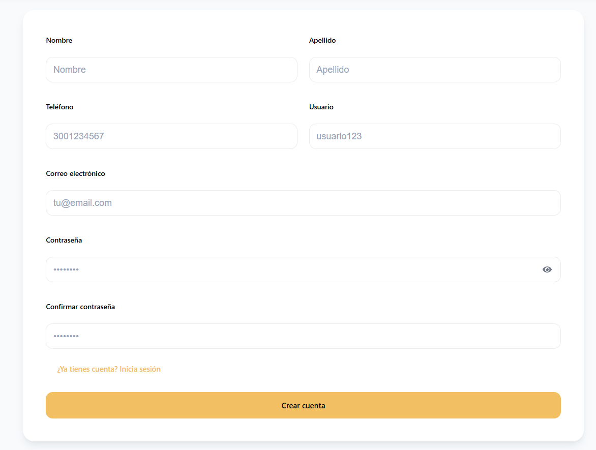

## 5.2 Inicio de sesión

Tabla 4. Inicio de sesión

| Nombre del módulo | Inicio de sesión |
| --- | --- |
| Descripción | Permite iniciar sesión en el sistema con las credenciales del usuario para acceder a las funcionalidades de reserva, pago y administración de la cuenta. |
| Rol autorizado a usarla | Cliente. (El administrador también inicia sesión por esta pantalla, pero el sistema lo dirige a su propio panel, descrito en el Manual de Administrador.) |
| Ruta o menú | Web: pantalla de inicio del sistema. Aplicación móvil: primera pantalla al abrir la app sin sesión activa. |
| Pasos en la web | Abra el navegador y vaya a la dirección de RentaMovil (URL). En el campo Correo o usuario, escriba el correo registrado o el nombre de usuario. En el campo Contraseña, escriba la contraseña. Puede usar el ícono del ojo para verla. Pulse Iniciar sesión. |
| Pasos en la aplicación móvil | Abra la aplicación RentaMovil. Escriba el Correo y la Contraseña. Pulse Iniciar sesión. |
| Captura | Figura 3. Pantalla de inicio de sesión (web) / Figura 4. Pantalla de inicio de sesión (web) |
| Resultado esperado | El sistema valida las credenciales. En la web el cliente llega a la página Home; en la aplicación móvil, al Menú. La sesión permanece abierta aunque se recargue la página. |
| Observaciones o restricciones | Si algún campo está vacío, aparece Complete todos los campos. Si los datos no coinciden, aparece Correo o contraseña incorrectos. Tras varios intentos fallidos la cuenta se bloquea y aparece lo siguiente: Su cuenta fue bloqueada por demasiados intentos fallidos. Recupere su contraseña o contacte a un administrador. Si se realizan demasiados intentos seguidos, el sistema pide esperar unos minutos antes de volver a intentar. Por seguridad, la sesión expira pasado cierto tiempo. En ese caso aparece Su sesión expiró. Inicie sesión nuevamente. Las páginas de reserva, pago, notificaciones y cuenta solo se pueden abrir con una sesión activa; de lo contrario el sistema lleva al usuario a la pantalla de inicio de sesión. |

## 5.3 Recuperación de contraseña

Tabla 5. Recuperación de contraseña

| Nombre del módulo | Recuperación de contraseña |
| --- | --- |
| Descripción | Permite restablecer la contraseña cuando el usuario la ha olvidado, mediante un código de verificación enviado a su dirección de correo. |
| Rol autorizado a usarla | Cliente (usuario registrado que no recuerda su contraseña). |
| Ruta o menú | Web: pantalla de inicio de sesión > enlace ¿Olvidó su contraseña? |
| Pasos en la web | En la pantalla de inicio de sesión, pulse ¿Olvidó su contraseña? En el campo Ingrese su dirección de correo, escriba el correo de la cuenta y pulse Confirmar. Revise la bandeja de entrada y copie el código de 6 dígitos recibido. En la pantalla Ingrese el código enviado a su correo, escriba los 6 dígitos (uno por casilla) y pulse Verificar. Escriba la Nueva contraseña. La lista de requisitos se va marcando a medida que se cumplen. Escriba la contraseña otra vez en Confirmar nueva contraseña. Pulse Guardar cambios y luego Aceptar en el mensaje Contraseña cambiada exitosamente. |
| Pasos en la aplicación móvil | Esta funcionalidad no está disponible en la aplicación móvil. Debe hacerse desde la versión web. |
| Captura | Figura 5. Pantalla de solicitud de correo (web) / Figura 6. Pantalla de ingreso del código (web) / Figura 7. Pantalla de nueva contraseña (web) |
| Resultado esperado | La contraseña se actualiza y el sistema vuelve a la pantalla de inicio de sesión, donde el usuario puede iniciar sesión con la nueva contraseña. |
| Observaciones o restricciones | La nueva contraseña debe tener al menos 8 caracteres, un carácter especial (#, @, !, $, %, &, *, . o -), una letra mayúscula y un número. El botón Guardar cambios solo se habilita cuando la contraseña cumple todos los requisitos y coincide con la confirmación. Por seguridad, el sistema avanza a la pantalla del código incluso si el correo no está registrado; en ese caso noclidará ningún código. El código se valida al guardar la nueva contraseña. Si es incorrecto o ha expirado, el sistema muestra un error y se debe solicitar un código nuevo. Si se solicitan demasiados códigos seguidos, el sistema pide esperar antes de volver a intentar. |

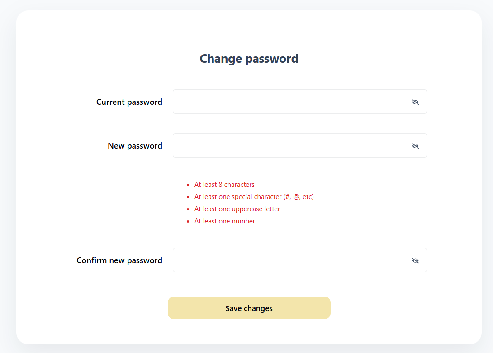

# 6. Descripción del menú principal

Después de iniciar sesión, el cliente accede a las opciones del sistema desde la barra de navegación (web) o desde las pestañas inferiores y los íconos superiores (aplicación móvil).

## 6.1 Menú en la versión web

Tabla 6. Menú en la versión web

| Opción | Descripción |
| --- | --- |
| Home | Página Home: búsqueda de vehículos disponibles y catálogo con filtros. |
| Notificaciones | Centro de avisos sobre reservas, pagos, cancelaciones y recordatorios. |
| Reserva | Página Mis reservas: historial, detalle, cambio de sucursal de devolución y cancelación. |
| Ícono de persona | Página de cuenta: perfil, correo, contraseña, tema, idioma y Cerrar sesión. |
| Ícono de menú (☰) | En pantallas pequeñas, despliega las opciones anteriores. |
| Pie de página | Enlaces a Home, Notificaciones y Cuenta, redes sociales y datos de contacto. |

Figura 8. Barra de navegación de la versión web

## 6.2 Menú en la aplicación móvil

Tabla 7. Menú en la aplicación móvil

| Opción | Descripción |
| --- | --- |
| Pestaña Home | Búsqueda de vehículos, resultados y filtros. |
| Pestaña Menú | Acceso a Home, Mis reservas, Notificaciones, Mi cuenta y Cerrar sesión. |
| Pestaña Reservas | Historial de reservas con filtros y acceso al detalle. |
| Ícono de campana | Notificaciones. |
| Ícono de usuario | Mi cuenta: perfil, cambio de contraseña y ajustes. |

Figura 9. Pestañas de la aplicación móvil y pantalla Menú

# 7. Módulos del sistema

A continuación se describe cada funcionalidad disponible para el cliente, en el orden en que normalmente se usan durante el proceso de alquiler.

## 7.1 Búsqueda de vehículos disponibles

Tabla 8. Búsqueda de vehículos disponibles

| Nombre del módulo | Búsqueda de vehículos disponibles |
| --- | --- |
| Descripción | Permite buscar los vehículos disponibles en una sucursal para un rango de fechas y horas, que corresponde al periodo de alquiler. |
| Rol autorizado a usarla | Cliente. |
| Ruta o menú | Web: menú Home (formulario ubicado sobre el banner principal). Aplicación móvil: pestaña Home. |
| Pasos en la web | Vaya a la página Home. En Lugar de recogida, escriba el nombre, la ciudad o la dirección de la sucursal donde se recogerá el vehículo y selecciónela en la lista de sugerencias. En Fecha de recogida y Hora de recogida, indique cuándo se recogerá el vehículo. En Fecha de devolución y Hora de devolución, indique cuándo se devolverá el vehículo. Pulse Buscar. |
| Pasos en la aplicación móvil | Pulse la pestaña Home. En Sucursal, escriba y seleccione la sucursal de la lista (Seleccione una sucursal). Ingrese Fecha de recogida, Hora de recogida, Fecha de devolución y Hora de devolución. Pulse Buscar. |
| Captura | Figura 10. Formulario de búsqueda en Home (web) / Figura 11. Resultados: Flota disponible (web) |
| Resultado esperado | El sistema muestra la sección Flota disponible con los vehículos de la sucursal elegida que no tienen otra reserva en esas fechas. Cada tarjeta muestra la foto, el nombre, el estado, el año, el kilometraje, la sucursal y el precio por día, junto con el botón Continuar (web) o Alquilar (aplicación móvil). |
| Observaciones o restricciones | En RentaMovil, la recogida se refiere al momento en que la sucursal entrega el vehículo al cliente. La sucursal debe seleccionarse de la lista; si solo se escribe, aparece Sucursal inválida (web) o Seleccione una sucursal válida. (aplicación móvil). Las horas de recogida y devolución deben estar entre las 8:00 y las 18:00; de lo contrario aparece Hora inválida (8:00 - 18:00). La fecha de devolución no puede ser anterior a la fecha de recogida: La fecha de recogida no puede ser anterior a la fecha de recolección. Antes de buscar, la página muestra la sección 4 pasos para tu próximo viaje y los requisitos para rentar. Aplicación móvil: si intenta ver vehículos sin buscar, aparece Primero debes realizar una búsqueda. |

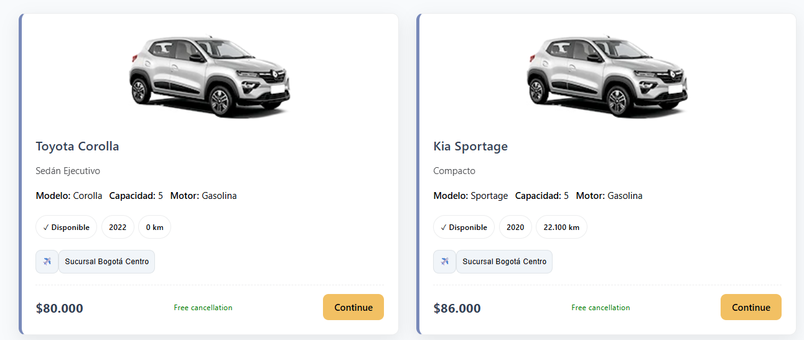

## 7.2 Filtros del catálogo

Tabla 9. Filtros del catálogo

| Nombre del módulo | Filtros del catálogo |
| --- | --- |
| Descripción | Permite reducir los resultados de la búsqueda por marca, precio, modelo, tipo de motor y categoría de vehículo. |
| Rol autorizado a usarla | Cliente. |
| Ruta o menú | Web: página Home > panel lateral de filtros de Flota disponible (en pantallas pequeñas, el botón Filtrar flota). Aplicación móvil: pestaña Home > botón Filtrar vehículos. |
| Pasos en la web | Primero realice una búsqueda de vehículos. En el panel lateral, despliegue el filtro deseado: Marca, Precio, Modelo, Tipo de motor o Categoría. Seleccione la opción deseada. Para Precio, ajuste el rango con los valores Mínimo y Máximo y pulse Aplicar filtros. Revise la lista actualizada. Para quitar los filtros, pulse Limpiar filtros. |
| Pasos en la aplicación móvil | Primero realice una búsqueda de vehículos. Pulse Filtrar vehículos. En la ventana Filtros, ingrese el rango de Precio (Mínimo y Máximo) y elija Tipo de motor, Marca, Modelo o Categoría. Pulse Aplicar. Para quitar los filtros, pulse Limpiar. |
| Captura | Figura 12. Panel de filtros del catálogo (web) |
| Resultado esperado | El catálogo muestra solo los vehículos que cumplen todos los filtros seleccionados. |
| Observaciones o restricciones | Los filtros solo aparecen después de realizar una búsqueda. Las opciones de cada filtro se construyen a partir de los vehículos encontrados en la búsqueda. Si ningún vehículo cumple los filtros, aparece No hay vehículos disponibles con esos filtros (web) o No hay vehículos disponibles para los filtros seleccionados. (aplicación móvil). Cuando vuelve a seleccionar una opción ya marcada, ese filtro se desactiva. |

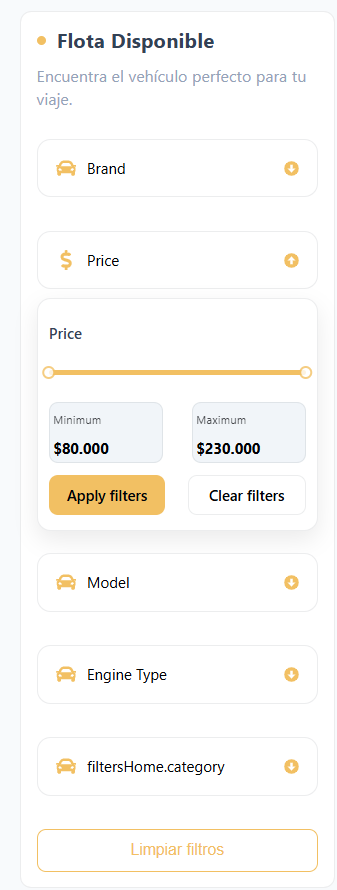

## 7.3 Reserva de vehículos

Tabla 10. Reserva de vehículos

| Nombre del módulo | Reserva de vehículos |
| --- | --- |
| Descripción | Permite configurar la reserva del vehículo elegido: revisar sus datos, confirmar o cambiar las sucursales de recogida y devolución, elegir el seguro y aceptar los términos y condiciones antes de pagar. |
| Rol autorizado a usarla | Cliente. |
| Ruta o menú | Web: Home > tarjeta del vehículo > Continuar. Aplicación móvil: Home > tarjeta del vehículo > Alquilar. |
| Pasos en la web | En la tarjeta del vehículo elegido, pulse Continuar. Revise la información del vehículo en la tarjeta superior izquierda. Si necesita cambiar la sucursal o las fechas, modifíquelas en el calendario superior y pulse Buscar; el sistema vuelve a Home con la nueva búsqueda. En Cambiar sucursal de recogida, verifique la Sucursal de recogida. Para devolver el vehículo en otro lugar, selecciónelo en el mapa; aparecerá como Sucursal de recogida. Si no elige ninguna, se usa la misma sucursal de recogida. En Resumen, revise el número de días, el precio por día y el total. En Seguro, seleccione la cobertura deseada. Su valor se suma al total. Marque la casilla He leído y acepto los términos y condiciones. Para leerlos, pulse Ver documento completo y, al terminar, Aceptar y continuar. Pulse Alquilar. |
| Pasos en la aplicación móvil | En la tarjeta del vehículo elegido, pulse Alquilar. En la pantalla Tu reserva, revise el vehículo y las fechas. En el bloque RECOGIDA, pulse Cambiar si desea otra sucursal u otra fecha; la app vuelve a Home para buscar de nuevo. En el bloque DEVOLUCIÓN, pulse Cambiar y elija la sucursal donde devolverá el vehículo. En Seguro, seleccione la cobertura deseada (opcional). Pulse Continuar y espere el mensaje Creando reserva... |
| Captura | Figura 13. Pantalla de reserva con mapa de sucursales y resumen (web) / Figura 14. Ventana de términos y condiciones (web) / Figura 15. Ventana de términos y condiciones (web) |
| Resultado esperado | Web: el sistema guarda los datos de la reserva y lleva al usuario a la pantalla de Pago. Aplicación móvil: la reserva se crea en estado Pendiente de pago y se abre la pantalla de pago. |
| Observaciones o restricciones | Web: el botón Alquilar permanece deshabilitado hasta que se acepten los términos y condiciones. Si intenta continuar sin aceptarlos, aparece Debe aceptar los términos y condiciones antes de continuar al pago. Si faltan las fechas, aparece Debe seleccionar las fechas. El total se calcula como: número de días × precio por día + valor del seguro seleccionado. El seguro es opcional. Si no se elige ninguno, la reserva no incluye cobertura adicional. La aceptación de los términos guarda la versión y la fecha del documento aceptado. |

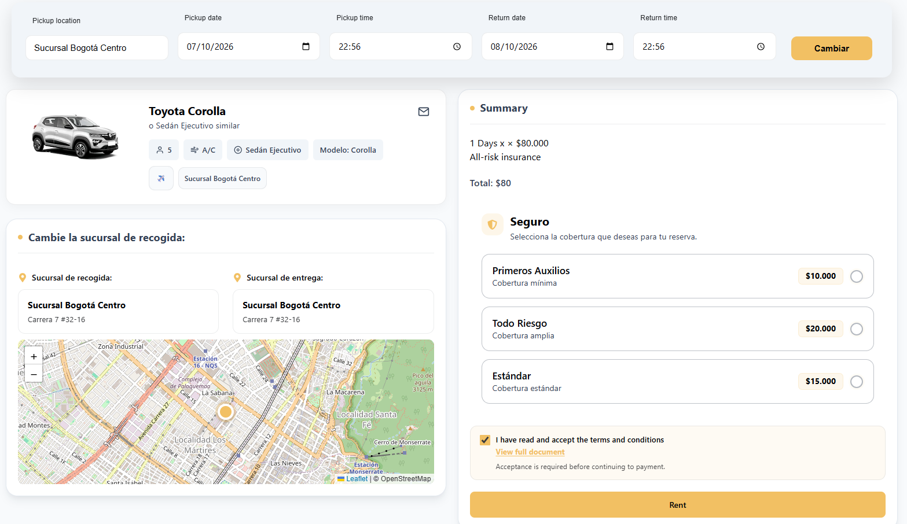

## 7.4 Pago de la reserva

Tabla 11. Pago de la reserva

| Nombre del módulo | Pago de la reserva |
| --- | --- |
| Descripción | Permite pagar la reserva por transferencia bancaria a una de las cuentas de RentaMovil y registrar el comprobante para que un administrador valide el pago. |
| Rol autorizado a usarla | Cliente. |
| Ruta o menú | Web: se abre automáticamente al pulsar Alquilar en la pantalla de reserva. Aplicación móvil: se abre al pulsar Continuar en Tu reserva. |
| Pasos en la web | Revise la sección Detalles del vehículo y el resumen de la Factura (alquiler, seguro y total). En Seleccione su cuenta bancaria de destino, pulse Seleccionar cuenta bancaria y elija la cuenta a la que transferirá. Se muestran el titular, el NIT, el número de cuenta (con un botón Copiar) y el código QR. Desde su app bancaria, transfiera el valor exacto que aparece en TOTAL A TRANSFERIR, o escanee el código QR. En Registrar transferencia, escriba el Número de referencia que aparece en el comprobante bancario. En Comprobante de pago, pulse Seleccione su comprobante o arrastre el archivo dentro del recuadro. Revise la vista previa; para cambiarla, pulseEliminar y adjunte otro. Pulse Reservar y enviar comprobante y espere el mensaje Procesando su pago... |
| Pasos en la aplicación móvil | Revise el resumen de la Factura: Alquiler, Seguro (o Sin seguro) y Total a pagar. En Cuenta de pago, seleccione la cuenta de destino. Puede pulsar Copiar número para copiar el número de cuenta. Desde su app bancaria, transfiera el valor exacto del total. En Comprobante de pago, pulse Adjuntar imagen para elegir una captura de la galería, o Tomar foto para fotografiar el comprobante. Si la app pide permiso de cámara, aceptelo. Use Cambiar o Eliminar para reemplazar la imagen. Pulse Registrar pago y espere el mensaje Enviando... |
| Captura | Figura 16. Selección de cuenta bancaria y código QR (web) / Figura 17. Registro de transferencia y comprobante (web) / Figura 18. Mensaje de pago enviado (web) |
| Resultado esperado | Web: aparece el mensaje ¡Pago enviado!, lo que indica que la reserva está pendiente de revisión; el botón Volver al inicio lo lleva a la página de inicio. Aplicación móvil: aparece el aviso Pago registrado y se muestra la pantalla Pago en revisión. Cuando un administrador valida la transferencia, la reserva pasa a Confirmada y el usuario recibe una notificación. |
| Observaciones o restricciones | El valor transferido debe coincidir exactamente con el total de la reserva. No se aceptan pagos parciales. El comprobante debe estar en formato PNG, JPG, JPEG o PDF y pesar máximo 10 MB. Web: el botón Reservar y enviar comprobante se habilita solo cuando se ha seleccionado la cuenta, escrito el número de referencia y adjuntado el comprobante. Aplicación móvil: no se solicita el número de referencia; el botón Registrar pago se habilita una vez que selecciona la cuenta y adjunta el comprobante. El pago no se aprueba automáticamente: siempre queda en revisión hasta que un administrador lo valida. Solo se muestran las cuentas bancarias que RentaMovil tiene activas. |

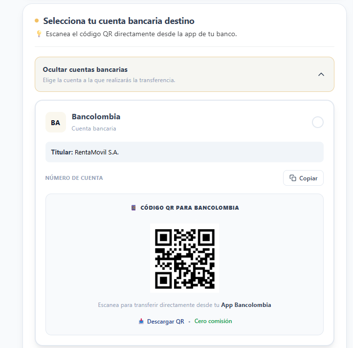

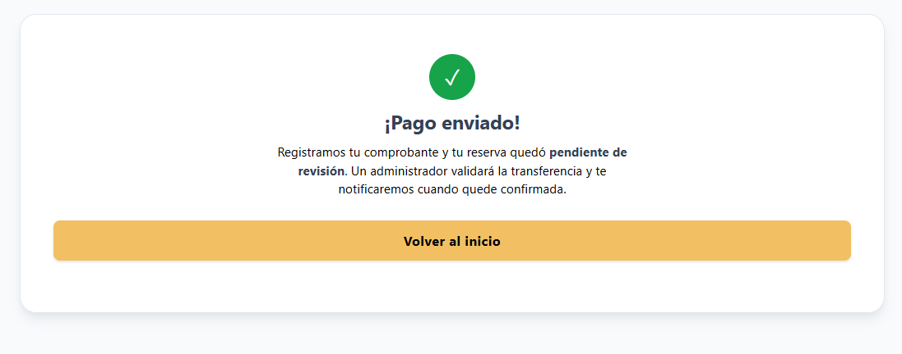

## 7.5 Reservar y pagar después

Tabla 12. Reservar y pagar después

| Nombre del módulo | Reservar y pagar después |
| --- | --- |
| Descripción | Permite crear la reserva sin adjuntar el comprobante en ese momento, para realizar el pago más adelante dentro del periodo establecido. |
| Rol autorizado a usarla | Cliente. |
| Ruta o menú | Web: pantalla de Pago > botón Reservar y pagar después. |
| Pasos en la web | Complete la configuración de la reserva y llegue a la pantalla de Pago. Revise el resumen de la Factura. Pulse Reservar y pagar después. |
| Pasos en la aplicación móvil | En la aplicación móvil la reserva se crea al pulsar Continuar en Tu reserva, antes de la pantalla de pago. Si el usuario se sale sin registrar el pago, la reserva queda en estado Pendiente de pago. |
| Captura | Figura 19. Resumen de factura y opciones de pago (web) |
| Resultado esperado | La reserva se crea en estado pendiente de pago y el sistema lleva al usuario a Mis reservas, donde aparece como activa. |
| Observaciones o restricciones | El usuario tiene 24 horas para realizar el pago. Pasado ese periodo, la reserva se cancela automáticamente. El vehículo se reserva solo mientras la reserva está vigente. |

## 7.6 Consulta de mis reservas

Tabla 13. Consulta de mis reservas

| Nombre del módulo | Consulta de mis reservas |
| --- | --- |
| Descripción | Permite consultar las reservas realizadas por el usuario, su estado y el detalle de facturación de cada una. |
| Rol autorizado a usarla | Cliente. |
| Ruta o menú | Web: menú Reserva > página Mis reservas. Aplicación móvil: pestaña Reservas o Menú > Mis reservas. |
| Pasos en la web | Pulse Reserva en la barra de navegación. Revise las tarjetas de reserva. Cada una muestra el código (#), la fecha de creación, el estado, el vehículo (foto, placa, categoría, transmisión y pasajeros), las fechas de RECOGIDA y DEVOLUCIÓN, la duración, el VALOR FACTURADO y si incluye cobertura. Para ver el desglose, pulse Ver detalle. En la ventana Detalle de facturación, revise el código de la reserva, la sucursal de recogida, la sucursal de devolución, el valor del alquiler, el seguro y el total. Pulse Entendido y cierre para salir del detalle. |
| Pasos en la aplicación móvil | Pulse la pestaña Reservas. En Mis reservas, use los filtros Todas, Activas, Completadas o Canceladas para localizar la reserva. Pulse una reserva para abrir su Detalle. Revise el estado, el Vehículo, la Información del viaje (recogida, devolución y fechas) y el Total a pagar. |
| Captura | Figura 20. Página Mis reservas (web) / Figura 21. Ventana Detalle de facturación (web) |
| Resultado esperado | El sistema muestra el historial de reservas del usuario con su estado actual y permite consultar el detalle de cada una. |
| Observaciones o restricciones | Solo se muestran las reservas de la cuenta con la que inició sesión. Si no hay reservas, aparece Ninguna reserva coincide con estos filtros. En la web los estados se muestran como activa (pendiente de pago, en revisión o confirmada), cancelada o completada. En la aplicación móvil se muestran como Pendiente de pago, Pago en revisión, Confirmada, Completada o Cancelada. |

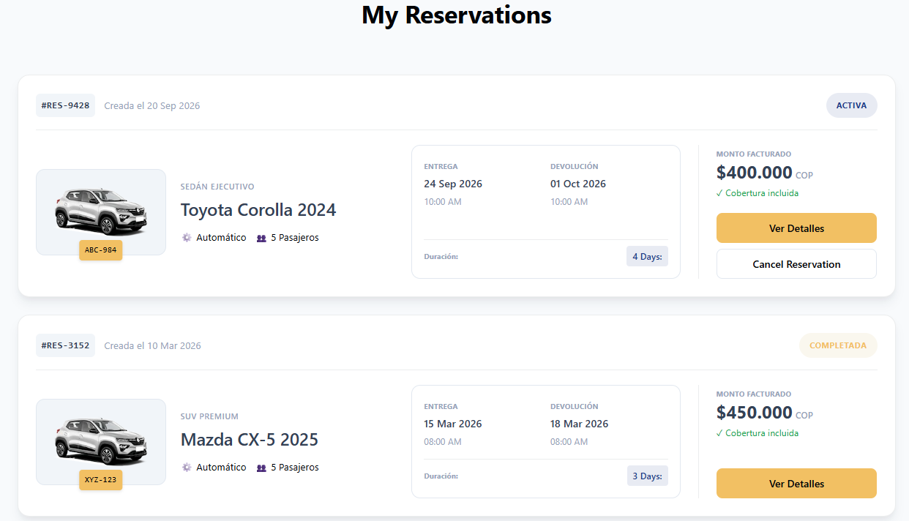

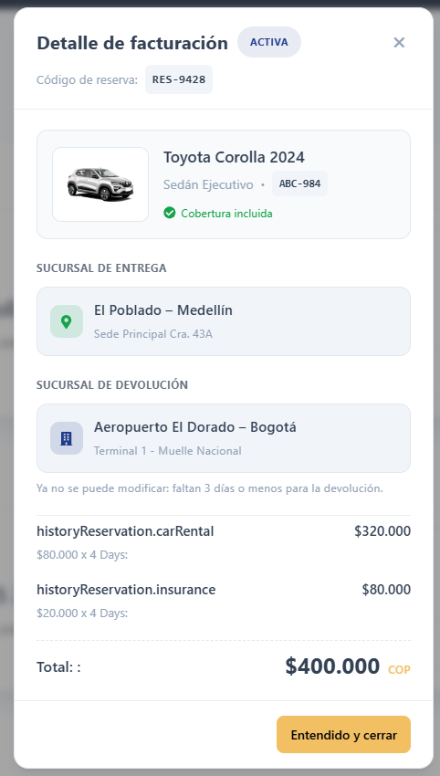

## 7.7 Cambio de sucursal de devolución

Tabla 14. Cambio de sucursal de devolución

| Nombre del módulo | Cambio de sucursal de devolución |
| --- | --- |
| Descripción | Permite cambiar la sucursal donde se devolverá el vehículo en una reserva ya creada. |
| Rol autorizado a usarla | Cliente. |
| Ruta o menú | Web: Reserva > Mis reservas > Ver detalle > Modificar sucursal. |
| Pasos en la web | Vaya a Mis reservas y pulse Ver detalle en la reserva deseada. Junto a Sucursal de devolución, pulse Modificar sucursal. Seleccione la nueva sucursal de devolución. Pulse Guardar. Para descartar el cambio, pulse Cancelar. |
| Pasos en la aplicación móvil | En la aplicación móvil la sucursal de devolución solo se puede elegir al crear la reserva (bloque DEVOLUCIÓN > Cambiar). Para cambiarla más adelante, use la versión web. |
| Captura | Figura 22. Edición de la sucursal de devolución en el detalle (web) |
| Resultado esperado | La nueva sucursal de devolución queda registrada y se muestra en el detalle de la reserva. |
| Observaciones o restricciones | Solo se puede cambiar en reservas activas y hasta 3 días antes de la fecha de devolución. Cuando quedan 3 días o menos, el sistema muestra Ya no puede modificar: quedan 3 días o menos antes de la devolución. Si ocurre un error, aparece No fue posible actualizar la sucursal de devolución. |

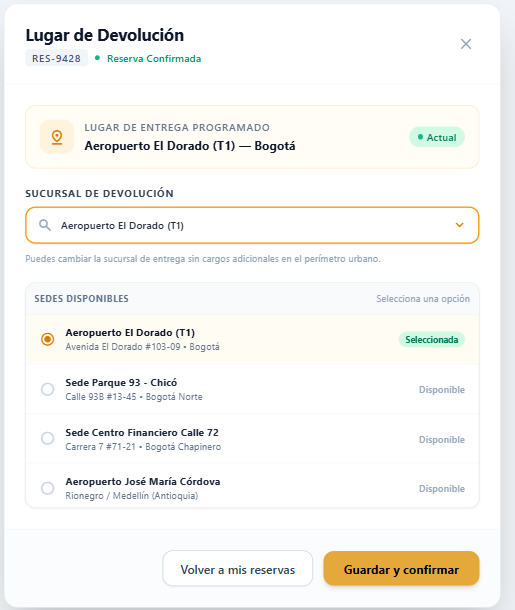

## 7.8 Cancelación de reservas

Tabla 15. Cancelación de reservas

| Nombre del módulo | Cancelación de reservas |
| --- | --- |
| Descripción | Permite cancelar una reserva que todavía no ha comenzado. |
| Rol autorizado a usarla | Cliente. |
| Ruta o menú | Web: Reserva > Mis reservas > Cancelar reserva. Aplicación móvil: Reservas > detalle de la reserva > Cancelar reserva. |
| Pasos en la web | Vaya a Mis reservas. En la reserva que desea cancelar, pulse Cancelar reserva. En la ventana de confirmación ¿Está seguro de que desea cancelar la reserva de...?, pulse Sí, cancelar. Para conservarla, pulse No. |
| Pasos en la aplicación móvil | Pulse la pestaña Reservas y abra la reserva. Pulse Cancelar reserva. En la ventana ¿Cancelar reserva?, pulse Sí, cancelar. Para conservarla, pulse Conservar reserva. |
| Captura | Figura 23. Confirmación de cancelación (web) |
| Resultado esperado | La reserva cambia al estado Cancelada y el vehículo vuelve a estar disponible para esas fechas. En la aplicación móvil aparece el aviso Reserva cancelada: Su reserva fue cancelada exitosamente. |
| Observaciones o restricciones | Web: el botón Cancelar reserva solo aparece en reservas activas cuando faltan más de 3 días para la fecha de recogida. Aplicación móvil: el botón aparece en reservas en estado Pendiente de pago o Confirmada. Una reserva cancelada no se puede reactivar; si necesita el vehículo, debe crear una nueva reserva. Si ocurre un error, aparece No fue posible cancelar la reserva. |

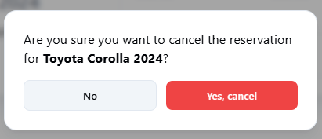

## 7.9 Notificaciones

Tabla 16. Notificaciones

| Nombre del módulo | Notificaciones |
| --- | --- |
| Descripción | Permite consultar los avisos que el sistema envía al usuario sobre sus reservas, pagos, cancelaciones y recordatorios. |
| Rol autorizado a usarla | Cliente. |
| Ruta o menú | Web: menú Notificaciones. Aplicación móvil: ícono de campana arriba o Menú > Notificaciones. |
| Pasos en la web | Pulse Notificaciones en la barra de navegación. En la columna izquierda, elija un filtro: Todas (muestra la cantidad de notificaciones no leídas), Reservas confirmadas, Pagos, Cancelaciones o Recordatorios. En la lista Recibidos, revise el mensaje y la fecha de cada notificación. Las no leídas aparecen resaltadas. Pulse una notificación para abrir Detalle de notificación (mensaje, fecha, estado y vehículo). Pulse Cerrar. |
| Pasos en la aplicación móvil | Pulse el ícono de campana o, en el Menú, la opción Notificaciones. Elija uno de los filtros superiores: Todas, Reservas confirmadas, Pagos, Cancelaciones o Recordatorios. Pulse una notificación para ver su detalle y luego pulse Cerrar. |
| Captura | Figura 24. Centro de notificaciones (web) / Figura 25. Detalle de notificación (web) |
| Resultado esperado | El sistema muestra las notificaciones del filtro elegido. Al abrir una notificación, queda marcada como leída. |
| Observaciones o restricciones | Si no hay notificaciones para el filtro elegido, aparece No hay notificaciones para este filtro. El campo Estado en el detalle puede ser Activo, Pago confirmado, Cancelado o Pendiente, según el tipo de aviso. |

## 7.10 Mi cuenta (perfil)

Tabla 17. Mi cuenta (perfil)

| Nombre del módulo | Mi cuenta (perfil) |
| --- | --- |
| Descripción | Permite consultar y actualizar la información personal del usuario: nombre, apellido, teléfono y foto de perfil. |
| Rol autorizado a usarla | Cliente. |
| Ruta o menú | Web: ícono de persona en la barra de navegación > página de cuenta. Aplicación móvil: ícono de usuario arriba o Menú > Mi cuenta. |
| Pasos en la web | Pulse el ícono de persona en la barra de navegación. Revise los datos: Nombre, Apellido, Teléfono, Usuario, Correo y Contraseña (oculta). Para editar, pulse el ícono del lápiz (Editar perfil). Se habilitan los campos editables. Modifique Nombre, Apellido o Teléfono. Para cambiar la foto, pulse Cambiar foto y seleccione una imagen. Pulse Guardar cambios. Para salir sin guardar, pulse la X (Cancelar). |
| Pasos en la aplicación móvil | Pulse el ícono de usuario o, en el Menú, la opción Mi cuenta. Revise la sección Información personal: Nombre, Teléfono y Correo. Pulse Editar para habilitar los campos, modifique los datos y pulse Guardar. Para cambiar la foto, pulse Cambiar foto y elija una imagen de la galería. |
| Captura | Figura 26. Página Mi cuenta en modo consulta (web) / Figura 27. Página Mi cuenta en modo edición (web) |
| Resultado esperado | Web: los datos se actualizan y aparece el mensaje Perfil actualizado. |
| Observaciones o restricciones | El Usuario no se puede modificar. La dirección de correo no se edita en este formulario; se cambia con la opción Cambiar correo. El nombre y el apellido no pueden quedar vacíos. El teléfono se puede vaciar. La foto de perfil debe ser una imagen JPG, PNG, WEBP o GIF de máximo 10 MB. Si no se modifica ningún dato, guardar simplemente sale del modo edición. Aplicación móvil: en la versión actual, los cambios de nombre, teléfono y foto no se guardan en el servidor. Para actualizar los datos de forma permanente, use la versión web. |

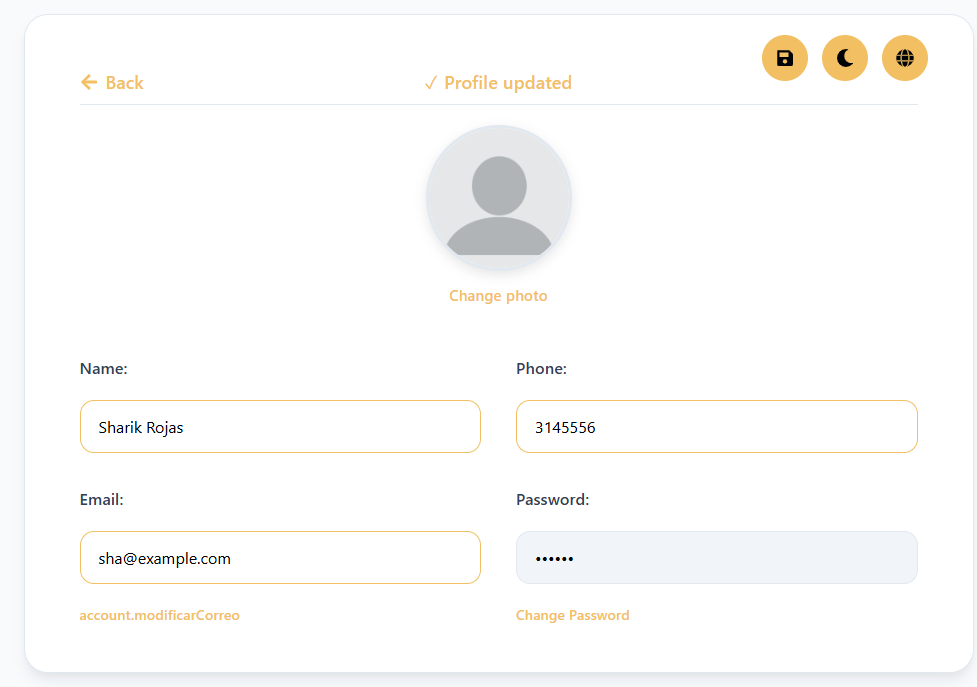

## 7.11 Cambio de dirección de correo

Tabla 18. Cambio de dirección de correo

| Nombre del módulo | Cambio de dirección de correo |
| --- | --- |
| Descripción | Permite reemplazar la dirección de correo asociada a la cuenta, confirmando la identidad con la contraseña actual. |
| Rol autorizado a usarla | Cliente. |
| Ruta o menú | Web: página de cuenta > botón Cambiar correo. |
| Pasos en la web | Vaya a la página de cuenta. Junto al campo Correo, pulse Cambiar correo. En la ventana Cambiar dirección de correo, verifique el Correo actual. Escriba la Nueva dirección de correo. Escriba la Contraseña actual. Pulse Confirmar cambio. Para salir sin cambios, pulse Cancelar. |
| Pasos en la aplicación móvil | Esta funcionalidad no está disponible en la aplicación móvil. Debe hacerse desde la versión web. |
| Captura | Figura 28. Ventana Cambiar dirección de correo (web) |
| Resultado esperado | El correo de la cuenta se actualiza y aparece el mensaje Correo actualizado. A partir de ese momento se debe usar el nuevo correo para iniciar sesión. |
| Observaciones o restricciones | El nuevo correo debe tener un formato válido, ser diferente del actual y no estar registrado por otro usuario. Si falta algún dato, aparece Escriba el nuevo correo. o Escriba su contraseña actual. Si la contraseña es incorrecta o el correo ya existe, aparece No fue posible actualizar el correo. Revise los datos e intente nuevamente. |

## 7.12 Cambio de contraseña

Tabla 19. Cambio de contraseña

| Nombre del módulo | Cambio de contraseña |
| --- | --- |
| Descripción | Permite al usuario que inició sesión actualizar su contraseña para mantener la cuenta segura. |
| Rol autorizado a usarla | Cliente. |
| Ruta o menú | Web: página de cuenta > enlace Cambiar contraseña. Aplicación móvil: Mi cuenta > Cambiar contraseña. |
| Pasos en la web | Vaya a la página de cuenta y pulse Cambiar contraseña. Escriba la Contraseña actual. Escriba la Nueva contraseña y verifique que todos los requisitos de la lista estén marcados. Escriba la contraseña otra vez en Confirmar nueva contraseña. Pulse Guardar cambios. En el mensaje Contraseña cambiada exitosamente, pulse Aceptar. |
| Pasos en la aplicación móvil | En Mi cuenta, pulse Cambiar contraseña. Escriba la Contraseña actual, la Nueva contraseña y Confirmar nueva contraseña. Pulse Actualizar contraseña. Para salir sin cambios, pulse Cancelar. |
| Captura | Figura 29. Formulario de cambio de contraseña (web) |
| Resultado esperado | La contraseña se actualiza. En la web, por seguridad, se cierran todas las sesiones abiertas y el sistema vuelve a la pantalla de inicio de sesión. En la aplicación móvil aparece el aviso Contraseña actualizada. |
| Observaciones o restricciones | Web: la nueva contraseña debe tener al menos 8 caracteres, un carácter especial, una letra mayúscula y un número. El botón Guardar cambios se habilita solo cuando se cumplen todos los requisitos. Aplicación móvil: la nueva contraseña debe tener al menos 6 caracteres y ser diferente de la actual. La nueva contraseña y su confirmación deben coincidir; de lo contrario aparece Las contraseñas no coinciden. Si la contraseña actual es incorrecta, no se realiza el cambio (Contraseña actual incorrecta). |

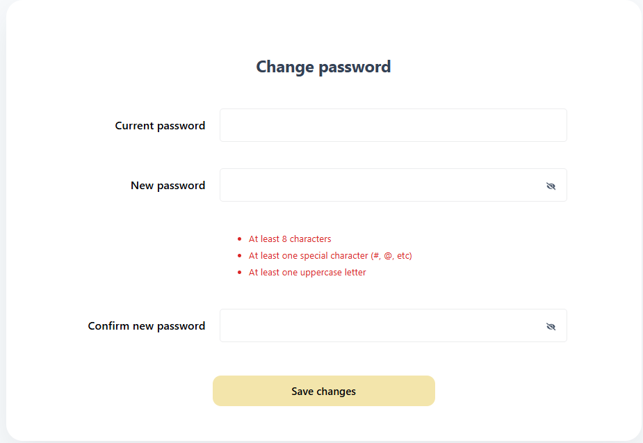

## 7.13 Preferencias de tema e idioma

Tabla 20. Preferencias de tema e idioma

| Nombre del módulo | Preferencias de tema e idioma |
| --- | --- |
| Descripción | Permite personalizar la apariencia de la interfaz (colores claros u oscuros) y el idioma en que se muestran los textos. |
| Rol autorizado a usarla | Cliente. |
| Ruta o menú | Web: página de cuenta > ícono de luna (Seleccionar un tema) e ícono de globo (Seleccionar un idioma). Aplicación móvil: Mi cuenta > Ajustes. |
| Pasos en la web | Vaya a la página de cuenta. Para cambiar el tema, pulse el ícono de luna y elija Modo claro, Modo claro neutro, Modo oscuro neutro o Modo azul oscuro. Para cambiar el idioma, pulse el ícono de globo y elija Español, English, Français o Português. |
| Pasos en la aplicación móvil | En Mi cuenta, pulse Ajustes para desplegar las opciones. En Tema, elija Verde claro, Oscuro, Noche o Azul claro. En el selector de idioma, elija Español, English, Français o Português. |
| Captura | Figura 30. Ventanas de tema e idioma (web) |
| Resultado esperado | La interfaz cambia de inmediato al tema o idioma seleccionado, y la preferencia queda guardada en el dispositivo para visitas posteriores. |
| Observaciones o restricciones | La preferencia se guarda en el navegador o teléfono utilizados; en otro dispositivo debe configurarse de nuevo. |

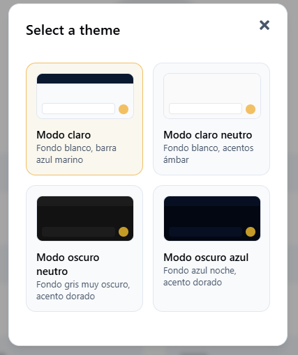

# 8. Mensajes y validaciones

La siguiente tabla reúne los mensajes más frecuentes que muestra el sistema, su significado y la acción que debe realizar el usuario.

Tabla 21. Mensajes y validaciones

| Mensaje del sistema | Significado | Acción del usuario |
| --- | --- | --- |
| Complete todos los campos | Se dejó vacío un campo obligatorio en el registro o el inicio de sesión. | Complete los campos vacíos. |
| Ingrese un correo válido | El correo no tiene un formato válido. | Escriba un correo con el formato nombre@dominio.com. |
| Teléfono inválido (10 dígitos) | El teléfono tiene caracteres o una cantidad de dígitos no permitidos. | Escriba solo números (10 dígitos en la aplicación móvil). |
| La contraseña debe tener al menos 8 caracteres / una letra mayúscula y un número | La contraseña no cumple la política de seguridad. | Escriba una contraseña que cumpla los requisitos. |
| Las contraseñas no coinciden | La contraseña y su confirmación son diferentes. | Escriba la misma contraseña en ambos campos. |
| Correo o contraseña incorrectos | Las credenciales no coinciden con una cuenta registrada. | Revise los datos o use ¿Olvidó su contraseña? |
| Su cuenta fue bloqueada por demasiados intentos fallidos... | Se superó el número de intentos de inicio de sesión permitidos. | Recupere la contraseña o contacte a un administrador. |
| Demasiados intentos. Espere ... e intente nuevamente. | Se realizaron muchas solicitudes seguidas. | Espere el tiempo indicado e intente nuevamente. |
| El servicio no está disponible en este momento. Intente más tarde. | El servidor no responde temporalmente. | Intente más tarde. |
| Su sesión expiró. Inicie sesión nuevamente. | Se agotó el tiempo máximo de sesión. | Inicie sesión nuevamente. |
| Sucursal inválida | La sucursal escrita no fue seleccionada de la lista de sugerencias. | Escriba y elija una sucursal de la lista. |
| Hora inválida (8:00 - 18:00) | La hora está fuera del horario de atención. | Elija una hora entre las 8:00 y las 18:00. |
| La fecha de recogida no puede ser anterior a la fecha de recolección | La fecha de devolución es anterior a la fecha de recogida. | Corrija las fechas. |
| Búsqueda realizada | La búsqueda de vehículos se ejecutó correctamente. | Revise los resultados en Flota disponible. |
| No hay vehículos disponibles con esos filtros | Ningún vehículo cumple la búsqueda o los filtros. | Cambie las fechas, la sucursal o limpie los filtros. |
| Debe seleccionar las fechas | No se ingresaron las fechas de alquiler. | Seleccione las fechas de recogida y devolución. |
| Debe aceptar los términos y condiciones antes de continuar al pago. | No se marcó la casilla de aceptación. | Lea y acepte los términos y condiciones. |
| Debe seleccionar una cuenta bancaria de destino. | No se eligió la cuenta a la que transferir. | Seleccione la cuenta bancaria. |
| Debe ingresar el número de referencia de la transferencia. | Falta la referencia del pago. | Copie la referencia del comprobante bancario. |
| Debe adjuntar el comprobante de pago. | No se cargó el comprobante. | Adjunte la imagen o el PDF del comprobante. |
| El comprobante debe estar en formato PNG, JPG, JPEG o PDF. | El archivo tiene un formato no permitido. | Adjunte el comprobante en un formato válido. |
| El comprobante no puede superar los 10 MB. | El archivo pesa demasiado. | Reduzca el tamaño o tome una nueva captura. |
| ¡Pago enviado! / Pago registrado | El comprobante quedó registrado y la reserva está pendiente de revisión. | Espere la notificación de confirmación. |
| Ya no puede modificar: quedan 3 días o menos antes de la devolución. | Ya pasó el plazo para cambiar la sucursal de devolución. | Contacte a RentaMovil si el cambio es indispensable. |
| No fue posible cancelar la reserva. | Ocurrió un error al cancelar. | Intente nuevamente o contacte a RentaMovil. |
| Perfil actualizado | Se guardaron los cambios del perfil. | Continúe. |
| Correo actualizado | Se cambió el correo de la cuenta. | Use el nuevo correo para iniciar sesión. |
| Contraseña cambiada exitosamente | Se actualizó la contraseña. | Inicie sesión con la nueva contraseña. |
| No hay notificaciones para este filtro. | No hay avisos de ese tipo. | Elija otro filtro. |

# 9. Cierre de sesión

Para cerrar la sesión de forma segura, especialmente en computadores compartidos, el usuario debe cerrarla cuando termine.

### En la web

1. Pulse el ícono de persona en la barra de navegación para abrir la página de cuenta.
2. Pulse el ícono de Cerrar sesión (puerta con flecha), ubicado en la parte superior derecha de la tarjeta de perfil.
3. Verifique que el sistema muestre la pantalla de inicio de sesión.

### En la aplicación móvil

1. Pulse la pestaña Menú.
2. Pulse Cerrar sesión.
3. Verifique que la app muestre la pantalla Iniciar sesión.
Resultado esperado: la sesión se cierra y, para volver a usar el sistema, debe iniciar sesión nuevamente.

Observación: cuando la contraseña se cambia desde la web, el sistema cierra automáticamente todas las sesiones abiertas de la cuenta.

# 10. Preguntas frecuentes

Tabla 22. Preguntas frecuentes

| Pregunta | Respuesta |
| --- | --- |
| ¿Necesito una cuenta para usar RentaMovil? | Sí. Para buscar vehículos, reservar, pagar y consultar notificaciones debe registrarse e iniciar sesión. |
| ¿Qué hago si olvido mi contraseña? | En la pantalla de inicio de sesión de la web, pulse ¿Olvidó su contraseña?, escriba su correo e ingrese el código de 6 dígitos que recibirá para crear una nueva contraseña. |
| Mi cuenta se bloqueó, ¿qué hago? | Restablezca la contraseña con la opción ¿Olvidó su contraseña? o contacte a un administrador de RentaMovil. |
| ¿Por qué no aparece ningún vehículo en la búsqueda? | Puede que no haya vehículos libres en esa sucursal y esas fechas, o que los filtros sean demasiado restrictivos. Pruebe otras fechas, otra sucursal o pulse Limpiar filtros. |
| ¿Puedo devolver el vehículo en otra sucursal? | Sí. Al reservar, seleccione la sucursal de devolución en el mapa (web) o con Cambiar en DEVOLUCIÓN (aplicación móvil). En la web también puede cambiarla después desde Mis reservas, hasta 3 días antes de la devolución. |
| ¿El seguro es obligatorio? | No. El seguro es opcional; si lo selecciona, su valor se suma al total de la reserva. |
| ¿Cómo pago mi reserva? | Por transferencia bancaria a una de las cuentas de RentaMovil que aparecen en la pantalla de pago (también mediante código QR). Luego se adjunta el comprobante. |
| ¿Puedo pagar con tarjeta de crédito o PSE? | No. El sistema solo acepta pagos por transferencia bancaria, que luego revisa un administrador. |
| ¿Puedo pagar una parte ahora y el resto después? | No. El valor transferido debe ser exactamente el total de la reserva. |
| ¿Cuándo se confirma mi reserva? | Cuando un administrador valida el comprobante de la transferencia. Recibirá una notificación y la reserva aparecerá como confirmada. |
| ¿Qué pasa si elijo Reservar y pagar después? | La reserva queda pendiente de pago durante 24 horas. Si no se paga en ese periodo, se cancela automáticamente. |
| ¿Hasta cuándo puedo cancelar una reserva? | En la web, mientras falten más de 3 días para la fecha de recogida. |
| ¿Puedo cambiar mi nombre de usuario? | No. El nombre de usuario se define en el registro y no se puede modificar. Sí puede cambiar su nombre, apellido, teléfono, foto, correo y contraseña. |
| ¿Qué documentos debo llevar para recoger el vehículo? | Una licencia de conducción válida, el documento de identidad original y la factura de la reserva. |

# 11. Glosario

Tabla 23. Glosario

| Término | Definición |
| --- | --- |
| Cliente | Usuario registrado que busca, reserva y paga alquileres de vehículos. |
| Administrador | Usuario de RentaMovil que administra la flota, valida pagos y gestiona el sistema. Sus funciones se describen en el Manual de Administrador. |
| Sucursal | Sede de RentaMovil donde se entrega (recoge) o se devuelve el vehículo. |
| Recogida | Momento en que la sucursal entrega el vehículo al cliente al inicio del alquiler. |
| Devolución | Momento en que el cliente devuelve el vehículo a la sucursal al final del alquiler. |
| Reserva | Solicitud de alquiler de un vehículo por un periodo determinado y con sucursales específicas. |
| Flota disponible | Conjunto de vehículos libres para la sucursal y las fechas buscadas. |
| Seguro / cobertura | Protección adicional opcional que se suma al valor del alquiler. |
| Términos y condiciones | Documento con las reglas del alquiler que el cliente debe aceptar antes de pagar. |
| Transferencia bancaria | Único método de pago del sistema: el cliente envía el dinero desde su banco a una cuenta de RentaMovil. |
| Número de referencia | Código que entrega el banco al hacer la transferencia y que identifica el pago. |
| Comprobante de pago | Imagen o PDF que demuestra que se realizó la transferencia. |
| Código QR | Imagen que se escanea con la app bancaria para hacer la transferencia sin escribir el número de cuenta. |
| Pendiente de pago | Estado de una reserva creada que aún no tiene un comprobante registrado. |
| Pago en revisión | Estado de una reserva cuyo comprobante está pendiente de validación por un administrador. |
| Confirmada | Estado de una reserva cuyo pago fue aprobado. |
| Notificación | Aviso del sistema sobre reservas, pagos, cancelaciones o recordatorios. |
| Sesión | Periodo durante el cual el usuario permanece autenticado en el sistema. |
| Tema | Combinación de colores de la interfaz (claro u oscuro). |

# 12. Anexos

## Anexo A. Flujo general de uso

La tabla resume el recorrido completo del cliente dentro de RentaMovil.

Tabla 24. Flujo general de uso

| Paso | Acción del usuario | Respuesta del sistema |
| --- | --- | --- |
| 1 | Se registra o inicia sesión. | Muestra la página Home (web) o el Menú (aplicación móvil). |
| 2 | Busca vehículos por sucursal, fechas y horas. | Muestra la Flota disponible para ese periodo. |
| 3 | Aplica filtros (opcional). | Actualiza el catálogo según los filtros. |
| 4 | Elige un vehículo (Continuar o Alquilar). | Abre la pantalla de reserva. |
| 5 | Confirma sucursales, elige el seguro y acepta los términos. | Calcula el total y habilita el paso al pago. |
| 6 | Transfiere el valor total y adjunta el comprobante. | Registra el pago como en revisión. |
| 7 | Espera la validación. | El administrador aprueba el pago; la reserva pasa a Confirmada y se envía una notificación. |
| 8 | Consulta, modifica o cancela la reserva (opcional). | Muestra el historial y aplica los cambios permitidos. |
| 9 | Recoge el vehículo en la sucursal con sus documentos. | Comienza el alquiler. |
| 10 | Devuelve el vehículo en la sucursal acordada. | La reserva pasa a Completada. |

## Anexo B. Estados de las reservas

Tabla 25. Estados de las reservas

| Estado | Significado | Cómo se muestra en Mis reservas (web) |
| --- | --- | --- |
| Pendiente de pago | La reserva se creó pero no tiene comprobante. Tiene 24 horas para pagarse. | activa |
| Pago en revisión | El cliente registró el comprobante; un administrador debe validarlo. | activa |
| Confirmada | El pago fue aprobado; el vehículo está reservado. | activa |
| Completada | El alquiler terminó y el vehículo fue devuelto. | completada |
| Cancelada | La reserva fue cancelada por el cliente o por vencerse el plazo de pago. | cancelada |

## Anexo C. Requisitos para recoger el vehículo

Tabla 26. Requisitos para recoger el vehículo

| Requisito | Descripción |
| --- | --- |
| Licencia de conducción | Válida y vigente para el tipo de vehículo reservado. |
| Documento de identidad | Documento original de quien es el titular de la reserva. |
| Factura / reserva confirmada | Se presenta en la sucursal junto con la licencia para recibir las llaves. |

## Anexo D. Capturas de pantalla

Las capturas se insertan en el campo Captura de cada módulo, reemplazando el texto entre corchetes. Se recomienda una captura por acción importante, tomada de la versión final del sistema, con buena resolución y sin datos personales reales.